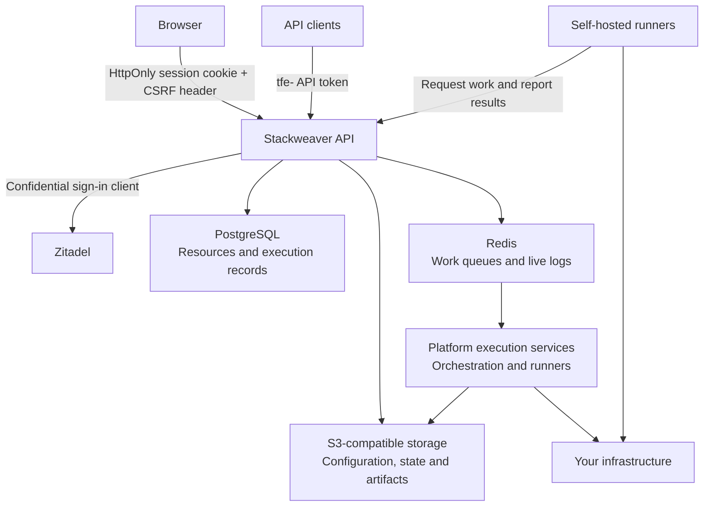
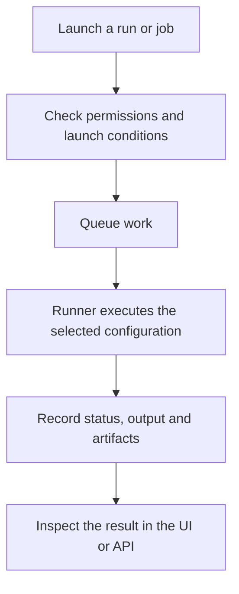

# Architecture overview

Stackweaver coordinates OpenTofu runs and Ansible jobs through an API and separate execution
services. The API manages resources and access; runners execute the tools that change your
infrastructure. You choose whether those runners operate alongside the platform or inside
your own network.

## The system at a glance

Diagram legend: services and connections

- **Browser users** sign in through the API, which acts as a confidential Zitadel client. Later requests use the session cookie and CSRF header. **Automation clients** use API tokens.
- **API** checks access and manages resources. PostgreSQL holds records; object storage holds configuration, state and artifacts.
- **Redis** carries queued work and buffers live output for the platform execution services.
- **Platform execution services** schedule and run infrastructure tools with access to storage and the infrastructure they manage.
- **Self-hosted runners** request work and report results through the API. Their access to your infrastructure comes from the network where you run them.

The arrows show communication between services. They do not represent every request or a required network route for every execution mode.

The API handles authentication, permissions and resource operations. Execution services run
the infrastructure tools and report their results. The browser reads status and output
through the API; it does not connect directly to the database or Redis.

For automation, use the [Terraform/OpenTofu provider](../user-guides/terraform-provider.md)
to maintain supported resources as configuration, or the [REST API](./using-the-api.md)
for integrations. Each interface supports a defined set of operations. Service configuration
belongs in the [self-hosting guides](../get-started/self-hosting/README.md).

## What each service does

| Component | Responsibility | What matters when operating it |
|---|---|---|
| Frontend | Displays resources, run output and documentation. | Users need access to its URL and the API and sign-in endpoints. |
| API | Enforces access and manages organizations, projects, workspaces and jobs. | Automation clients and self-hosted runners connect here. |
| Zitadel | Handles user identity and issues sign-in tokens. | Issuer and callback URLs must match the deployment's public addresses. |
| Execution services | Schedule and execute OpenTofu runs and Ansible jobs. | Runners need access to the Git repositories, providers, collections and target hosts their work uses. |
| PostgreSQL | Stores resource metadata, permissions and execution records. | Include its data in your backup and recovery plan. |
| Redis | Holds work queues and buffers live output. | Keep it reachable by the services that enqueue and execute work. |
| S3-compatible storage | Holds configuration snapshots, state files and artifacts. | Preserve it alongside the database. Garage is the bundled option; an external compatible service can be used. |

## From launch to result

Diagram legend: launch and execution

1. You launch a run or job through the UI, an API client or an enabled trigger.
2. Stackweaver checks permissions and launch conditions before releasing work for execution.
3. A runner executes the selected configuration with that run or job's settings and credentials.
4. Status, output and artifacts are recorded so you can inspect the result through the UI or API.

Some launches wait for an inventory refresh, approval or available execution capacity. The linked execution guides explain those paths and their failure behavior.

For OpenTofu, a workspace supplies configuration and variables. A run can plan, apply or
destroy infrastructure, subject to its settings and permissions. State versions are stored
in object storage, with their metadata in PostgreSQL. See [Understanding OpenTofu runs](../user-guides/understanding-opentofu-runs.md).

For Ansible, a job template supplies the playbook, inventory and execution settings. Launch
conditions can include inventory refreshes and concurrency limits. Workflows can add approval
steps. The runner
executes the playbook and reports host and task results. See [Ansible execution flows](../features/ansible/execution-flows.md)
for the detailed paths, including workflows and self-hosted runners.

## Choose where execution runs

The runner's network determines what a run or job can reach. Being able to open Stackweaver
in your browser does not mean a runner can reach a private target.

| Execution location | Use it when | Connections to plan for |
|---|---|---|
| Platform runners | The platform's execution environment can reach your targets and has the required tools. | The platform services use their configured database, Redis and object storage. Runners also need access to the repositories, dependencies and targets their work uses. |
| Self-hosted runners | Work must execute within another network or on hosts you control. | Runners request work and report results through the API. They also need access to their repositories, dependencies and targets. They do not need direct access to the platform database or Redis. |

Keep each runner's credentials limited to the work it performs. The API coordinates
execution; it does not provide the runner's network access to target hosts. See
[Self-hosted runners](../user-guides/self-hosted-runners.md) to configure agent pools and
connect runners.

## Identity, access and data

The API completes sign-in with Zitadel as the confidential **Stackweaver BFF** client,
verifies and discards the tokens, and stores a browser session in PostgreSQL. The browser
receives an opaque `HttpOnly`, `Secure`, `SameSite=Strict` cookie; the SPA holds no OAuth token.
Cookie API requests carry `X-Stackweaver-CSRF: 1`, and writes also require a trusted origin.
Default session limits are one hour idle, twelve hours absolute and a five-minute Zitadel
liveness check. See [browser sessions](../user-guides/authentication/zitadel-setup.md#browser-sessions).

Stackweaver applies organization, project and resource permissions to requests; sign-in alone
does not grant access to every resource. [Platform administration](../user-guides/platform-administration.md)
controls install-wide operations without granting membership inside organizations.
Automation authenticates with `tfe-` API tokens, not Zitadel access tokens. See [Using the API](./using-the-api.md) for
integration guidance and the [API explorer](/docs/api-reference/explorer) for endpoint details.

Keep database and Redis access restricted to the services and administrators that need it.
Configure HTTPS at your deployment's public entry points.

### What to preserve for recovery

Database records and object-storage files serve different purposes. A recovery plan needs
both, along with the identity and configuration needed to use them:

- **PostgreSQL:** resource definitions, permissions and execution records.
- **Object storage:** configuration snapshots, state files and artifacts.
- **Zitadel data:** user identities and sign-in configuration.
- **Deployment configuration and encryption keys:** the settings and keys needed to restore
  service connectivity and access to stored credentials.

The deployment guides describe storage setup. This overview is not a backup or restore
procedure.

## Deploy and configure

[Docker Compose](../get-started/self-hosting/docker-compose/README.md) runs the services on a
single host. [Kubernetes](../get-started/self-hosting/kubernetes/README.md) provides the Helm
deployment. Follow the guide for your environment for ingress, storage and identity setup;
public addresses and ports depend on that configuration.

For a codebase-oriented view, see [Repository layout](./repositories.md). The
[environment variable reference](../get-started/self-hosting/environment-variables.md)
describes configuration settings for each service.
