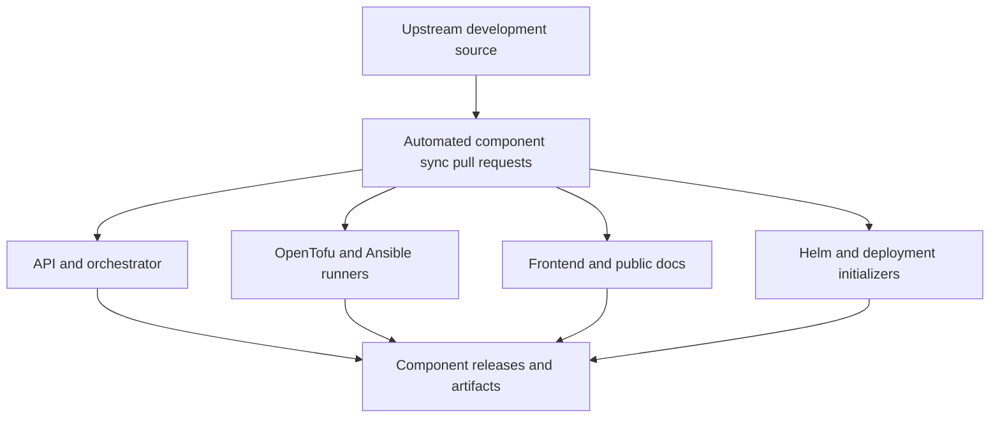

# Stackweaver repositories

Use the component repository to find a release, inspect distributed source or report an
issue. Development source is maintained upstream and copied into the public component
repositories by automated sync pull requests.

## Find the component you need

| Component | Public repository | Purpose |
|---|---|---|
| API | [stackweaver-api](https://github.com/vhco-pro/stackweaver-api) | HTTP API, authentication integration and platform services. |
| Orchestrator | [stackweaver-orchestrator](https://github.com/vhco-pro/stackweaver-orchestrator) | Dispatch queued infrastructure work. |
| OpenTofu runner | [stackweaver-opentofu-runner](https://github.com/vhco-pro/stackweaver-opentofu-runner) | Execute plan/apply work and provide runner images. |
| Ansible runner | [stackweaver-ansible-runner](https://github.com/vhco-pro/stackweaver-ansible-runner) | Execute playbooks and platform inventory syncs. |
| Frontend | [stackweaver-frontend](https://github.com/vhco-pro/stackweaver-frontend) | Web application and public documentation. |
| Helm chart | [stackweaver-helm](https://github.com/vhco-pro/stackweaver-helm) | Kubernetes installation and configuration. |
| Identity initializer | [stackweaver-zitadel-init](https://github.com/vhco-pro/stackweaver-zitadel-init) | Configure the bundled Zitadel integration. |
| Secrets initializer | [stackweaver-secrets-init](https://github.com/vhco-pro/stackweaver-secrets-init) | Prepare deployment secrets. |

[Organization defaults](https://github.com/vhco-pro/.github) contains shared community-health
files and reusable workflows. The upstream development repository also contains the shared
`core` module used by the Go services; it is not a separately deployed service.

## How source reaches a release

Repository and release legend

1. Development changes are integrated upstream and then distributed to component repositories.
2. A sync pull request is a source publication step, not proof that a new artifact is released.
3. Components have independent version series. Match the artifact and provenance to the
   component release you actually deploy.
4. Public documentation is copied with the frontend; internal engineering documents and
   saved design prototypes are excluded from the published product.

Source synchronization is one way. A component repository's release workflow, version
configuration and other distribution files can be maintained there rather than copied
from upstream. Follow [Sync architecture](../security/sync-architecture.md) for the detailed
publication boundary and [Verifying releases](../security/verifying-releases.md) to check
artifact signatures and provenance.

## Check the component's license

Read the `LICENSE` at the tag or commit you use. The runner repositories and Helm chart
publish Apache 2.0 licenses. API, orchestrator, frontend and initializer repositories
publish BSL 1.1 licenses. Runner `NOTICE` files also describe the shared `core` linkage.
Repository descriptions are not a substitute for those files.

The [OSPS evidence guide](../security/osps-baseline-compliance.md#argued-deviations)
describes the assessment boundary and its private shared-module gap. This page supplies the
repository map for QA-04.01; it does not certify a release merely because a repository exists.

## Report a problem

- Open a product issue in the component where you observed it. For a cross-component
  problem, choose the most affected component and include the other component versions.
- Follow that repository's contribution instructions. Direct changes to a distribution
  mirror can be replaced by the next upstream sync.
- Report vulnerabilities through the repository's private reporting channel or the
  published [security policy](https://github.com/vhco-pro/.github/blob/main/SECURITY.md).
