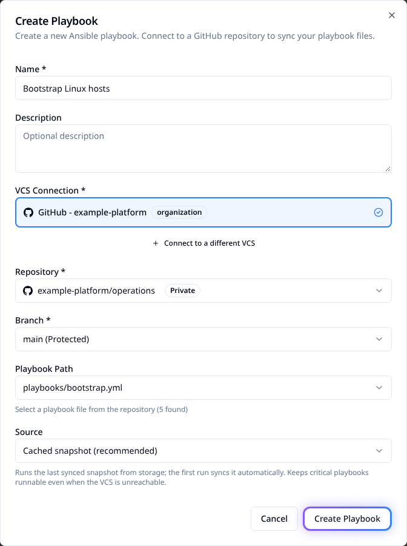
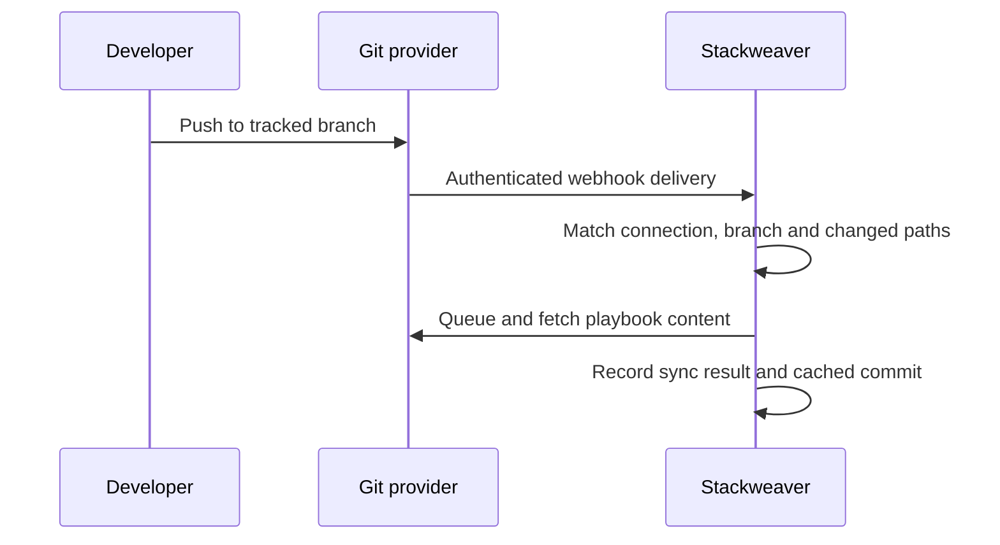

# Sync playbooks from repository pushes

A push to a playbook's tracked branch can queue a sync of its cached content. Register the
repository, branch and file once, then verify the synced commit after a relevant change.
This works for GitHub and Azure DevOps connections; it does not need an OpenTofu workspace.

## Connect the playbook

1. Configure a [GitHub App](../user-guides/vcs/github-app.md) or
   [Azure DevOps connection](../user-guides/vcs/azure-devops.md) with repository access.
2. Register the playbook with its VCS connection, repository, branch and playbook path.
3. Wait for the initial sync to succeed. Check its commit and sync time.
4. Push a small relevant change to the tracked branch, then confirm that the recorded
   sync and commit update. A delivery being accepted does not prove the async sync succeeded.



Example registration using the real product form. For all UI fields, bulk import and
source-mode choices, use [Managing Ansible playbooks](../user-guides/managing-ansible-playbooks.md).

### Declare the registration with Terraform

Configure the [Stackweaver provider](../user-guides/terraform-provider.md), then add this to
`playbooks.tf` using existing IDs from the same organization:

```hcl
variable "project_id" { type = string }
variable "vcs_connection_id" { type = string }

resource "stackweaver_ansible_playbook" "deploy" {
  project_id        = var.project_id
  name              = "Deploy production"
  vcs_connection_id = var.vcs_connection_id
  vcs_repository    = "example-platform/automation"
  vcs_branch        = "main"
  playbook_path     = "playbooks/deploy.yml"
  source_mode       = "cached"
}
```

Run a reviewed Terraform plan and apply from your existing management configuration. For
an existing registration, update its managed resource or import it rather than creating a
duplicate. The resource registers the playbook; it neither installs a GitHub App nor launches
a job. Use the linked guide for the complete [REST registration and sync procedure](../user-guides/managing-ansible-playbooks.md#register-and-sync-through-the-api).

## Which changes queue a sync?

| Change | Result |
|---|---|
| Added, modified or removed file in the registered playbook's directory. | Queues a playbook sync, including changes to the playbook itself. |
| VCS inventory's configured file changes. | Queues that inventory's sync. |
| No path configured on the registration. | Any push on its tracked branch can queue a sync. |
| Different branch or unrelated path. | Does not sync that registration. |
| Azure DevOps delivery without a changed-file list. | Syncs every matching playbook and inventory on the branch. |

Keep dependencies such as variables and requirements in paths covered by your sync rules.
For a playbook at the repository root, its directory covers repository changes broadly.
These rules concern playbooks and inventories. [Workspace path filters](./opentofu/vcs-path-filtering.md)
use their own directory/pattern settings.



<details>
<summary>Sync flow legend</summary>

1. The VCS connection must belong to the registration's organization and match the delivery.
2. Path matching selects affected registrations; syncing is asynchronous.
3. A sync refreshes cached content. It is separate from running a job template.

</details>

## Sync and job launch are separate

A push can also launch templates that explicitly enable webhook launches. Keep that opt-in
separate from playbook sync. Normal disabled-template, dependency and concurrency gates
still apply to the launched job.

> [!IMPORTANT]
> Fresh mode fetches branch HEAD when the job starts; it does not pin the triggering commit.
> In cached mode, a webhook launch can race a snapshot sync and use the older snapshot.
> Verify the job's actual playbook source before treating it as a deployment of one commit.

See [Ansible execution](./ansible/execution-flows.md#webhook-triggers) for launch gates and
[playbook source modes](../user-guides/managing-ansible-playbooks.md#source-modes) for the
snapshot/fresh distinction.

## Request another sync and check it

Open the playbook and choose **Sync from VCS** or **Retry sync**, depending on its current
status. Through the API, set your API origin, token and playbook ID, then queue a sync:

```bash
curl --fail-with-body --request POST \
  --header "Authorization: Bearer $STACKWEAVER_TOKEN" \
  "$STACKWEAVER_API_URL/api/v2/ansible/playbooks/$PLAYBOOK_ID/actions/sync"
curl --fail-with-body \
  --header "Authorization: Bearer $STACKWEAVER_TOKEN" \
  "$STACKWEAVER_API_URL/api/v2/ansible/playbooks/$PLAYBOOK_ID"
```

The POST returns `202 Accepted`. Read the registration until `last-sync-status` reports its
result. Check `cached-commit`, sync time and any error; queue acceptance alone is not success.
YAML configures your playbook and dependencies, not the Stackweaver registration itself.

## Recover a missed or failed sync

1. Check the provider's webhook delivery reached the public API and passed signature/secret
   verification. For 401 responses, compare the deployment secret and env-file quoting.
2. Confirm the connected installation/account can read the repository and tracked branch.
3. Check the file path and whether the changed files match this registration.
4. Read the sync error, correct the failed input and request another sync.
5. Verify the intended cached commit, then inspect the source event of any resulting job.

An older successful snapshot can remain usable after a failed sync. Do not confuse a job
succeeding from that snapshot with the latest repository change being synchronized.
