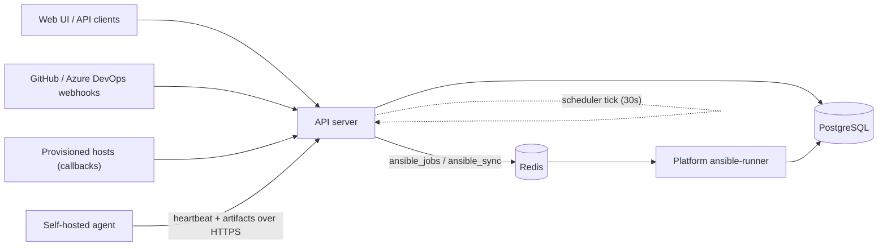
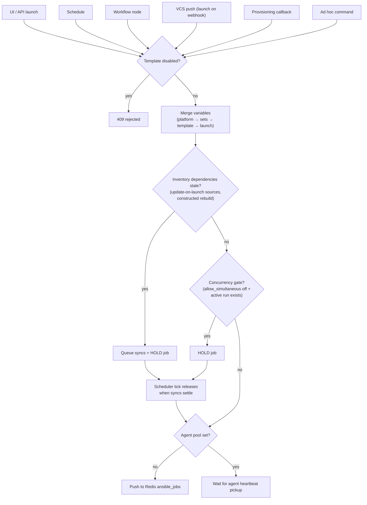
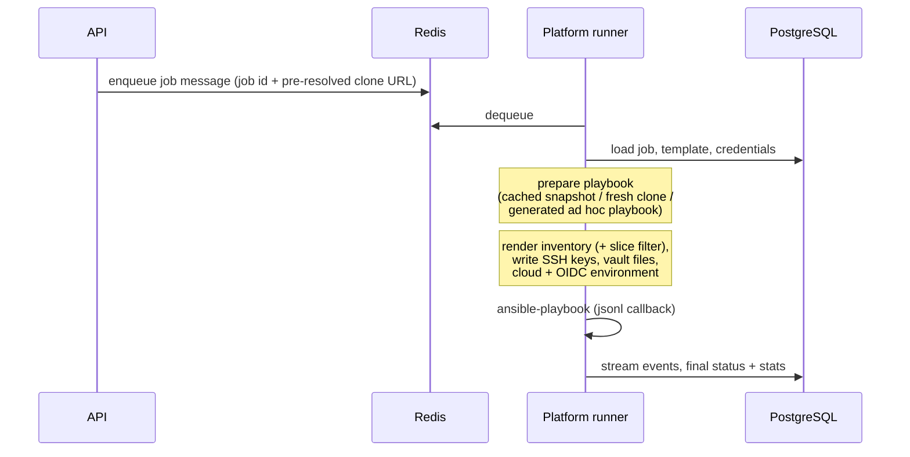
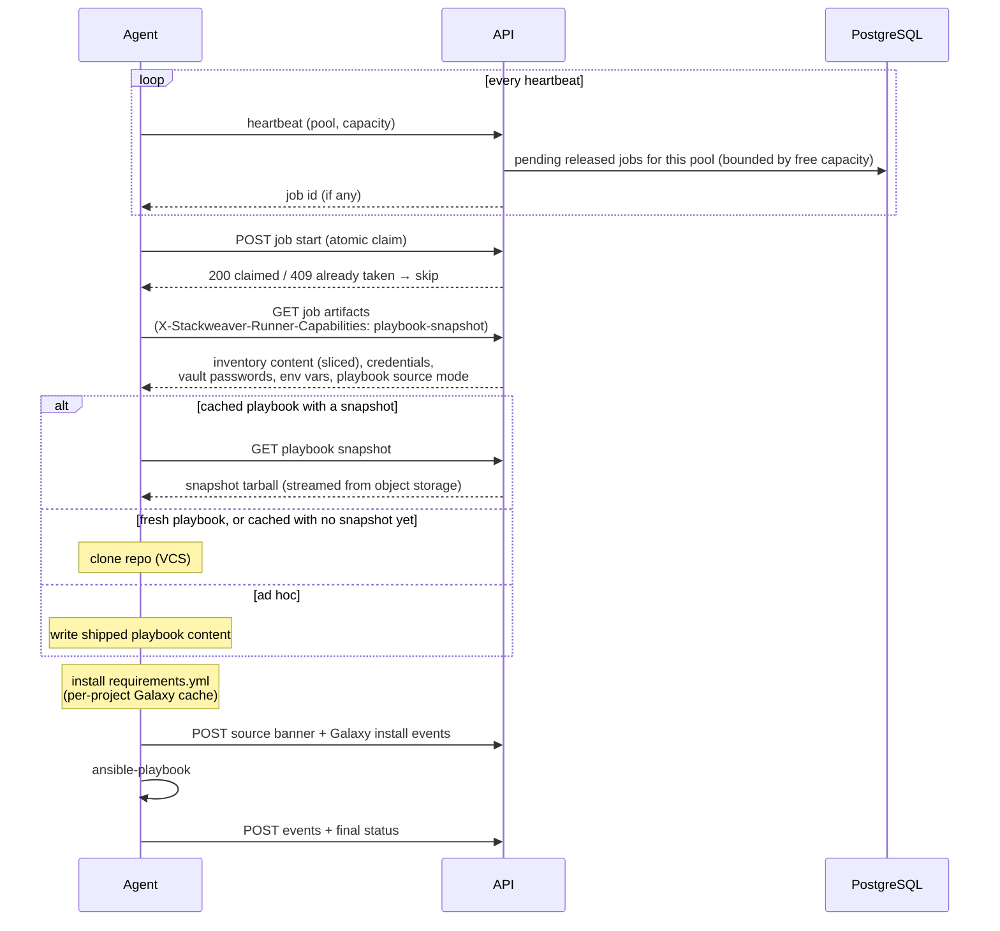
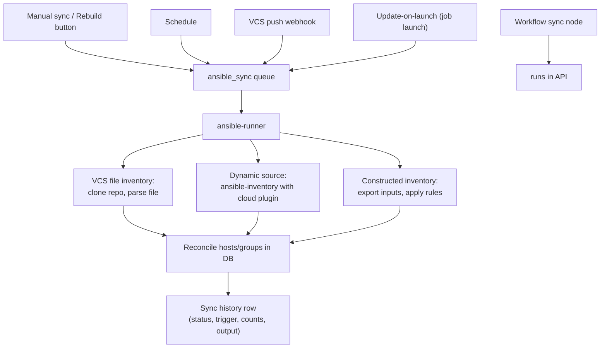
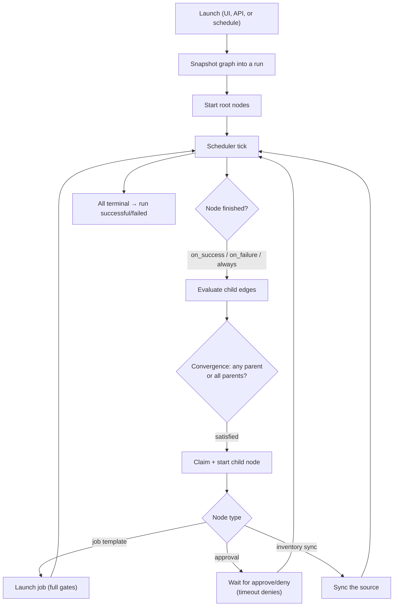
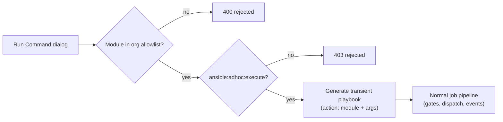
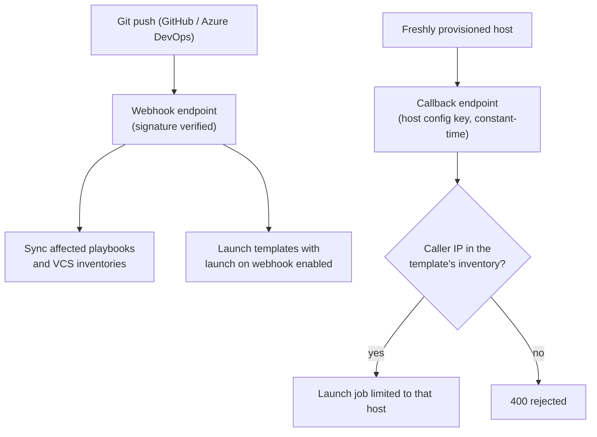

# Understand Ansible execution

Follow a job from launch to output, choose where it executes, and understand why it may wait.
The same execution model connects manual jobs, schedules, workflows, ad hoc commands and
repository triggers. Use the diagrams below to locate the stage you need to investigate.

## Where the work runs

Stackweaver's Ansible engine is built from a small number of cooperating services. The API owns all state and decisions; runners only execute. Two Redis lists connect them: `ansible_jobs` carries playbook runs and `ansible_sync` carries inventory and playbook syncs. Self-hosted agents do not use Redis at all - they poll the API over HTTPS.



<details>
<summary><strong>Components (Legend)</strong></summary>

1. **API server** - owns every decision: launch gates, RBAC, variable merging, workflow progression, notification dispatch. Runs the scheduler tick.
2. **PostgreSQL** - jobs, events, inventories, sync history, workflow state. The platform runner reads and writes it directly; agents never touch it.
3. **Redis** - two queues only: `ansible_jobs` (playbook runs) and `ansible_sync` (inventory/playbook syncs). Used exclusively by the platform runner.
4. **Platform ansible-runner** - Stackweaver's own runner container. Dequeues from Redis, executes, writes events straight to the database.
5. **Self-hosted agent** - the same runner binary in agent mode, running in your network. Outbound-only HTTPS: it heartbeats, picks up jobs assigned to its agent pool, downloads everything it needs as one artifacts bundle, and posts results back.
6. **Scheduler tick** - a 30-second loop inside the API that runs schedules, releases held jobs, advances workflows, dispatches notifications, and cleans up expired jobs.

</details>

## Why a launched job can wait

A disabled template rejects a launch with `409`; it does not create a held job. Inventory
dependencies and concurrency limits can hold an otherwise valid job until the blocking
condition clears. The scheduler rechecks held jobs periodically.



<details>
<summary><strong>Gate details (Legend)</strong></summary>

1. **Disabled gate** - a disabled template refuses every launch path with 409, including schedules and callbacks.
2. **Variable merge** - platform variables, then variable sets, then template variables, then launch-time overrides; later layers win.
3. **Dependency gate** - inventory sources with *update on launch* whose cache window lapsed are synced first; constructed inventories rebuild from their inputs. The job stays held until no dependency sync is running (a sync stuck longer than 30 minutes stops blocking).
4. **Concurrency gate** - without *allow simultaneous*, one run per template at a time; the check-then-create runs under a per-template database lock so concurrent launches cannot both pass. Sliced jobs skip this gate by design.
5. **Release** - the scheduler tick re-evaluates held jobs every 30 seconds and dispatches the ones whose gates cleared. A dependency sync that failed (or stopped blocking after 30 minutes) does not fail the job: it runs on the source's last successful hosts, and before it is dispatched the API records the source on the job (`inventory-sync-warnings`) and writes the notice as the job's first output event, which both runner paths continue after. See [Dynamic inventories](../../user-guides/dynamic-inventories.md#when-an-update-on-launch-sync-fails).

</details>

Job slicing happens at launch: a template with a slice count above one fans out into N jobs, each receiving a deterministic subset of the inventory's hosts (sorted, distributed round-robin). Slices run simultaneously and are grouped under one slice group.

> [!IMPORTANT]
> A failed update-on-launch inventory sync does not necessarily fail the job. Once its
> dependency gate clears, the job can use the last successful hosts and carry a warning.
> A sync still running after 30 minutes can stop blocking. Review the recorded warning
> and inventory freshness before trusting the job's result.


## Configure and launch a template

### Declare launch settings with Terraform

Configure the [Stackweaver provider](../../user-guides/terraform-provider.md), then manage
an existing template or create one from existing resources in the same organization:

```hcl
variable "project_id" { type = string }
variable "playbook_id" { type = string }
variable "inventory_id" { type = string }

resource "stackweaver_ansible_job_template" "baseline" {
  organization       = "example-platform"
  name               = "Production baseline"
  project_id         = var.project_id
  playbook_id        = var.playbook_id
  inventory_id       = var.inventory_id
  enabled            = true
  timeout_seconds    = 1800
  allow_simultaneous = false
  job_slice_count    = 1
}
```

This manages the template, not an execution. Import an existing template before adopting
it into a new Terraform configuration, review the plan and apply it. Credentials are
attached through the provider's template-credential attachment resource shown below or the template's UI/API.
For an existing stored credential, add this attachment to the same configuration:

```hcl
variable "credential_id" { type = string }

resource "stackweaver_ansible_job_template_credential" "baseline" {
  job_template_id = stackweaver_ansible_job_template.baseline.id
  credential_id   = var.credential_id
}
```

The credential must belong to the same organization. Creating a credential alone does not
attach it to a template. The [API explorer](/docs/api-reference/explorer) provides the
complete launch schema.

### Launch once through the API

Use a token allowed to execute the template. Set the API origin, token and `TEMPLATE_ID`.
Save this as `launch.json`:

```json
{
  "data": {
    "type": "ansible-jobs",
    "attributes": {
      "extra-vars": {"deployment_environment": "production"},
      "limit": "web",
      "tags": "configure"
    }
  }
}
```

```bash
curl --fail-with-body --request POST \
  --header "Authorization: Bearer $STACKWEAVER_TOKEN" \
  --header 'Content-Type: application/vnd.api+json' \
  --data-binary @launch.json \
  "$STACKWEAVER_API_URL/api/v2/ansible/job-templates/$TEMPLATE_ID/launch"
```

With no body, or an empty object, this endpoint uses the template's launch values. Overrides
belong under `data.attributes`, not top-level snake-case fields. Invalid documents return
`400` and launch nothing. Check the returned job ID and status, then inspect its output.

| Launch field | Effect on this execution |
|---|---|
| `extra-vars` | Merge keys over template variables. Unmentioned keys keep their values. |
| `limit`, `tags`, `skip-tags` | Replace the template value. An explicit empty string clears it; omission preserves it. |
| Template credentials | Copied onto the launched job. Editing the template later does not change that job. |

Every slice receives the same overrides. Relaunching a job uses that original job's
configuration and credentials, rather than silently substituting today's template values.
A direct organization job launch can also carry a `credentials` relationship; each named
credential must belong to that organization or the request is refused.

### Inspect the queue

Set `ORG` to the organization name, then read its pending/running jobs, oldest first:

```bash
curl --fail-with-body \
  --header "Authorization: Bearer $STACKWEAVER_TOKEN" \
  "$STACKWEAVER_API_URL/api/v2/organizations/$ORG/ansible/jobs/queue"
```

For a sliced launch, list project jobs with `filter[slice-group-id]` set to the slice-group
ID. That query returns the group's slices together in slice order. There is no management
YAML object that replaces template registration or a launch request. Your playbook YAML
still defines what Ansible executes.

## Choose platform or self-hosted execution

Both paths run the same playbook with the same options - the difference is **how the work and its inputs reach the executor**. The platform runner is push-based and trusted with database access; the agent is pull-based and receives everything as a self-contained bundle, so it works from inside a private network with outbound-only connectivity and no credentials for Stackweaver's infrastructure.

| | Platform runner | Self-hosted agent |
|---|---|---|
| Transport | Redis queue (`ansible_jobs`) | Outbound HTTPS polling (heartbeat) |
| Job assignment | Any platform runner takes the next queued job | Only jobs whose template targets the agent's pool, offered up to the agent's free capacity and claimed atomically on start so exactly one agent runs each job (or slice) |
| Inputs | Reads playbook/inventory/credentials from the database and object storage itself | Downloads one artifacts bundle: rendered inventory, decrypted credentials and vault passwords, cloud auth environment, and the playbook source (the cached snapshot to download from the API, VCS clone info for a fresh playbook, or generated content for ad hoc). Galaxy requirements are installed on the agent host from the playbook's `requirements.yml` |
| Results | Writes job events and status directly to the database | Posts events and status back over HTTPS |
| Network position | Inside the Stackweaver deployment | Anywhere with outbound HTTPS to the API |

### Platform runner flow



### Self-hosted agent flow



<details>
<summary><strong>Why the difference matters (Legend)</strong></summary>

1. **Held jobs apply to both** - agents only see jobs that the gates have released, so concurrency limits and dependency syncs behave identically.
2. **Credential handling** - agents receive decrypted job credentials and write temporary runtime files. Protect the runner host and its workspace; cleanup is not a guarantee against host access or an interrupted process.
3. **Ad hoc on agents** - the transient playbook is generated server-side and shipped as content in the artifacts bundle, so no repository access is needed.
4. **Job claiming** - the API limits offered work to free capacity and atomically claims a job on start. An agent that loses the claim skips it; this prevents that claim race from starting the same slice twice.
5. **Choosing the path** - set an agent pool on the job template (or pick a runner in the Run Command dialog); leave it empty to run on platform runners.
6. **Same playbook preparation on both paths** - a `cached` playbook runs its snapshot and a `fresh` one is cloned, and a repository's `requirements.yml` is installed before the play. An agent cannot reach object storage, so it downloads the snapshot through the API, and when a `cached` playbook has no snapshot yet the agent clones for that one run while the API queues a sync for the next. The agent announces that it can run snapshots in the `X-Stackweaver-Runner-Capabilities` header of the artifacts request; an agent that does not send it is given the clone URL for every VCS-backed playbook and clones.

</details>

## Follow an inventory sync

Every way an inventory can refresh goes through the same queue and lands in the same sync history (the Syncs tab), each run with its captured output. Long syncs can be tailed live: the runner flushes output to the run's history row every couple of seconds while it executes, and the output dialog polls while a run is active. Use these read operations, with your inventory or sync ID:

| API operation | Result |
|---|---|
| `GET /api/v2/ansible/inventories/{id}/syncs` | Newest sync runs first, without output. |
| `GET /api/v2/ansible/inventory-syncs/{sync_id}` | One run including its `output`. |



<details>
<summary><strong>Reconciliation semantics (Legend)</strong></summary>

1. **Source ownership** - dynamic sources stamp the hosts and groups they discover. With *overwrite* on, a source prunes only its own rows when the provider stops reporting them; manual entries and other sources' rows are never touched.
2. **A failed run reconciles nothing** - for a dynamic source sync and for a constructed inventory build, the runner tells `ansible-inventory` to exit non-zero when it cannot parse any one of the sources it was given (rejected credentials, an unreachable endpoint, a configuration the plugin refuses, an input it cannot read). Such a run is recorded as failed with the plugin's error in its output, and the rows stay as the last successful run left them. A run that succeeds with no hosts is a different outcome: with *overwrite* on it prunes everything the source owned.
3. **Variable merging** - by default synced host variables merge into existing ones (your manual keys survive); *overwrite variables* switches to wholesale replacement.
4. **Constructed inventories** - are derived-only: their hosts and groups come from the build alone, and every successful rebuild replaces the materialized set from the inputs and rules. The API refuses to add a host, a group or an inventory source to a constructed inventory, to add a host to one of its groups, or to move one of its groups under another, so every row a rebuild removes is one it derived. A host or group can still be deleted, and the next rebuild derives it again if the inputs and rules still produce it.
5. **History and live tail** - each run records who triggered it (manual, schedule, launch, workflow, webhook), host/group counts, duration, and the full diagnostics; raise the source's verbosity for more detail.

</details>

<a id="workflow-execution" style="scroll-margin-top: 7rem"></a>

## Follow a workflow

Launching a workflow snapshots its graph and creates a run; from there the scheduler tick advances execution. Nodes start when their parents finish with a matching edge condition, approval nodes pause the run until a human decides, and the run rolls up once no node can advance.



<details>
<summary><strong>Engine guarantees (Legend)</strong></summary>

1. **Snapshot** - edits to the workflow after launch never affect a running run.
2. **Single start** - nodes are claimed atomically, so a tick racing an approval click cannot start the same node twice.
3. **Skipped paths** - when an edge condition is not met, the unreachable subtree is marked skipped rather than left dangling.
4. **Approvals** - pending approvals surface in the run dialog with Approve/Deny; an optional timeout auto-denies.
5. **Organization boundary** - a node starts only when everything it names belongs to the workflow's organization. A node that names anything else fails without starting a job or a sync, and the run follows its failure edges.

</details>

Launching a workflow and approving/denying an approval node require job-execution permission
in its project. A launch without a body uses the workflow's variables. To override keys,
save this as `workflow-launch.json`:

```json
{
  "data": {
    "type": "ansible-workflow-jobs",
    "attributes": {"extra-vars": {"deployment_environment": "production"}}
  }
}
```

```bash
curl --fail-with-body --request POST \
  --header "Authorization: Bearer $STACKWEAVER_TOKEN" \
  --header 'Content-Type: application/vnd.api+json' \
  --data-binary @workflow-launch.json \
  "$STACKWEAVER_API_URL/api/v2/ansible/workflows/$WORKFLOW_ID/launch"
```

Unlike a template launch, an empty object is not a valid supplied workflow body. A malformed
document or non-object `extra-vars` returns `400` without a run. A workflow whose own project
or inventory lies outside its organization is refused with `409`. Check the returned run
and each node's result rather than treating launch acceptance as completion.

Configure graph nodes and edges through the API; the UI creates, lists and launches
workflows but has no drag-and-drop graph editor. Nested workflows and launch-time survey
prompts are not supported. See the [Ansible integration reference](./roadmap.md#workflows)
for graph fields and validation. The graph is not a playbook YAML file.

## Run an ad hoc command

Run Command executes a single module against an inventory without a playbook or template. The platform generates a one-task playbook from the module and arguments and pushes it through the normal job pipeline, so ad hoc runs get live output, events, and statistics like any job - on a platform runner or any agent pool.



The allowed modules are an organization setting (Settings → Ansible), defaulting to AWX's list, and the permission is distinct from template execution so you can grant ad hoc access separately.

The API command is:

```text
POST /api/v2/ansible/inventories/{id}/actions/run-command
```

The job runs under the project named by the optional `project-id` attribute. Without it the job runs under the inventory's own project, or under the organization's `default` project when the inventory belongs to none. The credential, the agent pool and the project the request names must belong to the inventory's organization: one that does not exist there is rejected with `400`, and the detail says which one was not found.

## Webhook Triggers

Two unauthenticated-by-design entry points exist, both validated by their own secret:



For *launch on webhook*, `fresh` source mode fetches the selected branch's HEAD when the job executes; it does not pin the job to the triggering commit. In `cached` mode a launch can race the snapshot sync and run the previous captured commit. Provisioning callbacks require the template to allow callbacks and the calling host to already exist in the template's inventory.

## Scheduled work and delayed transitions

A single 30-second loop in the API drives everything time-based. Knowing what it owns explains most "why did this happen a few seconds later" questions:

1. **Schedules** - due cron schedules launch their job template, inventory source sync, or workflow. A due `playbook_sync` schedule records a run and queues no sync.
2. **Held-job release** - re-evaluates jobs held by the concurrency or dependency gates and dispatches the ones whose conditions cleared.
3. **Workflow progression** - advances running workflow runs node by node.
4. **Notification dispatch** - finds job/workflow transitions and delivers configured webhook, email and Microsoft Teams messages. Treat the notification as a signal to inspect the run, not as a transaction proving a remote receiver acted exactly once.
5. **Retention cleanup** - once a day, deletes finished jobs older than the organization's retention window (template overrides apply; each template's most recent job is always kept).

### Configure schedules

| `schedule-type` | Target attribute | Behavior |
|---|---|---|
| `job_template` | `job-template-id` | Launch the template through normal gates. |
| `inventory_source` | `inventory-source-id` | Refresh that source. |
| `workflow` | `workflow-id` | Launch the workflow. |
| `playbook_sync` | `playbook-id` | Accepted as a target type but does not queue a playbook sync; do not use for recurring sync. |

Use the dedicated inventory-source schedule. A source form's **Sync Schedule** field alone
does not activate recurring execution. Invalid cron expressions, timezones or targets from
another organization are rejected with `400`; the error identifies the failed input.

A schedule update uses a `schedules` document. Supplied `name`, `description`,
`cron-expression`, `timezone` and `config` fields change; omitted ones remain. Updated
cron/timezone values are validated again.

- **Enable** recalculates the next run without launching immediately. A schedule can be
  enabled even if its template is disabled; each refused due launch records a failed run.
- **Disable** stops recurring launches.
- **Run now** executes without waiting for cron. A disabled job template returns `409`
  without a launch.
- A target missing from the schedule's organization at execution time records a failure.

The enable, disable and run-now actions return the resulting schedule. Use the
[API explorer](/docs/api-reference/explorer) for the schedule endpoints and the
[canonical Ansible catalogue](./README.md) to choose the task guide for each capability.
