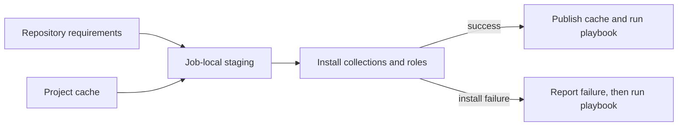

# Use Ansible Galaxy collections and roles

Declare extra collections and roles in your playbook repository's `requirements.yml`.
Both platform runners and self-hosted Ansible runners install those requirements before
running the playbook. Keep dependency versions in that repository, alongside the code
that uses them.

## Add repository requirements

Create one requirements file at the prepared repository root. The runner uses the first
file it finds in this order:

1. `requirements.yml`
2. `collections/requirements.yml`
3. `roles/requirements.yml`

For example:

```yaml
# requirements.yml
collections:
  - name: cisco.ios
    version: ">=5.0.0"
  - name: f5networks.f5_modules
  - name: paloaltonetworks.panos
  - name: ansible.windows
    version: "2.0.0"
roles:
  - name: geerlingguy.docker
  - name: geerlingguy.nginx
```

These illustrate accepted names and version syntax, not a recommended dependency set.
Choose releases compatible with your runner's Ansible version and pin exact versions you
have tested when reproducibility matters. Unversioned entries and ranges can resolve to
different content over time. A job template has no separate collection-version list.

Register the playbook through the [UI, Terraform or API](../../user-guides/managing-ansible-playbooks.md#automate-registrations).
Those interfaces choose the repository and source mode; YAML declares the dependencies.
Do not invent a Stackweaver collection resource to replace `requirements.yml`.

## Verify the install in job output

1. Run the playbook against a test inventory.
2. Find the requirements-install events before the playbook tasks.
3. Check the selected requirements path, installation result and any downloaded versions.
4. Confirm a task using the required collection or role succeeds on the intended runner.



<details>
<summary>Dependency install legend</summary>

1. The cache seeds an isolated job directory; concurrent cache publication does not replace
   files under a running job.
2. Collections and roles are installed separately from the selected requirements file.
3. A successful install can warm that project's cache for another job.

</details>

> [!IMPORTANT]
> An installation failure is reported, but the playbook still runs. It fails when a task
> needs missing content; a playbook that never uses it can succeed. Check the install
> event rather than treating a successful job as proof every dependency installed.

| Event | Meaning |
|---|---|
| `galaxy_cache_seeded` | Collections, roles or both were reused from this project's cache. |
| `galaxy_install` | The runner found a requirements file and started installation. |
| `galaxy_install_complete` | Installation completed; review the command output. |
| `galaxy_install_failed` | Installation failed; diagnostics accompany the event. |

An empty cache has no seeded event. Installation is bounded; an unreachable dependency
must not occupy a runner slot indefinitely.

## Use installed content

Use fully qualified collection names so the module's origin is clear:

```yaml
---
- name: Check target connectivity
  hosts: all
  gather_facts: false
  tasks:
    - name: Ping through the built-in module
      ansible.builtin.ping:
```

For another module, such as `community.general.pacman` or `amazon.aws.ec2_instance`, also
supply its required target platform, arguments and cloud credentials. Installing a
collection does not configure its authentication or make every example portable.

The runner image includes the collections bundled with its installed `ansible` community
package. Common examples are `amazon.aws`, `azure.azcollection`, `google.cloud`,
`community.vmware`, `community.general`, `ansible.posix` and `ansible.netcommon`. Exact
versions depend on the image you deploy; inspect that image or runner instead of relying
on a second hand-maintained version list.

From the deployment's Compose directory (`deploy/` in this repository), read the
installed set and engine version:

```bash
docker compose exec ansible-runner ansible-galaxy collection list
docker compose exec ansible-runner ansible --version
```

For self-hosted execution, run the equivalent read-only commands on that runner. Inspecting
one platform container does not prove what another agent has installed.

## Understand search order and cache scope

When requirements are installed, the job's installed directories and the playbook's own
collections/roles precede the paths already configured for the runner. Existing paths come
from the runner environment, its effective `ansible.cfg`, or Ansible defaults. Bundled
collections remain a fallback, so an earlier copy can take precedence over the bundle.

| Situation | Where content must come from |
|---|---|
| Repository declares requirements | Its own staged install, then the effective search path. |
| Repository has no requirements | Its repository content and configured/default paths; another repository's cached dependencies are not automatically added. |
| Ad hoc command | Configured/default paths; it has no repository requirements file to install. |

The project cache improves downloads; it is not a global dependency store or a deployment
contract. `GALAXY_CACHE_DIR` defaults beneath `WORKSPACES_DIR`, with separate project
subdirectories. Use a dedicated persistent volume if it must survive runner restarts.
Idle project caches are removed after `GALAXY_CACHE_TTL_DAYS` days, default 14; `0` disables
that cleanup. Keep unrelated files out of the cache directory.

For ad hoc content that must always exist, prefer a runner image containing it. A project's
or organization's `ansible.cfg`, or runner search-path environment, can also expose content.
Pointing platform commands at a project cache depends on that cache being present and not
expired; it is not a substitute for a declared or bundled dependency.

## Configure private collection sources

A requirements file can use a private Galaxy endpoint or a Git source:

```yaml
collections:
  - name: https://github.com/example-platform/private-collection.git
    type: git
    version: main
  - name: example_platform.operations
    source: https://galaxy.example.com
```

Use a tested commit/tag instead of a moving branch when you need a fixed Git dependency.
The runner must reach and authenticate to the source. A Stackweaver VCS connection used
to clone the playbook does not by itself establish authentication for every Galaxy/Git
requirement.

Open **Settings > Ansible Configuration**, select **Organization** or the intended
**Project**, and save a server definition in that scope's `ansible.cfg`:

```ini
[galaxy]
server_list = internal

[galaxy_server.internal]
url = https://galaxy.example.com/api/
```


You can manage the same configuration with the native provider. Save the INI above as
`ansible.cfg` beside your Terraform files, then use:

```hcl
resource "stackweaver_ansible_config" "galaxy" {
  organization   = "example-platform"
  config_content = file("${path.module}/ansible.cfg")
}
```

Use `project_id` instead of `organization` for a project-scoped config. Exactly one scope
must be set. This is the whole config for that scope: merge other needed settings into
the file, rather than overwriting an existing config with only the Galaxy section.
See [Configure Ansible dependencies](../../user-guides/self-hosted-runners.md#5-configure-ansible-dependencies)
for the UI procedure and precedence.

Supply the server's credentials through your approved runner/Ansible configuration.
If using an `ANSIBLE_GALAXY_SERVER_*` environment variable on the runner, name it in
`STACKWEAVER_RUN_ENV_PASSTHROUGH` so it can reach `ansible-galaxy`. See
[Runner variables that reach runs](../../get-started/self-hosting/environment-variables.md#runner-variables-that-reach-runs).
Keep tokens out of committed requirements and logs. Private servers need network access
and configuration; they are not an unsupported future feature merely because there is no
collection-store UI.

## Build an image with additional content

Use repository requirements for most playbooks. For content required by ad hoc commands,
create a runner image that installs it into a directory the runner user can read, such as
`/usr/share/ansible/collections`. Install as the image's build user and switch back to the
runtime user afterward. Do not install only into root's home directory.

A Dockerfile extending your chosen runner image can install content into that shared path.
Replace the base image placeholder with the runner image/tag you have tested:

```dockerfile
FROM your-runner-image:tested-tag
USER root
RUN ansible-galaxy collection install community.general \
    --collections-path /usr/share/ansible/collections
USER stackweaver
```

Pin the required collection version after testing compatibility with that image; an
unversioned install is not a reproducible dependency lock.

A custom `collections_path` replaces defaults, so include that shared directory if it
must remain searchable. If maintaining the runner source image, changing its pinned
`ansible` version and lock file changes the bundled set as a whole; test compatibility
before deploying the rebuilt image.

## Recover a dependency problem

| Symptom | Next check |
|---|---|
| Module/action cannot be resolved | Check this repository's requirements, the install event and the executing runner's collection list. |
| Role not found | Check its requirements entry and effective roles path; another repository's cache is not inherited. |
| Version incompatibility | Compare the selected collection with the runner's Ansible version. Pin a compatible release. |
| Download or authentication failure | Check runner network access, private-server credentials and passthrough settings. |
| A different module version runs | Inspect effective search order; a repository or staged copy can override a bundled collection. |

Use [Ansible's collection installation reference](https://docs.ansible.com/projects/ansible/latest/collections_guide/collections_installing.html)
for full requirements syntax and [Execution flows](./execution-flows.md) for runner routing.
