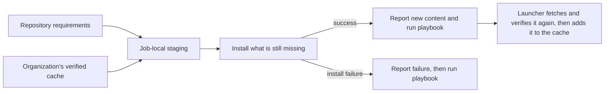

# Use Ansible Galaxy collections and roles

Declare extra collections and roles in your playbook repository's `requirements.yml`.
Every job installs those requirements before running the playbook, whether it runs on
the hosted capacity or on a self-hosted agent pool, and takes what it can from the
organization's verified cache first. Keep dependency versions in that repository, alongside the code
that uses them.

## Add repository requirements

Create one requirements file at the prepared repository root. The job uses the first
file it finds in this order:

1. `requirements.yml`
2. `collections/requirements.yml`
3. `roles/requirements.yml`

For example:

```yaml
# requirements.yml
collections:
  - name: cisco.ios
    version: ">=5.0.0"
  - name: f5networks.f5_modules
  - name: paloaltonetworks.panos
  - name: ansible.windows
    version: "2.0.0"
roles:
  - name: geerlingguy.docker
  - name: geerlingguy.nginx
```

These illustrate accepted names and version syntax, not a recommended dependency set.
Choose releases compatible with the Ansible version of the job's image and pin exact versions you
have tested when reproducibility matters. Unversioned entries and ranges can resolve to
different content over time. A job template has no separate collection-version list.

Register the playbook through the [UI, Terraform or API](../../user-guides/managing-ansible-playbooks.md#automate-registrations).
Those interfaces choose the repository and source mode; YAML declares the dependencies.
Do not invent a Stackweaver collection resource to replace `requirements.yml`.

## Verify the install in job output

1. Run the playbook against a test inventory.
2. Find the requirements-install events before the playbook tasks.
3. Check the selected requirements path, installation result and any downloaded versions.
4. Confirm a task using the required collection or role succeeds on the intended pool.



<details>
<summary>Dependency install legend</summary>

1. The cache seeds an isolated job directory with what it holds for the job's
   `requirements.yml`, and `ansible-galaxy` then installs only what is still missing.
2. Collections and roles are installed separately from the selected requirements file.
3. A job never writes the cache. The launcher that ran it adds new content only after
   fetching it again from its source and verifying it, so a later job of the same
   organization can reuse it.

</details>

> [!IMPORTANT]
> An installation failure is reported, but the playbook still runs. It fails when a task
> needs missing content; a playbook that never uses it can succeed. Check the install
> event rather than treating a successful job as proof every dependency installed.

| Event | Meaning |
|---|---|
| `galaxy_cache_seeded` | How many collections, roles and git sources were installed from the organization's verified cache. |
| `galaxy_install` | The job found a requirements file and started installation. |
| `galaxy_install_complete` | Installation completed; review the command output. |
| `galaxy_install_failed` | Installation failed; diagnostics accompany the event. |

A job whose requirements the cache does not hold yet has no seeded event. Installation is
bounded to 15 minutes, so an unreachable dependency does not occupy a launcher slot
indefinitely.

## Use installed content

Use fully qualified collection names so the module's origin is clear:

```yaml
---
- name: Check target connectivity
  hosts: all
  gather_facts: false
  tasks:
    - name: Ping through the built-in module
      ansible.builtin.ping:
```

For another module, such as `community.general.pacman` or `amazon.aws.ec2_instance`, also
supply its required target platform, arguments and cloud credentials. Installing a
collection does not configure its authentication or make every example portable.

The Ansible image includes the collections bundled with its installed `ansible` community
package. Common examples are `amazon.aws`, `azure.azcollection`, `google.cloud`,
`community.vmware`, `community.general`, `ansible.posix` and `ansible.netcommon`. Exact
versions depend on the image a job runs in; inspect that image instead of relying on a
second hand-maintained version list.

On Docker Compose, read the installed set and engine version from the directory that
holds your `docker-compose.yml`:

```bash
docker compose exec ansible-launcher ansible-galaxy collection list
docker compose exec ansible-launcher ansible --version
```

For a job that runs in an execution environment or on a self-hosted pool, run the
equivalent read-only commands in that image. Inspecting one container does not prove what
another image contains.

## Understand search order and cache scope

Every job resolves collections and roles by the same rule, wherever it runs. When
requirements are installed, the job's installed directories and the playbook's own
collections/roles precede the paths already in effect. Existing paths come from the job's
environment, its effective `ansible.cfg`, or Ansible defaults. Bundled
collections remain a fallback, so an earlier copy can take precedence over the bundle.

| Situation | Where content must come from |
|---|---|
| Repository declares requirements | Its own staged install, then the effective search path. |
| Repository has no requirements | Its repository content and configured/default paths; it installs nothing, so another repository's dependencies are not added. |
| Ad hoc command | Configured/default paths; it has no repository requirements file to install. |

The organization's verified cache saves downloads; it is not a dependency store a job can
search or a deployment contract. A job takes from the cache only what its own
`requirements.yml` declares:

| Requirement entry | What the cache supplies |
|---|---|
| Collection or role pinned to a version | That version. |
| Unpinned collection or role | The newest version the cache holds. |
| `type: git` with a full commit | That commit. |
| `type: git` with a branch, a tag or no version | The commit `git ls-remote` resolves when the job runs, so a branch that moved installs its new commit from the source. |
| `type: git` from a subdirectory (`#/path/`) | The whole repository at that commit. |

The launcher that ran a job adds what it installed beyond the cache only after fetching it
again and verifying it: a collection against the checksum its Galaxy server publishes for
that version, and a role or git source by the commit it resolved to. One organization's
entries are never served to another. The cache lives in the installation's object storage
and is bounded by the organization's cache size limit (**Settings > Organization > Run
Defaults**), which removes the oldest entries first. See
[The Organization's Cache](../../user-guides/self-hosted-runners.md#the-organizations-cache).

For ad hoc content that must always exist, use an
[execution environment](../../user-guides/run-images-and-execution-environments.md) that
contains it, selected on the inventory's project or organization. A project's or
organization's `ansible.cfg` can also add a search path to a directory the job's image holds.

## Configure private collection sources

A requirements file can use a private Galaxy endpoint or a Git source:

```yaml
collections:
  - name: https://github.com/example-platform/private-collection.git
    type: git
    version: main
  - name: example_platform.operations
    source: https://galaxy.example.com
```

Use a tested commit/tag instead of a moving branch when you need a fixed Git dependency.
The job, on the hosted capacity or on your own launchers, must reach the source.
Stackweaver passes no Git credential to `ansible-galaxy`: a private Git source must be
reachable without one, and a Stackweaver VCS connection used for the playbook does not
authenticate Galaxy or Git requirements.

Open **Settings > Ansible Configuration**, select **Organization** or the intended
**Project**, and save a server definition in that scope's `ansible.cfg`:

```ini
[galaxy]
server_list = internal

[galaxy_server.internal]
url = https://galaxy.example.com/api/
```


You can manage the same configuration with the native provider. Save the INI above as
`ansible.cfg` beside your Terraform files, then use:

```hcl
resource "stackweaver_ansible_config" "galaxy" {
  organization   = "example-platform"
  config_content = file("${path.module}/ansible.cfg")
}
```

Use `project_id` instead of `organization` for a project-scoped config. Exactly one scope
must be set. This is the whole config for that scope: merge other needed settings into
the file, rather than overwriting an existing config with only the Galaxy section.
See [Configure Ansible dependencies](../../user-guides/self-hosted-runners.md#5-configure-ansible-dependencies)
for the UI procedure and precedence.

A private Galaxy server takes its token from the `ansible.cfg` server definition. To use a
private server for the whole installation, set `STACKWEAVER_GALAXY_SERVERS` and its
`STACKWEAVER_GALAXY_SERVER_<NAME>_TOKEN` values on the API (see
[Job mirrors, proxy and CA](../../get-started/self-hosting/environment-variables.md#job-mirrors-proxy-and-ca)).
A job whose `ansible.cfg` names its own server list keeps it. If using an
`ANSIBLE_GALAXY_SERVER_*` environment variable on a launcher, name it in
`STACKWEAVER_RUN_ENV_PASSTHROUGH` so it can reach `ansible-galaxy`. See
[Runner variables that reach runs](../../get-started/self-hosting/environment-variables.md#runner-variables-that-reach-runs).
Keep tokens out of committed requirements and logs.

## Build an image with additional content

Use repository requirements for most playbooks. For content required by ad hoc commands,
build an image on top of the Ansible image that installs it into a directory the job's user
can read, such as `/usr/share/ansible/collections`, and select it as an
[execution environment](../../user-guides/run-images-and-execution-environments.md).
Install as the image's build user and switch back to the runtime user afterward. Do not
install only into root's home directory. An existing AWX execution environment works the
same way.

A Dockerfile extending the Ansible image can install content into that shared path.
Replace the base image placeholder with the image and tag you have tested:

```dockerfile
FROM your-ansible-image:tested-tag
USER root
RUN ansible-galaxy collection install community.general \
    --collections-path /usr/share/ansible/collections
USER stackweaver
```

Pin the required collection version after testing compatibility with that image; an
unversioned install is not a reproducible dependency lock.

A custom `collections_path` replaces defaults, so include that shared directory if it
must remain searchable. If you build the Ansible image from this repository, changing its
pinned `ansible` version and lock file changes the bundled set as a whole; test
compatibility before deploying the rebuilt image.

## Recover a dependency problem

| Symptom | Next check |
|---|---|
| Module/action cannot be resolved | Check this repository's requirements, the install event and the collection list of the job's image. |
| Role not found | Check its requirements entry and effective roles path; another repository's requirements are not inherited. |
| Version incompatibility | Compare the selected collection with the Ansible version of the job's image. Pin a compatible release. |
| Download or authentication failure | Check the job's route to the source (a self-hosted launcher's jobs network, or a proxy the job does not use), private-server credentials and passthrough settings. |
| A different module version runs | Inspect effective search order; a repository or staged copy can override a bundled collection. |

Use [Ansible's collection installation reference](https://docs.ansible.com/projects/ansible/latest/collections_guide/collections_installing.html)
for full requirements syntax and [Execution flows](./execution-flows.md) for job routing.
