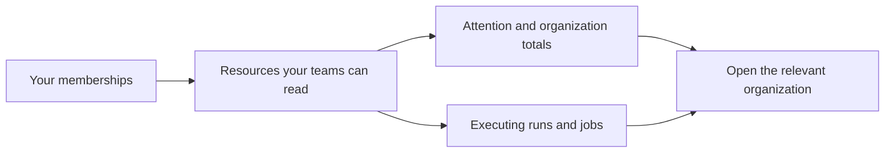

# Understand dashboard counts

The dashboard combines the organizations you can access so you can find blocked work without
opening each organization first. It shows current attention items and live operations;
[Usage & Analytics](../../user-guides/usage-analytics.md) provides trends within one organization.
For the controls and a worked example, see [Reading the dashboard](../../user-guides/reading-the-dashboard.md).

## What needs attention

Rows appear only when a count is non-zero. Each names the organization, describes the problem
and links to the relevant work. Terraform and Ansible items share this order:

| Priority | Item | What it means |
|---|---|---|
| 1 | Runs waiting to apply | A completed plan needs confirmation. |
| 2 | Workflow approvals waiting | An Ansible approval node needs approval or denial. |
| 3 | Workspaces left broken | The workspace's latest run errored. |
| 4 | Job templates left failing | The template's latest job errored. |
| 5 | Inventories failed to sync | The latest inventory sync failed; inspect its last successful data before relying on it. |
| 6 | Runners offline | Execution capacity may be unavailable. |
| 7 | Terraform runs failed | Failures occurred inside the displayed recent-failure window. |
| 8 | Ansible jobs failed | Ansible failures occurred inside that same window. |
| 9 | Open change requests | A workspace has outstanding requested work. |

A "left broken" count is a current condition. A recent-failure count is an event count within
a time window. A later successful execution can clear the first while the earlier failure
still contributes to the second. Ad hoc Ansible failures count as recent failures but do not
make a job template "left failing".

Runner and change-request counts require the corresponding administrative access. An absent
row can mean you lack access; it does not establish that its count is zero.

## Live work and organization cards

**Live operations** lists executing Terraform runs and Ansible jobs across organizations,
with their organization, status and elapsed time. A run waiting for apply confirmation belongs
to the attention list instead. The operations list is bounded and indicates when more work
exists than it can show.

**Your organizations** links to each organization and shows its projects, workspaces,
playbooks and activity summary. **Recent activity** shows your own recent actions. On a new
account, the **Getting started** checklist replaces attention and live operations until an
organization, project and workspace exist.

Section headings collapse their contents. The browser remembers each section's choice;
collapsed polling sections stop requesting their data until reopened.

## Which resources count

Counts reflect your organization memberships and team permissions, including the projects,
workspaces and Ansible resources you can read. They are not limited to executions you started.
Owners and teams with organization-wide access can see a broader population than a restricted
team. Completed-this-month counts start at the beginning of the current month in UTC.

## Dashboard endpoint reference

These are read-only, cross-organization views. Neither takes an organization parameter.
Use a signed-in user session for the same membership-based view as the dashboard; do not
assume an organization-scoped automation token can enumerate all of its owner's memberships.

| Endpoint | Response to use |
|---|---|
| `GET /api/v2/dashboard/stats` | Totals and per-organization counts; `recent_failure_window_days` identifies the failure window. Permission-restricted fields may be omitted. |
| `GET /api/v2/dashboard/operations` | In-flight executions and their organization, status and start time; inspect `truncated`. |

Use the [API viewer](/api-reference) for the full response contract. These endpoints report
state; they do not acknowledge alerts or change infrastructure. Terraform and repository YAML
configure resources elsewhere and are not alternative ways to read this screen.

## Related guides

- [Reading the dashboard](../../user-guides/reading-the-dashboard.md): find and open work.
- [Usage & Analytics](../../user-guides/usage-analytics.md): examine trends and failures in one organization.
- [Change requests](../../user-guides/change-requests.md): track requested workspace changes.
