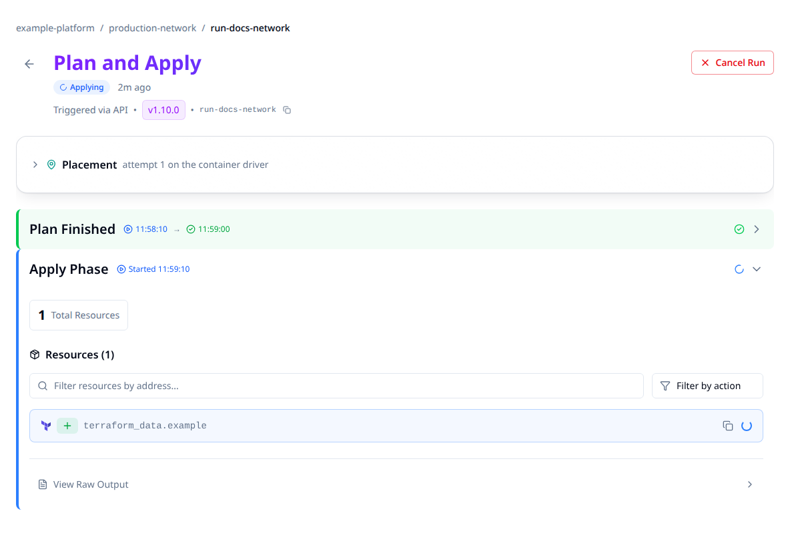

# Cancel a run

Cancel pending or executing work from its run page or the API. Cancellation stops further
work when the job running it observes it; it does not reverse infrastructure changes already made.
A canceled apply interrupts OpenTofu, which saves the state of the resources it already changed,
and that state becomes the workspace's current state version. The apply log keeps OpenTofu's
interrupt output and ends with `Stackweaver: the run was canceled.`

> [!WARNING]
> Canceling an apply can leave partially changed infrastructure. Check the output and the
> latest saved state before retrying or cleaning up resources. A canceled status is not
> evidence that every provider operation stopped immediately.

## Choose the action for the current state

| Run state | Action |
|---|---|
| `pending`, `planning`, `applying` | Cancel from the run page or API. |
| A run-task stage (an external check at a plan/apply boundary) is running | Use the cancel API below. It also cancels outstanding task stages/results. |
| Plan finished and is waiting for approval (`planned`) | Discard the plan rather than using Cancel. The run ends `discarded`. |
| Final run (`applied`, `planned_and_finished`, `errored`, `canceled`, `discarded`) | Inspect its result; it cannot be canceled again. |

The run's `actions.is-cancelable` and `actions.is-discardable` attributes say which action
its current status accepts.

Use the actual run status, not an informal queue label, to choose an action. The API can
refuse a request if a run finishes or changes state before the cancellation is accepted.

## Cancel from the UI

1. Open the workspace's **Runs** tab and select the active run.
2. Check its workspace, operation and current phase.
3. Choose **Cancel Run** in the header. This control acts immediately; there is no separate
   cancellation confirmation dialog.
4. Wait for the status to update. Review the output and saved state before taking another action.



The shared maintained capture uses synthetic data. No run was canceled to create it.
For a run waiting on external run tasks, use the API path rather than relying on the
current page's cancellation control.

## Cancel through the API

Use a token with apply permission on the run's workspace. Set the API origin, token and
run ID, then send:

```bash
curl --fail-with-body --request POST \
  --header "Authorization: Bearer $STACKWEAVER_TOKEN" \
  "$STACKWEAVER_API_URL/api/v2/runs/$RUN_ID/actions/cancel"
```

`202 Accepted` records the cancellation. Read the run again and inspect its phase logs:

```bash
curl --fail-with-body \
  --header "Authorization: Bearer $STACKWEAVER_TOKEN" \
  "$STACKWEAVER_API_URL/api/v2/runs/$RUN_ID"
```

The serialized canceled status is `canceled`. A `409` means the run's status does not
accept a cancel, or that it changed concurrently. Read the current record before choosing
another action. Cancellation also closes outstanding run-task stages, so a later external verdict
does not restart the run.

Terraform resources configure and queue work; the cancel action is a lifecycle request,
not a workspace YAML option. Use the [API explorer](/docs/api-reference/explorer) for the
separate discard and force-cancel operations. Do not substitute force-cancel for normal
cancellation without understanding whether execution has actually stopped.

## Check the consequences

| Phase | What to verify |
|---|---|
| Planning | Output identifies how far evaluation got. A plan normally does not apply proposed changes, but providers/data sources can still perform external work. |
| Applying or destroying | Resources already changed remain. Compare phase output, the latest available state and actual infrastructure before a fresh plan. |
| Waiting on run tasks | The run and outstanding checks become terminal. Check the run before responding to any delayed task result. |

On the hosted capacity and on agent pools alike, the job running a canceled run
stops OpenTofu within one status poll. The launcher that placed it then stops and removes its
container, pod or process, even on a pool that keeps failed jobs for inspection. The process
can take a moment to stop after the request is recorded. If the result is uncertain, check
the launcher before starting overlapping work.

The [run-timeout guide](./run-timeout.md) explains automatic limits: a run phase that
exceeds its timeout is stopped as well, and the run ends as failed rather than canceled. Use
[run output](./opentofu-streaming.md) and [troubleshooting](../../user-guides/troubleshooting-common-issues.md)
for verification and recovery.
