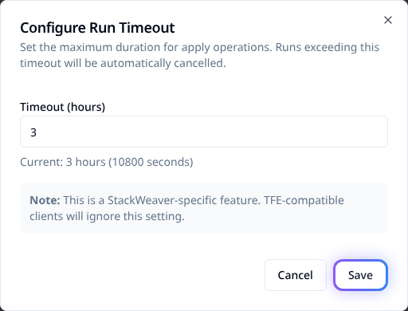

# Configure run timeouts

Set a workspace's **Run Timeout** to limit long-running OpenTofu applies. The default is
**2 hours**. This setting does not give the entire run one shared deadline: plans,
initialization, external checks and approval waits behave differently.

> [!WARNING]
> A timeout does not undo infrastructure changes. A failed run status does not prove the
> command has stopped: self-hosted agent commands and platform provider-error retries can
> continue running. Confirm execution has stopped before starting another run against the
> same infrastructure.

## Choose a configuration path

You need permission to edit the workspace. Choose a positive value based on successful
apply durations, with room for slow provider operations. Set it before launching work.
Increasing a limit does not resolve an operation that is waiting indefinitely.

| Interface | How to set it |
|---|---|
| Workspace UI | Enter hours in **Run Timeout**. The dialog also shows the equivalent seconds. |
| Workspace API | Send the positive `run-timeout` attribute in seconds. For example, 3 hours is `10800`. |
| Terraform/OpenTofu provider | The current workspace resource does not expose this Stackweaver extension. Use the UI or API for this setting; other workspace arguments are covered in the [provider guide](../../user-guides/terraform-provider.md). |

<a id="set-the-timeout"></a>

## Set it in the UI

1. Open the workspace's **Overview** tab and find **Workspace Settings**.
2. Beside **Run Timeout**, select **Edit**.
3. Enter **Timeout (hours)**. Check the equivalent seconds, then select **Save**.
4. Confirm that **Run Timeout** shows the intended value. Reload the page and check again.



*Example: 3 hours equals 10800 seconds. Choose a limit appropriate for your workspace.*

## Set it through the API

This attribute is a Stackweaver extension. A compatible client that does not send it cannot
change it. With your API origin and token configured as in
[Using the API](../../architecture/using-the-api.md), set `WORKSPACE_ID` to the workspace's
ID. Keep the origin free of `/api/v2`. This request sets a three-hour timeout:

```bash
curl --fail --silent --show-error --request PATCH \
  --header "Authorization: Bearer $STACKWEAVER_TOKEN" \
  --header "Content-Type: application/vnd.api+json" \
  --data '{"data":{"type":"workspaces","attributes":{"run-timeout":10800}}}' \
  "$STACKWEAVER_API_URL/api/v2/workspaces/$WORKSPACE_ID"
```

Check `data.attributes.run-timeout` in the response, then read the workspace again:

```bash
curl --fail --silent --show-error \
  --header "Authorization: Bearer $STACKWEAVER_TOKEN" \
  "$STACKWEAVER_API_URL/api/v2/workspaces/$WORKSPACE_ID"
```

The stored `data.attributes.run-timeout` should be `10800`. Zero leaves the saved timeout
unchanged; it does not disable execution limits. See the
[API explorer](/docs/api-reference/explorer) for workspace operation schemas.

## Which limit applies?

| Work or wait | Limit |
|---|---|
| Platform runner: apply | The workspace timeout, normally 2 hours. |
| Platform runner: first plan attempt | Half the workspace timeout, with a minimum of 30 minutes. A 2-hour workspace value gives a 1-hour first-plan deadline. |
| Platform runner: first initialization | 15 minutes, independent of the workspace value. |
| Platform runner: automatic provider-error recovery | Retried initialization and planning do not receive the initial attempts' local deadlines. The periodic workspace timeout check still applies. |
| Self-hosted agent: OpenTofu command | This setting supplies no local command deadline. The platform can mark overdue execution as failed while the command continues. |
| External run-task stage | Normally 10 minutes without progress or 60 minutes total. Operators can configure these limits separately. |
| Apply confirmation or override of a failed mandatory check | Waits for a person's decision without an automatic deadline. |

### The periodic timeout check

The platform checks overdue executing runs about once a minute. It compares the workspace
limit with elapsed time since apply started, or otherwise since the run started. This check
marks the run as failed; it does not stop its process.

For example, a workspace value below 30 minutes can produce a plan error before the first
plan command reaches its 30-minute local deadline. A failed status and an error message
mentioning cancellation are not proof that every process has exited.

## After a timeout

1. **Find the affected phase.** Read the run error and output to identify where progress stopped.
2. **Confirm execution has stopped.** Ask the runner operator to check for a remaining
   OpenTofu process, especially on agents or after provider-error retries. Stop any remaining
   execution before retrying against the same infrastructure.
3. **Check state and infrastructure.** Open the workspace's **States** tab for the latest
   recorded version. Inspect the actual infrastructure too: resources created before an
   interruption can still exist.
4. **Resolve the cause, then review a new plan.** Adjust the timeout if the duration was
   legitimate. Check the new plan before applying again; increasing the limit is not a rollback.

Use [run cancellation](./run-cancellation.md) to request a manual stop of an active run.
For external-check failures and override rules, see [Run Tasks](../../user-guides/run-tasks.md).
