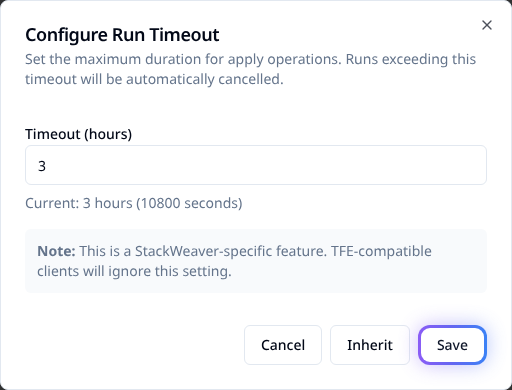

# Configure run timeouts

Set a **Run Timeout** to stop OpenTofu plans and applies that run too long, so a run cannot
hold a launcher and its workspace's state lock indefinitely. The platform default is
**2 hours**. The timeout bounds the plan and the apply separately; external checks and
approval waits have their own limits.

> [!WARNING]
> A timeout does not undo infrastructure changes. Resources an apply created before it was
> stopped remain. Check state and infrastructure before starting another run against the
> same infrastructure.

## Where the value comes from

A run uses the first value it finds in this order: the workspace's own value, its project's,
its organization's, then the platform default. An empty value, or `0`, at a level means
inherit from the next one. Run images and identity bindings follow the same rule; see
[Run images and execution environments](../../user-guides/run-images-and-execution-environments.md#where-a-setting-comes-from).

The platform default is 2 hours (7200 seconds). An operator can change it for the whole
installation with `STACKWEAVER_RUN_TIMEOUT_DEFAULT`; see
[Runs, jobs and launchers](../../get-started/self-hosting/environment-variables.md#runs-jobs-and-launchers).

## Choose a configuration path

You need permission to edit the workspace, project or organization. Choose a positive value
based on successful plan and apply durations, with room for slow provider operations. Between
30 minutes and 24 hours is a sensible range. Set it before launching work. Increasing a limit
does not resolve an operation that is waiting indefinitely.

| Interface | How to set it |
|---|---|
| Workspace UI | Enter hours in **Run Timeout**. The dialog also shows the equivalent seconds, and **Inherit** clears the workspace's own value. |
| Project UI | Set the project's default in the **Edit project** dialog on the project page. |
| Organization UI | Set the organization's default in the **Run Defaults** card of **Settings > Organization**. |
| API | Send the `run-timeout` attribute in seconds on a workspace, project or organization. For example, 3 hours is `10800`, and `0` inherits. |
| Terraform/OpenTofu provider | The current workspace resource does not expose this Stackweaver extension. Use the UI or API for this setting; other workspace arguments are covered in the [provider guide](../../user-guides/terraform-provider.md). |

<a id="set-the-timeout"></a>

## Set it in the UI

1. Open the workspace's **Overview** tab and find **Workspace Settings**.
2. Beside **Run Timeout**, select **Edit**.
3. Enter **Timeout (hours)**. Check the equivalent seconds, then select **Save**.
4. Confirm that **Run Timeout** shows the intended value. Reload the page and check again.



*Example: 3 hours equals 10800 seconds. Choose a limit appropriate for your workspace.*

When the workspace sets no value of its own, **Run Timeout** shows the value it uses and the
level it is inherited from. To return a workspace to its inherited value, open the dialog
and select **Inherit**.

## Set it through the API

This attribute is a Stackweaver extension. A compatible client that does not send it cannot
change it. With your API origin and token configured as in
[Using the API](../../architecture/using-the-api.md), set `WORKSPACE_ID` to the workspace's
ID. Keep the origin free of `/api/v2`. This request sets a three-hour timeout:

```bash
curl --fail --silent --show-error --request PATCH \
  --header "Authorization: Bearer $STACKWEAVER_TOKEN" \
  --header "Content-Type: application/vnd.api+json" \
  --data '{"data":{"type":"workspaces","attributes":{"run-timeout":10800}}}' \
  "$STACKWEAVER_API_URL/api/v2/workspaces/$WORKSPACE_ID"
```

Check `data.attributes.run-timeout` in the response, then read the value a run of the
workspace uses and the level it came from:

```bash
curl --fail --silent --show-error \
  --header "Authorization: Bearer $STACKWEAVER_TOKEN" \
  "$STACKWEAVER_API_URL/api/v2/workspaces/$WORKSPACE_ID/effective-settings"
```

The response's `run-timeout` should have `value` `10800` and `level` `workspace`. Send
`"run-timeout":0` to make the workspace inherit again. Projects and organizations take the
same `run-timeout` attribute on their own update operations. See the
[API explorer](/docs/api-reference/explorer) for the operation schemas.

## Which limit applies?

| Work or wait | Limit |
|---|---|
| Plan | The run timeout, normally 2 hours, counted from the moment the plan's job starts. |
| Apply | The run timeout again, counted from the moment the apply's job starts. |
| External run-task stage | Normally 10 minutes without progress or 60 minutes total. Operators can configure these limits separately. |
| Apply confirmation or override of a failed mandatory check | Waits for a person's decision without an automatic deadline. |

The limit is the same on the hosted capacity and on self-hosted agent pools, because the
launcher that placed the job enforces it.

### What happens at the timeout

When a plan or an apply runs longer than its timeout, the launcher running it reports the
run failed with "the job exceeded its timeout of ... and was stopped", then stops the run's
container, pod or process. The output up to that point stays on the run.

The platform also checks overdue executing runs about once a minute and marks them failed.
It compares the run timeout with elapsed time since apply started, or otherwise since the
run started.

## After a timeout

1. **Find the affected phase.** Read the run error and output to identify where progress stopped.
2. **Check state and infrastructure.** Open the workspace's **States** tab for the latest
   recorded version. Inspect the actual infrastructure too: resources created before the
   apply was stopped can still exist.
3. **Resolve the cause, then review a new plan.** Adjust the timeout if the duration was
   legitimate. Check the new plan before applying again; increasing the limit is not a rollback.

Use [run cancellation](./run-cancellation.md) to request a manual stop of an active run.
For external-check failures and override rules, see [Run Tasks](../../user-guides/run-tasks.md).
