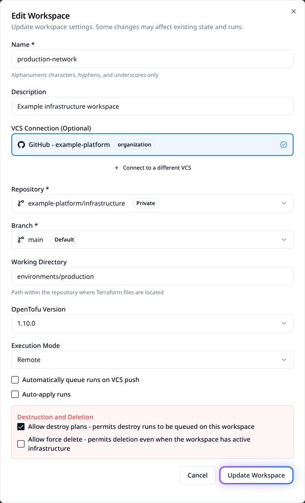

# Edit workspace settings

Update a workspace in place instead of recreating it. Review what the next run will
execute before changing its configuration source, working directory, engine version or
automation settings.

> [!WARNING]
> Changing a repository, branch or working directory can point existing state at different
> configuration. It does not move state to another workspace. Review a fresh plan before
> applying, especially when auto-apply is enabled.

## Edit through the UI

1. Open the intended workspace and choose **Edit** in its header.
2. Change the required fields. Check the repository, branch and working directory together.
3. Review any source-change warning. The absence of a warning does not prove a change is safe.
4. Choose **Update Workspace**, reopen the dialog and confirm the stored values.
5. Queue a reviewable plan when ready. Check the resulting configuration before approving apply.



The maintained example uses synthetic data. No settings are saved during capture.

## Decide what needs a plan or additional review

| Setting | Consequence |
|---|---|
| Name and description | Change identification. A rename changes name-based links and API addressing. |
| Connection, repository, branch, working directory | Choose the configuration read by future work; compare it against existing state. |
| OpenTofu version | Changes the engine used for runs. Check configuration, provider and state compatibility. |
| Auto-queue | Controls automatic runs from repository pushes. |
| Auto-apply | Can apply successful plans without a manual approval. |
| Allow destroy plans | Permits destroy operations to be queued; turning it off does not disable other run types. |
| Allow force delete | Permits deleting the workspace despite active infrastructure. This does not destroy that infrastructure. |
| Execution mode and agent pool | Choose remote, local or agent execution; confirm the selected runner has the required access. |
| Run timeout | Set separately with **Run Timeout > Edit**. UI uses hours; the API stores seconds. |

Changing settings does not retroactively rewrite the configuration of work already running.
Avoid overlapping execution while switching a workspace's source or runner.

## Manage settings with Terraform

Configure the [Stackweaver provider](../../user-guides/terraform-provider.md). Update the
resource already managing this workspace; do not create a second one for an existing workspace:

```hcl
resource "stackweaver_workspace" "production" {
  name               = "production"
  organization       = "example-platform"
  description        = "Production infrastructure"
  working_directory  = "environments/production"
  execution_mode     = "remote"
  auto_apply         = false
  allow_destroy_plan = false
}
```

Retain the resource's VCS settings, project and other managed values. If adopting an
existing workspace, import its ID first, using the resource address in your configuration:

```bash
terraform import stackweaver_workspace.production ws-replace-with-id
terraform plan -out=workspace.tfplan
terraform apply workspace.tfplan
```

Apply only the reviewed plan. A rename or execution-setting change is not a request to
recreate infrastructure. The `tfe_workspace` alias supports the corresponding workspace
fields; check the installed provider's schema for optional settings. The platform-specific
run timeout is described separately in [Run timeouts](./run-timeout.md).

## Update through the API

Use a token with workspace write permission. Set the API origin and workspace ID, and read
the current record first:

```bash
curl --fail-with-body \
  --header "Authorization: Bearer $STACKWEAVER_TOKEN" \
  "$STACKWEAVER_API_URL/api/v2/workspaces/$WORKSPACE_ID"
```

For this example, save `workspace-update.json` with the intended current directory and
replace its ID with `WORKSPACE_ID`:

```json
{
  "data": {
    "type": "workspaces",
    "id": "ws-replace-with-id",
    "attributes": {
      "description": "Production infrastructure",
      "working-directory": "environments/production",
      "auto-apply": false,
      "allow-destroy-plan": false
    }
  }
}
```

> [!IMPORTANT]
> Include the working directory even when changing another setting. The current update
> handler can clear it to the repository root when the attribute is omitted. Do not treat
> every workspace field as having identical partial-update behavior.

```bash
curl --fail-with-body --request PATCH \
  --header "Authorization: Bearer $STACKWEAVER_TOKEN" \
  --header 'Content-Type: application/vnd.api+json' \
  --data-binary @workspace-update.json \
  "$STACKWEAVER_API_URL/api/v2/workspaces/$WORKSPACE_ID"
```

Read back the resource and check the directory, automation flags and any other values you
changed. Use the [API explorer](/docs/api-reference/explorer) for the complete schema and
[Path filters](./vcs-path-filtering.md) for trigger-only settings. Repository YAML does not
replace these platform settings.

## Verify the next run

Check that the next run used the intended repository revision, directory, engine and
runner. Review the resource changes and verify auto-apply/destroy policies before applying.
If the result is unexpected, stop further automatic work, correct the settings and inspect
state before another attempt. A source warning does not automatically migrate or repair state.
