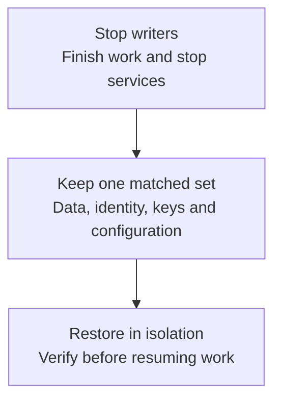

# Back up and restore a deployment

A recovery set needs the application database, object data, identity and the keys that
unlock them, all from the same quiet point. A PostgreSQL dump on its own is incomplete.

The procedure below is a **cold backup of the bundled, single-host Compose deployment**.
It requires downtime and restores onto an empty Linux Docker host with the same CPU
architecture and exact image versions. External databases, external Zitadel, S3 services
and Kubernetes need the coordinated recovery plan described at the end of this guide.



## What belongs in the backup

| Data | Bundled Compose location | Why you need it |
|---|---|---|
| Application and identity databases | `postgres_data` | Organizations, workspaces, job records, encrypted values and Zitadel accounts/configuration. |
| Object data and its index | `garage_data` and `garage_meta` | State, configuration archives, playbook snapshots and stored output. Both Garage volumes are required. |
| Identity bootstrap material | `zitadel-pat` and generated `.env` | Preserve the configured identity and initializer credentials. |
| Encryption and signing keys | `.env`, `oidc.env`, configured key files | Losing the encryption key can make retained credentials unreadable. Changing the workload identity key changes its published signing identity. |
| Deployment configuration | Complete installed bundle, including hidden files | Image pins, Zitadel master key, SSO/VCS settings, proxy/issuer configuration, certificates and GitHub App keys. |
| Runner volumes | `runner-workspaces` and `ansible-workspaces` | Preserve retained local content; these can contain sensitive material. |

Redis in the supplied bundle is ephemeral. Finish or cancel queued work before backing
up; this procedure does not promise queue recovery or continuation of in-flight runs.
Include any extra mounts or external secret sources you added to the bundle.

## 1. Prepare the recovery set

1. Reserve a maintenance window. Pause schedules and incoming webhooks, stop new launches,
   and let active jobs, runs and syncs finish. Stop self-hosted agents separately.
2. Record your image pins and retain access to those exact images. Physical PostgreSQL
   recovery needs the same major version; this procedure uses the exact saved image.
3. Choose a new, protected backup directory **outside** the installed bundle. Allow room
   for every listed volume and an additional copy off the Docker host.

Run the commands from your installed bundle directory. Set `BACKUP_DIR` to an absolute
new directory and keep this shell open for the following steps. These examples assume the
bundle's `docker-compose.yml`; include all of your override files consistently if you use them.

```bash
set -eu
umask 077
BACKUP_DIR=/srv/backups/stackweaver-REPLACE_WITH_TIMESTAMP
mkdir -m 700 "$BACKUP_DIR"
docker compose config --format json > "$BACKUP_DIR/compose.resolved.json"
docker compose config --images > "$BACKUP_DIR/images.txt"
```

The resolved configuration contains secrets. Do not attach it to an issue, commit it or
serve the backup directory from a web server. Encrypt the completed set with your backup
system and retain its recovery key separately.

## 2. Stop and copy

Stop every service cleanly, including PostgreSQL and Garage. Check that no service remains
running before copying data. A live copy of Garage metadata or PostgreSQL files is not this
backup method.

```bash
docker compose stop --timeout 120
running=$(docker compose ps --status running --quiet)
test -z "$running"
tar -czpf "$BACKUP_DIR/configuration.tgz" .
```

Resolve volume names from the stopped containers. This avoids assuming your Compose project
is named `stackweaver`. Run this loop in the same shell after the commands above, so
`set -eu` and `BACKUP_DIR` remain in effect:

```bash
while read -r key service destination; do
  container=$(docker compose ps --all --quiet "$service")
  test -n "$container"
  volume=$(docker inspect --format \
    "{{range .Mounts}}{{if eq .Destination \"$destination\"}}{{.Name}}{{end}}{{end}}" \
    "$container")
  test -n "$volume"
  docker volume inspect "$volume" > /dev/null
  printf '%s\t%s\t%s\t%s\n' "$key" "$service" "$destination" "$volume" \
    >> "$BACKUP_DIR/volumes.tsv"
  docker run --rm --network none \
    --mount "type=volume,src=$volume,dst=/source,readonly" \
    --mount "type=bind,src=$BACKUP_DIR,dst=/backup" \
    alpine:3.24 tar -czpf "/backup/$key.volume.tgz" -C /source .
done <<'VOLUMES'
postgres postgres /var/lib/postgresql/data
garage-data garage /var/lib/garage/data
garage-meta garage /var/lib/garage/meta
identity zitadel /pat
runner runner /home/stackweaver/workspaces
ansible ansible-runner /home/stackweaver/workspaces
VOLUMES
```

Expect six archives and six manifest rows. The manifest records **source** volume names;
never use those names as restore destinations on a host that still holds the source.
This loop covers the supplied bundle. Review extra mounts and any non-volume storage
before calling a customized deployment's backup complete.

Create and verify checksums before resuming service:

```bash
(
  cd "$BACKUP_DIR"
  sha256sum configuration.tgz *.volume.tgz volumes.tsv images.txt \
    compose.resolved.json > SHA256SUMS
  sha256sum --check SHA256SUMS
)
docker compose up -d
docker compose ps -a
```

Expect every checksum to pass. Copy the encrypted recovery set off-host. Resume external
agents and triggers only after checking the source deployment is healthy. Checksums detect
corruption; they do not prove that the set can restore successfully.

## 3. Restore into an empty destination

Use a separate recovery host or fully isolated Docker daemon. Before starting **any**
restored service, block outbound traffic from the recovery environment to production
targets, production runners, SMTP and webhook destinations. Keep production ingress/DNS
pointing at the original installation. This network isolation is mandatory for a rehearsal:
the API's scheduler can launch work even before you open the browser. A different Compose
project name is not an egress policy. Use your host/network firewall and verify its deny
rules before proceeding; Docker-published traffic needs Docker-aware firewall controls.

The supplied bundle uses
fixed container names and public host ports: changing only the Compose project name does
not isolate a second live copy on the same daemon. Do not expose a recovery copy to real
cloud targets, production agents, webhooks, email or users while rehearsing.

Bring the complete recovery set to the new host. Use the same architecture and exact image
versions. Define `BACKUP_DIR` again, verify all checksums, then extract into an empty directory:

```bash
set -eu
BACKUP_DIR=/srv/backups/stackweaver-REPLACE_WITH_TIMESTAMP
(cd "$BACKUP_DIR" && sha256sum --check SHA256SUMS)
RESTORE_DIR=/srv/stackweaver-restored
mkdir -m 700 "$RESTORE_DIR"
tar -xzpf "$BACKUP_DIR/configuration.tgz" -C "$RESTORE_DIR"
cd "$RESTORE_DIR"
docker compose create
```

`create` prepares containers and destination volumes without starting the application. Do
not run `up` against empty data first. Keep the saved encryption/signing keys and identity
configuration; do not run the first-install key-generation sequence.

Resolve the **destination** volumes from these new containers. The helper refuses existing
files or symlinks. Empty directories copied from the image are allowed. A refusal is a
reason to inspect the destination, not to delete its contents:

```bash
while read -r key service destination source_volume; do
  container=$(docker compose ps --all --quiet "$service")
  test -n "$container"
  volume=$(docker inspect --format \
    "{{range .Mounts}}{{if eq .Destination \"$destination\"}}{{.Name}}{{end}}{{end}}" \
    "$container")
  test -n "$volume"
  docker volume inspect "$volume" > /dev/null
  docker run --rm --network none \
    --mount "type=volume,src=$volume,dst=/target" \
    --mount "type=bind,src=$BACKUP_DIR,dst=/backup,readonly" \
    alpine:3.24 sh -eu -c \
    'existing=$(find /target -mindepth 1 ! -type d -print -quit); test -z "$existing"; tar -xzpf "/backup/$1.volume.tgz" -C /target' \
    -- "$key"
done < "$BACKUP_DIR/volumes.tsv"
```

Start infrastructure and the restored application without running first-install jobs or
starting workers. Wait for PostgreSQL readiness before starting Zitadel, then check its
startup logs before starting the API. The saved `.env` and `env.js` must already exist.

```bash
docker compose up -d --no-deps postgres redis garage
until docker compose exec -T postgres sh -c \
  'pg_isready -U "$POSTGRES_USER" -d "$POSTGRES_DB"' > /dev/null 2>&1; do sleep 2; done
docker compose up -d --no-deps zitadel
docker compose logs --tail 30 zitadel
docker compose up -d --no-deps api frontend
docker compose ps -a
```

Expect the same identity and application data, not a new empty installation. If the public
hostname changes, align issuer, proxy, callback and BFF settings using the
[identity guide](../../user-guides/authentication/zitadel-setup.md) before testing sign-in.
Do not run two copies of a recovered Garage node on the same storage network.

## 4. Prove the recovery

Keep the original installation and backup intact until these checks pass:

1. Sign in with an existing account and inspect a known organization and workspace.
2. Read a known state version, playbook snapshot and historical job output. Database rows
   without their corresponding object bytes are not a complete restore.
3. Verify a dedicated test credential works and configured SSO can sign in. Matching key
   files alone does not establish that encrypted data can be read.
4. Review schedules and pending work while production destinations remain blocked. Only
   then start the workers needed for a harmless test:

   ```bash
   docker compose up -d --no-deps orchestrator runner ansible-runner
   ```

   Check runner connectivity and use dedicated targets explicitly permitted by the
   rehearsal network policy. Keep unrelated self-hosted agents stopped.
5. Record the recovery duration, recovered data timestamp, exact image references and any
   manual changes. Repeat the drill after changes to storage, keys or identity.

At a real cutover, reconcile initializer settings and start the complete retained Compose
configuration only after accepting the restored data. An isolated rehearsal does not need
to resume production triggers. Keep the rehearsal's egress controls in place throughout.

If initialization reports unknown credentials, stop and compare the saved `.env`, identity
database, PAT and Zitadel master key. For missing objects, check both Garage volumes,
bucket configuration and storage credentials. Do not generate replacements to hide a
mismatched recovery set. Keep the failed copy for diagnosis and retry with empty storage.

## Kubernetes and externally managed services

Use the same recovery inventory, but take coordinated backups with your database, object
store, identity and CSI/storage tools. Export the complete Helm values and every referenced
Secret, including encryption/OIDC keys and the **complete** Zitadel Secret with BFF
credentials. Protect these exports as secrets. Back up external services through their
owners; a PVC snapshot does not include them.

Restore Secrets and data into an isolated namespace/cluster before starting writers. Retain
matching image and chart versions. A chart reinstall or `helm rollback` is not data recovery.
Snapshot consistency, encryption and restore behavior depend on your storage provider;
validate its procedure with the checks above. The Compose volume commands do not operate
on Kubernetes PVCs or constitute a generic CSI restore recipe.

See the [Kubernetes guide](./kubernetes/README.md#uninstalling) for retained/deleted chart
resources, [Docker volume backups](https://docs.docker.com/engine/storage/volumes/#back-up-restore-or-migrate-data-volumes),
and [Garage storage configuration](https://garagehq.deuxfleurs.fr/documentation/reference-manual/configuration/)
for the metadata/data boundary.
