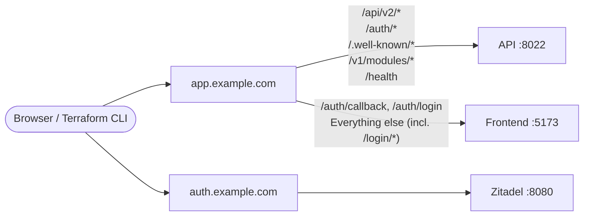

# Install with Docker Compose

Run Stackweaver and its database, Redis, object storage and identity provider on one host.
The downloadable bundle uses pre-built images; you do not need the application source.
Use [Helm](../kubernetes/README.md) when deploying into Kubernetes.

## Before you start

- A Linux host with Docker Engine 24 or later and Compose v2, or Podman with a Compose
  provider (see [Run on Podman](#run-on-podman)), plus a POSIX shell and OpenSSL for the
  commands below. The launchers place every job in a container through the engine's socket.
  Docker Engine 26 or later lets job containers mount the launchers' node-local cache; on
  older engines jobs fetch every cache entry through the API.
- At least 4 GB free RAM; allow 8 GB for an evaluation with workload execution. Size production
  capacity for the runs you expect, rather than treating these as a capacity guarantee.
- Ports 5173 (frontend), 8022 (API) and 8080 (Zitadel) available.
- Pull access to every required image. For private packages, obtain access and authenticate
  with `docker login ghcr.io`; see [GHCR access](../kubernetes/kubernetes-pull-secret-ghcr.md).

The supplied localhost passwords and storage keys are evaluation defaults. Before exposing a
new install, choose unique database/storage credentials and a Zitadel master key/password in
the bundle's bootstrap input files. Keep existing keys when moving a configured installation.

For a **new** installation, review these coupled inputs before copying `.env.example`:

| Setting | Locations that must agree |
|---|---|
| Database password | `POSTGRES_PASSWORD` in `.env.example` and `Database.Postgres.Admin.Password` / `Database.Postgres.User.Password` in `zitadel-defaults.yaml`. |
| Zitadel administrator password | `FirstInstance.Org.Human.Password` in `zitadel-init-steps.yaml` is the first-instance password. Keep the bundle's `ZITADEL_ADMIN_PASSWORD` input consistent; changing that env input alone does not change an existing account. |
| Zitadel master key | `ZITADEL_MASTERKEY` in `.env.example`: exactly 32 bytes. Keep it unchanged for existing identity data. |
| Object-storage credentials | `STORAGE_ACCESS_KEY` (`GK` plus 24 hex characters) and `STORAGE_SECRET_KEY` (64 hex characters) in `.env.example`; Garage initialization imports these values. |

Do not apply a first-instance password change to an existing database and expect account
rotation. Use the account's password-change flow instead.

## 1. Download the complete bundle

Use **Download** in this file browser and extract the archive into an empty directory. Keep
all files together, including the hidden `.env.example`, SQL, nginx and Zitadel YAML files.
Run the following commands in that directory, not in a source checkout's `deploy/` directory.

::: code-explorer ./example
:::

## 2. Generate keys and start

This is a first-install sequence. Do not copy over existing configuration or regenerate an
existing installation's encryption/signing keys.

```bash
cp .env.example .env

# The api, orchestrator and zitadel-init services read these three files directly,
# so they must exist before Compose starts even when you configure nothing in them.
# Leave sso.env and vcs.env as-is for a plain installation; fill them in when you
# add SSO, email (SMTP) or a VCS provider.
cp sso.env.example sso.env
cp vcs.env.example vcs.env
cp oidc.env.example oidc.env

# Generate the workload identity signing key. This is required: the API refuses
# to start without OIDC_SIGNING_KEY, even when you do not use workload identity.
sed -i.bak "s|^OIDC_SIGNING_KEY=.*|OIDC_SIGNING_KEY=$(openssl genrsa 2048 | openssl base64 -A)|" oidc.env

# Generate a unique 32-byte encryption key. This is required: the API refuses to
# start with a missing or all-zero key. The key encrypts stored credentials,
# state and plans at rest.
sed -i.bak "s/^ENCRYPTION_KEY=.*/ENCRYPTION_KEY=$(openssl rand -hex 32)/" .env
rm -f oidc.env.bak .env.bak

docker compose up -d
```

The three integration env files must exist even when you leave their optional settings empty.
The API requires the OIDC signing key and the encryption key.

The initializer writes generated identity credentials, and the launchers' registration
secret, into the bundle's `.env`. The API reads
that output at startup, and `frontend-config` writes the browser's `env.js`. Do not edit the
generated identity values or use that output for persistent SSO/VCS/OIDC configuration.

```bash
docker compose ps
docker compose logs -f zitadel-init
```

Wait for initialization to complete, then open `http://localhost:5173`. The example's initial
Zitadel administrator is `admin@ZITADEL.localhost` / `Password1!` unless you changed its bootstrap
password before the first start. Change that password before sharing the installation.

Without SMTP, public sign-up and email recovery are unavailable. Use SSO or an administrator-created
account with a verified address; see [Sign-in email and sign-up](../email.md).

## 3. Check the network path

Containers use Docker service names internally. PostgreSQL, Redis and Garage are not published
to the host; API, frontend and Zitadel are. The orchestrator and the two launchers,
`launcher` (OpenTofu) and `ansible-launcher` (Ansible jobs and syncs), publish no ports. The
launchers hold no database, Redis or storage credential: they reach the API at
`http://host.docker.internal:8022`, the API's published port, and every run, job and sync
they claim runs in a container of its own on a separate jobs network (see
[Launchers and job containers](#launchers-and-job-containers)).

| Address on the host | Purpose |
|---|---|
| `http://localhost:5173` | Browser application, login pages and same-origin API proxy. |
| `http://localhost:8022` | Direct API/CLI and webhook access. |
| `http://localhost:8080` | Zitadel identity service. |

For a reverse proxy, the simplest app route sends the entire app hostname to port 5173; the
bundle's `frontend-proxy.conf` handles API paths. You can also route API paths directly:



Match SPA `/auth/callback` and `/auth/login` before a broad `/auth/*` API rule. Other API paths
include `/api/v2/*`, the discovery documents, `/v1/modules/*` and `/health`. Serve `/login/*`
from the frontend. Keep browser API requests on the app origin.

For public domains, follow [Configure a Zitadel domain](../../../user-guides/authentication/zitadel-custom-domain.md)
and reconcile persistent identity settings and registered redirects. A reverse proxy or
[Cloudflare Tunnel](./cloud-flare-tunnel.md) does not change those registrations for you.

### Public pages and indexing

Public product pages and documentation share the app hostname. The frontend requests
exclusion from search by default. To publish those pages, use the bundle's optional
`docker-compose.public-site.yml` override and configure your own HTTPS address with
[Public pages and search indexing](../public-site.md#docker-compose).

### HTTPS and browser sessions


Browser sign-in needs HTTPS. After sign-in the browser's only credential is a session cookie, `__Host-sw_session`, which is `HttpOnly`, `Secure` and `SameSite=Strict`, and browsers drop a `Secure` cookie received over plain HTTP on any host other than `localhost`. The default `http://localhost:5173` works as it is; any other address needs TLS in front of Stackweaver. The API logs a warning at startup when `STACKWEAVER_APP_URL` is plain `http` on a host other than `localhost`.

A reverse proxy in front of the app domain must do the following:

- Pass the `Cookie` request header and the `Set-Cookie` response header through unmodified. Do not rewrite cookie domains or paths (for example with nginx `proxy_cookie_domain` or `proxy_cookie_path`): a `__Host-` cookie must have no `Domain` and `Path=/`, and the browser rejects it otherwise.
- Forward the `X-Stackweaver-CSRF` request header. The browser sends it on every request, and the API refuses a cookie-authenticated request without it with `403`.
- Set `X-Forwarded-Proto` when it terminates TLS, and list the proxy in `TRUSTED_PROXIES` so the client IP recorded for a session and used for rate limiting is the browser's.

The API trusts the origin of `STACKWEAVER_APP_URL` for browser requests. Set `CORS_EXTRA_ORIGINS` only when the SPA is served from another origin than that, because every state-changing browser request from an origin that is not trusted is refused.

How long a sign-in lasts is set in `.env` with `STACKWEAVER_SESSION_IDLE_TIMEOUT` (default `1h` without activity), `STACKWEAVER_SESSION_MAX_LIFETIME` (default `12h` after sign-in) and `STACKWEAVER_SESSION_LIVENESS_INTERVAL` (default `5m`). A sign-in survives a browser restart until one of these limits ends it. See [Browser Sessions](../../../user-guides/authentication/zitadel-setup.md#browser-sessions).


## Launchers and job containers

The `launcher` (OpenTofu) and `ansible-launcher` (Ansible jobs and syncs) services are the
installation's hosted launchers. They serve every organization's hosted capacity: runs and
jobs in remote execution mode, and every sync that captures a snapshot from a VCS provider.
They register with `STACKWEAVER_HOSTED_SECRET`, which `zitadel-init` generates into `.env`
once and keeps on later runs.

Both launchers use the container driver. They mount the host's Docker socket and start a
fresh container for every job from their own image. The socket is root-equivalent on the
host, so the launchers run as `root` only to reach it and never run user code themselves.

| Job container property | Behavior |
|---|---|
| User and filesystem | The image's non-root user, a read-only root filesystem and no capabilities. |
| Lifetime | Removed when the job ends. `RUNNER_KEEP_FAILED_FOR` keeps a failed one for inspection. |
| Network | The jobs network `stackweaver-jobs` (`RUNNER_NETWORK`), firewalled on a rootful engine: through the host's `DOCKER-USER` chain on Docker, through an nftables table of its own on Podman and on Docker's nftables backend. |
| Can reach | DNS, the internet and the API through `host.docker.internal:8022`. |
| Cannot reach | Cloud metadata endpoints, the Compose network with PostgreSQL, Redis and Garage, other jobs and any other port the host publishes. |
| Cache | A read-only mount of its organization's part of the launcher's node-local cache volume. |

| Launcher setting | Purpose | Example file value |
|---|---|---|
| `RUNNER_MAX_CONCURRENT_JOBS` | Jobs one launcher runs at once. | `4` |
| `RUNNER_IMAGE` | Image of the job containers. | The launcher's own image |
| `RUNNER_DENY_CIDRS` | Further ranges jobs must not reach. | (none) |
| `RUNNER_ALLOW_TCP` | Endpoints jobs must reach inside a denied range, such as an air-gapped installation's mirrors. | (none) |
| `RUNNER_CACHE_DIR`, `RUNNER_CACHE_VOLUME` | Location and volume of the node-local cache: `stackweaver-launcher-cache` and `stackweaver-ansible-launcher-cache`. | Set per launcher |
| `RUNNER_CACHE_LOCAL_SIZE_LIMIT` | Size bound of the node-local cache. | `20Gi` (default) |

The [environment reference](../environment-variables.md#launchers) lists every launcher
variable. Installation-wide settings for runs and jobs, such as the default run timeout, the
run image registry allowlist and the job mirrors, are read by the API. Set them in the `api`
service's `environment:` block; see
[Runs, jobs and launchers](../environment-variables.md#runs-jobs-and-launchers).

To run work inside your own network as well, add agent pools and start launchers in them;
see [Self-hosted runners](../../../user-guides/self-hosted-runners.md).

### Run on Podman

The launchers speak the Docker Engine API, which Podman also serves. To run the stack with
`podman compose` and a Compose provider (`docker-compose` or `podman-compose`):

1. Enable Podman's API socket: `systemctl enable --now podman.socket` for rootful Podman
   (`/run/podman/podman.sock`), or `systemctl --user enable --now podman.socket` for
   rootless Podman (`$XDG_RUNTIME_DIR/podman/podman.sock`).
2. Mount that socket into both launcher services at `/var/run/docker.sock` in place of the
   Docker socket. A rootful socket must be reachable by the user the launchers run as.

On rootful Podman the launcher creates the jobs network through Podman's own API, without
Podman's isolation between networks: the launcher's nftables table is that network's policy, and
it still refuses every other Podman network. If Docker also runs on the host, Docker's
`FORWARD` drop policy cuts rootful Podman containers off from the internet. Let the jobs
network's subnet (`podman network inspect stackweaver-jobs`) past it in Docker's `DOCKER-USER`
chain:

```bash
sudo iptables -I DOCKER-USER -s <jobs subnet> -j ACCEPT
sudo iptables -I DOCKER-USER -d <jobs subnet> -m conntrack --ctstate RELATED,ESTABLISHED -j ACCEPT
```

Rootless Podman cannot program the host firewall, so the jobs network has no firewall and
the launcher logs a warning. Every executor then checks whether a cloud metadata endpoint
answers from its network and refuses to run if one does, so such a host fails closed. A
pool's CPU and memory limits apply on cgroup v2 hosts with delegation; elsewhere jobs run
without them unless the pool requires them. On Podman, each job's part of the node-local
cache volume is mounted from the volume's directory on the host, so the volume must use the
`local` driver.

## Change settings in the right place

| File | Responsibility |
|---|---|
| `.env.example` and first-install bootstrap inputs | Operator-chosen initial values for this standalone bundle. Preserve your configured installation's files after bootstrap. |
| `.env` | Generated identity output and the hosted launchers' registration secret (`STACKWEAVER_HOSTED_SECRET`) alongside the bundle's operator values. Do not hand-edit generated entries. |
| `sso.env` | Persistent SSO and SMTP settings. |
| `vcs.env` | Persistent GitHub/Azure DevOps credentials. |
| `oidc.env` | Persistent workload-identity signing key and issuer. |
| `zitadel-defaults.yaml`, `zitadel-init.yaml`, `zitadel-init-steps.yaml` | Persistent identity setup; follow the domain guide for changes. |

After changing initializer inputs, run it again without restarting its dependencies, then
apply the generated consumer settings:

```bash
docker compose run --rm --no-deps zitadel-init
docker compose up -d
```

A plain container restart does not reload Compose's `env_file` values. The API also reads its
configured env output file with precedence over container environment; a one-command shell
override is not a reliable way to replace a generated value.

For GitHub, use the [complete GitHub App guide](../../../user-guides/vcs/github-app.md), including
the private-key mount for the API and orchestrator. See the
[environment reference](../environment-variables.md) for service settings.

### Give a variable to runs

A job container starts with the run's own variables, the mirror, proxy and CA settings the
API hands it, and a fixed allowlist of the launcher's environment (path, locale, proxy and CA
settings, cloud identity variables and a few OpenTofu and Ansible settings), listed in
[Runner variables that reach runs](../environment-variables.md#runner-variables-that-reach-runs).
The launcher's registration secret and runner token never reach it. Give runs further
settings through workspace and variable-set variables rather than the launcher's environment.

## Preserve data and upgrade

Use [Back up and restore](../backup-and-restore.md) for a complete recovery set and
restore rehearsal, and [Plan and verify an upgrade](../upgrading.md) to select component
versions and check the result. The commands below provide deployment-specific details.

| Volume | Data | Critical? |
|---|---|---|
| `postgres_data` | Database (all application state) | Yes; back up regularly |
| `garage_data` | Object storage (OpenTofu state, configs, registry) | Yes; back up regularly |
| `garage_meta` | Garage metadata (the index of the objects in `garage_data`) | Yes; back up together with `garage_data` |
| `stackweaver-launcher-cache` | The OpenTofu launcher's node-local copy of the organizations' cache entries | No; refilled from object storage |
| `stackweaver-ansible-launcher-cache` | The Ansible launcher's node-local copy of the organizations' cache entries | No; refilled from object storage |
| `zitadel-pat` | Zitadel admin PAT (shared with init job) | Preserve with the configured identity and generated `.env` |


Back up the database, object storage and the configuration/key files together. A database
backup without the encryption or Zitadel master key is insufficient to recover encrypted data.
The application and identity data are separate databases. Export both, using the configured
users/database names if you changed them:

```bash
docker compose exec -T postgres pg_dump -U iac iac_platform > application-backup.sql
docker compose exec -T postgres pg_dump -U iac zitadel > identity-backup.sql
```

Protect the backup as sensitive data. These dumps do not include object storage, volumes or key/configuration files.
The Garage data and metadata volumes must be backed up consistently together. The
organizations' caches live in the same bucket, so a restore of object storage brings them back too.

### Prepare the browser-session upgrade

For an installation using the bundled initializer, the next `docker compose up -d` after pulling switches it to server-side browser sessions with nothing else to run: `zitadel-init` creates the confidential browser sign-in app, writes `ZITADEL_BFF_CLIENT_ID` and `ZITADEL_BFF_CLIENT_SECRET` to `.env`, deactivates the public frontend app, and the API reads the new values when it starts.

Before you upgrade, check two settings in `.env` if you run Stackweaver on an address other than `http://localhost:5173`:

- Set `STACKWEAVER_APP_URL` to the app's public URL. The API builds the sign-in redirect from it, so it must match the `/auth/callback` URL registered in `zitadel-init.yaml`. If you had set `VITE_ZITADEL_REDIRECT_URI`, set `STACKWEAVER_APP_URL` to the same origin; `VITE_ZITADEL_REDIRECT_URI` is not read and can be removed.
- Serve the app over HTTPS, as described in [HTTPS and Browser Sessions](#https-and-browser-sessions).

After the upgrade, each browser signs in once and returns to the page it had open. API tokens, the Terraform CLI and runners keep working without any change. A script that called the API with a Zitadel access token must use an API token instead, created under **Settings > API Tokens**.

If you go back to a release from before server-side browser sessions by setting the StackWeaver image tags in `docker-compose.yml` to an older version, browsers cannot sign in until you reactivate the public frontend app, because the older `zitadel-init` signs browsers in with it and never reactivates it. Sign in to the Zitadel console as the administrator, open the `IAC Platform Project` project in the `IAC Platform` organization, select the `IAC Platform Frontend` application, and reactivate it. A later upgrade deactivates it again.

If you operate an external Zitadel without this initializer, create **Stackweaver BFF** and
provide its BFF credentials before upgrading. Follow [the confidential-client setup](../../../user-guides/authentication/zitadel-setup.md#using-an-external-zitadel).


### Upgrade to the release with launchers

> [!IMPORTANT]
> Back up PostgreSQL and the object storage (the `garage_data` and `garage_meta` volumes, or
> your external bucket) before you upgrade to the release that introduces the launchers. The
> upgrade is forward-only: the database cannot be downgraded in place afterwards, and rolling
> back is a restore of both backups together with the previous `docker-compose.yml`.

Start the new release within 30 minutes of stopping the old runners. The orchestrator marks a run
that stays pending for 30 minutes as failed, so queue any such run again after the upgrade.

Replace your `docker-compose.yml` with the one of the new release. It replaces the `runner`
and `ansible-runner` services with `launcher` and `ansible-launcher`, which mount the Docker
socket, and adds the two cache volumes. Then apply it and remove the containers of the
services that are gone:

```bash
docker compose pull
docker compose up -d --remove-orphans
```

`zitadel-init` adds `STACKWEAVER_HOSTED_SECRET` to `.env` on this run. The API and the two
launchers start after `zitadel-init` completes and read it from `.env` through
`STACKWEAVER_ENV_FILE`, so the same `up` starts working hosted launchers. The launchers read that
one value, which is why the upgraded Compose file mounts `.env`, and only that file, read-only
into both of them. Take the `launcher` and `ansible-launcher` services from the
example Compose file as they are, including that mount.

The `runner-workspaces` and `ansible-workspaces` volumes are not used by this release, and
each organization's verified cache in object storage takes the place of the per-project
Galaxy cache they held; it fills again as jobs run. Once the upgrade works, find their
prefixed names with `docker volume ls` and delete them with
`docker volume rm <project>_runner-workspaces <project>_ansible-workspaces`. If you ran
self-hosted runners with `RUNNER_MODE=agent`, drop that variable: every runner image starts
as a launcher.

### Apply the selected images

Before upgrading, read the relevant release notes and save a recovery copy. Pull the images
selected in your Compose file, then recreate changed services:

```bash
docker compose pull
docker compose up -d
docker compose ps
```

The API migrates the schema at startup. Image rollback alone may not reverse a schema change.
Mutable `latest` tags select whatever is published at pull time; pin the versions or digests
you have reviewed for repeatable production deployments.

Use `docker compose down` to stop the stack while retaining named volumes.

> [!WARNING]
> `docker compose down -v` deletes the named volumes and their data. It is not an upgrade or
> troubleshooting step. Keep configuration, keys and persistent data together during recovery.

## Diagnose startup problems

| Symptom | Read/check |
|---|---|
| Image pull denied | Package access, GHCR login and the exact image/tag. |
| A published port is unavailable | `docker compose ps` and the host's listening ports. |
| Identity initialization failed | `docker compose logs zitadel-init` and `docker compose logs zitadel`; reconcile after correcting inputs. |
| API cannot reach PostgreSQL | Database health and matching credentials; `docker compose ps postgres` should report healthy. |
| Blank page or wrong API address | Browser console, frontend logs and same-origin `VITE_API_URL`; reapply configuration and reload. |
| A run or job stays pending | `docker compose logs launcher` and `docker compose logs ansible-launcher`. A launcher that says a hosted launcher needs `STACKWEAVER_HOSTED_SECRET` cannot read `.env`: check that its service sets `STACKWEAVER_ENV_FILE` and mounts `.env` as in the example Compose file, and that `zitadel-init` completed. A launcher that cannot reach the API retries, and `docker compose ps` shows it unhealthy until it is registered. |
| The orchestrator logs `Waiting for the API to migrate the database` | The API migrates the schema when it starts, and the orchestrator waits for it after an upgrade. Read `docker compose logs api` for the reason the API has not finished starting. |
| A job fails because a cloud metadata endpoint is reachable | The jobs network is not firewalled on this host, which happens on rootless engines, and the executor refuses to run a job that could reach the node's identity. Run the launchers against a rootful engine, or block the metadata ranges in the host's own firewall. |

Use `docker compose logs api`, `docker compose logs orchestrator`, `docker compose logs launcher`
or `docker compose logs ansible-launcher` to narrow the failing service. Do not share initializer
logs without checking them for credentials. To inspect PostgreSQL interactively:

```bash
docker compose exec postgres psql -U iac -d iac_platform
```

For source access or contribution enquiries, contact `contact@vhco.pro`.
