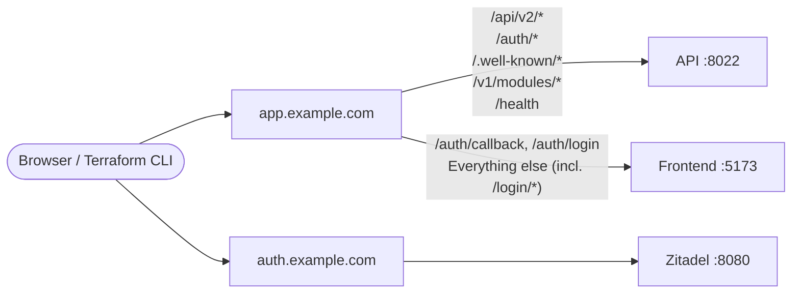

# Install with Docker Compose

Run Stackweaver and its database, queue, object storage and identity provider on one host.
The downloadable bundle uses pre-built images; you do not need the application source.
Use [Helm](../kubernetes/README.md) when deploying into Kubernetes.

## Before you start

- Docker Engine and Compose v2, plus a POSIX shell and OpenSSL for the commands below.
- At least 4 GB free RAM; allow 8 GB for an evaluation with workload execution. Size production
  capacity for the runs you expect, rather than treating these as a capacity guarantee.
- Ports 5173 (frontend), 8022 (API) and 8080 (Zitadel) available.
- Pull access to every required image. For private packages, obtain access and authenticate
  with `docker login ghcr.io`; see [GHCR access](../kubernetes/kubernetes-pull-secret-ghcr.md).

The supplied localhost passwords and storage keys are evaluation defaults. Before exposing a
new install, choose unique database/storage credentials and a Zitadel master key/password in
the bundle's bootstrap input files. Keep existing keys when moving a configured installation.

For a **new** installation, review these coupled inputs before copying `.env.example`:

| Setting | Locations that must agree |
|---|---|
| Database password | `POSTGRES_PASSWORD` in `.env.example` and `Database.Postgres.Admin.Password` / `Database.Postgres.User.Password` in `zitadel-defaults.yaml`. |
| Zitadel administrator password | `FirstInstance.Org.Human.Password` in `zitadel-init-steps.yaml` is the first-instance password. Keep the bundle's `ZITADEL_ADMIN_PASSWORD` input consistent; changing that env input alone does not change an existing account. |
| Zitadel master key | `ZITADEL_MASTERKEY` in `.env.example`: exactly 32 bytes. Keep it unchanged for existing identity data. |
| Object-storage credentials | `STORAGE_ACCESS_KEY` (`GK` plus 24 hex characters) and `STORAGE_SECRET_KEY` (64 hex characters) in `.env.example`; Garage initialization imports these values. |

Do not apply a first-instance password change to an existing database and expect account
rotation. Use the account's password-change flow instead.

## 1. Download the complete bundle

Use **Download** in this file browser and extract the archive into an empty directory. Keep
all files together, including the hidden `.env.example`, SQL, nginx and Zitadel YAML files.
Run the following commands in that directory, not in a source checkout's `deploy/` directory.

::: code-explorer ./example
:::

## 2. Generate keys and start

This is a first-install sequence. Do not copy over existing configuration or regenerate an
existing installation's encryption/signing keys.

```bash
cp .env.example .env

# The api, zitadel-init and runner services read these three files directly, so
# they must exist before Compose starts even when you configure nothing in them.
# Leave sso.env and vcs.env as-is for a plain installation; fill them in when you
# add SSO, email (SMTP) or a VCS provider.
cp sso.env.example sso.env
cp vcs.env.example vcs.env
cp oidc.env.example oidc.env

# Generate the workload identity signing key. This is required: the API refuses
# to start without OIDC_SIGNING_KEY, even when you do not use workload identity.
sed -i.bak "s|^OIDC_SIGNING_KEY=.*|OIDC_SIGNING_KEY=$(openssl genrsa 2048 | openssl base64 -A)|" oidc.env

# Generate a unique 32-byte encryption key. This is required: the Ansible runner
# refuses to start with a missing or all-zero key, and Compose will not bring the
# stack up until it is set. The key encrypts stored credentials at rest.
sed -i.bak "s/^ENCRYPTION_KEY=.*/ENCRYPTION_KEY=$(openssl rand -hex 32)/" .env
rm -f oidc.env.bak .env.bak

docker compose up -d
```

The three integration env files must exist even when you leave their optional settings empty.
The API requires the OIDC signing key; the platform services require the encryption key.

The initializer writes generated identity credentials into the bundle's `.env`. The API reads
that output at startup, and `frontend-config` writes the browser's `env.js`. Do not edit the
generated identity values or use that output for persistent SSO/VCS/OIDC configuration.

```bash
docker compose ps
docker compose logs -f zitadel-init
```

Wait for initialization to complete, then open `http://localhost:5173`. The example's initial
Zitadel administrator is `admin@ZITADEL.localhost` / `Password1!` unless you changed its bootstrap
password before the first start. Change that password before sharing the installation.

Without SMTP, public sign-up and email recovery are unavailable. Use SSO or an administrator-created
account with a verified address; see [Sign-in email and sign-up](../email.md).

## 3. Check the network path

Containers use Docker service names internally. PostgreSQL, Redis and Garage are not published
to the host; API, frontend and Zitadel are. Runners and orchestrator publish no ports.

| Address on the host | Purpose |
|---|---|
| `http://localhost:5173` | Browser application, login pages and same-origin API proxy. |
| `http://localhost:8022` | Direct API/CLI and webhook access. |
| `http://localhost:8080` | Zitadel identity service. |

For a reverse proxy, the simplest app route sends the entire app hostname to port 5173; the
bundle's `frontend-proxy.conf` handles API paths. You can also route API paths directly:



Match SPA `/auth/callback` and `/auth/login` before a broad `/auth/*` API rule. Other API paths
include `/api/v2/*`, the discovery documents, `/v1/modules/*` and `/health`. Serve `/login/*`
from the frontend. Keep browser API requests on the app origin.

For public domains, follow [Configure a Zitadel domain](../../../user-guides/authentication/zitadel-custom-domain.md)
and reconcile persistent identity settings and registered redirects. A reverse proxy or
[Cloudflare Tunnel](./cloud-flare-tunnel.md) does not change those registrations for you.

### Public pages and indexing

Public product pages and documentation share the app hostname. The frontend requests
exclusion from search by default. To publish those pages, use the bundle's optional
`docker-compose.public-site.yml` override and configure your own HTTPS address with
[Public pages and search indexing](../public-site.md#docker-compose).

### HTTPS and browser sessions


Browser sign-in needs HTTPS. After sign-in the browser's only credential is a session cookie, `__Host-sw_session`, which is `HttpOnly`, `Secure` and `SameSite=Strict`, and browsers drop a `Secure` cookie received over plain HTTP on any host other than `localhost`. The default `http://localhost:5173` works as it is; any other address needs TLS in front of Stackweaver. The API logs a warning at startup when `STACKWEAVER_APP_URL` is plain `http` on a host other than `localhost`.

A reverse proxy in front of the app domain must do the following:

- Pass the `Cookie` request header and the `Set-Cookie` response header through unmodified. Do not rewrite cookie domains or paths (for example with nginx `proxy_cookie_domain` or `proxy_cookie_path`): a `__Host-` cookie must have no `Domain` and `Path=/`, and the browser rejects it otherwise.
- Forward the `X-Stackweaver-CSRF` request header. The browser sends it on every request, and the API refuses a cookie-authenticated request without it with `403`.
- Set `X-Forwarded-Proto` when it terminates TLS, and list the proxy in `TRUSTED_PROXIES` so the client IP recorded for a session and used for rate limiting is the browser's.

The API trusts the origin of `STACKWEAVER_APP_URL` for browser requests. Set `CORS_EXTRA_ORIGINS` only when the SPA is served from another origin than that, because every state-changing browser request from an origin that is not trusted is refused.

How long a sign-in lasts is set in `.env` with `STACKWEAVER_SESSION_IDLE_TIMEOUT` (default `1h` without activity), `STACKWEAVER_SESSION_MAX_LIFETIME` (default `12h` after sign-in) and `STACKWEAVER_SESSION_LIVENESS_INTERVAL` (default `5m`). A sign-in survives a browser restart until one of these limits ends it. See [Browser Sessions](../../../user-guides/authentication/zitadel-setup.md#browser-sessions).


## Change settings in the right place

| File | Responsibility |
|---|---|
| `.env.example` and first-install bootstrap inputs | Operator-chosen initial values for this standalone bundle. Preserve your configured installation's files after bootstrap. |
| `.env` | Generated identity output alongside the bundle's operator values. Do not hand-edit generated identity entries. |
| `sso.env` | Persistent SSO and SMTP settings. |
| `vcs.env` | Persistent GitHub/Azure DevOps credentials. |
| `oidc.env` | Persistent workload-identity signing key and issuer. |
| `zitadel-defaults.yaml`, `zitadel-init.yaml`, `zitadel-init-steps.yaml` | Persistent identity setup; follow the domain guide for changes. |

After changing initializer inputs, run it again without restarting its dependencies, then
apply the generated consumer settings:

```bash
docker compose run --rm --no-deps zitadel-init
docker compose up -d
```

A plain container restart does not reload Compose's `env_file` values. The API also reads its
configured env output file with precedence over container environment; a one-command shell
override is not a reliable way to replace a generated value.

For GitHub, use the [complete GitHub App guide](../../../user-guides/vcs/github-app.md), including
the private-key mount for API, orchestrator and Ansible runner. See the
[environment reference](../environment-variables.md) for service settings.

### Give a variable to runs

Runners do not forward their whole environment to user code. Configure a variable on the
runner service and name it in `STACKWEAVER_RUN_ENV_PASSTHROUGH` when it is outside the built-in
allowlist. Never pass platform secrets this way. See
[Runner variables that reach runs](../environment-variables.md#runner-variables-that-reach-runs).

```dotenv
STACKWEAVER_RUN_ENV_PASSTHROUGH=PROXY_USER,PROXY_PASSWORD
```

## Preserve data and upgrade

Use [Back up and restore](../backup-and-restore.md) for a complete recovery set and
restore rehearsal, and [Plan and verify an upgrade](../upgrading.md) to select component
versions and check the result. The commands below provide deployment-specific details.

| Volume | Data | Critical? |
|---|---|---|
| `postgres_data` | Database (all application state) | Yes; back up regularly |
| `garage_data` | Object storage (OpenTofu state, configs, registry) | Yes; back up regularly |
| `garage_meta` | Garage metadata (the index of the objects in `garage_data`) | Yes; back up together with `garage_data` |
| `runner-workspaces` | Temporary workspace files of the OpenTofu runner | No; recreated on runs |
| `ansible-workspaces` | Temporary per-job files and the Galaxy cache of the Ansible runner | No; recreated on jobs |
| `zitadel-pat` | Zitadel admin PAT (shared with init job) | Preserve with the configured identity and generated `.env` |


Back up the database, object storage and the configuration/key files together. A database
backup without the encryption or Zitadel master key is insufficient to recover encrypted data.
The application and identity data are separate databases. Export both, using the configured
users/database names if you changed them:

```bash
docker compose exec -T postgres pg_dump -U iac iac_platform > application-backup.sql
docker compose exec -T postgres pg_dump -U iac zitadel > identity-backup.sql
```

Protect the backup as sensitive data. These dumps do not include object storage, volumes or key/configuration files.
The Garage data and metadata volumes must be backed up consistently together.

### Prepare the browser-session upgrade

For an installation using the bundled initializer, the next `docker compose up -d` after pulling switches it to server-side browser sessions with nothing else to run: `zitadel-init` creates the confidential browser sign-in app, writes `ZITADEL_BFF_CLIENT_ID` and `ZITADEL_BFF_CLIENT_SECRET` to `.env`, deactivates the public frontend app, and the API reads the new values when it starts.

Before you upgrade, check two settings in `.env` if you run Stackweaver on an address other than `http://localhost:5173`:

- Set `STACKWEAVER_APP_URL` to the app's public URL. The API builds the sign-in redirect from it, so it must match the `/auth/callback` URL registered in `zitadel-init.yaml`. If you had set `VITE_ZITADEL_REDIRECT_URI`, set `STACKWEAVER_APP_URL` to the same origin; `VITE_ZITADEL_REDIRECT_URI` is not read and can be removed.
- Serve the app over HTTPS, as described in [HTTPS and Browser Sessions](#https-and-browser-sessions).

After the upgrade, each browser signs in once and returns to the page it had open. API tokens, the Terraform CLI and runners keep working without any change. A script that called the API with a Zitadel access token must use an API token instead, created under **Settings > API Tokens**.

If you go back to a release from before server-side browser sessions by setting the StackWeaver image tags in `docker-compose.yml` to an older version, browsers cannot sign in until you reactivate the public frontend app, because the older `zitadel-init` signs browsers in with it and never reactivates it. Sign in to the Zitadel console as the administrator, open the `IAC Platform Project` project in the `IAC Platform` organization, select the `IAC Platform Frontend` application, and reactivate it. A later upgrade deactivates it again.

If you operate an external Zitadel without this initializer, create **Stackweaver BFF** and
provide its BFF credentials before upgrading. Follow [the confidential-client setup](../../../user-guides/authentication/zitadel-setup.md#using-an-external-zitadel).


### Apply the selected images

Before upgrading, read the relevant release notes and save a recovery copy. Pull the images
selected in your Compose file, then recreate changed services:

```bash
docker compose pull
docker compose up -d
docker compose ps
```

The API migrates the schema at startup. Image rollback alone may not reverse a schema change.
Mutable `latest` tags select whatever is published at pull time; pin the versions or digests
you have reviewed for repeatable production deployments.

Use `docker compose down` to stop the stack while retaining named volumes.

> [!WARNING]
> `docker compose down -v` deletes the named volumes and their data. It is not an upgrade or
> troubleshooting step. Keep configuration, keys and persistent data together during recovery.

## Diagnose startup problems

| Symptom | Read/check |
|---|---|
| Image pull denied | Package access, GHCR login and the exact image/tag. |
| A published port is unavailable | `docker compose ps` and the host's listening ports. |
| Identity initialization failed | `docker compose logs zitadel-init` and `docker compose logs zitadel`; reconcile after correcting inputs. |
| API cannot reach PostgreSQL | Database health and matching credentials; `docker compose ps postgres` should report healthy. |
| Blank page or wrong API address | Browser console, frontend logs and same-origin `VITE_API_URL`; reapply configuration and reload. |
| A run stays queued | Runner/orchestrator logs and matching database/Redis settings. |

Use `docker compose logs api`, `docker compose logs orchestrator`, `docker compose logs runner`
or `docker compose logs ansible-runner` to narrow the failing service. Do not share initializer
logs without checking them for credentials. To inspect PostgreSQL interactively:

```bash
docker compose exec postgres psql -U iac -d iac_platform
```

For source access or contribution enquiries, contact `contact@vhco.pro`.
