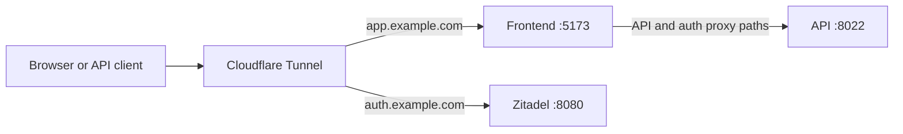

# Expose a Compose install with Cloudflare Tunnel

Route a stable hostname to your local Stackweaver installation without opening inbound
ports. This guide uses a locally managed tunnel so its ingress rules live in YAML. Cloudflare
also offers remotely managed tunnels, including API and Terraform management; see its
[tunnel management options](https://developers.cloudflare.com/tunnel/features/locally-managed-tunnels/).

## Before you start

- A working [Compose installation](./README.md), with frontend on port 5173, API on 8022
  and Zitadel on 8080.
- A domain managed in your Cloudflare account and permission to create DNS records.
- `cloudflared` installed using [Cloudflare's installation instructions](https://developers.cloudflare.com/cloudflare-one/networks/connectors/cloudflare-tunnel/downloads/).
- Public application and identity URLs configured using [Configure a Zitadel domain](../../../user-guides/authentication/zitadel-custom-domain.md).

A named tunnel's `<UUID>.cfargotunnel.com` address is its DNS target, not a free public
application hostname. Use your own domain. A quick tunnel gives a temporary `trycloudflare.com`
address and is unsuitable as a stable OAuth callback or webhook URL.

## 1. Create the tunnel

Run these commands as the account that will own the tunnel files:

```bash
cloudflared tunnel login
cloudflared tunnel create stackweaver
cloudflared tunnel list
```

Record the tunnel UUID. The creation command writes its credentials JSON in your
`.cloudflared` directory; keep that file private.

## 2. Route the application and identity hostnames

Create `~/.cloudflared/config.yml`. Replace the UUID, username and domains:

```yaml
tunnel: "<tunnel-uuid>"
credentials-file: /home/your-user/.cloudflared/<tunnel-uuid>.json

ingress:
  - hostname: app.example.com
    service: http://localhost:5173
  - hostname: auth.example.com
    service: http://localhost:8080
  - service: http_status:404
```

The frontend's supplied nginx configuration forwards API, discovery and login-proxy paths
to the API while serving public pages and application routes itself. Routing the entire app hostname to port 5173
therefore preserves the same-origin browser setup. The identity hostname goes to Zitadel.
The final catch-all rule must stay last.



If `cloudflared` runs in a container, `localhost` is that container. Use reachable service
names or host addresses instead of copying these host-run origins unchanged.

Register both DNS records, validate the file and run in the foreground:

```bash
cloudflared tunnel route dns stackweaver app.example.com
cloudflared tunnel route dns stackweaver auth.example.com
cloudflared tunnel ingress validate
cloudflared tunnel ingress rule https://app.example.com/
cloudflared tunnel run stackweaver
```

Open the app hostname, sign in and return to the app. Check the
[discovery document](https://app.example.com/.well-known/terraform.json) and send a test delivery from your
[VCS provider](../../../user-guides/vcs/README.md) if webhooks are enabled. A tunnel exposes
traffic; it does not update Stackweaver's issuer, redirect registrations or public URLs.
Configure your own canonical address and indexing policy with
[Public pages and search indexing](../public-site.md).

## 3. Persist the tunnel on Linux

Copy the files into a root-owned directory. Replace `TUNNEL_UUID` before running:

```bash
sudo install -d -m 700 /etc/cloudflared
sudo install -m 600 ~/.cloudflared/config.yml /etc/cloudflared/config.yml
sudo install -m 600 ~/.cloudflared/TUNNEL_UUID.json /etc/cloudflared/TUNNEL_UUID.json
```

In `/etc/cloudflared/config.yml`, change only the credential path to
`/etc/cloudflared/TUNNEL_UUID.json`, using the actual UUID in both places. Then install
with an explicit config path so `sudo` does not look in `/root/.cloudflared`:

```bash
sudo cloudflared --config /etc/cloudflared/config.yml tunnel ingress validate
sudo cloudflared --config /etc/cloudflared/config.yml service install
sudo systemctl enable --now cloudflared
sudo systemctl status cloudflared
sudo journalctl -u cloudflared -f
```

## Add a hostname or diagnose a failure

Add new hostname rules before the catch-all, create the matching DNS record with
`cloudflared tunnel route dns`, validate, then run `sudo systemctl restart cloudflared`.
Use `sudo systemctl stop cloudflared` to stop the service without deleting its tunnel.

| Symptom | Check |
|---|---|
| Cloudflare reports an unreachable origin | The local service is running and reachable from the `cloudflared` process. |
| A hostname returns the catch-all 404 | The hostname, DNS route and first matching ingress rule agree. |
| Sign-in redirects to localhost or the wrong domain | Reconcile the persistent identity and application URL settings, not just tunnel DNS. |
| Webhook deliveries are blocked | The webhook URL reaches the API and any Cloudflare access policy permits the provider's requests. |

For temporary origin testing, create a quick tunnel:

```bash
cloudflared tunnel --url http://localhost:5173
```

Keep registered callbacks and production webhooks on the named hostnames.
