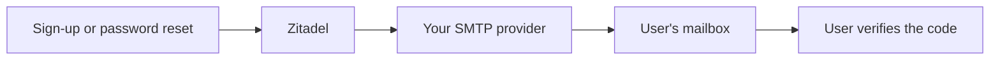

# Configure sign-in email and sign-up

Configure SMTP so Zitadel can deliver verification codes, password-reset links and email
login codes. Public sign-up is off by default. Without SMTP, use SSO or accounts created by
an administrator; password recovery then needs an administrator too.

## Before you configure email

Use an SMTP submission service and a sending domain you control. Add the provider's SPF,
DKIM and DMARC records and verify that the chosen sender address is permitted. Confirm the
provider's TLS and port requirements. Keep sign-in mail separate from marketing mail so
newsletter reputation does not affect password-reset delivery.



The browser does not receive a verification/reset code from the production API. It must be
delivered to the address being verified.

## Docker Compose

Save persistent values in `sso.env` beside your Compose file. Substitute your provider's
settings; keep the password outside version control:

```dotenv
SMTP_HOST=smtp.example.com:587
SMTP_USER=example-user
SMTP_PASSWORD=replace-with-provider-password
SMTP_SENDER_ADDRESS=noreply@mail.example.com
SMTP_SENDER_NAME=Stackweaver
SMTP_TLS=true
STACKWEAVER_SELF_REGISTRATION=false
```

| Variable | Meaning |
|---|---|
| `SMTP_HOST` | The SMTP submission server as `host:port`, for example `smtp.example.com:587`. Leave it empty to run without SMTP. |
| `SMTP_USER` | The SMTP username. Leave it empty for a server that needs no authentication. |
| `SMTP_PASSWORD` | The SMTP password or API key. |
| `SMTP_SENDER_ADDRESS` | The From address, for example `noreply@mail.example.com`. Required when `SMTP_HOST` is set. |
| `SMTP_SENDER_NAME` | The From display name. Defaults to `Stackweaver`. |
| `SMTP_TLS` | Whether to use TLS. Defaults to `true`. |
| `STACKWEAVER_SELF_REGISTRATION` | Whether anyone may create an account (see [Who can sign up](#decide-who-can-create-an-account)). Defaults to `false`. |

Protect the file. For literal dollar signs, follow the
[Compose secret quoting guidance](./environment-variables.md#github-integration).
Apply the new provider and login policy without stopping Zitadel:

```bash
docker compose run --rm --no-deps zitadel-init
docker compose up -d
```

The one-off initializer reads `sso.env` afresh. A missing sender address with a configured
host, or an invalid setting, fails visibly rather than silently enabling unusable email.

## Kubernetes (Helm)

This path requires the chart's **bundled Zitadel**. With `zitadel.bundled: false`, configure
the SMTP provider and login policy in that external instance yourself.

Create the namespace if needed, then a password Secret in the release namespace:

```bash
kubectl create secret generic stackweaver-smtp --namespace stackweaver \
  --from-literal=smtp-password='replace-with-provider-password'
```

The placeholder becomes a real secret; avoid exposing the real value in shared terminals
or shell history. A secrets operator can manage the same key instead.

Save the non-secret settings as `email-values.yaml`:

```yaml
smtp:
  host: smtp.example.com:587
  user: example-user
  senderAddress: noreply@mail.example.com
  senderName: Stackweaver
  tls: true
  secretName: stackweaver-smtp
  keys:
    password: smtp-password
signup:
  selfRegistration: false
```

| Value | Meaning |
|---|---|
| `smtp.host` | The SMTP submission server as `host:port`. Leave it empty to run without SMTP. |
| `smtp.user` | The SMTP username. Leave it empty for a server that needs no authentication. |
| `smtp.senderAddress` | The From address. Required when `smtp.host` is set. |
| `smtp.senderName` | The From display name. Defaults to `Stackweaver`. |
| `smtp.tls` | Whether to use TLS. Defaults to `true`. |
| `smtp.secretName` | An existing Secret that holds the SMTP password. |
| `smtp.keys.password` | The key of the password inside that Secret. Defaults to `smtp-password`. |
| `signup.selfRegistration` | Whether anyone may create an account. Defaults to `false`. |

For an existing release, set `CHART_VERSION` to its installed chart version and retain its
release values. This changes email settings without selecting a different chart version:

```bash
helm upgrade stackweaver oci://ghcr.io/vhco-pro/charts/stackweaver \
  --namespace stackweaver --version "$CHART_VERSION" \
  --reuse-values --values email-values.yaml
```

For a new release, merge these settings into the [installation values](./kubernetes/README.md).
A post-install/post-upgrade Job applies SMTP and login policy. An invalid configuration fails
the Job and Helm operation; inspect the Job logs before retrying. Zitadel can continue serving
its existing configuration, so a successful sign-in alone does not verify this change.

Argo CD runs the reconcile Job as a PostSync hook. Flux runs it on Helm install/upgrade.
Rotating only the SMTP Secret does not itself run that Job: trigger the relevant sync or
HelmRelease upgrade after rotation.

## Decide who can create an account

| Choice | Result |
|---|---|
| Self-registration off, the default | People need a configured SSO path or an administrator-created account. |
| Self-registration on with SMTP | New users verify their email before using Stackweaver. |
| Self-registration on without SMTP | Sign-up stays off; the initializer warns because verification cannot be delivered. |

Enable with `STACKWEAVER_SELF_REGISTRATION=true` in Compose or `signup.selfRegistration: true`
in Helm. A configured SSO provider can create users on first sign-in independently of this
switch. Restrict access at that provider: for Entra, use a tenant ID unless you intentionally
allow multiple tenants (`AZURE_AD_ALLOW_MULTI_TENANT=true` or Helm's
`sso.azureAd.allowMultiTenant: true`). Public identity providers can admit a wider population.
Follow the [SSO setup guides](../../user-guides/sso/README.md) for the upstream restrictions.

For an administrator-created account without SMTP, mark its address verified in the Zitadel
console and provide its initial password securely. The user must change that password at
first sign-in. An unverified account cannot use Stackweaver or accept an invitation for that
address. Existing password users linking SSO with the same address must first prove ownership
by signing in with their password.

## Verify delivery and diagnose failures

1. Check the initializer or Helm reconcile Job completed successfully.
2. Use an account you control to request a password reset or verification message.
3. Confirm delivery, sender identity and that the code/link completes the intended flow.
4. If no message arrives, inspect provider delivery events and spam folders; check sender
   verification, credentials and TLS/port settings. Do not paste codes or passwords into logs.

Without SMTP, expect no **Create account**, **Forgot password?** or email-code second factor.
Authenticator apps, security keys and passkeys remain available. An administrator resets
forgotten passwords in the Zitadel console.

## Which login settings the initializer owns

The initializer reconciles registration, password-recovery visibility and email/SMS second
factors on the instance and organizations with their own policy. It permits registration
only with enabled self-registration and deliverable email; it removes email factors without
SMTP and SMS factors without an active SMS provider. It restores email as an allowed second
factor when configured and another second factor is already allowed.

Change these managed choices through deployment settings. Direct console edits to them can
be overwritten on reconciliation. Other login-policy choices remain operator-managed.

Keep `STACKWEAVER_NOTIFICATION_MODE=email` in deployments. The development `return_code` mode
is refused in release mode and is not a substitute for SMTP. Check `notification_mode` at
`GET /auth/health/auth-proxy` when diagnosing a configuration mismatch. See the
[environment reference](./environment-variables.md#login-custom-stackweaver-spa) for the guard settings.
