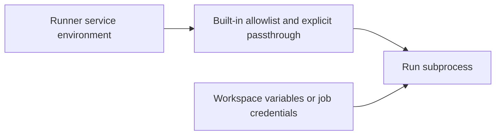

# Environment Variables Reference

Use this reference to place deployment settings and check which service reads them. It covers
the main service settings; workspace variables and job credentials belong in their resource
guides. Defaults can come from application configuration, Compose or Helm, so read the scope
beside each value rather than assuming one default applies to every deployment.

## Choose where to configure it

| Task | Configuration source |
|---|---|
| SSO or sign-in email in Compose | Persistent `sso.env`. |
| GitHub or Azure DevOps credentials in Compose | Persistent `vcs.env`. |
| Workload identity signing in Compose | Persistent `oidc.env`. |
| Database, public URLs and initial bootstrap inputs in the standalone Compose example | Follow the [Compose guide](./docker-compose/README.md); distinguish operator inputs from generated identity values. |
| Kubernetes deployment | Chart values and referenced Secrets in the [Helm guide](./kubernetes/README.md). |
| Variables a run should receive | Workspace variables, Ansible credentials or the explicit [runner passthrough](#runner-variables-that-reach-runs). |

Do not put persistent integration settings into generated identity output. After changing a
value, update the service that consumes it and verify the effective behavior. Merely editing
an env file does not change a process that is already running.

## API

The API is the primary Go backend serving the REST API, managing authentication, and running background schedulers.

### Server

| Variable | Description | Default |
|---|---|---|
| `CONFIG_PATH` | Path to `config.yaml`. When unset the API tries `config/config.yaml` and falls back to environment variables only if it is missing; when set, a missing file is fatal. The dev Compose stack sets `/etc/stackweaver/config/config.yaml` | (unset) |
| `LOG_LEVEL` | Log verbosity (`debug`, `info`, `warn`, `error`) | `info` |
| `SERVER_HOST` | Listen address | `0.0.0.0` (from config.yaml) |
| `SERVER_PORT` | Listen port | `8022` (from config.yaml) |
| `TRUSTED_PROXIES` | Comma-separated CIDRs of proxies trusted for `X-Forwarded-For` client-IP attribution. Required behind an ingress or reverse proxy - without it every request is attributed to the proxy's IP, so all users share one per-IP rate-limit bucket. When unset the API trusts no proxies. The Helm chart sets the RFC1918 ranges by default (`api.trustedProxies`) | (unset - trust no proxies) |
| `RATE_LIMIT_RPS` / `RATE_LIMIT_BURST` | Global per-IP rate limit (requests/second and burst) | `100` / `200` |
| `AUTH_RATE_LIMIT_RPS` / `AUTH_RATE_LIMIT_BURST` | Stricter per-IP rate limit on `/auth/*`, which covers the login endpoints and the browser session endpoints (the SPA reads `GET /auth/session` on each page load and every five minutes). Raise when many users share one attributed IP (e.g. an office NATing through a single egress) | `10` / `20` |

### Database

| Variable | Description | Default |
|---|---|---|
| `DATABASE_HOST` | PostgreSQL hostname | `localhost` (from config.yaml) |
| `DATABASE_PORT` | PostgreSQL port | `5432` (from config.yaml) |
| `DATABASE_USER` | PostgreSQL username | `iac` (from config.yaml) |
| `DATABASE_PASSWORD` | PostgreSQL password | `iac_password` (from config.yaml) |
| `DATABASE_NAME` | Database name | `iac_platform` (from config.yaml) |
| `DATABASE_SSLMODE` | SSL mode (`disable`, `require`, `verify-full`) | `disable` (from config.yaml) |

### Authentication (Zitadel)

| Variable | Description | Default |
|---|---|---|
| `ZITADEL_ISSUER` | Zitadel OIDC issuer URL | `http://localhost:8080` |
| `ZITADEL_INTERNAL_ADDR` | Internal Zitadel address for gRPC calls | `internal-zitadel:8080` |
| `ZITADEL_API_CLIENT_ID` | OIDC client ID for the API | Auto-generated by `zitadel-init` |
| `ZITADEL_API_CLIENT_SECRET` | OIDC client secret for the API | Auto-generated by `zitadel-init` |
| `ZITADEL_BFF_CLIENT_ID` | Client ID of the confidential app the API signs browsers in with (see [The Browser Sign-in Client](../../user-guides/authentication/zitadel-setup.md#the-browser-sign-in-client)). **Required** with `GIN_MODE=release`: the API refuses to start without it | Auto-generated by `zitadel-init` |
| `ZITADEL_BFF_CLIENT_SECRET` | Client secret of that app, sent to Zitadel's token endpoint as HTTP Basic. **Required** with `GIN_MODE=release`: the API refuses to start without it | Auto-generated by `zitadel-init` |
| `ZITADEL_LOGIN_SERVICE_USER_TOKEN` | Service user PAT for the login UI, user management and the browser session checks. **Required** with `GIN_MODE=release`: the API refuses to start without it | Auto-generated by `zitadel-init` |
| `ZITADEL_WEBHOOK_IDP_SYNC_KEY` | Signing key for IdP sync webhook | Auto-generated by `zitadel-init` |
| `ZITADEL_WEBHOOK_COMPLEMENT_TOKEN_KEY` | Signing key for token complement webhook | Auto-generated by `zitadel-init` |

### Browser Sessions

A signed-in browser holds an `HttpOnly` session cookie; the session itself is stored in PostgreSQL. These settings bound how long it lasts. Each is a Go duration such as `30m` or `8h`; the API refuses to start with a value that is not a positive duration. See [Browser Sessions](../../user-guides/authentication/zitadel-setup.md#browser-sessions).

| Variable | Description | Default |
|---|---|---|
| `STACKWEAVER_SESSION_IDLE_TIMEOUT` | Sign a browser out after this long without keyboard, mouse or touch activity. Background requests do not count as activity. Helm: `api.session.idleTimeout` | `1h` |
| `STACKWEAVER_SESSION_MAX_LIFETIME` | Sign a browser out this long after sign-in, whatever its activity. This is also the session cookie's lifetime. Helm: `api.session.maxLifetime` | `12h` |
| `STACKWEAVER_SESSION_LIVENESS_INTERVAL` | How often a session is checked against Zitadel, so a session ended there, or a user or organization deactivated there, is signed out here within this interval. Helm: `api.session.livenessInterval` | `5m` |

Browser sign-in needs HTTPS, or `localhost`, because the session cookie is `Secure`. The API logs a warning at startup when `STACKWEAVER_APP_URL` is plain `http` on another host.

### Storage (S3-compatible)

| Variable | Description | Default |
|---|---|---|
| `STORAGE_BACKEND` | Storage provider (`s3`) | `s3` |
| `STORAGE_BUCKET` | Bucket for all storage (state, configs, registry) | `stackweaver` |
| `STORAGE_ENDPOINT` | S3-compatible endpoint (host:port) | `localhost:3900` |
| `STORAGE_ACCESS_KEY` | Access key / AWS access key ID | `GK000000000000000000000000` |
| `STORAGE_SECRET_KEY` | Secret key / AWS secret access key | (auto-generated) |
| `STORAGE_USE_SSL` | Use HTTPS for storage connection | `false` |
| `STORAGE_REGION` | S3 region | `garage` |
| `STORAGE_FORCE_PATH_STYLE` | Force path-style addressing (required for Garage) | `true` |

### Redis

| Variable | Description | Default |
|---|---|---|
| `REDIS_HOST` | Redis hostname | `localhost` |
| `REDIS_PORT` | Redis port | `6379` |
| `REDIS_PASSWORD` | Redis password (leave empty if no auth) | (empty) |
| `REDIS_DB` | Redis logical database index | `0` |

The API must use the same `REDIS_DB` as the orchestrator and the runners, because that is the
queue they share. Pointing them at different logical databases is only useful when you deliberately
want two isolated sets of services on one Redis, as a development slot does.

### Encryption

| Variable | Description | Default |
|---|---|---|
| `ENCRYPTION_KEY` | 32-byte hex key (64 hex chars) for encrypting sensitive data at rest. **Required** - the API and runners refuse to start with a missing, too-short, or all-zero key. Generate one with `openssl rand -hex 32`. | (required) |
| `ANSIBLE_ENCRYPTION_KEY` | Alias for `ENCRYPTION_KEY` (checked first) | Falls back to `ENCRYPTION_KEY` |
| `DEV_INSECURE_KEY` | Set to `1` to allow starting with a missing/insecure key, falling back to an all-zero key. **Local development only - never set in production.** | unset |

This key protects the following stored values: workspace and variable-set variables, Ansible credentials, OpenTofu **state files** in object storage, sensitive OpenTofu **output values**, and **VCS connection tokens** in the database. Use the same value across every service that handles this data so they can read each other's ciphertext. The **orchestrator** also reads it, to decrypt VCS tokens when refreshing OAuth tokens and building clone URLs and to decrypt the signing keys of notification and run-task webhooks. Like the API and the runners, it refuses to start with a missing, too-short, or all-zero key.

The Helm chart provisions a strong `ENCRYPTION_KEY` automatically into a Kubernetes Secret (preserved across upgrades and uninstall) and injects it into the API, runners, **and orchestrator**, or you can bring your own - see the [Kubernetes guide](kubernetes/README.md#secrets). Self-hosted *agent* runners (`RUNNER_MODE=agent`) receive job artifacts over the API and do not need this platform encryption key.

> [!WARNING]
> Keep the encryption key with your database and object-storage backups. Generating a new key is not a credential-rotation procedure and can make stored data unreadable.

State files and VCS tokens stored as plaintext remain readable: decryption tolerates plaintext, and each value is re-encrypted on its next write, so no migration step is required.

### OIDC Workload Identity

| Variable | Description | Default |
|---|---|---|
| `OIDC_ISSUER_URL` | Issuer URL for OIDC workload identity tokens (Azure/AWS/GCP/Vault keyless auth) | Falls back to `API_URL` |
| `OIDC_SIGNING_KEY` | PEM-encoded RSA private key (raw or base64) for signing OIDC tokens. **Required** - the API refuses to start without it, so every replica signs with the same stable key. Set `DEV_INSECURE_KEY=1` to auto-generate an ephemeral key for local development only. | (required) |

### GitHub Integration

| Variable | Description | Default |
|---|---|---|
| `GITHUB_APP_ID` | GitHub App ID | (none) |
| `GITHUB_APP_NAME` | GitHub App name (slug) | (none) |
| `GITHUB_APP_PRIVATE_KEY_PATH` | Path to GitHub App private key PEM file | (none) |
| `GITHUB_APP_PRIVATE_KEY` | PEM key contents (alternative to path) | (none) |
| `GITHUB_APP_CLIENT_ID` | The GitHub App's OAuth client ID ("Client ID" on the App's settings page). **Required** to connect a GitHub App installation: connecting asks the person to authorize the App, which confirms they can access the installation. In Docker Compose, put it in `vcs.env`. | (none) |
| `GITHUB_APP_CLIENT_SECRET` | A client secret generated on the App's settings page, used with `GITHUB_APP_CLIENT_ID`. In Docker Compose, put it in `vcs.env`; single-quote a value containing literal dollar signs. | (none) |
| `GITHUB_WEBHOOK_SECRET` | Webhook signing secret. **Required** for GitHub webhooks: the App's incoming deliveries are authenticated by HMAC-SHA256 of the body against this value, and the endpoint **rejects every delivery (401) when it is unset** - set the same value here and in the GitHub App's webhook configuration. In Docker Compose, put it in `vcs.env`; use the quoting guidance below. | (none) |

> [!WARNING]
> **Preserve literal dollar signs.** Single-quote values in Compose env files to avoid
> interpolation. In Compose YAML values, escape a literal dollar sign as `$$`. Keep the
> same actual secret at the provider and Stackweaver; validate using synthetic values.

For example, in `vcs.env`:

```dotenv
GITHUB_WEBHOOK_SECRET='example$literal'
```


### Azure DevOps Integration

| Variable | Description | Default |
|---|---|---|
| `AZURE_DEVOPS_CLIENT_ID` | Azure DevOps OAuth2 client ID | (none) |
| `AZURE_DEVOPS_CLIENT_SECRET` | Azure DevOps OAuth2 client secret | (none) |
| `AZURE_DEVOPS_WEBHOOK_SECRET` | Service-hook Basic-auth password. **Required** for Azure DevOps webhooks: each service-hook subscription must send this as its Basic-auth password, and the endpoint **rejects every delivery (401) when it is unset**. | (none) |
| `AZURE_DEVOPS_TENANT_ID` | Azure AD tenant ID | (none) |
| `AZURE_DEVOPS_REDIRECT_URI` | OAuth2 redirect URI | (none) |

### SSO

| Variable | Description | Default |
|---|---|---|
| `ENABLE_OIDC_TEAM_SYNC` | Sync team memberships from OIDC claims | `false` |
| `OIDC_REMOVE_FROM_NON_SSO_TEAMS` | Remove users from teams not managed by SSO | `false` |

### Platform administration

A platform administrator manages the installation itself: the OpenTofu versions catalogue, the list of platform administrators, and a read-only list of every organization. See [Platform administration](../../user-guides/platform-administration.md) for what the role can and cannot do. On Docker Compose these variables go in `sso.env`; on Kubernetes they come from the chart's `platform.*` values.

| Variable | Description | Default |
|---|---|---|
| `STACKWEAVER_PLATFORM_ADMINS` | Comma-separated email addresses of the platform administrators the deployment declares. An address is matched case-insensitively against the email the identity provider reports as verified when that person signs in. A declared administrator cannot be removed through the API or the UI; removing an address from the list takes effect when the API restarts. When the list is empty, the API logs a warning at startup and nobody can reach the platform pages until the list is set. Declare only addresses you control at every identity provider this installation signs people in with, and declare them before anyone else could register them. In Kubernetes it comes from `platform.admins` | `ZITADEL_ADMIN_USERNAME` |
| `ZITADEL_ADMIN_USERNAME` | The bootstrap admin's email address, the same value `zitadel-init` creates the first Zitadel user with. The API reads it only as the seed of the declared list when `STACKWEAVER_PLATFORM_ADMINS` is unset. The Compose files set it on the `api` service; the Helm chart sets it from `zitadel.init.adminUsername` when `zitadel.bundled` is `true` and leaves it unset for an external Zitadel | `admin@ZITADEL.localhost` (Compose) |
| `STACKWEAVER_ORGANIZATION_CREATION` | Who may create organizations: `everyone`, or `platform-admins` to limit creation to platform administrators. Any other value stops the API at startup. In Kubernetes it comes from `platform.organizationCreation` | `everyone` |

### Miscellaneous

| Variable | Description | Default |
|---|---|---|
| `CORS_EXTRA_ORIGINS` | Further browser origins the API trusts with credentials (comma-separated), on top of the origin of `STACKWEAVER_APP_URL`, which is always trusted. Needed only when the SPA is served from an origin other than `STACKWEAVER_APP_URL`. Every state-changing browser request must come from a trusted origin, so a missing origin here refuses all browser writes from it with `403` | (none) |
| `STACKWEAVER_BASE_URL` | Base URL for API-generated links | (derived) |
| `STACKWEAVER_WEBHOOK_BASE_URL` | Webhook callback base URL | (derived) |
| `ANSIBLE_SCHEDULER_ENABLED` | Enable Ansible job scheduler | `true` |
| `TERRAFORM_DRIFT_DETECTION_ENABLED` | Enable drift detection | `true` |
| `TOFU_VERSION_INDEX_URL` | URL of the OpenTofu version index used to seed the version catalogue at startup. See [Using an internal OpenTofu mirror](#using-an-internal-opentofu-mirror). | `https://get.opentofu.org/tofu/api.json` |
| `TOFU_RELEASES_URL` | Base URL recorded as the download URL on seeded versions | `https://github.com/opentofu/opentofu/releases/download` |
| `RUNNER_MONITOR_ENABLED` | Enable runner health monitoring | `true` |
| `STACKWEAVER_NOTIFICATIONS_ALLOW_PRIVATE` | Allow workspace notification webhooks to deliver to internal/private/loopback addresses. Off by default, so notification delivery cannot reach the cloud metadata endpoint or internal services (SSRF guard). Set to `true` only if your notification collectors run on an internal network. Applies to both the API (test deliveries) and the orchestrator (run-event deliveries). | `false` |
| `STACKWEAVER_RUN_TASKS_ALLOW_PRIVATE` | The run-task twin of the flag above: allow run-task webhooks (and the create-time URL verification) to reach internal/private/loopback addresses. Kept separate from the notifications flag so opening one surface does not silently open the other. Applies to the API (verification handshake) and the orchestrator (stage webhook delivery). | `false` |
| `STACKWEAVER_ANSIBLE_NOTIFICATIONS_ALLOW_PRIVATE` | The Ansible twin of the two flags above: allow Ansible notification templates of type webhook and Microsoft Teams to deliver to internal/private/loopback/link-local addresses. Off by default, so a template's URL, whatever it resolves to and wherever it redirects, cannot reach the cloud metadata endpoint or internal services. Set to `true` only if your Ansible notification receivers, such as an internal chat server, run on an internal network. Email notifications go to the SMTP host you configure and are not affected. Applies to the API, which sends both the test deliveries and the job and workflow event deliveries. | `false` |
| `STACKWEAVER_API_URL` | Public base URL of the API, used by the orchestrator to build the run-task webhook URLs external services call back to (`task_result_callback_url`, `plan_json_api_url`, `configuration_version_download_url`). Must be reachable by your task services. | `http://localhost:8022` (dev compose) |
| `STACKWEAVER_TASK_RESULT_TIMEOUT` | How long a run-task stage may go without progress (a callback or `running` heartbeat) before its remaining results are errored, as a Go duration. Matches TFE's 10-minute contract by default. | `10m` |
| `STACKWEAVER_TASK_RESULT_MAX_DURATION` | Hard cap on a run-task stage's total execution time, as a Go duration. Matches TFE's 60-minute contract by default. | `60m` |

---

## Frontend

The frontend is a React SPA built with Vite.
Configuration is loaded at runtime via an `env.js` file that sets values on `window.__STACKWEAVER__`.
The app falls back to `import.meta.env.VITE_*` build-time variables, and then to hardcoded defaults.

In Kubernetes, the Helm chart generates `env.js` automatically from the ingress configuration - the frontend image is generic and does not need domain-specific build args.
In the standalone Compose bundle, `frontend-config` writes `env.js` after identity initialization. Set its `VITE_*` inputs and re-run the config writer; adding those variables only to the frontend container does not update that file.

| Variable | Description | Default |
|---|---|---|
| `VITE_API_URL` | API base URL as seen by the browser. It must be on the same origin as the frontend, whose security policy allows calls to its own origin only; the Compose example sets it to `http://localhost:5173/api/v2` and proxies those paths to the API. | `http://localhost:8022/api/v2` |
| `VITE_BASE_PATH` | Base path for the SPA | `/` |

---

## Orchestrator

The orchestrator is a background service that assigns pending runs and jobs to runners via a Redis queue.

| Variable | Description | Default |
|---|---|---|
| `LOG_LEVEL` | Log verbosity | `info` |
| `REDIS_HOST` | Redis hostname | `localhost` |
| `REDIS_PORT` | Redis port | `6379` |
| `REDIS_PASSWORD` | Redis password | (empty) |
| `REDIS_DB` | Redis database index | `0` |
| `DATABASE_HOST` | PostgreSQL hostname | `localhost` |
| `DATABASE_PORT` | PostgreSQL port | `5432` |
| `DATABASE_USER` | PostgreSQL username | `iac` |
| `DATABASE_PASSWORD` | PostgreSQL password | `iac_password` |
| `DATABASE_NAME` | Database name | `iac_platform` |
| `DATABASE_SSLMODE` | SSL mode | `disable` |
| `ENCRYPTION_KEY` | 32-byte hex encryption key (**required**; `openssl rand -hex 32`) | (required) |
| `GITHUB_APP_ID` | GitHub App ID (for PR status checks) | (none) |
| `GITHUB_APP_NAME` | GitHub App name | (none) |
| `GITHUB_APP_PRIVATE_KEY_PATH` | Path to GitHub App private key | (none) |

---

## OpenTofu Runner

The runner picks jobs from the Redis queue and executes OpenTofu plan/apply/destroy operations.

| Variable | Description | Default |
|---|---|---|
| `LOG_LEVEL` | Log verbosity | `info` |
| `RUNNER_MODE` | Set to `agent` for agent mode | (empty = server mode) |
| `REDIS_HOST` | Redis hostname | `localhost` |
| `REDIS_PORT` | Redis port | `6379` |
| `REDIS_PASSWORD` | Redis password | (empty) |
| `REDIS_DB` | Redis database index | `0` |
| `DATABASE_HOST` | PostgreSQL hostname | `localhost` |
| `DATABASE_PORT` | PostgreSQL port | `5432` |
| `DATABASE_USER` | PostgreSQL username | `iac` |
| `DATABASE_PASSWORD` | PostgreSQL password | `iac_password` |
| `DATABASE_NAME` | Database name | `iac_platform` |
| `DATABASE_SSLMODE` | SSL mode | `disable` |
| `STORAGE_ENDPOINT` | S3-compatible endpoint (host:port) | `localhost:3900` |
| `STORAGE_ACCESS_KEY` | Access key | `GK000000000000000000000000` |
| `STORAGE_SECRET_KEY` | Secret key | (auto-generated) |
| `STORAGE_USE_SSL` | Use HTTPS | `false` |
| `STORAGE_BUCKET` | Bucket for OpenTofu configs and registry | `stackweaver` |
| `ENCRYPTION_KEY` | 32-byte hex encryption key (**required**; `openssl rand -hex 32`) | (required) |
| `OIDC_ISSUER_URL` | OIDC issuer URL for workload identity | Falls back to `API_URL` |
| `TOFU_RELEASES_URL` | Base URL for OpenTofu release artifacts | `https://github.com/opentofu/opentofu/releases/download` |
| `TOFU_VERSION_INDEX_URL` | URL of the OpenTofu version index | `https://get.opentofu.org/tofu/api.json` |
| `STACKWEAVER_RUN_ENV_PASSTHROUGH` | Comma-separated names of further runner variables to hand to runs. See [Runner variables that reach runs](#runner-variables-that-reach-runs). Applies in both modes. | (none) |

### Using an internal OpenTofu mirror

Runs download the OpenTofu version pinned on the workspace the first time they need it, verifying
the archive against the checksums published alongside the release. The runner image already bundles
one version, so an install that only ever uses that version needs no outbound access at all.

Air-gapped or egress-restricted installs can point both endpoints at an internal mirror by setting
`TOFU_RELEASES_URL` and `TOFU_VERSION_INDEX_URL` on the API, orchestrator and runner (the Helm chart
exposes these as `tofu.releasesUrl` and `tofu.versionIndexUrl`). Set both: the first serves the
binaries and the second populates the version catalogue, so overriding only one still leaves the
other reaching for the internet.

Your mirror must reproduce the upstream layout exactly, because the runner builds these paths itself:

```
<TOFU_RELEASES_URL>/v<version>/tofu_<version>_linux_<arch>.zip
<TOFU_RELEASES_URL>/v<version>/tofu_<version>_SHA256SUMS
```

Checksum verification runs against your mirror's own `SHA256SUMS` file and cannot be turned off, so
the mirror must serve that file alongside the archives. A malformed URL in either variable is logged
at startup and ignored in favour of the upstream default rather than failing the service.

---

## Ansible Runner

The Ansible runner processes Ansible playbook jobs from the Redis queue.

| Variable | Description | Default |
|---|---|---|
| `LOG_LEVEL` | Log verbosity | `info` |
| `RUNNER_MODE` | Set to `agent` for agent mode | (empty = server mode) |
| `REDIS_HOST` | Redis hostname | `localhost` |
| `REDIS_PORT` | Redis port | `6379` |
| `REDIS_PASSWORD` | Redis password | (empty) |
| `REDIS_DB` | Redis database index | `0` |
| `DATABASE_HOST` | PostgreSQL hostname | `localhost` |
| `DATABASE_PORT` | PostgreSQL port | `5432` |
| `DATABASE_USER` | PostgreSQL username | `iac` |
| `DATABASE_PASSWORD` | PostgreSQL password | `iac_password` |
| `DATABASE_NAME` | Database name | `iac_platform` |
| `DATABASE_SSLMODE` | SSL mode | `disable` |
| `STORAGE_ENDPOINT` | S3-compatible endpoint (host:port) | `localhost:3900` |
| `STORAGE_ACCESS_KEY` | Access key | `GK000000000000000000000000` |
| `STORAGE_SECRET_KEY` | Secret key | (auto-generated) |
| `STORAGE_USE_SSL` | Use HTTPS | `false` |
| `STORAGE_BUCKET` | Bucket for all storage, shared with the API and the OpenTofu runner | `stackweaver` |
| `WORKSPACES_DIR` | Directory for workspace files | `/home/stackweaver/workspaces` |
| `ANSIBLE_ENCRYPTION_KEY` | 32-byte hex encryption key | Falls back to `ENCRYPTION_KEY` |
| `ANSIBLE_RUNNER_KEEP_WORKSPACE` | Keep workspace after execution | `false` |
| `ANSIBLE_BINARY_PATH` | Custom path to ansible-playbook binary | (auto-detected) |
| `ANSIBLE_HOST_KEY_CHECKING` | Enable SSH host-key verification for playbook runs. Left at the default, the runner disables strict checking (managed hosts are ephemeral). Set it to `true` to enforce verification and honor a project or organization `ansible.cfg` `known_hosts`. | `false` |
| `OIDC_ISSUER_URL` | OIDC issuer URL for workload identity | Falls back to `API_URL` |
| `GALAXY_CACHE_TTL_DAYS` | Days an unused per-project Galaxy cache is kept before the runner removes it. `0` disables the cleanup. Applies in both modes. | `14` |
| `STACKWEAVER_RUN_ENV_PASSTHROUGH` | Comma-separated names of further runner variables to hand to jobs and inventory syncs. See [Runner variables that reach runs](#runner-variables-that-reach-runs). Applies in both modes. | (none) |

In agent mode (`RUNNER_MODE=agent`) the runner talks only to the Stackweaver API, so the Redis, database and storage variables above are not read. It is configured with the variables below instead.

| Variable | Description | Default |
|---|---|---|
| `STACKWEAVER_SERVER` | Base URL of the Stackweaver API the runner connects to | (required) |
| `STACKWEAVER_TOKEN` | Agent token or API key the runner registers with | (required) |
| `RUNNER_AGENT_POOL_ID` | ID of the agent pool the runner joins | (required) |
| `RUNNER_NAME` | Name shown in the UI | Hostname |
| `RUNNER_LABELS` | Comma-separated labels | (none) |
| `POLL_INTERVAL` | How often the runner polls for work, as a duration such as `10s` | `10s` |
| `GALAXY_CACHE_DIR` | Directory that holds the per-project Galaxy caches for collections and roles installed from `requirements.yml`. Mount a volume here to keep the cache across restarts. Use a directory dedicated to the runner: it manages the per-project subdirectories in it and removes the ones that go unused. | `$WORKSPACES_DIR/galaxy-cache` |

### Runner variables that reach runs

Runner services hold platform credentials that user-supplied code must not inherit. Both
runner modes construct subprocess environments from the run's variables plus an allowlist.
OpenTofu providers, provisioners, inventory plugins, playbooks and Galaxy installs all run
code; granting a variable to a runner's jobs grants it to that code.



| Subprocess scope | Inherited names |
|---|---|
| Every run | `PATH`, `HOME`, `USER`, `LOGNAME`, `TMPDIR`, `TZ`, `LANG`, `LANGUAGE`, `LC_*`. |
| Proxies and CA bundles | `HTTP_PROXY`, `HTTPS_PROXY`, `NO_PROXY`, `ALL_PROXY` and lowercase equivalents; `SSL_CERT_FILE`, `SSL_CERT_DIR`, `REQUESTS_CA_BUNDLE`, `CURL_CA_BUNDLE`. |
| AWS pod identity | `AWS_ROLE_ARN`, `AWS_WEB_IDENTITY_TOKEN_FILE`, `AWS_ROLE_SESSION_NAME`, `AWS_REGION`, `AWS_DEFAULT_REGION`, `AWS_STS_REGIONAL_ENDPOINTS`, `AWS_CONTAINER_CREDENTIALS_FULL_URI`, `AWS_CONTAINER_AUTHORIZATION_TOKEN_FILE`. |
| Azure pod identity | `AZURE_CLIENT_ID`, `AZURE_TENANT_ID`, `AZURE_FEDERATED_TOKEN_FILE`, `AZURE_AUTHORITY_HOST`. |
| Kubernetes | `KUBERNETES_SERVICE_HOST`, `KUBERNETES_SERVICE_PORT`. |
| OpenTofu only | `TF_CLI_CONFIG_FILE`, `TF_PLUGIN_CACHE_DIR`, `TF_PLUGIN_CACHE_MAY_BREAK_DEPENDENCY_LOCK_FILE`, `TF_IN_AUTOMATION`, `TF_REGISTRY_DISCOVERY_RETRY`, `TF_REGISTRY_CLIENT_TIMEOUT`, `TF_PROVIDER_DOWNLOAD_RETRY`, `TF_TOKEN_<host>`. |
| Ansible jobs, inventory sync and Galaxy | `ANSIBLE_HOME`, `ANSIBLE_REMOTE_TMP`, `ANSIBLE_LOCAL_TEMP`, `ANSIBLE_COLLECTIONS_PATH`, `ANSIBLE_ROLES_PATH`, `VIRTUAL_ENV`, `AZURE_TENANT`, `AZURE_SUBSCRIPTION_ID`. Other `ANSIBLE_*` names are not automatically inherited. |

A pod-level cloud identity is available to every run on that runner. The database password,
Redis/storage credentials, encryption/signing keys and agent token are not inherited through
the built-in list.

For additional names, set the variable on the runner service and list it explicitly:

```dotenv
AWS_PROFILE=example-profile
AWS_CONFIG_FILE=/etc/aws/config
STACKWEAVER_RUN_ENV_PASSTHROUGH=AWS_PROFILE,AWS_CONFIG_FILE
```

The referenced file must also exist in that runner. Names are exact and comma-separated;
wildcards are unsupported. For Helm, use the corresponding runner's `env` and
`runEnvPassthrough` values:

```yaml
runner:
  env:
    AWS_PROFILE: example-profile
    AWS_CONFIG_FILE: /etc/aws/config
  runEnvPassthrough:
    - AWS_PROFILE
    - AWS_CONFIG_FILE
```

Use `ansibleRunner.env` and `ansibleRunner.runEnvPassthrough` for Ansible. Never list a
platform secret. Verify with a harmless diagnostic on an isolated test workload, without
printing secrets into logs.

---

## Zitadel (Identity Provider)

Zitadel is configured via its own YAML files and supports env var overrides using the `ZITADEL_*` prefix.
The following are the most relevant variables used in the StackWeaver deployment.

| Variable | Description | Default |
|---|---|---|
| `ZITADEL_MASTERKEY` | 32-byte encryption master key | (required) |
| `ZITADEL_DATABASE_POSTGRES_HOST` | PostgreSQL host | `localhost` |
| `ZITADEL_DATABASE_POSTGRES_ADMIN_PASSWORD` | DB admin password | From config |
| `ZITADEL_DATABASE_POSTGRES_USER_PASSWORD` | DB user password | From config |
| `ZITADEL_FIRSTINSTANCE_ORG_HUMAN_PASSWORD` | Initial admin password | `Password1!` |

---

## zitadel-init

The zitadel-init container sets up the Zitadel organisation, OIDC apps, and service users.
In Docker Compose it writes the generated credentials to `.env` in your Compose directory.
In Kubernetes it runs as a sidecar in the Zitadel pod and patches the K8s Secret directly.
In Kubernetes, the `STACKWEAVER_NOTIFICATION_MODE`, `SMTP_*`, `STACKWEAVER_SELF_REGISTRATION` and `ZITADEL_ACCESS_TOKEN_LIFETIME` variables are set on the post-install/post-upgrade reconcile Job (`ZITADEL_INIT_MODE=reconcile`), not on the sidecar.

| Variable | Description | Default |
|---|---|---|
| `ZITADEL_INTERNAL_ADDR` | Internal Zitadel address | `internal-zitadel:8080` |
| `ZITADEL_DOMAIN` | Zitadel's external domain, sent as the gRPC authority so the request reaches the right instance | `localhost` |
| `PROJECT_ROOT` | Path to project root (for config files) | `/config` |
| `ZITADEL_PAT_PATH` | Path to PAT file written by Zitadel | `/pat/admin.pat` |
| `ZITADEL_PAT` | Pre-existing PAT (highest priority, skips file and secret read) | (empty) |
| `ZITADEL_CUSTOM_DOMAINS` | Additional custom domains | (none) |
| `FRONTEND_REDIRECT_URI` | Explicit sign-in redirect URI registered on the browser sign-in app; localhost defaults are added when this value is unset | `http://localhost:5173/auth/callback` |
| `FRONTEND_POST_LOGOUT_URI` | Post-logout redirect URI registered on the browser sign-in app; localhost defaults follow the `FRONTEND_REDIRECT_URI` setting | `http://localhost:5173` |
| `ZITADEL_BFF_BACKCHANNEL_LOGOUT_URI` | Back-channel logout URI registered on the browser sign-in app: the API's `/auth/oidc/end-session`, at an address Zitadel can reach. The Helm chart sets it to the API's in-cluster service | (empty) |
| `LOGIN_UI_BASE_URL` | URL of the SPA's `/login` route, set as Zitadel's Login V2 base URI on every run | `http://localhost:5173/login` |
| `STACKWEAVER_NOTIFICATION_MODE` | The API's notification mode, which decides whether codes can be delivered (`email` or `return_code`; `return_code` is refused in Kubernetes and needs `STACKWEAVER_ALLOW_RETURN_CODE=true` elsewhere) | `email` |
| `SMTP_HOST` | SMTP submission server as `host:port` for Zitadel's email provider; empty means no SMTP | (empty) |
| `SMTP_USER` | SMTP username; empty means no authentication | (empty) |
| `SMTP_PASSWORD` | SMTP password or API key | (empty) |
| `SMTP_SENDER_ADDRESS` | From address; required when `SMTP_HOST` is set | (empty) |
| `SMTP_SENDER_NAME` | From display name | `Stackweaver` |
| `SMTP_TLS` | Use TLS for the SMTP connection | `true` |
| `STACKWEAVER_SELF_REGISTRATION` | Allow anyone to create an account; takes effect only with SMTP | `false` |
| `ZITADEL_ACCESS_TOKEN_LIFETIME` | Lifetime of the access tokens Zitadel issues, as a duration (`1h`, `30m`); applied to the instance on every run, so changing it also updates an existing installation. It does not affect how long a browser stays signed in to Stackweaver. In Kubernetes it comes from `zitadel.config.accessTokenLifetime` | `1h` |
| `AZURE_AD_ALLOW_MULTI_TENANT` | Allow configuring Azure AD without `AZURE_AD_TENANT_ID`, letting any Microsoft account sign in and create an account | `false` |
| `ZITADEL_INIT_MODE` | `reconcile` applies only the email provider, the login policy and the access-token lifetime, and exits (the Helm chart's post-install/post-upgrade Job) | (empty: full setup) |

### Kubernetes-only variables

These are set by the Helm chart and used by the sidecar for K8s Secret patching and deployment restarts.

| Variable | Description | Default |
|---|---|---|
| `K8S_SECRET_NAME` | Name of the K8s Secret to patch | (from Helm template) |
| `K8S_NAMESPACE` | Namespace (injected via Downward API) | (from pod metadata) |
| `K8S_API_DEPLOYMENT` | API deployment name (for rolling restart) | (from Helm template) |
| `K8S_FRONTEND_DEPLOYMENT` | Frontend deployment name | (from Helm template) |
| `K8S_KEY_CLIENT_ID` | Secret key name for client ID | `client-id` |
| `K8S_KEY_CLIENT_SECRET` | Secret key name for client secret | `client-secret` |
| `K8S_KEY_LOGIN_SERVICE_USER_TOKEN` | Secret key name for login service user token | `login-service-user-token` |
| `K8S_KEY_BFF_CLIENT_ID` | Secret key name for the browser sign-in client ID | `bff-client-id` |
| `K8S_KEY_BFF_CLIENT_SECRET` | Secret key name for the browser sign-in client secret | `bff-client-secret` |
| `K8S_KEY_WEBHOOK_IDP_SYNC_KEY` | Secret key name for webhook IdP sync key | `webhook-idp-sync-key` |
| `K8S_KEY_WEBHOOK_COMPLEMENT_TOKEN_KEY` | Secret key name for webhook complement token key | `webhook-complement-token-key` |
| `K8S_KEY_ADMIN_PAT` | Secret key name for persisted admin PAT | `admin-pat` |

---

## Login (custom Stackweaver SPA)

Login is served by the Stackweaver SPA via `/login/*` routes; the auth proxy in the API container handles all Zitadel session API calls and OIDC endpoint forwarding. The variables below configure the auth proxy.

| Variable | Description | Default |
|---|---|---|
| `ZITADEL_LOGIN_SERVICE_USER_TOKEN` | Service user PAT consumed by the auth proxy + TOTP service + Zitadel webhook handler | Auto-generated by `zitadel-init` |
| `ZITADEL_API_CLIENT_ID` | OIDC client_id for the API (used by the backchannel-logout audience binding per OIDC §2.6, together with `ZITADEL_BFF_CLIENT_ID`) | Auto-generated by `zitadel-init` |
| `ZITADEL_BFF_CLIENT_ID` / `ZITADEL_BFF_CLIENT_SECRET` | The browser sign-in client; see [Authentication (Zitadel)](#authentication-zitadel) | Auto-generated by `zitadel-init` |
| `STACKWEAVER_NOTIFICATION_MODE` | How verification, reset and login codes reach the user. `email`: only Zitadel delivers them, through its SMTP provider (see [Email (SMTP) and sign-up](./email.md)). `return_code`: development machines only, codes are returned to the browser; refused unless `STACKWEAVER_ALLOW_RETURN_CODE=true` is also set, and always refused when `GIN_MODE=release`. Any other value stops the API at startup. | `email` |
| `STACKWEAVER_ALLOW_RETURN_CODE` | Development-only switch that permits `STACKWEAVER_NOTIFICATION_MODE=return_code`. Only the exact value `true` counts. `zitadel-init` reads the same variable. Leave it unset on anything but a development machine. | (unset) |
| `STACKWEAVER_ENV_FILE` | Path of an env file the API reads once at startup, before any other setting. Its non-empty values take precedence over the container's environment. The Compose example points it at its own `.env`, so the API receives the credentials `zitadel-init` writes there after the container was created. Not used in Kubernetes. | (unset) |
| `STACKWEAVER_DEFAULT_REDIRECT_URI` | Where Zitadel returns the browser after sign-in: the SPA's `/auth/callback` page. The API sends it on every authorize request and on the code exchange, so it must be registered on the browser sign-in app. The origin of this URI is also the post-logout redirect. The Helm chart sets it to `https://<ingress.hosts.app>/auth/callback` | (empty - `STACKWEAVER_APP_URL` + `/auth/callback`) |
| `STACKWEAVER_AUTO_SUBMIT_CODE` | Auto-submit OTP forms on full-length digit paste (UX toggle) | `false` |
| `STACKWEAVER_APP_URL` | Browser-visible base URL of the SPA. Its origin is always trusted for credentialed browser requests, and when `STACKWEAVER_DEFAULT_REDIRECT_URI` is unset the sign-in redirect is this URL plus `/auth/callback` | (empty - falls back to API's own public base URL) |
| `STACKWEAVER_PUBLIC_URL` | Browser/client-visible base URL of this API. Used unconditionally for the OIDC discovery document's issuer and endpoint URLs so they cannot be steered by a forged `X-Forwarded-Host`/`X-Zitadel-*` header, and its host joins the trusted-host allowlist. Set this in production (especially split-domain, where the API and SPA differ). | (empty - falls back to the header-derived host, dev/same-origin only) |
| `STACKWEAVER_TRUSTED_HOSTS` | Comma-separated extra hostnames honored in `X-Forwarded-Host`/`X-Zitadel-*` headers when building auth URLs, on top of the hosts of `STACKWEAVER_PUBLIC_URL`, `STACKWEAVER_APP_URL` and the Zitadel issuer (which are trusted automatically). | (empty) |
| `STACKWEAVER_LOGINNAME_LOCKOUT_THRESHOLD` | Failed-password attempts per loginName before lockout | `5` |
| `STACKWEAVER_LOGINNAME_LOCKOUT_WINDOW` | Sliding window for the lockout threshold | `15m` |
| `CUSTOM_REQUEST_HEADERS` | Comma-separated `key:value` list of headers added to every Zitadel call (e.g. `x-zitadel-instance-host:zitadel.example.com` for custom-domain deployments) | (none) |

---

## Environment File Layout (Docker Compose)

When running with Docker Compose, environment variables are split across several files in your Compose directory (the directory that holds `docker-compose.yml`).

| File | Purpose | Created by |
|---|---|---|
| `.env` | Core settings (encryption key, database, frontend URLs) plus the Zitadel credentials and client IDs | You, from `.env.example`; `zitadel-init` fills in the `ZITADEL_*` keys |
| `sso.env` | Identity and access configuration: SSO / external IdP credentials, identity mail (SMTP), platform administrators and the organization-creation setting | Manual (see `sso.env.example`) |
| `vcs.env` | VCS provider OAuth credentials (GitHub, Azure DevOps) | Manual (see `vcs.env.example`) |
| `oidc.env` | OIDC workload identity signing key and issuer URL | Manual (see `oidc.env.example`) |

> [!WARNING]
> The `zitadel-init` container sets the `ZITADEL_*` keys in `.env` on every run and leaves every other
> entry as it is. Do not edit the `ZITADEL_*` values by hand, because the next run replaces them.
> Put identity and access settings (SSO, SMTP, platform administration) in `sso.env`, VCS settings in `vcs.env`, and workload identity settings in `oidc.env`.
