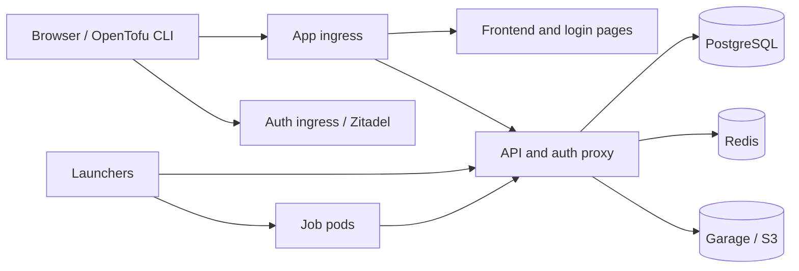

# Install Stackweaver with Helm

Deploy Stackweaver and its bundled PostgreSQL, Redis, Garage and Zitadel services in one Helm
release. You can replace those dependencies with existing services. This is a deployment
procedure; use [Kustomize and GitOps](./kustomize/README.md) for declarative reconciliation.

## Before you start

- Kubernetes 1.27+ APIs (job pods use scheduling gates) and Helm 3.12+ as documented by the chart. Use a maintained cluster
  version supported by your operator, with Helm available on the machine that runs the deployment.
- An ingress controller, app and auth DNS names, and TLS certificates for both hosts.
- Persistent storage suitable for PostgreSQL and Garage.
- Access to all image packages; create the [GHCR pull Secret](./kubernetes-pull-secret-ghcr.md)
  in the release namespace before installation when private images need it.
- Permission to create the workloads and bootstrap Job/RBAC in that namespace.

Select a published chart version from the
[chart registry](https://github.com/vhco-pro/stackweaver-helm/pkgs/container/charts%2Fstackweaver)
and set `CHART_VERSION` to that exact version. Do not infer a production version from an
example or a source checkout's placeholder chart metadata. Review image tags/digests as well;
a pinned chart with mutable image tags does not make every image immutable.

## 1. Set hostnames and routing

Save as `my-values.yaml`. Replace both hosts, TLS Secret names and the ingress class for your
cluster. The TLS Secrets must exist or be supplied by your certificate controller.

```yaml
global:
  imagePullSecrets:
    - name: ghcr-pull-secret
ingress:
  enabled: true
  provider: nginx-inc
  className: nginx
  hosts:
    app: stackweaver.example.com
    auth: auth.stackweaver.example.com
  tls:
    enabled: true
    secretName: stackweaver-tls
    authSecretName: stackweaver-auth-tls
```

Omit the pull-secret entry only if your configured images do not need authentication.
The chart routes API, discovery and auth-proxy requests on the app host to the API; SPA and
login pages go to the frontend. The auth host reaches Zitadel. Browser API calls remain on
the app origin.

To keep both hosts internal while Azure DevOps, a GitHub App or a cloud token service still
reaches Stackweaver, add a public host that serves only those paths with `ingress.public`; see
[Public host for webhooks and discovery](../public-endpoints.md).



### Choose storage before installing

PostgreSQL and Garage each request a ReadWriteOnce claim. Launchers and job pods use no
persistent claim. To choose the storage class, merge the following into `my-values.yaml`,
replacing the class names:

```yaml
postgresql:
  storage:
    storageClass: block-storage-class
garage:
  storage:
    storageClass: block-storage-class
```

Use `kubectl get storageclass` to inspect available classes. You can instead provide existing
claims through `postgresql.storage.existingClaim` and `garage.storage.existingClaim`.

## 2. Install and check bootstrap

```bash
helm install stackweaver oci://ghcr.io/vhco-pro/charts/stackweaver \
  --version "$CHART_VERSION" \
  --namespace stackweaver --create-namespace \
  --values my-values.yaml
kubectl get pods,pvc --namespace stackweaver
kubectl logs --namespace stackweaver job/stackweaver-secrets-init
kubectl logs --namespace stackweaver deployment/stackweaver-zitadel -c zitadel-init
```

The default secret bootstrap creates missing passwords, encryption/signing keys and the hosted launcher registration secret. The
bundled Zitadel initializer then creates the identity applications and service users, patches
the identity Secret and restarts consumers. Existing initialized credentials are preserved.
The frontend receives runtime configuration; a domain change does not require building a new image.

The initial bundled administrator name is configured by `zitadel.init.adminUsername` before
the first installation. For the default release/Secret names, read the generated login in
a trusted local terminal:

```bash
kubectl get secret stackweaver-zitadel --namespace stackweaver \
  --output=jsonpath='{.data.admin-username}' | base64 --decode
kubectl get secret stackweaver-zitadel --namespace stackweaver \
  --output=jsonpath='{.data.admin-password}' | base64 --decode
```

Use your actual Secret name/key mapping if you supplied a BYO Secret or changed chart keys.
These commands print credentials; do not send their output to shared logs. Change the initial
password after signing in.

Verify both HTTPS hostnames, successful sign-in and return to the app. With no SMTP, use SSO
or an administrator-created verified account. Configure [email and sign-up](../email.md)
before relying on verification or password-reset mail.

## Public pages and indexing

The frontend serves public product pages and documentation at your app hostname. Search
indexing is disabled by default. Set `frontend.publicSite.url` and explicitly enable
`frontend.publicSite.indexing` when publishing those pages; see
[Public pages and search indexing](../public-site.md#helm) for values, supported URL paths
and response checks. These settings do not change DNS, TLS or sign-in registrations.

## Ingress Controller Provider

| `ingress.provider` | Use |
|---|---|
| `nginx-inc` | NGINX Inc controller presets; default class `nginx`. |
| `traefik` | Minimal Traefik annotations; set `className: traefik`. Advanced settings may require middleware resources. |
| `community-nginx` | Existing community ingress-nginx deployments during migration. |
| `none` | Supply controller annotations or external routing yourself. |

The community ingress-nginx controller is retired; plan migration to a maintained controller.
See the [Kubernetes retirement notice](https://kubernetes.io/blog/2025/11/11/ingress-nginx-retirement/).
Do not confuse it with NGINX Inc's separate controller.

Shared annotations merge first, followed by app/auth-specific annotations:

```yaml
ingress:
  provider: traefik
  className: traefik
  annotations: {}
  appAnnotations: {}
  authAnnotations: {}
```

For controllers using different resource kinds, set `ingress.enabled: false` and manage those
routes yourself. Keep SPA `/auth/callback` and `/auth/login` routed to the frontend while
other `/auth` traffic goes to the API.

### Trusted Proxies and Client-IP Attribution

Set `api.trustedProxies` to the ingress controller's actual trusted network. The chart defaults
to RFC1918 private ranges; an empty string trusts no proxies. Without an appropriate setting,
requests can share the ingress pod's IP and the same login rate-limit bucket.

```yaml
api:
  trustedProxies: "10.244.0.0/16"
```

Replace that example with your controller's network. If users legitimately share an office
NAT, review auth rate limits instead of widening proxy trust; see the
[environment reference](../environment-variables.md#server).

## Secrets

The bootstrap Job creates whole Secrets only when absent. It does not rotate or overwrite an
existing Secret. Generated Secrets are not owned by the Helm release, so an uninstall retains
them. Hooks run before install/upgrade in Helm and before sync in Argo CD. With `--no-hooks`,
pre-provision required Secrets yourself.

> [!WARNING]
> Deleting a live Secret is not a rotation procedure. A replacement password can stop access
> to existing databases, and losing the encryption or Zitadel master key can make data
> unreadable. Back up keys and data together before an upgrade or recovery action.

### Bring Your Own Secrets

Create the following Secrets in the target namespace before installation, then reference
every name in your values. Commands contain secret material; run in a protected session or
use your secret-management tooling. Protect the generated PEM file as a private key.

```bash
NAMESPACE=stackweaver
kubectl create namespace $NAMESPACE

# PostgreSQL password
kubectl create secret generic my-db-secret \
  --namespace $NAMESPACE \
  --from-literal=password="$(openssl rand -base64 24)"

# Storage credentials (Garage format: access-key = GK + 24 hex, secret-key = 64 hex)
kubectl create secret generic my-storage-secret \
  --namespace $NAMESPACE \
  --from-literal=access-key="GK$(openssl rand -hex 12)" \
  --from-literal=secret-key="$(openssl rand -hex 32)"

# Encryption key (32-byte hex string)
kubectl create secret generic my-encryption-secret \
  --namespace $NAMESPACE \
  --from-literal=encryption-key="$(openssl rand -hex 32)"

# Hosted launcher registration secret (tfe- followed by 64 hex characters)
kubectl create secret generic my-hosted-secret \
  --namespace $NAMESPACE \
  --from-literal=hosted-secret="tfe-$(openssl rand -hex 32)"

# OIDC workload-identity signing key
openssl genrsa 2048 > oidc-signing-key.pem
kubectl create secret generic my-oidc-secret \
  --namespace $NAMESPACE \
  --from-file=signing-key=oidc-signing-key.pem

# Zitadel credentials
kubectl create secret generic my-zitadel-secret \
  --namespace $NAMESPACE \
  --from-literal=masterkey="$(openssl rand -hex 16)" \
  --from-literal=admin-password="$(openssl rand -base64 16)" \
  --from-literal=client-id="" \
  --from-literal=client-secret="" \
  --from-literal=login-service-user-token="" \
  --from-literal=bff-client-id="" \
  --from-literal=bff-client-secret="" \
  --from-literal=webhook-idp-sync-key="" \
  --from-literal=webhook-complement-token-key="" \
  --from-literal=admin-pat=""
```

Reference them in your values file.

```yaml
secrets:
  postgresql:
    secretName: my-db-secret
  storage:
    secretName: my-storage-secret
  encryption:
    secretName: my-encryption-secret
  hosted:
    secretName: my-hosted-secret
  zitadel:
    secretName: my-zitadel-secret
  oidc:
    secretName: my-oidc-secret
```


The chart's rendered manifests do not contain generated credential values, but values you
supply directly to env overrides can still appear there. Treat rendered output accordingly.
When all six credential Secret names are supplied **and bundled Garage is disabled**, the
bootstrap Job and its RBAC are omitted. Bundled Garage still needs its own bootstrap Secret.
Mirror `secretsInit.image.repository` when operating an internal registry.

### BYO Zitadel Secret with External Zitadel

With `zitadel.bundled: false`, the bundled initializer does not create applications or fill
in identity keys. Configure the external instance first, including its applications, service
user and registered redirects; provide the populated values below and its issuer/internal
address. Deployment wiring alone does not configure an external identity provider.

```bash
kubectl create secret generic my-zitadel-secret \
  --namespace stackweaver \
  --from-literal=client-id="<your API app client ID>" \
  --from-literal=client-secret="<your API app client secret>" \
  --from-literal=bff-client-id="<your confidential BFF app client ID>" \
  --from-literal=bff-client-secret="<your confidential BFF app client secret>" \
  --from-literal=login-service-user-token="<your service user PAT>" \
  --from-literal=masterkey="" \
  --from-literal=admin-password="" \
  --from-literal=webhook-idp-sync-key="" \
  --from-literal=webhook-complement-token-key=""
```

> [!WARNING]
> If you set `zitadel.bundled: false` without providing `secrets.zitadel.secretName`, the bootstrap Job generates a Zitadel secret with empty derived keys and there is no sidecar to populate them.
> The API will fail to start, and browser sign-in will be unavailable.


### Required Keys Reference

| Credential | Required keys by default | Values prefix |
|---|---|---|
| PostgreSQL | `password` | `secrets.postgresql` |
| S3 credentials | `access-key`, `secret-key` | `secrets.storage` |
| Platform encryption | `encryption-key` | `secrets.encryption` |
| Hosted launcher registration | `hosted-secret` | `secrets.hosted` |
| Workload identity | `signing-key` (RSA private PEM) | `secrets.oidc` |
| Bundled Zitadel | `masterkey`, `admin-password`; initializer fills derived keys | `secrets.zitadel` |
| External Zitadel | `client-id`, `client-secret`, `bff-client-id`, `bff-client-secret`, `login-service-user-token`; configure webhook keys when used | `secrets.zitadel` |

Override `secrets.<component>.keys.*` if your existing Secret uses different names. Missing
required keys can prevent pods from starting; inspect pod events rather than assuming an
empty value was accepted.

<a id="runner-security-and-isolation"></a>

## Launchers and job isolation

The launcher Deployment, `<release>-launcher`, runs the `stackweaver-launcher` image. A launcher
registers with the API as the installation's hosted launcher, using the hosted registration
Secret, and places every OpenTofu run, Ansible job and sync it claims in a pod of its own in the
job namespace. Each pod runs that engine's job image: `launcher.jobImages.opentofu` for runs and
`launcher.jobImages.ansible` for jobs and syncs. A launcher holds no database,
Redis or storage credential, no encryption key and no signing key, and it never runs user
code. The job pod fetches what its job needs from the API with a token valid for that one
job, held in a Secret the pod owns, and the pod is removed when the job ends. Run output,
status and history live in PostgreSQL and object storage, so nothing you see in the UI
depends on a pod.

Every job pod satisfies the restricted Pod Security Standard: it runs as a non-root user with
a read-only root filesystem and writable `/tmp` and working directories, drops all Linux
capabilities, forbids privilege escalation and runs under the default seccomp profile. It
never uses the host network, PID or IPC namespace, mounts no host path, and carries no
ServiceAccount token unless its identity needs one. To have the cluster enforce the profile,
run jobs in a namespace of their own with `launcher.jobNamespace` and
`launcher.createJobNamespace: true`, which labels the namespace
`pod-security.kubernetes.io/enforce: restricted`. `launcher.runtimeClassName` runs job pods
under a sandboxed runtime such as gVisor or Kata. Ansible `become` executes on the managed
target, not inside the job pod. These controls do not turn untrusted IaC into a sandbox or
remove the permissions granted to its cloud identity.

The chart renders a NetworkPolicy for job pods. They take no inbound traffic and reach DNS,
the API and the internet, but not the cluster's pod and service ranges you list in
`launcher.clusterCIDRs`, the node's cloud metadata endpoints or Azure's platform address
`168.63.129.16`, so a job cannot borrow the node's identity. `launcher.clusterCIDRs` takes IPv4
and IPv6 ranges. Jobs resolve names through the cluster's DNS service. A NetworkPolicy needs a network plugin that enforces it. To let jobs use
the node's identity, set `launcher.network: host-identity`, which leaves the metadata
endpoints open and keeps `168.63.129.16` closed. Jobs otherwise authenticate to clouds with the per-run identity token the
platform mints, or with an identity binding a pool offers (see
[Set up launchers](../../../user-guides/launchers/identity-bindings-and-pull-secrets.md#identity-bindings)).

The launchers serve every organization's hosted capacity: runs and jobs in remote execution
mode, and every sync that captures a snapshot from a VCS provider. `launcher.replicas` and
`launcher.maxConcurrentJobs` (8 by default, shared by both engines) size it. Each launcher runs
under its own ServiceAccount, bound to a Role in the job namespace. The Role lets the launcher read, create, patch and delete job pods and their
Secrets and ServiceAccounts, and read pod logs and ConfigMaps. It grants no exec and no
NetworkPolicy changes, because the chart manages the job namespace's NetworkPolicies itself.
The launcher holds nothing cluster-scoped. It serves `/healthz` and `/readyz` on
`launcher.healthPort`, which the chart probes. `launcher.hostedGroup` names the placement
group the launchers serve, and `launcher.hostedStrict: true` makes them refuse the in-process
driver and the `host-identity` network. With `launcher.driver: inprocess` each job runs inside a
launcher pod instead, so the chart renders one launcher Deployment per engine from that engine's
job image, `<release>-launcher-opentofu` and `<release>-launcher-ansible`;
`launcher.inprocess.opentofu` and `launcher.inprocess.ansible` set their `replicas`, `resources`,
`nodeSelector`, `tolerations` and `affinity`, and anything they leave unset comes from the shared
`launcher` values. Job pods read the organizations' cache entries
through the API, because a pod under the restricted profile cannot mount a node directory.

A job pod receives the run's own variables, the mirror, proxy and CA settings the API hands
it, and a fixed allowlist of the launcher's environment (path, locale, proxy and CA settings
and a few OpenTofu and Ansible settings), listed in
[Launcher variables that reach runs](../environment-variables.md#launcher-variables-that-reach-runs).
A variable you set in `launcher.env` and name in `launcher.runEnvPassthrough` is passed into
the job pod,
where the job's processes receive it when it is also on that allowlist; give runs any other
setting through workspace or variable-set variables. Settings for runs and jobs across the
installation, such as the default run timeout, the run image registry allowlist and the job
mirrors, are read by the API: set them in `api.env`, as listed under
[Runs, jobs and launchers](../environment-variables.md#runs-jobs-and-launchers).

For an air-gapped cluster, point the job mirrors at your own (see
[Job mirrors, proxy and CA](../environment-variables.md#job-mirrors-proxy-and-ca)). The job
NetworkPolicy blocks the ranges in `launcher.clusterCIDRs`, so a mirror or registry inside the
cluster must be opened to job pods: list it in `launcher.extraJobEgress`, whose entries are
NetworkPolicy egress rules (`to` and `ports`) appended to the job policy as given, or add a
NetworkPolicy of your own in the job namespace that selects pods labelled
`stackweaver.io/role: job`. NetworkPolicies add up, so either opens that destination without
widening anything else.

`launcher.keepFailedJobsFor` keeps a failed job's pod for inspection for that long, for
example `30m`; the job has already removed every credential it wrote before the pod is kept.
`launcher.podTemplate` adds labels, annotations, a node selector, tolerations and a priority
class to every job pod. To run work inside your own network as well, add agent pools and
start launchers in them; see [Set up launchers](../../../user-guides/launchers/README.md).

Keep the platform encryption key consistent across the API and orchestrator; launchers and
job pods never hold it. The chart creates a strong key by default; a BYO key is a
64-character hex representation of 32 bytes. Keep it with recovery backups.


## Using External Dependencies

To use existing PostgreSQL, Redis and S3 services, save overrides like these alongside the
matching credential Secrets. Replace hosts, database and bucket values:

```yaml
# External PostgreSQL
postgresql:
  enabled: false
  external:
    host: my-postgres.example.com
    port: 5432
    username: stackweaver
    database: stackweaver
    sslmode: require

# External Redis
redis:
  enabled: false
  external:
    host: my-redis.example.com
    port: 6379

# External S3-compatible storage (AWS S3, R2, B2, MinIO, etc.)
garage:
  enabled: false

storage:
  bucket: stackweaver
  region: eu-west-1
  endpoint: s3.eu-west-1.amazonaws.com  # explicit endpoint required by the chart
  useSSL: true
  forcePathStyle: false
```

## Custom CA Certificates

If your Zitadel instance (or any other upstream service such as an external S3-compatible storage or PostgreSQL endpoint) is signed by an internal or corporate certificate authority, the Go services will refuse TLS connections with an error such as "x509: certificate signed by unknown authority".

To fix this, provide the CA certificate to the chart using one of three approaches.

**Option 1 - inline PEM in your values file** (simplest, cert is public data):

```yaml
customCA:
  cert: |
    -----BEGIN CERTIFICATE-----
    MIIDXTCCAkWgAwIBAgIJAL...
    -----END CERTIFICATE-----
```

The chart creates a ConfigMap from this value automatically.

**Option 2 - existing ConfigMap** (if you manage the cert separately):

```bash
kubectl create configmap my-ca-bundle \
  --namespace stackweaver \
  --from-file=ca.crt=/path/to/corporate-ca.crt
```

```yaml
customCA:
  existingConfigMap: my-ca-bundle
```

**Option 3 - existing Secret** (for GitOps workflows using External Secrets Operator or Sealed Secrets):

```yaml
customCA:
  existingSecret: my-ca-secret
  key: ca.crt  # key within the Secret (default: ca.crt)
```

In all cases the certificate is mounted at `/etc/ssl/certs/custom-ca.crt` using `subPath`, so the system certificate directory is not replaced.
The Go services include the mounted Linux certificate directory in their trust roots. Test the failing connection again after rollout; a CA mount does not bypass hostname verification.

The certificate is mounted into the API, orchestrator and launcher containers. Job pods
mount nothing of the chart's, so the chart also sets `STACKWEAVER_JOB_CA_FILE` on the API,
which hands the certificate to every job; the job adds it to the system roots, so a private
registry or mirror behind that CA works from job pods too. A `STACKWEAVER_JOB_CA_FILE` you
set in `api.env` takes precedence.


## SSO Configuration

This chart SSO wiring requires **bundled Zitadel and its initializer**. With external
Zitadel, configure its provider and login policy in that instance; these chart values do not
register the provider there.

Use the [provider-specific SSO guides](../../../user-guides/sso/README.md) for application
registration, claims, policy and redirect URLs. This chart wiring assumes the upstream app
already exists. Generic OIDC support depends on that provider's compatibility; a values field
alone is not proof of a working integration.

For Entra, create the Secret and set non-secret values:

```bash
kubectl create secret generic stackweaver-sso --namespace stackweaver \
  --from-literal=azure-ad-client-secret='replace-with-client-secret'
```

```yaml
sso:
  secretName: stackweaver-sso
  enableOidcTeamSync: true
  azureAd:
    clientId: replace-with-client-id
    tenantId: replace-with-tenant-id
```

Keep a tenant ID. To intentionally accept multiple tenants, explicitly set
`sso.azureAd.allowMultiTenant: true`; omitting the ID alone is refused. This broadens who
can sign in, so set the upstream application policy deliberately. For a generic provider, use
`oidc-idp-client-secret` in the Secret and the `sso.oidcProvider` fields instead:

```yaml
sso:
  secretName: stackweaver-sso
  oidcProvider:
    name: Okta
    issuer: https://dev-12345678.okta.com/oauth2/default
    clientId: replace-with-client-id
  keys:
    oidcProviderClientSecret: oidc-idp-client-secret
```

`sso.keys.azureAdClientSecret` overrides the Azure key name. When configuring both paths,
include both keys in the same Secret rather than creating the same Secret twice. Apply
settings with the complete retained release values and inspect initializer results.

## Email (SMTP) and Sign-up

Use [Configure sign-in email](../email.md) for the SMTP Secret, values, reconcile Job,
registration policy and delivery checks. The Job configures only bundled Zitadel.

## Frontend Runtime Configuration

The chart creates `env.js` using the ingress hostnames. Browser sign-in uses the API's
confidential client, not a frontend client ID. The API derives its app URL and `/auth/callback`
from `ingress.hosts.app` and `ingress.tls.enabled`. Serve non-localhost browser sessions over HTTPS.
The chart also sets the API's public origin, `STACKWEAVER_PUBLIC_URL`, which the sign-in discovery
document is built from: the app origin, or the origin of `frontend.env.VITE_API_URL` when that names
another. Set it in `api.env` to use a different value.
`frontend.env.VITE_ZITADEL_REDIRECT_URI` is not read; remove it after aligning the ingress and
registered callback. Keep browser API requests on the frontend origin. Override
`frontend.env.VITE_API_URL` only with consistent routing and browser policy.

### Deploying Without Ingress (localhost / port-forward)

Port-forwarding is useful for diagnostics:

```bash
kubectl port-forward --namespace stackweaver svc/stackweaver-frontend 5173:8080
```

Run separate forwards for API `8022:8022` and bundled Zitadel `8080:8080` when needed. These
three forwards alone do **not** provide the same-origin routing and matching public identity
configuration needed for a complete browser login. For a local evaluation, use the supplied
[Compose setup](../docker-compose/README.md), or supply a local reverse proxy and configure
its app/auth URLs and callbacks consistently. Do not weaken the browser security policy to
make an unproxied split-port example work.

## Upgrading

Use [Plan and verify an upgrade](../upgrading.md) for component selection, maintenance
and acceptance checks. Prepare a coordinated [recovery set](../backup-and-restore.md#kubernetes-and-externally-managed-services)
before changing the release; Helm history alone cannot restore data or keys.

> [!IMPORTANT]
> When upgrading an installation that uses the public frontend client, complete
> [browser-session upgrade preparation](#upgrading-to-server-side-browser-sessions) first,
> including image pins or pull policies for the bundled initializer.
> With external Zitadel, create the confidential client and populate `bff-client-id` and
> `bff-client-secret` before upgrading. Follow [browser-session upgrade preparation](#upgrading-to-server-side-browser-sessions).

Save your current values and recovery data. Choose the target `CHART_VERSION`, read its
release notes, and keep a complete `my-values.yaml` under configuration management. Follow
the ordered [API strategy transition](#api-strategy-transition) before changing the version.
Local Kustomize, Argo CD and Flux installations use their
[desired-configuration procedure](./kustomize/README.md#api-upgrades). The verified
target package contains the [database inventory checks](../upgrading.md#retrieve-the-database-inventory-checks).

For a small settings-only change, pin the **installed** version and use `--reuse-values`
with the specific override file. Do not combine an incidental settings change with an
unreviewed chart upgrade. ConfigMap checksum changes roll affected pods; check init and
reconcile Jobs as well as workload readiness. Bootstrap skips existing Secrets rather than
adding or rotating keys, and creates any whole Secret a new chart version adds; follow
release-specific schema migration instructions when needed.

### API strategy transition

The chart omits the API Deployment's strategy, so Kubernetes defaults it to RollingUpdate.
These first-release instructions require a temporary native Recreate transition for every
upgrade, including required intermediate hops. An earlier API can retain cached database
queries while the new API adds columns. Preparing Recreate at the source version stops
those old pods before the target starts its database migration. The verified fixed **API
component version** will be documented after publication. API component versions, chart
versions and monorepo source tags identify different artifacts.

Recreate causes an API outage during image pull and startup. Pause incoming work and
schedules, let active work finish, and stop external launchers as described in
[upgrade preparation](../upgrading.md). An older executor whose job finishes during the
outage can lose its completion report. Upgrade the API, launchers and job images together,
and retain the matching pre-upgrade recovery set.

This procedure uses Helm 3, minimum 3.12, and its native three-way merge updates. Native
preservation checks use Helm 3.20.0. Source and target API manifests must both omit
`spec.strategy`. A customized chart that renders it needs its own reviewed desired-strategy
transition before changing versions.

#### Record the installation

Run the stages from one operator shell. Set your selected context, namespace and release,
then save protected state outside version control. Retain this directory after a failure.

```bash
umask 077
export KUBE_CONTEXT="$(kubectl config current-context)"
export NAMESPACE=stackweaver
export HELM_RELEASE=stackweaver
export STATE_DIR="$(mktemp -d)"
helm --kube-context "$KUBE_CONTEXT" get manifest "$HELM_RELEASE" \
  --namespace "$NAMESPACE" > "$STATE_DIR/source-manifest.yaml"
helm --kube-context "$KUBE_CONTEXT" history "$HELM_RELEASE" \
  --namespace "$NAMESPACE" > "$STATE_DIR/source-history.txt"
helm --kube-context "$KUBE_CONTEXT" template "$HELM_RELEASE" \
  oci://ghcr.io/vhco-pro/charts/stackweaver --version "$CHART_VERSION" \
  --namespace "$NAMESPACE" --values my-values.yaml \
  --show-only templates/api/api-deployment.yaml > "$STATE_DIR/target-api.yaml"
```

Find the API Deployment in the saved source manifest by its rendered name and labels
`app.kubernetes.io/component: api` and `app.kubernetes.io/instance` matching your release.
Confirm exactly one source object, the same target name, and an omitted strategy in both
manifests. Set that rendered name explicitly, including any fullname override.

```bash
export API_DEPLOYMENT=REPLACE_WITH_RENDERED_API_DEPLOYMENT_NAME
```

Define this guard in the same shell. It checks namespace, Helm owner, rendered name and
recorded UID on every invocation. The original live strategy is saved beside the desired
source manifest. Merge patches include UID and resource-version preconditions.

```bash
guard_api() {
  python3 - "$STATE_DIR" "$KUBE_CONTEXT" "$NAMESPACE" "$HELM_RELEASE" "$API_DEPLOYMENT" "$1" <<'PY'
import fcntl
import json
import os
from pathlib import Path
import subprocess
import sys

directory, context, namespace, release, name, action = sys.argv[1:]
directory = Path(directory)
lock = (directory / "strategy.lock").open("a")
fcntl.flock(lock.fileno(), fcntl.LOCK_EX)
command = ["kubectl", "--context", context, "--namespace", namespace, "--request-timeout=20s"]
selector = f"app.kubernetes.io/component=api,app.kubernetes.io/instance={release}"
items = json.loads(subprocess.check_output(command + ["get", "deployments", "-l", selector, "-o", "json"]))["items"]
assert len(items) == 1, "expected exactly one API Deployment"
current = items[0]
metadata = current["metadata"]
assert metadata["namespace"] == namespace and metadata["name"] == name
assert metadata["annotations"]["meta.helm.sh/release-name"] == release
assert metadata["annotations"]["meta.helm.sh/release-namespace"] == namespace
assert metadata["labels"]["app.kubernetes.io/managed-by"] == "Helm"
path = directory / "api-strategy.json"
if path.exists():
    record = json.loads(path.read_text())
else:
    assert action == "prepare", "the original strategy record is missing"
    revision = json.loads(subprocess.check_output(["helm", "--kube-context", context, "status", release, "--namespace", namespace, "-o", "json"]))["version"]
    record = {"context": context, "namespace": namespace, "release": release,
              "name": name, "uid": metadata["uid"], "original_strategy": current["spec"]["strategy"],
              "original_template": current["spec"]["template"], "source_revision": revision,
              "original_desired_manifest": "source-manifest.yaml", "phase": "captured", "pending": True}
assert (record["context"], record["namespace"], record["release"], record["name"], record["uid"]) == (context, namespace, release, name, metadata["uid"])
if action == "prepared":
    assert current["spec"]["strategy"] == {"type": "Recreate"}
    assert current["spec"]["template"] == record["original_template"]
    revision = json.loads(subprocess.check_output(["helm", "--kube-context", context, "status", release, "--namespace", namespace, "-o", "json"]))["version"]
    assert revision == record["source_revision"], "source release changed during preparation"
    record["phase"] = "prepared"
if action == "target":
    assert current["spec"]["strategy"] == {"type": "Recreate"}
    record["phase"] = "target-applied"
if action in ("restore", "restored"):
    replicas = current["spec"].get("replicas", 1)
    status = current.get("status", {})
    assert status.get("observedGeneration", 0) >= metadata["generation"]
    assert all(status.get(field, 0) >= replicas for field in ("updatedReplicas", "readyReplicas", "availableReplicas"))
if action in ("prepare", "restore"):
    strategy = {"type": "Recreate"} if action == "prepare" else record["original_strategy"]
    patch = {"metadata": {"uid": metadata["uid"], "resourceVersion": metadata["resourceVersion"]},
             "spec": {"strategy": {"rollingUpdate": None, **strategy}}}
    (directory / "strategy.patch.json").write_text(json.dumps(patch))
if action == "restored":
    assert current["spec"]["strategy"] == record["original_strategy"]
    record["phase"] = "restored"
    record["pending"] = False
temporary = path.with_suffix(".tmp")
temporary.write_text(json.dumps(record, indent=2) + "\n")
os.replace(temporary, path)
PY
}
```

#### Prepare at the unchanged source version

Run each command only after the preceding one succeeds. The complete native strategy patch
sets `type: Recreate` and `rollingUpdate: null`. The null removes the API-server-defaulted
rolling fields. Changing strategy leaves the source Pod template unchanged.

```bash
guard_api prepare
kubectl --context "$KUBE_CONTEXT" --namespace "$NAMESPACE" patch deployment "$API_DEPLOYMENT" \
  --type=merge --patch-file "$STATE_DIR/strategy.patch.json"
kubectl --context "$KUBE_CONTEXT" --namespace "$NAMESPACE" rollout status \
  "deployment/$API_DEPLOYMENT" --timeout=15m
guard_api prepared
```

The final guard requires live strategy `{"type":"Recreate"}`, an unchanged source Pod
template and the original Helm revision. Complete this stage before changing the chart or
any API image version.

#### Apply the target and restore after readiness

Keep Recreate through the target update. Standard source and target charts omit the
strategy, so Helm preserves that native patch during its merge. Complete the applicable
identity initialization and readiness checks before restoration.

```bash
guard_api prepared
helm --kube-context "$KUBE_CONTEXT" upgrade "$HELM_RELEASE" \
  oci://ghcr.io/vhco-pro/charts/stackweaver --version "$CHART_VERSION" \
  --namespace "$NAMESPACE" --values my-values.yaml
guard_api target
kubectl --context "$KUBE_CONTEXT" --namespace "$NAMESPACE" rollout status \
  "deployment/$API_DEPLOYMENT" --timeout=15m
```

Run `guard_api restore` only after target readiness or completed documented recovery.
It revalidates the same Deployment and its readiness, and prepares the original strategy.

```bash
guard_api restore
kubectl --context "$KUBE_CONTEXT" --namespace "$NAMESPACE" patch deployment "$API_DEPLOYMENT" \
  --type=merge --patch-file "$STATE_DIR/strategy.patch.json"
kubectl --context "$KUBE_CONTEXT" --namespace "$NAMESPACE" rollout status \
  "deployment/$API_DEPLOYMENT" --timeout=15m
guard_api restored
kubectl --context "$KUBE_CONTEXT" get pods,pvc --namespace "$NAMESPACE"
```

On any failure, keep the state directory, prepared strategy and saved desired configuration.
Capture API, launcher, PostgreSQL and controller diagnostics before recovery. A migrated
deployment requires the [matching pre-upgrade recovery set](../backup-and-restore.md#kubernetes-and-externally-managed-services).
An image rollback alone cannot reverse its schema. After recovery completes and the same
recorded Deployment is ready, restore and verify its original strategy. A changed UID or
owner leaves restoration pending for the operator to resolve.

### OpenTofu engine version

Workspaces that set no OpenTofu version run the installation default, `tofu.defaultVersion`.
Left empty, it is the version the release's job image bakes, so an upgrade to a release with
a newer engine moves those workspaces to it. Each run log's first line names the engine that
ran. To choose the default yourself, set `tofu.defaultVersion` to `latest` or to an exact
version; see [Environment variables](../environment-variables.md#opentofu-installation-default-version).

> [!IMPORTANT]
> Before you roll the chart back to a release whose job image bakes an older engine, set
> `tofu.defaultVersion` to the OpenTofu version your workspaces last ran. OpenTofu does not
> guarantee that an older release can read state a newer one wrote. Lower the value only after
> checking each workspace's state.

### Job image pulls

Job pods pull their job image as `launcher.jobImages.pullPolicy` says: `Always` by default,
pinned tags included, so a moved tag runs its current image. `IfNotPresent` and `Never` are the
alternatives.

- Every node must reach the registry of the job images. The kubelet pulls them even when the node
  holds a copy.
- For a private job image, such as `ghcr.io/vhco-pro/stackweaver-opentofu-runner`, list its
  dockerconfigjson Secret in `launcher.jobImages.pullSecrets`, or leave that empty to use
  `global.imagePullSecrets`. The chart mounts those Secrets into the launcher pod, and the
  launcher copies the matching registry's credential into a pull Secret of each job's own in the
  job namespace, keyed by the job image's repository so that no run image receives it. Use an
  `auth`, or a `username` and `password`, entry: an `identitytoken` entry cannot reach a job pod.
- A job pod that cannot pull its image fails after `RUNNER_PLACEMENT_TIMEOUT` (five minutes by
  default), with the kubelet's reason in the run or job's error.

### Upgrading to the chart version with one launcher

One launcher Deployment, `<release>-launcher`, replaces the OpenTofu and Ansible launcher
Deployments, `<release>-runner` and `<release>-ansible-runner`.

1. Upgrade to chart 0.16.2 (Stackweaver 5.109.17) first, if you run an earlier chart. That
   release gives the old launcher pods a termination grace above their drain grace, and the
   upgrade to one launcher relies on it: Helm deletes the two old Deployments, and their pods
   stop with their own spec. Skipping that release stops the old pods after 30 seconds, and the
   Ansible jobs and applies running at that moment are lost.
2. Move your `runner.*` and `ansibleRunner.*` values under `launcher`, as the table under
   "Deprecated launcher values" in the chart README lists. For two minor releases the chart
   translates them and lists each translated value in the install notes.
3. Run `helm upgrade`. A launcher drains for up to `RUNNER_DRAIN_GRACE` (5 minutes by default)
   and then stops the jobs still running. To let longer jobs finish, raise `RUNNER_DRAIN_GRACE`
   in `launcher.env` and raise `launcher.terminationGracePeriodSeconds` above it, plus the
   60-second kill grace.

### Upgrading to the chart version with launchers

Chart version 0.16.1 is the first with launchers.

> [!IMPORTANT]
> Back up PostgreSQL and the object storage bucket before you upgrade from an earlier chart
> version. The upgrade is forward-only: the database cannot be downgraded in place
> afterwards, and rolling back is a restore of both backups with the previous chart version,
> not a `helm rollback`.

1. Remove `runnerWorkspaces`, `ansibleRunner.galaxyCache`, `ansibleRunner.workloadIdentity`,
   `ansibleRunner.tmpSizeLimit` and `ansibleRunner.workspacesSizeLimit` from your values.
   The chart has none of them. Remove `RUNNER_MODE` from `runner.env` and
   `ansibleRunner.env` if you set it.
2. Set `launcher.clusterCIDRs` to your cluster's pod and service ranges, so job pods cannot
   reach in-cluster services. To run job pods in a namespace of their own, also set
   `launcher.jobNamespace` with `launcher.createJobNamespace: true`.
3. Run `helm upgrade` with the new chart version, as in [Upgrading](#upgrading). The upgrade
   adds the hosted launcher registration Secret, which the bootstrap Job generates unless you
   name your own with `secrets.hosted.secretName`. It also removes the launchers' workspace and
   Galaxy cache PersistentVolumeClaims the chart created.
4. Queue again any OpenTofu run that failed with `Run was pending for too long and was
   automatically cancelled`. The orchestrator fails a run that is still pending 30 minutes
   after it was created, so finish the upgrade promptly once the old launchers stop.
5. Upgrade the launchers of your agent pools to the same release and remove `RUNNER_MODE`
   from their environment. The program that runs each job comes from its launcher's image; see
   [Set up launchers](../../../user-guides/launchers/operate.md#operate-and-troubleshoot).
   A launcher you run with the Kubernetes driver outside the chart needs the Role described
   under [Run every job in a pod of its own](../../../user-guides/launchers/start-a-launcher.md#run-every-job-in-a-pod-of-its-own).
6. If a cloud trust matches an Ansible job's subject exactly, update it to the job name in
   [the token subject](../../../user-guides/workload-identity/token-subjects.md).
   Rename any organization, project, workspace, template or job whose name contains a colon:
   a run or job whose configured identity cannot be minted fails before it starts.
7. Once the upgrade works, delete any claim you supplied through `existingClaim`, such as the
   statically provisioned `runner-workspaces-pvc` and its PersistentVolume of the Kustomize
   example. Helm leaves those in place, and nothing mounts them.

Each organization's verified cache in object storage takes the place of the per-project Galaxy
cache, and fills again as jobs run. An Ansible inventory sync that used AKS workload identity
through `ansibleRunner.workloadIdentity` uses an identity binding of an agent pool instead; see
[Dynamic inventories](../../../user-guides/ansible/dynamic-inventories/cloud-sources.md#choose-azure-source-authentication).

### Upgrading to server-side browser sessions

If your release signs browsers in with the public frontend app, the chart version that introduces server-side browser sessions adds two keys to the Zitadel Secret, `bff-client-id` and `bff-client-secret`, which the API requires. With the bundled Zitadel, the zitadel-init sidecar creates them. The upgrade changes the sidecar's settings, so `helm upgrade` replaces the Zitadel pod and the new sidecar runs without a separate restart: it creates the browser sign-in app, writes `bff-client-id` and `bff-client-secret` into the Zitadel Secret, deactivates the public frontend app, and restarts the API Deployment. Upgrade as follows:

1. Pin each Stackweaver image to its reviewed component version or digest; component versions need not match. Set `api.image.tag`, `frontend.image.tag`, `orchestrator.image.tag`, `launcher.image.tag`, `secretsInit.image.tag` and `zitadel.init.image.tag` to the corresponding component version, or set their `pullPolicy` to `Always`. Pin the job images with `launcher.jobImages.opentofu.tag` and `launcher.jobImages.ansible.tag`. With the default `tag: latest` and `pullPolicy: IfNotPresent`, a node that still holds an older `latest` image runs the older zitadel-init, which never writes `bff-client-id`, and the new API pods wait in `CreateContainerConfigError` indefinitely.
2. Run `helm upgrade` without `--wait` and without `--atomic`. The new API pods cannot start until the new keys exist, so a waiting upgrade would time out, and an atomic one would roll back.
3. Watch the API rollout. The examples use release and namespace `stackweaver`; substitute
   your own names if different:

   ```bash
   kubectl rollout status deployment/stackweaver-api \
     --namespace stackweaver
   ```

   If API pods are still not Ready a few minutes after Zitadel is, inspect the initializer
   sidecar's output and resolve any reported error before restarting the API:

   ```bash
   kubectl logs deployment/stackweaver-zitadel \
     --container zitadel-init --namespace stackweaver
   kubectl rollout restart deployment/stackweaver-api \
     --namespace stackweaver
   ```

Browser sign-in is unavailable from the upgrade until the API rollout finishes, usually about
a minute. With the [Recreate transition](#api-strategy-transition), previous API pods stop
before the target starts, so API tokens and launchers also lose API access during that window.

The chart does not read `frontend.env.VITE_ZITADEL_REDIRECT_URI`. The sign-in redirect is always the app URL followed by `/auth/callback`, and the chart builds the app URL from `ingress.hosts.app`, with `https` when `ingress.tls.enabled` is true and `http` otherwise. If you had set `VITE_ZITADEL_REDIRECT_URI`, set `ingress.hosts.app` and `ingress.tls.enabled` so that they produce the same callback URL, and remove `VITE_ZITADEL_REDIRECT_URI` from `frontend.env`.

With an external Zitadel (`zitadel.bundled: false`), create the browser sign-in app and add `bff-client-id` and `bff-client-secret` to your Zitadel Secret **before** you upgrade, as described in [Using an External Zitadel](../../../user-guides/authentication/zitadel-setup.md#using-an-external-zitadel).

After the upgrade, each browser signs in once and returns to the page it had open, and a sign-in then lasts across browser restarts up to `api.session.maxLifetime`. API tokens, the Terraform CLI and launchers are unaffected. A script that called the API with a Zitadel access token must use an API token instead, created under **Settings > API Tokens**.

If you roll back to a chart version from before server-side browser sessions, with `helm rollback` or by pinning older image tags, browsers cannot sign in until you reactivate the public frontend app, because the older zitadel-init signs browsers in with it and never reactivates it. Sign in to the Zitadel console as the administrator, open the `IAC Platform Project` project in the `IAC Platform` organization, select the `IAC Platform Frontend` application, and reactivate it. A later upgrade deactivates it again.

## Uninstalling

```bash
helm uninstall stackweaver --namespace stackweaver
```

This removes the release, not necessarily all its data. Generated Secrets and PostgreSQL/Garage
StatefulSet claims remain. Back up the database, object data, encryption/signing
keys and complete Zitadel Secret before retiring the installation. In a protected recovery
directory, export the identity key material:

```bash
kubectl get secret stackweaver-zitadel --namespace stackweaver \
  --output=yaml > zitadel-secret-backup.yaml
```

Back up the other credential Secrets too; these files contain secrets and are not a GitOps commit.

Deleting persistent volumes loses data; deleting only keys can make retained data unreadable.
A deliberate full reset must account for both generated and operator-supplied resources.
Use an explicit reviewed inventory instead of a broad label-delete command.

## Troubleshooting

| Symptom | Check |
|---|---|
| Install fails before workloads appear | `kubectl logs --namespace stackweaver job/stackweaver-secrets-init`; inspect its pod events for pull errors or denied Secret access. |
| Identity setup waits or fails | The `zitadel-init` container logs, required Secret keys and external/public addresses. |
| Pods wait in `Pending` | PVC binding, storage class, access mode and scheduling events. |
| Pull denied | Namespace-local pull Secret, package permissions and exact image/tag. |
| Sign-in succeeds but returns to a wrong host | App URL, runtime config, issuer and registered redirect agree. |
| SMTP settings did not apply | The post-install/post-upgrade reconcile Job and provider delivery logs. |
| The orchestrator logs `Waiting for the API to migrate the database` | The API migrates the schema when it starts, and the orchestrator waits for it after an upgrade. Check that the new API pods start and become ready: `kubectl logs --namespace stackweaver deployment/stackweaver-api`. |

For bundled identity, the initial administrator PAT file is transient. Later restarts use
the persisted `admin-pat` key in the identity Secret when that file is absent. A missing
file alone is not a reason to regenerate credentials.

A bootstrap Job is retained for about an hour after completion for diagnosis. If policy
forbids it, supply every required Secret and disable bundled Garage to omit it. For a Secret
apply-conflict during a chart migration, inspect that version's release notes and ownership;
do not delete credentials to clear the error.
