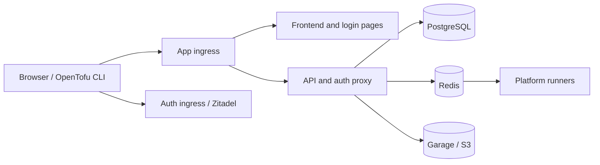

# Install Stackweaver with Helm

Deploy Stackweaver and its bundled PostgreSQL, Redis, Garage and Zitadel services in one Helm
release. You can replace those dependencies with existing services. This is a deployment
procedure; use [Kustomize and GitOps](./kustomize/README.md) for declarative reconciliation.

## Before you start

- Kubernetes 1.27+ APIs and Helm 3.12+ as documented by the chart. Use a maintained cluster
  version supported by your operator, with Helm available on the deployment runner.
- An ingress controller, app and auth DNS names, and TLS certificates for both hosts.
- Persistent storage suitable for PostgreSQL, Garage and runner/cache claims.
- Access to all image packages; create the [GHCR pull Secret](./kubernetes-pull-secret-ghcr.md)
  in the release namespace before installation when private images need it.
- Permission to create the workloads and bootstrap Job/RBAC in that namespace.

Select a published chart version from the
[chart registry](https://github.com/vhco-pro/stackweaver-helm/pkgs/container/charts%2Fstackweaver)
and set `CHART_VERSION` to that exact version. Do not infer a production version from an
example or a source checkout's placeholder chart metadata. Review image tags/digests as well;
a pinned chart with mutable image tags does not make every image immutable.

## 1. Set hostnames and routing

Save as `my-values.yaml`. Replace both hosts, TLS Secret names and the ingress class for your
cluster. The TLS Secrets must exist or be supplied by your certificate controller.

```yaml
global:
  imagePullSecrets:
    - name: ghcr-pull-secret
ingress:
  enabled: true
  provider: nginx-inc
  className: nginx
  hosts:
    app: stackweaver.example.com
    auth: auth.stackweaver.example.com
  tls:
    enabled: true
    secretName: stackweaver-tls
    authSecretName: stackweaver-auth-tls
```

Omit the pull-secret entry only if your configured images do not need authentication.
The chart routes API, discovery and auth-proxy requests on the app host to the API; SPA and
login pages go to the frontend. The auth host reaches Zitadel. Browser API calls remain on
the app origin.



### Choose storage before installing

The default OpenTofu runner workspace claim requests **ReadWriteMany**. Check that your
provisioner supports it; a default block-storage class may support only ReadWriteOnce.
For example, merge the following into `my-values.yaml`, replacing the class names:

```yaml
postgresql:
  storage:
    storageClass: block-storage-class
garage:
  storage:
    storageClass: block-storage-class
runnerWorkspaces:
  storageClass: shared-filesystem-class
  accessMode: ReadWriteMany
ansibleRunner:
  galaxyCache:
    storageClass: block-storage-class
    accessMode: ReadWriteOnce
```

Use `kubectl get storageclass` to inspect available classes. You can instead provide existing
claims through `postgresql.storage.existingClaim`, `garage.storage.existingClaim`,
`runnerWorkspaces.existingClaim` and `ansibleRunner.galaxyCache.existingClaim`. For an install
with one OpenTofu runner, a deliberately chosen `runnerWorkspaces.accessMode: ReadWriteOnce`
can suit block storage; review node/rollout attachment behavior before scaling it. Multiple
Ansible runner replicas sharing a persistent Galaxy cache need an RWX cache too.

## 2. Install and check bootstrap

```bash
helm install stackweaver oci://ghcr.io/vhco-pro/charts/stackweaver \
  --version "$CHART_VERSION" \
  --namespace stackweaver --create-namespace \
  --values my-values.yaml
kubectl get pods,pvc --namespace stackweaver
kubectl logs --namespace stackweaver job/stackweaver-secrets-init
kubectl logs --namespace stackweaver deployment/stackweaver-zitadel -c zitadel-init
```

The default secret bootstrap creates missing passwords and encryption/signing keys. The
bundled Zitadel initializer then creates the identity applications and service users, patches
the identity Secret and restarts consumers. Existing initialized credentials are preserved.
The frontend receives runtime configuration; a domain change does not require building a new image.

The initial bundled administrator name is configured by `zitadel.init.adminUsername` before
the first installation. For the default release/Secret names, read the generated login in
a trusted local terminal:

```bash
kubectl get secret stackweaver-zitadel --namespace stackweaver \
  --output=jsonpath='{.data.admin-username}' | base64 --decode
kubectl get secret stackweaver-zitadel --namespace stackweaver \
  --output=jsonpath='{.data.admin-password}' | base64 --decode
```

Use your actual Secret name/key mapping if you supplied a BYO Secret or changed chart keys.
These commands print credentials; do not send their output to shared logs. Change the initial
password after signing in.

Verify both HTTPS hostnames, successful sign-in and return to the app. With no SMTP, use SSO
or an administrator-created verified account. Configure [email and sign-up](../email.md)
before relying on verification or password-reset mail.

## Ingress Controller Provider

| `ingress.provider` | Use |
|---|---|
| `nginx-inc` | NGINX Inc controller presets; default class `nginx`. |
| `traefik` | Minimal Traefik annotations; set `className: traefik`. Advanced settings may require middleware resources. |
| `community-nginx` | Existing community ingress-nginx deployments during migration. |
| `none` | Supply controller annotations or external routing yourself. |

The community ingress-nginx controller is retired; plan migration to a maintained controller.
See the [Kubernetes retirement notice](https://kubernetes.io/blog/2025/11/11/ingress-nginx-retirement/).
Do not confuse it with NGINX Inc's separate controller.

Shared annotations merge first, followed by app/auth-specific annotations:

```yaml
ingress:
  provider: traefik
  className: traefik
  annotations: {}
  appAnnotations: {}
  authAnnotations: {}
```

For controllers using different resource kinds, set `ingress.enabled: false` and manage those
routes yourself. Keep SPA `/auth/callback` and `/auth/login` routed to the frontend while
other `/auth` traffic goes to the API.

### Trusted Proxies and Client-IP Attribution

Set `api.trustedProxies` to the ingress controller's actual trusted network. The chart defaults
to RFC1918 private ranges; an empty string trusts no proxies. Without an appropriate setting,
requests can share the ingress pod's IP and the same login rate-limit bucket.

```yaml
api:
  trustedProxies: "10.244.0.0/16"
```

Replace that example with your controller's network. If users legitimately share an office
NAT, review auth rate limits instead of widening proxy trust; see the
[environment reference](../environment-variables.md#server).

## Secrets

The bootstrap Job creates whole Secrets only when absent. It does not rotate or overwrite an
existing Secret. Generated Secrets are not owned by the Helm release, so an uninstall retains
them. Hooks run before install/upgrade in Helm and before sync in Argo CD. With `--no-hooks`,
pre-provision required Secrets yourself.

> [!WARNING]
> Deleting a live Secret is not a rotation procedure. A replacement password can stop access
> to existing databases, and losing the encryption or Zitadel master key can make data
> unreadable. Back up keys and data together before an upgrade or recovery action.

### Bring Your Own Secrets

Create the following Secrets in the target namespace before installation, then reference
every name in your values. Commands contain secret material; run in a protected session or
use your secret-management tooling. Protect the generated PEM file as a private key.

```bash
NAMESPACE=stackweaver
kubectl create namespace $NAMESPACE

# PostgreSQL password
kubectl create secret generic my-db-secret \
  --namespace $NAMESPACE \
  --from-literal=password="$(openssl rand -base64 24)"

# Storage credentials (Garage format: access-key = GK + 24 hex, secret-key = 64 hex)
kubectl create secret generic my-storage-secret \
  --namespace $NAMESPACE \
  --from-literal=access-key="GK$(openssl rand -hex 12)" \
  --from-literal=secret-key="$(openssl rand -hex 32)"

# Encryption key (32-byte hex string)
kubectl create secret generic my-encryption-secret \
  --namespace $NAMESPACE \
  --from-literal=encryption-key="$(openssl rand -hex 32)"

# OIDC workload-identity signing key
openssl genrsa 2048 > oidc-signing-key.pem
kubectl create secret generic my-oidc-secret \
  --namespace $NAMESPACE \
  --from-file=signing-key=oidc-signing-key.pem

# Zitadel credentials
kubectl create secret generic my-zitadel-secret \
  --namespace $NAMESPACE \
  --from-literal=masterkey="$(openssl rand -hex 16)" \
  --from-literal=admin-password="$(openssl rand -base64 16)" \
  --from-literal=client-id="" \
  --from-literal=client-secret="" \
  --from-literal=login-service-user-token="" \
  --from-literal=bff-client-id="" \
  --from-literal=bff-client-secret="" \
  --from-literal=webhook-idp-sync-key="" \
  --from-literal=webhook-complement-token-key="" \
  --from-literal=admin-pat=""
```

Reference them in your values file.

```yaml
secrets:
  postgresql:
    secretName: my-db-secret
  storage:
    secretName: my-storage-secret
  encryption:
    secretName: my-encryption-secret
  zitadel:
    secretName: my-zitadel-secret
  oidc:
    secretName: my-oidc-secret
```


The chart's rendered manifests do not contain generated credential values, but values you
supply directly to env overrides can still appear there. Treat rendered output accordingly.
When all five credential Secret names are supplied **and bundled Garage is disabled**, the
bootstrap Job and its RBAC are omitted. Bundled Garage still needs its own bootstrap Secret.
Mirror `secretsInit.image.repository` when operating an internal registry.

### BYO Zitadel Secret with External Zitadel

With `zitadel.bundled: false`, the bundled initializer does not create applications or fill
in identity keys. Configure the external instance first, including its applications, service
user and registered redirects; provide the populated values below and its issuer/internal
address. Deployment wiring alone does not configure an external identity provider.

```bash
kubectl create secret generic my-zitadel-secret \
  --namespace stackweaver \
  --from-literal=client-id="<your API app client ID>" \
  --from-literal=client-secret="<your API app client secret>" \
  --from-literal=bff-client-id="<your confidential BFF app client ID>" \
  --from-literal=bff-client-secret="<your confidential BFF app client secret>" \
  --from-literal=login-service-user-token="<your service user PAT>" \
  --from-literal=masterkey="" \
  --from-literal=admin-password="" \
  --from-literal=webhook-idp-sync-key="" \
  --from-literal=webhook-complement-token-key=""
```

> [!WARNING]
> If you set `zitadel.bundled: false` without providing `secrets.zitadel.secretName`, the bootstrap Job generates a Zitadel secret with empty derived keys and there is no sidecar to populate them.
> The API will fail to start, and browser sign-in will be unavailable.


### Required Keys Reference

| Credential | Required keys by default | Values prefix |
|---|---|---|
| PostgreSQL | `password` | `secrets.postgresql` |
| S3 credentials | `access-key`, `secret-key` | `secrets.storage` |
| Platform encryption | `encryption-key` | `secrets.encryption` |
| Workload identity | `signing-key` (RSA private PEM) | `secrets.oidc` |
| Bundled Zitadel | `masterkey`, `admin-password`; initializer fills derived keys | `secrets.zitadel` |
| External Zitadel | `client-id`, `client-secret`, `bff-client-id`, `bff-client-secret`, `login-service-user-token`; configure webhook keys when used | `secrets.zitadel` |

Override `secrets.<component>.keys.*` if your existing Secret uses different names. Missing
required keys can prevent pods from starting; inspect pod events rather than assuming an
empty value was accepted.

## Runner security and isolation

Runner containers use a non-root user, read-only root filesystem, dropped capabilities,
no privilege escalation and the default seccomp profile. Ansible `become` executes on the
managed target, not inside the runner container. These controls do not turn untrusted IaC
into a sandbox or remove the permissions granted to its cloud identity.

The processes a runner starts for a run (OpenTofu and its providers, `ansible-playbook`, `ansible-inventory`, `ansible-galaxy`) are not handed the runner's own environment, which carries the database, Redis and storage credentials, the encryption key and the workload identity signing key. They receive the run's own variables plus a fixed allowlist of the runner's (path, locale, proxy and CA settings, pod-level cloud identity variables, and a few OpenTofu and Ansible settings), listed in [Runner variables that reach runs](../environment-variables.md#runner-variables-that-reach-runs). To give runs another variable you set in `runner.env` or `ansibleRunner.env`, add its name to `runner.runEnvPassthrough` or `ansibleRunner.runEnvPassthrough`; for example, an `AZURE_SUBSCRIPTION_ID` in `ansibleRunner.env` reaches inventory syncs without it, but a custom `HTTP_PROXY_USER` needs the corresponding
`ansibleRunner.runEnvPassthrough` entry.

The Ansible runner's per-job working directory - which briefly holds SSH keys, vault passwords, and inventory secrets while a job runs - lives on an ephemeral volume that is isolated from the OpenTofu runner and is removed when the job finishes. It deliberately does not share the OpenTofu runner's workspace volume, so a compromised run in one runner cannot read the other's staged credentials. Because run output, status, and history are persisted to PostgreSQL and object storage rather than this scratch volume, nothing you see in the UI is lost when a runner pod is rescheduled.

The Ansible runner keeps a per-project Ansible Galaxy collection cache on a dedicated PersistentVolumeClaim (`ansibleRunner.galaxyCache`, enabled by default). The cache is namespaced per project so one tenant's collections are never served to another, and a background janitor evicts any project cache that has been idle longer than `GALAXY_CACHE_TTL_DAYS` (14 days by default; set to `0` to disable) so it cannot grow without bound. The cache is purely a download optimization - set `ansibleRunner.galaxyCache.enabled` to `false` to use an ephemeral cache instead, at the cost of re-downloading collections after a pod restart. For more than one Ansible runner replica, set `ansibleRunner.galaxyCache.accessMode` to `ReadWriteMany`.

Keep the platform encryption key consistent across API, orchestrator and runners. The chart
creates a strong key by default; a BYO key is a 64-character hex representation of 32 bytes.
Keep it with recovery backups. Self-hosted agents use the API artifact path instead of these
platform database credentials.


## Using External Dependencies

To use existing PostgreSQL, Redis and S3 services, save overrides like these alongside the
matching credential Secrets. Replace hosts, database and bucket values:

```yaml
# External PostgreSQL
postgresql:
  enabled: false
  external:
    host: my-postgres.example.com
    port: 5432
    username: stackweaver
    database: stackweaver
    sslmode: require

# External Redis
redis:
  enabled: false
  external:
    host: my-redis.example.com
    port: 6379

# External S3-compatible storage (AWS S3, R2, B2, MinIO, etc.)
garage:
  enabled: false

storage:
  bucket: stackweaver
  region: eu-west-1
  endpoint: s3.eu-west-1.amazonaws.com  # explicit endpoint required by the chart
  useSSL: true
  forcePathStyle: false
```

## Custom CA Certificates

If your Zitadel instance (or any other upstream service such as an external S3-compatible storage or PostgreSQL endpoint) is signed by an internal or corporate certificate authority, the Go services will refuse TLS connections with an error such as "x509: certificate signed by unknown authority".

To fix this, provide the CA certificate to the chart using one of three approaches.

**Option 1 - inline PEM in your values file** (simplest, cert is public data):

```yaml
customCA:
  cert: |
    -----BEGIN CERTIFICATE-----
    MIIDXTCCAkWgAwIBAgIJAL...
    -----END CERTIFICATE-----
```

The chart creates a ConfigMap from this value automatically.

**Option 2 - existing ConfigMap** (if you manage the cert separately):

```bash
kubectl create configmap my-ca-bundle \
  --namespace stackweaver \
  --from-file=ca.crt=/path/to/corporate-ca.crt
```

```yaml
customCA:
  existingConfigMap: my-ca-bundle
```

**Option 3 - existing Secret** (for GitOps workflows using External Secrets Operator or Sealed Secrets):

```yaml
customCA:
  existingSecret: my-ca-secret
  key: ca.crt  # key within the Secret (default: ca.crt)
```

In all cases the certificate is mounted at `/etc/ssl/certs/custom-ca.crt` using `subPath`, so the system certificate directory is not replaced.
The Go services include the mounted Linux certificate directory in their trust roots. Test the failing connection again after rollout; a CA mount does not bypass hostname verification.

The certificate is mounted into the API, Orchestrator, OpenTofu Runner, and Ansible Runner containers.


## SSO Configuration

This chart SSO wiring requires **bundled Zitadel and its initializer**. With external
Zitadel, configure its provider and login policy in that instance; these chart values do not
register the provider there.

Use the [provider-specific SSO guides](../../../user-guides/sso/README.md) for application
registration, claims, policy and redirect URLs. This chart wiring assumes the upstream app
already exists. Generic OIDC support depends on that provider's compatibility; a values field
alone is not proof of a working integration.

For Entra, create the Secret and set non-secret values:

```bash
kubectl create secret generic stackweaver-sso --namespace stackweaver \
  --from-literal=azure-ad-client-secret='replace-with-client-secret'
```

```yaml
sso:
  secretName: stackweaver-sso
  enableOidcTeamSync: true
  azureAd:
    clientId: replace-with-client-id
    tenantId: replace-with-tenant-id
```

Keep a tenant ID. To intentionally accept multiple tenants, explicitly set
`sso.azureAd.allowMultiTenant: true`; omitting the ID alone is refused. This broadens who
can sign in, so set the upstream application policy deliberately. For a generic provider, use
`oidc-idp-client-secret` in the Secret and the `sso.oidcProvider` fields instead:

```yaml
sso:
  secretName: stackweaver-sso
  oidcProvider:
    name: Okta
    issuer: https://dev-12345678.okta.com/oauth2/default
    clientId: replace-with-client-id
  keys:
    oidcProviderClientSecret: oidc-idp-client-secret
```

`sso.keys.azureAdClientSecret` overrides the Azure key name. When configuring both paths,
include both keys in the same Secret rather than creating the same Secret twice. Apply
settings with the complete retained release values and inspect initializer results.

## Email (SMTP) and Sign-up

Use [Configure sign-in email](../email.md) for the SMTP Secret, values, reconcile Job,
registration policy and delivery checks. The Job configures only bundled Zitadel.

## Frontend Runtime Configuration

The chart creates `env.js` using the ingress hostnames. Browser sign-in uses the API's
confidential client, not a frontend client ID. The API derives its app URL and `/auth/callback`
from `ingress.hosts.app` and `ingress.tls.enabled`. Serve non-localhost browser sessions over HTTPS.
`frontend.env.VITE_ZITADEL_REDIRECT_URI` is not read; remove it after aligning the ingress and
registered callback. Keep browser API requests on the frontend origin. Override
`frontend.env.VITE_API_URL` only with consistent routing and browser policy.

### Deploying Without Ingress (localhost / port-forward)

Port-forwarding is useful for diagnostics:

```bash
kubectl port-forward --namespace stackweaver svc/stackweaver-frontend 5173:8080
```

Run separate forwards for API `8022:8022` and bundled Zitadel `8080:8080` when needed. These
three forwards alone do **not** provide the same-origin routing and matching public identity
configuration needed for a complete browser login. For a local evaluation, use the supplied
[Compose setup](../docker-compose/README.md), or supply a local reverse proxy and configure
its app/auth URLs and callbacks consistently. Do not weaken the browser security policy to
make an unproxied split-port example work.

## Upgrading

Use [Plan and verify an upgrade](../upgrading.md) for component selection, maintenance
and acceptance checks. Prepare a coordinated [recovery set](../backup-and-restore.md#kubernetes-and-externally-managed-services)
before changing the release; Helm history alone cannot restore data or keys.

> [!IMPORTANT]
> When upgrading an installation that uses the public frontend client, complete
> [browser-session upgrade preparation](#upgrading-to-server-side-browser-sessions) first,
> including image pins or pull policies for the bundled initializer.
> With external Zitadel, create the confidential client and populate `bff-client-id` and
> `bff-client-secret` before upgrading. Follow [browser-session upgrade preparation](#upgrading-to-server-side-browser-sessions).

Save your current values and recovery data. Choose the target `CHART_VERSION`, read its
release notes, and keep a complete `my-values.yaml` under configuration management:

```bash
helm upgrade stackweaver oci://ghcr.io/vhco-pro/charts/stackweaver \
  --version "$CHART_VERSION" --namespace stackweaver --values my-values.yaml
kubectl get pods,pvc --namespace stackweaver
```

For a small settings-only change, pin the **installed** version and use `--reuse-values`
with the specific override file. Do not combine an incidental settings change with an
unreviewed chart upgrade. ConfigMap checksum changes roll affected pods; check init and
reconcile Jobs as well as workload readiness. Bootstrap skips existing Secrets rather than
adding or rotating keys; follow release-specific schema migration instructions when needed.

### Upgrading to server-side browser sessions

If your release signs browsers in with the public frontend app, the chart version that introduces server-side browser sessions adds two keys to the Zitadel Secret, `bff-client-id` and `bff-client-secret`, which the API requires. With the bundled Zitadel, the zitadel-init sidecar creates them. The upgrade changes the sidecar's settings, so `helm upgrade` replaces the Zitadel pod and the new sidecar runs without a separate restart: it creates the browser sign-in app, writes `bff-client-id` and `bff-client-secret` into the Zitadel Secret, deactivates the public frontend app, and restarts the API Deployment. Upgrade as follows:

1. Pin each Stackweaver image to its reviewed component version or digest; component versions need not match. Set `api.image.tag`, `frontend.image.tag`, `orchestrator.image.tag`, `runner.image.tag`, `ansibleRunner.image.tag`, `secretsInit.image.tag` and `zitadel.init.image.tag` to the corresponding component version, or set their `pullPolicy` to `Always`. With the default `tag: latest` and `pullPolicy: IfNotPresent`, a node that still holds an older `latest` image runs the older zitadel-init, which never writes `bff-client-id`, and the new API pods wait in `CreateContainerConfigError` indefinitely.
2. Run `helm upgrade` without `--wait` and without `--atomic`. The new API pods cannot start until the new keys exist, so a waiting upgrade would time out, and an atomic one would roll back.
3. Watch the API rollout. The examples use release and namespace `stackweaver`; substitute
   your own names if different:

   ```bash
   kubectl rollout status deployment/stackweaver-api \
     --namespace stackweaver
   ```

   If API pods are still not Ready a few minutes after Zitadel is, inspect the initializer
   sidecar's output and resolve any reported error before restarting the API:

   ```bash
   kubectl logs deployment/stackweaver-zitadel \
     --container zitadel-init --namespace stackweaver
   kubectl rollout restart deployment/stackweaver-api \
     --namespace stackweaver
   ```

Browser sign-in is unavailable from the upgrade until the API rollout finishes, usually about a minute; the previous API pod keeps serving API tokens and runners throughout.

The chart does not read `frontend.env.VITE_ZITADEL_REDIRECT_URI`. The sign-in redirect is always the app URL followed by `/auth/callback`, and the chart builds the app URL from `ingress.hosts.app`, with `https` when `ingress.tls.enabled` is true and `http` otherwise. If you had set `VITE_ZITADEL_REDIRECT_URI`, set `ingress.hosts.app` and `ingress.tls.enabled` so that they produce the same callback URL, and remove `VITE_ZITADEL_REDIRECT_URI` from `frontend.env`.

With an external Zitadel (`zitadel.bundled: false`), create the browser sign-in app and add `bff-client-id` and `bff-client-secret` to your Zitadel Secret **before** you upgrade, as described in [Using an External Zitadel](../../../user-guides/authentication/zitadel-setup.md#using-an-external-zitadel).

After the upgrade, each browser signs in once and returns to the page it had open, and a sign-in then lasts across browser restarts up to `api.session.maxLifetime`. API tokens, the Terraform CLI and runners are unaffected. A script that called the API with a Zitadel access token must use an API token instead, created under **Settings > API Tokens**.

If you roll back to a chart version from before server-side browser sessions, with `helm rollback` or by pinning older image tags, browsers cannot sign in until you reactivate the public frontend app, because the older zitadel-init signs browsers in with it and never reactivates it. Sign in to the Zitadel console as the administrator, open the `IAC Platform Project` project in the `IAC Platform` organization, select the `IAC Platform Frontend` application, and reactivate it. A later upgrade deactivates it again.

## Uninstalling

```bash
helm uninstall stackweaver --namespace stackweaver
```

This removes the release, not necessarily all its data. Generated Secrets and PostgreSQL/Garage
StatefulSet claims remain. Chart-owned runner workspace and Galaxy cache claims are removed
unless you supplied existing claims. Back up the database, object data, encryption/signing
keys and complete Zitadel Secret before retiring the installation. In a protected recovery
directory, export the identity key material:

```bash
kubectl get secret stackweaver-zitadel --namespace stackweaver \
  --output=yaml > zitadel-secret-backup.yaml
```

Back up the other credential Secrets too; these files contain secrets and are not a GitOps commit.

Deleting persistent volumes loses data; deleting only keys can make retained data unreadable.
A deliberate full reset must account for both generated and operator-supplied resources.
Use an explicit reviewed inventory instead of a broad label-delete command.

## Troubleshooting

| Symptom | Check |
|---|---|
| Install fails before workloads appear | `kubectl logs --namespace stackweaver job/stackweaver-secrets-init`; inspect its pod events for pull errors or denied Secret access. |
| Identity setup waits or fails | The `zitadel-init` container logs, required Secret keys and external/public addresses. |
| Pods wait in `Pending` | PVC binding, storage class, access mode and scheduling events. |
| Pull denied | Namespace-local pull Secret, package permissions and exact image/tag. |
| Sign-in succeeds but returns to a wrong host | App URL, runtime config, issuer and registered redirect agree. |
| SMTP settings did not apply | The post-install/post-upgrade reconcile Job and provider delivery logs. |

For bundled identity, the initial administrator PAT file is transient. Later restarts use
the persisted `admin-pat` key in the identity Secret when that file is absent. A missing
file alone is not a reason to regenerate credentials.

A bootstrap Job is retained for about an hour after completion for diagnosis. If policy
forbids it, supply every required Secret and disable bundled Garage to omit it. For a Secret
apply-conflict during a chart migration, inspect that version's release notes and ownership;
do not delete credentials to clear the error.
