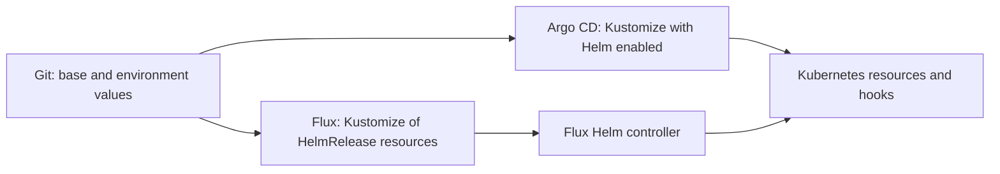

# Deploy with Kustomize and GitOps

Keep shared deployment configuration in a base and environment-specific chart values in
overlays. The supplied example uses Kustomize's Helm chart inflation. Argo CD and Flux need
different execution paths; do not point Flux's Kustomize controller at `helmCharts` and expect
it to run Helm.

## Choose the controller path

| Path | How the chart is rendered |
|---|---|
| Local Kustomize | `kustomize build --enable-helm`, with Helm available. |
| Argo CD | Enable Helm inflation in the repo-server's Kustomize build options, then use the overlay Application. |
| Flux | Reconcile an `OCIRepository` and `HelmRelease` through Flux's source/Helm controllers. Use Kustomize to compose those resources. |

Before deploying, complete the [Helm prerequisites](../README.md#before-you-start), image access,
namespace storage and TLS setup. Select an exact published chart version and matching values;
the example pin is an example, not a promise that it is the latest release.

## Adapt the base and overlay

Download the complete example. It includes a namespace base, a production overlay and its
values file:

::: code-explorer ./example
:::

Change these inputs before a sync:

- `overlays/production/kustomization.yaml`: reviewed chart version and release namespace.
- `overlays/production/values.yaml`: app/auth hosts, ingress provider/class, TLS Secret names,
  image tags/digests and `global.imagePullSecrets` when needed.
- `launcher.clusterCIDRs` in `overlays/production/values.yaml`: replace the two ranges with
  your cluster's pod and service CIDRs, so job pods reach the API and DNS but no other
  in-cluster service. See [Launchers and job isolation](../README.md#launchers-and-job-isolation)
  for the other `launcher.*` values.

Keep search indexing disabled for private environments. If an overlay publishes public
pages, configure `frontend.publicSite` in its chart values and follow the
[public-site checks](../../public-site.md#helm) before submitting a sitemap.

The launchers keep no volume of their own: every job runs in a fresh pod with an ephemeral
working directory, and everything a job keeps lives in the database and object storage. The
PostgreSQL, Redis and Garage claims are the chart's only persistent volumes. They need
durable storage, and a persistent volume is not a database backup.

The example runs job pods in the release namespace, because the overlay's `namespace:` field
moves every namespaced object the chart renders into `stackweaver`, including the Role,
NetworkPolicy and pod template the launchers use in a separate job namespace.



## Render locally before syncing

With an OCI-capable Kustomize (for example 5.7.1) and Helm installed, from the extracted
example root:

```bash
kustomize build overlays/production --enable-helm > rendered.yaml
```

Use a Kustomize version that supports your OCI chart source, and verify its Helm command can
pull the selected version. Review the output's namespace, hosts, image references, PVCs and
hook annotations. This renders files; it does not create resources. Protect rendered output
if you add secrets or sensitive env values.

## Argo CD

An Argo administrator must enable Helm inflation in the `argocd-cm` ConfigMap. Merge this
setting with existing build options rather than replacing unrelated configuration:

```yaml
apiVersion: v1
kind: ConfigMap
metadata:
  name: argocd-cm
  namespace: argocd
data:
  kustomize.buildOptions: --enable-helm
```

This is a repo-server/global build setting, not a per-Application `kustomize.enableHelm`
field. A custom config-management plugin is another option when a global setting is unsuitable.
See [Argo CD's Kustomize guidance](https://argo-cd.readthedocs.io/en/stable/user-guide/kustomize/#kustomizing-helm-charts).

Save an Application in your deployment repository, substituting its URL and overlay path:

```yaml
apiVersion: argoproj.io/v1alpha1
kind: Application
metadata:
  name: stackweaver
  namespace: argocd
spec:
  project: default
  source:
    repoURL: https://github.com/your-org/your-gitops-repo
    targetRevision: main
    path: overlays/production
  destination:
    server: https://kubernetes.default.svc
    namespace: stackweaver
  syncPolicy:
    syncOptions:
      - CreateNamespace=true
```

Review the diff and perform the first sync manually. The chart uses PreSync secret bootstrap
and PostSync identity-policy reconciliation. Do not assume a selective resource sync executes
all hooks. Enable automated pruning/self-healing only after agreeing how deletions and secret
ownership should be handled.

## Flux

Flux's Kustomize controller does not execute the Helm inflation plugin. Use its native Helm
resources. The following belongs in a directory referenced by your existing Flux
`GitRepository`/`Kustomization`; create namespace `stackweaver` and prerequisite Secrets first.
Replace `REPLACE_WITH_CHART_VERSION` with the exact selected chart tag:

```yaml
apiVersion: source.toolkit.fluxcd.io/v1
kind: OCIRepository
metadata:
  name: stackweaver
  namespace: stackweaver
spec:
  interval: 10m
  url: oci://ghcr.io/vhco-pro/charts/stackweaver
  ref:
    tag: REPLACE_WITH_CHART_VERSION
  layerSelector:
    mediaType: application/vnd.cncf.helm.chart.content.v1.tar+gzip
    operation: copy
---
apiVersion: helm.toolkit.fluxcd.io/v2
kind: HelmRelease
metadata:
  name: stackweaver
  namespace: stackweaver
spec:
  interval: 10m
  releaseName: stackweaver
  chartRef:
    kind: OCIRepository
    name: stackweaver
  values:
    global:
      imagePullSecrets:
        - name: ghcr-pull-secret
    ingress:
      provider: nginx-inc
      className: nginx
      hosts:
        app: stackweaver.example.com
        auth: auth.stackweaver.example.com
      tls:
        enabled: true
        secretName: stackweaver-tls
        authSecretName: stackweaver-auth-tls
```

Copy your complete environment values into `spec.values`, or reference an appropriately
managed values source. The local Kustomize `valuesFile` does not automatically become Flux
HelmRelease values. Include your storage/secret overrides as well. For full source and
release options, use [Flux's Helm guide](https://fluxcd.io/flux/guides/helmreleases/).

## API upgrades

The first-release procedure requires Recreate for every API upgrade, including intermediate
hops. Prepare it at the unchanged source version, keep it through the target revision, and
restore the recorded strategy after readiness or completed recovery. The API is unavailable
while its old pods stop and the target starts. Pause incoming work and let active jobs finish
first. An older executor finishing during that outage can lose its completion report.
Prepare the [maintenance window and matching recovery set](../../upgrading.md) before a sync.
Retrieve the [database inventory checks](../../upgrading.md#retrieve-the-database-inventory-checks)
from the verified target chart package for the selected upgrade procedure.

API component versions, chart versions and monorepo/source tags identify different artifacts.
The verified fixed API boundary will be added after publication. Use the conservative
transition until that boundary is documented.

### Save identity and desired configuration

Save the original overlay/controller configuration and rendered source manifests in protected
state outside Git. Record the namespace, rendered API Deployment name, Deployment UID, live
strategy and original desired strategy, including an omitted field. Resolve exactly one
rendered Deployment with the API component label, then verify the live object belongs to the
selected installation. Record the overlay path for local apply, the Application namespace,
name and UID for Argo CD, or the HelmRelease namespace, name and UID for Flux.

Revalidate that installation identity and the same Deployment UID before every apply, sync,
check and restoration. For Argo CD, use its configured resource-tracking metadata and
rendered manifests. For Flux, confirm the HelmRelease's selected Helm release and the
Deployment's Helm ownership. Stop on a missing, ambiguous or mismatched object. Preserve
unrelated patches, sync options, values and controller settings throughout the procedure.

Record the installation's apply mode. Local `kubectl apply` and the example Argo CD
Application use client-side apply. An existing local server-side installation keeps
`--server-side` and its original `--field-manager` on all three stages. An Argo CD server-side
Application keeps `ServerSideApply=true` throughout. The separate controller installation
has its own apply configuration.

### Local Kustomize

Append this temporary entry to the selected overlay's existing `patches` list. Replace the
name with the exact rendered API Deployment name. Retain every other entry.

```yaml
patches:
  - target:
      group: apps
      version: v1
      kind: Deployment
      name: stackweaver-api
      labelSelector: app.kubernetes.io/component=api
    patch: |-
      - op: add
        path: /spec/strategy
        value:
          type: Recreate
          rollingUpdate: null
```

JSON Patch `add` replaces the complete strategy when present and creates it when omitted.
The explicit null clears the API-server-defaulted rolling fields. Keep the chart pin and
API image pins unchanged during this preparation.

Render and review the source revision. The following uses the default client-side mode.
Use the recorded server-side flags instead when that is your installation's existing mode.

```bash
kustomize build "$OVERLAY" --enable-helm > "$STATE_DIR/prepared-source.yaml"
kubectl --context "$KUBE_CONTEXT" --namespace "$NAMESPACE" apply \
  -f "$STATE_DIR/prepared-source.yaml"
kubectl --context "$KUBE_CONTEXT" --namespace "$NAMESPACE" rollout status \
  "deployment/$API_DEPLOYMENT" --timeout=15m
kubectl --context "$KUBE_CONTEXT" --namespace "$NAMESPACE" get deployment "$API_DEPLOYMENT" -o json
```

Require the saved UID/identity, live strategy `{"type":"Recreate"}`, unchanged source Pod
template and an observed Deployment generation matching the prepared object. Complete this
before changing the chart version or API image pins.

Next change the reviewed target pins with the temporary entry retained. Render again,
confirm the target API images, and apply with the same mode and field manager. Wait for the
target to become ready. Recheck UID and Recreate before restoration.

Replace only the temporary entry's strategy value with the complete captured original live
strategy. For a captured Kubernetes default, that value is the following object. A customized
original strategy uses its captured values.

```yaml
value:
  type: RollingUpdate
  rollingUpdate:
    maxSurge: 25%
    maxUnavailable: 25%
```

Render, apply and verify the restored live strategy and UID. If the original desired overlay
omitted strategy, preview removing only the temporary entry with the same apply mode and a
server dry-run. Require that result to preserve the captured live strategy before applying
the removal, then verify persistence after apply. When omission would change that strategy,
keep the explicit restoration entry and record desired-configuration restoration as pending.
If desired strategy was explicit, restore that original desired configuration and verify it.
Keep the saved overlay and restoration state until those checks pass.

### Argo CD upgrades

Use the same targeted overlay patch, with separate committed Git revisions for source
preparation, target pins and restoration. Preserve the selected Application's tracking,
pruning, self-healing and apply settings. Self-healing must see Recreate in desired
configuration throughout the source and target stages.

1. Commit the Recreate patch with the source chart and API image pins unchanged. Sync that
   revision. Record the desired Git SHA and Application UID. Wait for `Synced` and `Healthy`
   at that exact SHA, then verify the saved Deployment UID, unchanged source Pod template,
   observed generation and live Recreate strategy.
2. Commit target pins with the patch retained. Sync and wait for that target SHA and health.
   Verify the target API images, same Deployment UID and retained Recreate before proceeding.
3. Commit an explicit restoration of the captured original strategy. Sync and verify that
   revision after readiness or completed recovery. When the original overlay omitted the
   field, preview removing only the temporary entry through the Application's selected
   apply mode. Remove it in a subsequent revision only when that preserves the captured
   strategy, then sync and verify persistence. Keep the explicit restoration and a pending
   desired-configuration record when omission would change the strategy.

Inspect the actual Application and Deployment at each stage, using their recorded
namespaces and names.

```bash
kubectl --context "$KUBE_CONTEXT" --namespace "$ARGO_NAMESPACE" \
  get application "$APPLICATION" -o json
kubectl --context "$KUBE_CONTEXT" --namespace "$NAMESPACE" \
  get deployment "$API_DEPLOYMENT" -o json
```

Require the observed sync revision to equal the selected Git SHA. The next commit follows
successful observation of the preceding stage. A failed reconciliation leaves the prepared
Git revision and restoration record pending. Follow the matching-backup recovery procedure
before restoring a migrated installation.

### Flux HelmRelease

Append a targeted patch to the existing `spec.postRenderers` configuration. Preserve the
complete existing post-renderer list and its ordering. The following shows the new entry
for the example release name.

```yaml
spec:
  postRenderers:
    - kustomize:
        patches:
          - target:
              group: apps
              version: v1
              kind: Deployment
              name: stackweaver-api
              labelSelector: app.kubernetes.io/component=api
            patch: |-
              - op: add
                path: /spec/strategy
                value:
                  type: Recreate
                  rollingUpdate: null
```

Keep `OCIRepository.spec.ref.tag` at the source chart tag for this first reconciliation.
Wait for the source and HelmRelease to become ready, require the HelmRelease's observed
generation to match its current generation, and verify the successful release's chart
revision alongside the OCI artifact digest. Inspect the Ready conditions, observed revision
and successful release history together. [Flux HelmRelease status](https://fluxcd.io/flux/components/helm/helmreleases/#helmrelease-status), [OCIRepository status](https://fluxcd.io/flux/components/source/ocirepositories/#ocirepository-status)

```bash
kubectl --context "$KUBE_CONTEXT" --namespace "$NAMESPACE" \
  get ocirepository "$OCI_REPOSITORY" -o json
kubectl --context "$KUBE_CONTEXT" --namespace "$NAMESPACE" \
  get helmrelease "$HELM_RELEASE_RESOURCE" -o json
kubectl --context "$KUBE_CONTEXT" --namespace "$NAMESPACE" \
  get deployment "$API_DEPLOYMENT" -o json
```

Require the saved HelmRelease and Deployment UIDs, unchanged source Pod template, live
Recreate and an observed Deployment generation matching preparation. Then change the OCI
tag to the target while retaining the post-renderer. Wait for the target artifact and
successful HelmRelease reconciliation, target API readiness and the same Deployment UID.

Restore the captured original strategy through the targeted post-renderer after readiness
or completed recovery. Reconcile and verify it. Restore the original post-renderer list
only when a render/reconciliation check confirms it preserves the captured strategy, then
verify persistence. Keep the explicit restoration patch and a pending configuration record
when removing it would change the strategy. Preserve unrelated post-renderers and controller
settings at every stage.

### Failed upgrades

Keep the protected identity/strategy record and prepared desired configuration after a
failure. Capture API, launcher, PostgreSQL and controller diagnostics before recovery. A
failed migrated upgrade uses the [matching pre-upgrade recovery set](../../backup-and-restore.md#kubernetes-and-externally-managed-services).
After documented recovery is complete, restore only the same recorded Deployment and verify
readiness and strategy through the installation's management path. A changed UID, wrong
owner or failed reconciliation leaves restoration visibly pending.

## Browser-session upgrades

Before a GitOps upgrade with external Zitadel, create the confidential BFF client and
populate its required Secret keys. Pin the reviewed per-component image versions or use
`Always` so a cached initializer cannot leave the new API without credentials. Follow
[the Helm upgrade sequence](../README.md#upgrading-to-server-side-browser-sessions), including
readiness checks and rollback prerequisites; do not let an automatic rollback conceal missing keys.

## Secrets and first-sync checks

The chart's bootstrap Job creates missing Secrets without overwriting existing values.
For production lifecycle control, provision credentials through your secret store/operator
and reference them through `secrets.<component>.secretName`. To omit bootstrap entirely,
supply all five credential Secrets and disable bundled Garage; see
[Helm secret ownership](../README.md#secrets). Kubernetes RBAC and hook ordering still matter.

Do not commit live passwords or unencrypted pull credentials in Git. The chart's credential
references do not make arbitrary values you add to manifests secret.

After syncing, check:

```bash
kubectl get pods,pvc --namespace stackweaver
kubectl logs --namespace stackweaver job/stackweaver-secrets-init
kubectl logs --namespace stackweaver deployment/stackweaver-zitadel -c zitadel-init
```

If you intentionally omitted bootstrap or use external identity, skip the absent Job/container
and verify that path's supplied credentials. Check the controller's Ready/health conditions,
then sign in through the configured HTTPS app hostname. On a failed sync, inspect image pulls,
PVC binding and hook logs before retrying; do not delete Secrets to force a clean sync.
