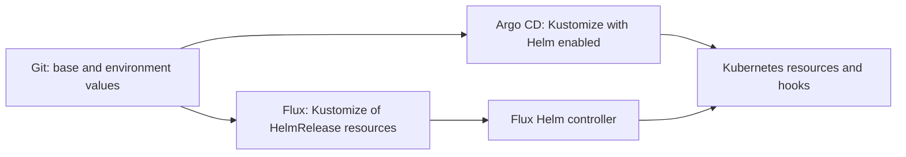

# Deploy with Kustomize and GitOps

Keep shared deployment configuration in a base and environment-specific chart values in
overlays. The supplied example uses Kustomize's Helm chart inflation. Argo CD and Flux need
different execution paths; do not point Flux's Kustomize controller at `helmCharts` and expect
it to run Helm.

## Choose the controller path

| Path | How the chart is rendered |
|---|---|
| Local Kustomize | `kustomize build --enable-helm`, with Helm available. |
| Argo CD | Enable Helm inflation in the repo-server's Kustomize build options, then use the overlay Application. |
| Flux | Reconcile an `OCIRepository` and `HelmRelease` through Flux's source/Helm controllers. Use Kustomize to compose those resources. |

Before deploying, complete the [Helm prerequisites](../README.md#before-you-start), image access,
namespace storage and TLS setup. Select an exact published chart version and matching values;
the example pin is an example, not a promise that it is the latest release.

## Adapt the base and overlay

Download the complete example. It includes a namespace base, production overlay, values file
and an Azure Blob CSI static volume example:

::: code-explorer ./example
:::

Change these inputs before a sync:

- `overlays/production/kustomization.yaml`: reviewed chart version and release namespace.
- `overlays/production/values.yaml`: app/auth hosts, ingress provider/class, TLS Secret names,
  image tags/digests and `global.imagePullSecrets` when needed.
- `overlays/production/pv-pvc.yaml`: storage driver, volume identity and claim for your cluster.
  The Azure-specific identifiers are placeholders, not portable storage defaults.
- `runnerWorkspaces.existingClaim`: must match the runner claim, `runner-workspaces-pvc` in
  this example. Replace the static volume resources with your storage path if different.

Keep search indexing disabled for private environments. If an overlay publishes public
pages, configure `frontend.publicSite` in its chart values and follow the
[public-site checks](../../public-site.md#helm) before submitting a sitemap.

This example disables the persistent Galaxy cache, so a restarted Ansible runner downloads
collections again. PostgreSQL and Garage still need durable storage; a runner scratch claim
is not a database backup.



## Render locally before syncing

With an OCI-capable Kustomize (for example 5.7.1) and Helm installed, from the extracted
example root:

```bash
kustomize build overlays/production --enable-helm > rendered.yaml
```

Use a Kustomize version that supports your OCI chart source, and verify its Helm command can
pull the selected version. Review the output's namespace, hosts, image references, PVCs and
hook annotations. This renders files; it does not create resources. Protect rendered output
if you add secrets or sensitive env values.

## Argo CD

An Argo administrator must enable Helm inflation in the `argocd-cm` ConfigMap. Merge this
setting with existing build options rather than replacing unrelated configuration:

```yaml
apiVersion: v1
kind: ConfigMap
metadata:
  name: argocd-cm
  namespace: argocd
data:
  kustomize.buildOptions: --enable-helm
```

This is a repo-server/global build setting, not a per-Application `kustomize.enableHelm`
field. A custom config-management plugin is another option when a global setting is unsuitable.
See [Argo CD's Kustomize guidance](https://argo-cd.readthedocs.io/en/stable/user-guide/kustomize/#kustomizing-helm-charts).

Save an Application in your deployment repository, substituting its URL and overlay path:

```yaml
apiVersion: argoproj.io/v1alpha1
kind: Application
metadata:
  name: stackweaver
  namespace: argocd
spec:
  project: default
  source:
    repoURL: https://github.com/your-org/your-gitops-repo
    targetRevision: main
    path: overlays/production
  destination:
    server: https://kubernetes.default.svc
    namespace: stackweaver
  syncPolicy:
    syncOptions:
      - CreateNamespace=true
```

Review the diff and perform the first sync manually. The chart uses PreSync secret bootstrap
and PostSync identity-policy reconciliation. Do not assume a selective resource sync executes
all hooks. Enable automated pruning/self-healing only after agreeing how deletions and secret
ownership should be handled.

## Flux

Flux's Kustomize controller does not execute the Helm inflation plugin. Use its native Helm
resources. The following belongs in a directory referenced by your existing Flux
`GitRepository`/`Kustomization`; create namespace `stackweaver` and prerequisite Secrets first.
Replace `REPLACE_WITH_CHART_VERSION` with the exact selected chart tag:

```yaml
apiVersion: source.toolkit.fluxcd.io/v1
kind: OCIRepository
metadata:
  name: stackweaver
  namespace: stackweaver
spec:
  interval: 10m
  url: oci://ghcr.io/vhco-pro/charts/stackweaver
  ref:
    tag: REPLACE_WITH_CHART_VERSION
  layerSelector:
    mediaType: application/vnd.cncf.helm.chart.content.v1.tar+gzip
    operation: copy
---
apiVersion: helm.toolkit.fluxcd.io/v2
kind: HelmRelease
metadata:
  name: stackweaver
  namespace: stackweaver
spec:
  interval: 10m
  releaseName: stackweaver
  chartRef:
    kind: OCIRepository
    name: stackweaver
  values:
    global:
      imagePullSecrets:
        - name: ghcr-pull-secret
    ingress:
      provider: nginx-inc
      className: nginx
      hosts:
        app: stackweaver.example.com
        auth: auth.stackweaver.example.com
      tls:
        enabled: true
        secretName: stackweaver-tls
        authSecretName: stackweaver-auth-tls
```

Copy your complete environment values into `spec.values`, or reference an appropriately
managed values source. The local Kustomize `valuesFile` does not automatically become Flux
HelmRelease values. Include your storage/secret overrides as well. For full source and
release options, use [Flux's Helm guide](https://fluxcd.io/flux/guides/helmreleases/).

## Browser-session upgrades

Before a GitOps upgrade with external Zitadel, create the confidential BFF client and
populate its required Secret keys. Pin the reviewed per-component image versions or use
`Always` so a cached initializer cannot leave the new API without credentials. Follow
[the Helm upgrade sequence](../README.md#upgrading-to-server-side-browser-sessions), including
readiness checks and rollback prerequisites; do not let an automatic rollback conceal missing keys.

## Secrets and first-sync checks

The chart's bootstrap Job creates missing Secrets without overwriting existing values.
For production lifecycle control, provision credentials through your secret store/operator
and reference them through `secrets.<component>.secretName`. To omit bootstrap entirely,
supply all five credential Secrets and disable bundled Garage; see
[Helm secret ownership](../README.md#secrets). Kubernetes RBAC and hook ordering still matter.

Do not commit live passwords or unencrypted pull credentials in Git. The chart's credential
references do not make arbitrary values you add to manifests secret.

After syncing, check:

```bash
kubectl get pods,pvc --namespace stackweaver
kubectl logs --namespace stackweaver job/stackweaver-secrets-init
kubectl logs --namespace stackweaver deployment/stackweaver-zitadel -c zitadel-init
```

If you intentionally omitted bootstrap or use external identity, skip the absent Job/container
and verify that path's supplied credentials. Check the controller's Ready/health conditions,
then sign in through the configured HTTPS app hostname. On a failed sync, inspect image pulls,
PVC binding and hook logs before retrying; do not delete Secrets to force a clean sync.
