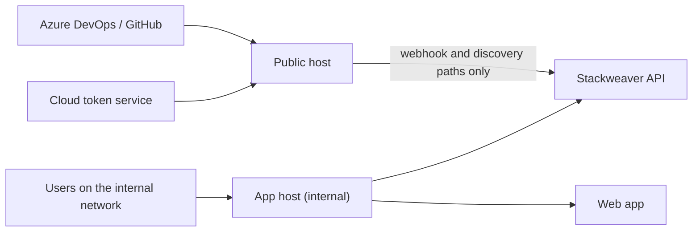

# Expose webhooks and discovery on a public host

Some outside services must call Stackweaver directly. Azure DevOps delivers service hooks,
a GitHub App delivers its webhook, and a cloud that trusts per-resource federation fetches
the workload identity discovery document and signing keys. When the app itself must stay on
an internal network, publish only those paths on a separate public host.

| Path | Who calls it | Needed when |
|---|---|---|
| `/api/v2/vcs-connections/azure-devops/webhook` | Azure DevOps service hooks | You link workspaces, playbooks or inventories to Azure DevOps repositories |
| `/api/v2/vcs-connections/github/webhook` | Your GitHub App | You use a GitHub App connection |
| `/.well-known/openid-configuration` | The cloud's token service, for example Microsoft Entra ID | Targets trust Stackweaver's workload identity issuer (per-resource federation) |
| `/.well-known/jwks` | The same token service | As above |

Stackweaver authenticates each webhook delivery: Azure DevOps sends the webhook secret as a
Basic-auth password, and GitHub signs every delivery with the App's webhook secret. The
discovery document and JWKS are deliberately unauthenticated, because they hold only public
information: the issuer and the public signing keys. The rest of the API, the web app and
sign-in stay unreachable from the public host.

The public host must be a hostname of its own. The chart refuses an `ingress.public.host`
equal to the app or auth host, because those hosts route everything.



## Kubernetes with Helm

1. Create a DNS name the outside services can resolve, and a TLS certificate for it.
2. Add the public host to `my-values.yaml`. Use `className` when an internet-facing ingress
   controller of its own serves the host:

   ```yaml
   ingress:
     public:
       host: hooks.stackweaver.example.com
       className: nginx-external      # omit to use ingress.className
       tlsSecretName: stackweaver-public-tls
       oidcDiscovery: false           # true for per-resource federation, see below
       annotations: {}
   ```

3. Apply the change with the installed chart version, so the settings change does not also
   upgrade the chart:

   ```bash
   helm upgrade stackweaver oci://ghcr.io/vhco-pro/charts/stackweaver \
     --version "${STACKWEAVER_CHART_VERSION:?Set the installed chart version}" \
     --namespace stackweaver --values my-values.yaml
   ```

The chart then:

- creates a third Ingress, named after the release and ending in `-public`, that routes exactly the webhook paths (and,
  with `oidcDiscovery`, the two discovery paths) to the API, each with `pathType: Exact`;
- sets the API's `STACKWEAVER_WEBHOOK_BASE_URL` to the public host's origin, so Azure DevOps
  service hooks are registered against it. A value you set under `api.env` takes precedence;
- with `oidcDiscovery: true` and an empty `oidc.issuerUrl`, sets the workload identity issuer
  to the public host's origin. An explicit `oidc.issuerUrl`, or `OIDC_ISSUER_URL` under
  `api.env`, takes precedence; it must then be the public host's origin for the cloud to reach
  its discovery document;
- applies `ingress.annotations` to the public Ingress, with `ingress.public.annotations`
  winning on a shared key, so it can use its own certificate issuer.

The origin uses `https` when `ingress.tls.enabled` is true and `http` otherwise.

### Per-resource federation

Set `oidcDiscovery: true` when cloud targets trust Stackweaver's workload identity issuer,
for example Azure federated credentials on each managed identity or app registration. The
issuer is embedded in every token, so each cloud-side trust must name the new issuer exactly,
without a trailing slash.

> [!WARNING]
> Changing the issuer of an existing install breaks every cloud trust that names the old
> issuer until you update it. Update the trusts in the same change window.

Installs that give job pods one central cloud identity instead of per-resource federation
do not need the discovery paths; leave `oidcDiscovery` false. See
[Signing key and issuer](../../user-guides/workload-identity/signing-key.md) for the issuer
settings.

### Other callers from outside your network

`ingress.public` covers the VCS webhooks and workload identity discovery only. These
integrations call other paths, which carry resource IDs and are not routed on the public
host. Give such callers private connectivity to the app host, or forward these paths in your
own edge proxy:

| Integration | Paths it calls | URL it is given |
|---|---|---|
| Run tasks hosted outside your network | `GET /api/v2/plans/<id>/json-output`, `GET /api/v2/configuration-versions/<id>/download`, `PATCH /api/v2/task-results/<id>/callback` | Built from the orchestrator's `STACKWEAVER_API_URL` |
| Ansible provisioning callbacks from hosts outside your network | `POST /api/v2/ansible/job-templates/<id>/callback` | The template's callback URL on the app host |
| An external Zitadel that uses Stackweaver's Actions | `/api/v2/zitadel/actions/idp-sync`, `/api/v2/zitadel/actions/complement-token` | Configured in Zitadel |

### Register the GitHub App webhook

A GitHub App's webhook URL is part of the App's settings, not of Stackweaver's. In the App's
settings on GitHub, set **Webhook URL** to the public host followed by
`/api/v2/vcs-connections/github/webhook`. See [GitHub App](../../user-guides/vcs/github-app.md).

## Docker Compose and other installs

Configure your reverse proxy or load balancer to forward only the paths in the table above,
matched exactly, from the public host to the API. Then set:

```bash
# vcs.env in your Compose directory
STACKWEAVER_WEBHOOK_BASE_URL=https://hooks.stackweaver.example.com
```

For per-resource federation, also set `OIDC_ISSUER_URL` to the same origin in `oidc.env`.
Recreate the API afterwards with `docker compose up -d api`.

## Check the setup

1. From outside your network, request the discovery document (only with `oidcDiscovery`):

   ```bash
   curl -fsS https://hooks.stackweaver.example.com/.well-known/openid-configuration
   ```

   The `issuer` in the answer is the public host's origin.

2. Confirm that nothing else is published. This request must not reach the API:

   ```bash
   curl -s -o /dev/null -w '%{http_code}\n' https://hooks.stackweaver.example.com/api/v2/ping
   ```

   Expect the ingress controller's `404`.

3. Save one linked resource per Azure DevOps repository, so its service hooks are registered
   against the public host. In Azure DevOps, **Project settings > Service hooks** lists the
   subscriptions; use **Test** on one to send a delivery.

## When webhooks are not registered

If `STACKWEAVER_WEBHOOK_BASE_URL` is not set while Azure DevOps is configured, the API logs a
warning at startup and again each time a resource linked to an Azure DevOps repository is
saved:

```text
Azure DevOps service hooks for playbook repository infra/ansible were not registered: STACKWEAVER_WEBHOOK_BASE_URL is not set, ...
```

No service hook subscription is created or refreshed. Subscriptions registered earlier keep
delivering, but a repository without one triggers nothing on push or pull request. Set the
base URL as described above, restart the API, and save each linked resource again.
