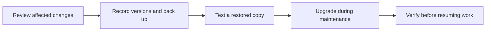

# Plan and verify an upgrade

Choose a reviewed set of component versions, take a recoverable backup, then follow the
procedure for your deployment. A healthy container is the first check; sign-in, saved data
and launcher connectivity must work too.



## 1. Decide what you are upgrading

Read the [Stackweaver changelog](../../changelog.md). Start with the **For** and **Action**
fields for your deployment, then open the linked task guides. Review the selected component
release notes too; the central feed contains reviewed changes with confirmed availability,
not every commit or an exhaustive compatibility matrix.

| Record | Why it matters |
|---|---|
| Current and target component tags or digests | API, frontend, orchestrator, the launcher image, the two job images and the initializer publish independently. A matching version number across them is not required. |
| Chart version and complete values, for Helm | A chart version selects templates and defaults; image overrides can select different containers. |
| Identity and storage arrangement | Bundled Zitadel/Garage and external services have different recovery owners. |
| Self-hosted launcher versions | Upgrading the platform does not upgrade launchers running elsewhere. Upgrade them with the platform, because the program that runs each job comes from its launcher's image. |

**Confirmed available by** in the feed establishes that a change is present in the listed
component releases. It is not the first release containing the change, a minimum supported
version, or proof that an arbitrary mixture of versions is compatible. Verify your chosen
artifacts with [release verification](../../security/verifying-releases.md).

For an upgrade from browser-held OAuth tokens to server-side sessions, prepare identity
before changing containers. External Zitadel needs the confidential **Stackweaver BFF**
client and its credentials in advance. Use the deployment-specific instructions below.
Automation uses `tfe-` API tokens; a Zitadel access token is not an API credential.

## 2. Prepare recovery and a quiet maintenance window

1. Record the exact images, Compose configuration or Helm revision/values, and third-party
   database, object-store and identity versions. Pin target images to reviewed immutable
   references or explicit component tags; avoid an incidental move to `latest`.
2. Take a [complete backup](./backup-and-restore.md), including keys, identity, database and
   object data. A database dump alone does not restore a deployment.
3. Restore into an isolated environment and test the target versions there. Keep it away
   from production launchers, schedules, webhooks, SMTP and cloud targets.
4. Pause incoming work and schedules, let active jobs/runs finish, and stop self-hosted
   launchers for the maintenance window. Confirm no pending run, job or update-on-launch sync
   remains. The orchestrator fails an OpenTofu run that is still pending 30 minutes after it
   was created, so queue any such run again after the upgrade.

> [!WARNING]
> Upgrades are forward-only. Changing image tags back does not reverse database migrations
> or identity changes: rolling back is a restore of the pre-upgrade backup with the previous
> versions. Keep a tested, matching pre-upgrade recovery set. Never use `docker compose down -v` as an
> upgrade step or delete Kubernetes Secrets/PVCs to make a rollout proceed.

## 3. Apply the selected deployment procedure

### Docker Compose

Work in your installed bundle directory. Review image pins in `docker-compose.yml` or a
retained override. For example, an override has the same service names as the bundle:

```yaml
# images.yaml: replace both placeholders with reviewed image references.
services:
  api:
    image: ghcr.io/vhco-pro/stackweaver-api@sha256:REPLACE_WITH_API_DIGEST
  frontend:
    image: ghcr.io/vhco-pro/stackweaver-frontend@sha256:REPLACE_WITH_FRONTEND_DIGEST
```

Include every component you intend to change; this example pins only two. Use the same
file set for every Compose command. Review the complete image list before pulling:

```bash
docker compose -f docker-compose.yml -f images.yaml config --images
docker compose -f docker-compose.yml -f images.yaml pull
docker compose -f docker-compose.yml -f images.yaml up -d
docker compose -f docker-compose.yml -f images.yaml ps -a
```

Follow [Compose upgrade preparation](./docker-compose/README.md#prepare-the-browser-session-upgrade)
for a browser-session transition, [the launcher upgrade](./docker-compose/README.md#upgrade-to-the-release-with-launchers)
when you move from the `runner` services to launchers, and the
[Compose upgrade procedure](./docker-compose/README.md#apply-the-selected-images).
Preserve generated `.env` and the persistent `sso.env`, `vcs.env`, `oidc.env`, keys and
configuration. Do not regenerate them or copy first-install examples over them. Container
environment changes require recreation with `up -d`; a bare restart retains old values.

### Kubernetes and Helm

Read [Helm upgrade preparation](./kubernetes/README.md#upgrading) first. In particular, the
browser-session transition with bundled Zitadel has a specific initializer ordering and
must not use `--wait` or `--atomic`. External Zitadel's BFF credentials must already exist.
An upgrade from a chart version before 0.16.1 also follows
[the launcher upgrade](./kubernetes/README.md#upgrading-to-the-chart-version-with-launchers).

Record the installed release before changing it. The example uses release and namespace
`stackweaver`; replace them if yours differ. Values can contain secrets, so save them in a
protected directory outside version control:

```bash
umask 077
mkdir -p recovery-record
helm history stackweaver --namespace stackweaver > recovery-record/revisions.txt
helm get values stackweaver --namespace stackweaver --all \
  > recovery-record/installed-values.yaml
kubectl get pods,pvc --namespace stackweaver
```

Set `CHART_VERSION` to the reviewed target and maintain a complete `my-values.yaml`, with
the image overrides and external Secret names your installation needs:

```bash
helm upgrade stackweaver oci://ghcr.io/vhco-pro/charts/stackweaver \
  --version "$CHART_VERSION" --namespace stackweaver --values my-values.yaml
kubectl get jobs,pods,pvc --namespace stackweaver
kubectl rollout status deployment/stackweaver-api --namespace stackweaver
```

A settings-only change should use the installed chart version and `--reuse-values`, with
only the intended overrides. Keep it separate from a software upgrade. Neither Helm
history nor `helm rollback` restores a database, an overwritten Secret or external storage.

## 4. Verify before reopening access

Keep background workers and external integrations paused until the relevant checks pass.
Use a dedicated test workspace/inventory and harmless targets for execution checks.

| Check | Expected result |
|---|---|
| Deployment and bootstrap | Required containers/pods are healthy; initializer/reconcile jobs complete without credential errors. |
| Browser sign-in, refresh and sign-out | The expected account reaches its organization and protected pages. Reauthenticate after the browser-session transition. |
| API token | A `tfe-` token can read a resource it is authorized to read; a denied cross-organization read stays denied. |
| Saved data and object storage | A known workspace, state version and prior job output are readable. |
| Stored credentials and identity | A dedicated test credential remains usable; sign-in and configured SSO still work. |
| Launcher connectivity | **Settings > Agent Pools** shows hosted launchers online under **Hosted capacity**, and your self-hosted launchers online in their pools. A controlled plan or harmless playbook produces output. Do not apply production changes as a smoke test. |

If a check fails, keep maintenance in place, collect redacted logs, and compare the target
configuration to the saved record. Use the linked deployment troubleshooting guidance.
Restore the matched recovery set when the failure requires a data rollback; do not point
old binaries at a migrated database without a release-specific recovery procedure.

Resume schedules, launchers and incoming triggers deliberately, then watch the first normal
runs and jobs. Keep the recovery set until the upgraded installation has passed your
retention and acceptance policy.

## 5. Release-specific instructions

### Correct timestamps written outside UTC

Stackweaver stores and returns timestamps in UTC whatever time zone its services run in. On
its first start, the upgraded API changes six database columns to `timestamp with time
zone`. Each value in them is read as UTC. Values written by a process running in UTC keep
their instant; the published images run in UTC.

Follow this procedure only if the API or the orchestrator ever ran with `TZ` set to another
zone, or on a host whose time zone is not UTC. Values that process wrote are off by its UTC
offset:

| Column | What it holds | Effect of a wrong value |
|---|---|---|
| `api_keys.expires_at` | When an API token expires | The token stops working early or late. |
| `api_keys.last_used_at` | When an API token was last used | Display only. |
| `vcs_connections.token_expires_at` | When the stored VCS access token expires | The token is refreshed early or late. |
| `runners.last_heartbeat_at` | A launcher's latest heartbeat | Overwritten within a minute while the launcher runs. |
| `runner_job_executions.started_at` | When a launcher started an execution | History only. |
| `runner_job_executions.finished_at` | When a launcher finished an execution | History only. |

1. Find the offset the process ran at. Run `date +%z` on that host, or read the `TZ` you set:
   `+0200` is `2 hours`, `-0500` is `-5 hours`.
2. Find the window: when that process started running in that zone, and when you upgraded.
   If the window crosses a daylight-saving change, split it into two windows, each with its
   own offset.
3. After the upgraded API has started once, connect to the database with `psql` and start a
   transaction with `BEGIN;`.
4. For each column and window, replace the placeholders and count the rows first, then run the
   update with the same values. Each update must report the same number of rows as its count.
   Use the statements for the column:

   - **The four columns stamped when they are written** (`api_keys.last_used_at`,
     `runners.last_heartbeat_at`, `runner_job_executions.started_at` and `finished_at`). A
     value the process wrote inside the window now sits shifted by the offset:

     ```sql
     SELECT count(*) FROM <table>
     WHERE <column> BETWEEN '<window start>'::timestamptz + interval '<offset>'
                        AND '<window end>'::timestamptz + interval '<offset>';

     UPDATE <table> SET <column> = <column> - interval '<offset>'
     WHERE <column> BETWEEN '<window start>'::timestamptz + interval '<offset>'
                        AND '<window end>'::timestamptz + interval '<offset>';
     ```

   - **`vcs_connections.token_expires_at`.** The connection is rewritten whenever its token
     refreshes, so its row says nothing about when the expiry was written. Stackweaver stores an
     expiry only for Azure DevOps connections, from Microsoft's sign-in tokens, which last at
     most 90 minutes. Extend the window end by those 90 minutes:

     ```sql
     SELECT count(*) FROM vcs_connections
     WHERE token_expires_at BETWEEN '<window start>'::timestamptz + interval '<offset>'
                                AND '<window end>'::timestamptz + interval '90 minutes' + interval '<offset>';

     UPDATE vcs_connections SET token_expires_at = token_expires_at - interval '<offset>'
     WHERE token_expires_at BETWEEN '<window start>'::timestamptz + interval '<offset>'
                                AND '<window end>'::timestamptz + interval '90 minutes' + interval '<offset>';
     ```

     Run it soon after the upgrade. A token the upgraded API stored in its first 90 minutes can
     match as well and is shifted too. For an offset east of UTC that only makes Stackweaver
     refresh the token early.

5. When every column and window is done, `COMMIT;`. If a count looks wrong, `ROLLBACK;`
   instead.

For example, an API that ran at `+0200` from 1 April to 1 October 2026 needs, for
`api_keys.last_used_at`:

```sql
UPDATE api_keys SET last_used_at = last_used_at - interval '2 hours'
WHERE last_used_at BETWEEN '2026-04-01T00:00:00Z'::timestamptz + interval '2 hours'
                       AND '2026-10-01T00:00:00Z'::timestamptz + interval '2 hours';
```

`api_keys.expires_at` has no repair statement. Launcher tokens renew their expiry on every
heartbeat, so a running launcher's token corrects itself after the upgrade. A job token lasts only
as long as its job, and registration and rotation tokens were always stored in UTC. A user, team or
organization token created with an explicit expiry may expire off by the UTC offset that expiry was
given in. Check the expiry date shown for each such token, and reissue any whose expiry matters.

> [!WARNING]
> Run each update once. A second run shifts the same rows again. A value written by a UTC
> process can match the statements too, and it is shifted as well. For an offset east of UTC, a
> wrongly shifted VCS token expiry only brings its next refresh forward.
