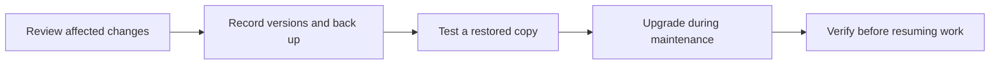

# Plan and verify an upgrade

Choose a reviewed set of component versions, take a recoverable backup, then follow the
procedure for your deployment. A healthy container is the first check; sign-in, saved data
and runner connectivity must work too.



## 1. Decide what you are upgrading

Read the [Stackweaver changelog](../../changelog.md). Start with the **For** and **Action**
fields for your deployment, then open the linked task guides. Review the selected component
release notes too; the central feed contains reviewed changes with confirmed availability,
not every commit or an exhaustive compatibility matrix.

| Record | Why it matters |
|---|---|
| Current and target component tags or digests | API, frontend, orchestrator, runners and initializer publish independently. A matching version number across them is not required. |
| Chart version and complete values, for Helm | A chart version selects templates and defaults; image overrides can select different containers. |
| Identity and storage arrangement | Bundled Zitadel/Garage and external services have different recovery owners. |
| Self-hosted runner versions | Upgrading the platform does not upgrade agents running elsewhere. Check each affected change's runner scope. |

**Confirmed available by** in the feed establishes that a change is present in the listed
component releases. It is not the first release containing the change, a minimum supported
version, or proof that an arbitrary mixture of versions is compatible. Verify your chosen
artifacts with [release verification](../../security/verifying-releases.md).

For an upgrade from browser-held OAuth tokens to server-side sessions, prepare identity
before changing containers. External Zitadel needs the confidential **Stackweaver BFF**
client and its credentials in advance. Use the deployment-specific instructions below.
Automation uses `tfe-` API tokens; a Zitadel access token is not an API credential.

## 2. Prepare recovery and a quiet maintenance window

1. Record the exact images, Compose configuration or Helm revision/values, and third-party
   database, object-store and identity versions. Pin target images to reviewed immutable
   references or explicit component tags; avoid an incidental move to `latest`.
2. Take a [complete backup](./backup-and-restore.md), including keys, identity, database and
   object data. A database dump alone does not restore a deployment.
3. Restore into an isolated environment and test the target versions there. Keep it away
   from production runners, schedules, webhooks, SMTP and cloud targets.
4. Pause incoming work and schedules, let active jobs/runs finish, and stop self-hosted
   runners for the maintenance window. Confirm no pending queue or update-on-launch sync
   remains. Do not assume queued Redis work is part of a filesystem backup.

> [!WARNING]
> Changing image tags back does not reverse database migrations or identity changes. Keep
> a tested, matching pre-upgrade recovery set. Never use `docker compose down -v` as an
> upgrade step or delete Kubernetes Secrets/PVCs to make a rollout proceed.

## 3. Apply the selected deployment procedure

### Docker Compose

Work in your installed bundle directory. Review image pins in `docker-compose.yml` or a
retained override. For example, an override has the same service names as the bundle:

```yaml
# images.yaml: replace both placeholders with reviewed image references.
services:
  api:
    image: ghcr.io/vhco-pro/stackweaver-api@sha256:REPLACE_WITH_API_DIGEST
  frontend:
    image: ghcr.io/vhco-pro/stackweaver-frontend@sha256:REPLACE_WITH_FRONTEND_DIGEST
```

Include every component you intend to change; this example pins only two. Use the same
file set for every Compose command. Review the complete image list before pulling:

```bash
docker compose -f docker-compose.yml -f images.yaml config --images
docker compose -f docker-compose.yml -f images.yaml pull
docker compose -f docker-compose.yml -f images.yaml up -d
docker compose -f docker-compose.yml -f images.yaml ps -a
```

Follow [Compose upgrade preparation](./docker-compose/README.md#prepare-the-browser-session-upgrade)
for a browser-session transition and the [Compose upgrade procedure](./docker-compose/README.md#apply-the-selected-images).
Preserve generated `.env` and the persistent `sso.env`, `vcs.env`, `oidc.env`, keys and
configuration. Do not regenerate them or copy first-install examples over them. Container
environment changes require recreation with `up -d`; a bare restart retains old values.

### Kubernetes and Helm

Read [Helm upgrade preparation](./kubernetes/README.md#upgrading) first. In particular, the
browser-session transition with bundled Zitadel has a specific initializer ordering and
must not use `--wait` or `--atomic`. External Zitadel's BFF credentials must already exist.

Record the installed release before changing it. The example uses release and namespace
`stackweaver`; replace them if yours differ. Values can contain secrets, so save them in a
protected directory outside version control:

```bash
umask 077
mkdir -p recovery-record
helm history stackweaver --namespace stackweaver > recovery-record/revisions.txt
helm get values stackweaver --namespace stackweaver --all \
  > recovery-record/installed-values.yaml
kubectl get pods,pvc --namespace stackweaver
```

Set `CHART_VERSION` to the reviewed target and maintain a complete `my-values.yaml`, with
the image overrides and external Secret names your installation needs:

```bash
helm upgrade stackweaver oci://ghcr.io/vhco-pro/charts/stackweaver \
  --version "$CHART_VERSION" --namespace stackweaver --values my-values.yaml
kubectl get jobs,pods,pvc --namespace stackweaver
kubectl rollout status deployment/stackweaver-api --namespace stackweaver
```

A settings-only change should use the installed chart version and `--reuse-values`, with
only the intended overrides. Keep it separate from a software upgrade. Neither Helm
history nor `helm rollback` restores a database, an overwritten Secret or external storage.

## 4. Verify before reopening access

Keep background workers and external integrations paused until the relevant checks pass.
Use a dedicated test workspace/inventory and harmless targets for execution checks.

| Check | Expected result |
|---|---|
| Deployment and bootstrap | Required containers/pods are healthy; initializer/reconcile jobs complete without credential errors. |
| Browser sign-in, refresh and sign-out | The expected account reaches its organization and protected pages. Reauthenticate after the browser-session transition. |
| API token | A `tfe-` token can read a resource it is authorized to read; a denied cross-organization read stays denied. |
| Saved data and object storage | A known workspace, state version and prior job output are readable. |
| Stored credentials and identity | A dedicated test credential remains usable; sign-in and configured SSO still work. |
| Runner connectivity | Platform and retained self-hosted agents report healthy. A controlled plan or harmless playbook produces output. Do not apply production changes as a smoke test. |

If a check fails, keep maintenance in place, collect redacted logs, and compare the target
configuration to the saved record. Use the linked deployment troubleshooting guidance.
Restore the matched recovery set when the failure requires a data rollback; do not point
old binaries at a migrated database without a release-specific recovery procedure.

Resume schedules, runners and incoming triggers deliberately, then watch the first normal
runs and jobs. Keep the recovery set until the upgraded installation has passed your
retention and acceptance policy.
