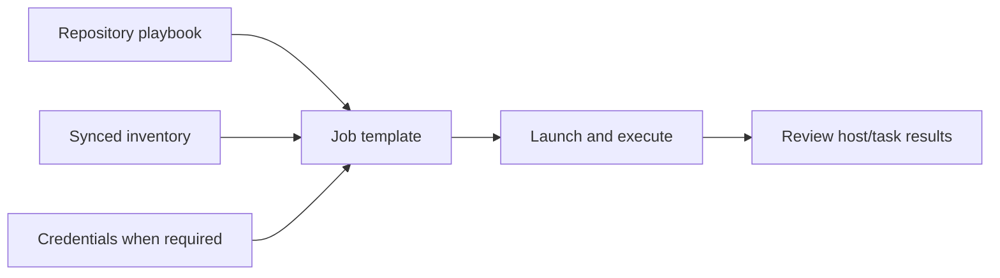

# Run your first Ansible job

Run a small playbook that prints a message on the runner. You will register a repository
playbook and inventory, create a reusable job template, launch it and inspect its result.
This example uses no cloud resources and needs no target SSH credential.

## Before you start

You need an account, an organization/project where you can manage Ansible resources, a
connected VCS repository and available Ansible execution capacity. Set up
[GitHub](../user-guides/vcs/github-app.md) or [Azure DevOps](../user-guides/vcs/azure-devops.md)
first if your project cannot select a repository.

The organization-level creation screens use the organization's project selection/defaults;
check where the created objects appear. The Terraform alternative below supplies `project_id`
explicitly.

The `localhost` in this example is the **runner**, not your laptop. Keep the sample task
read-only. To manage another host later, the chosen runner needs network access and the
appropriate SSH/cloud credentials.

## 1. Commit a playbook and inventory

Add these files to a repository you control and commit them to the branch you will select.
Save the playbook as `playbooks/hello.yml`:

```yaml
---
- name: First Stackweaver job
  hosts: demo
  connection: local
  gather_facts: false
  tasks:
    - name: Show the greeting
      ansible.builtin.debug:
        msg: Hello from Stackweaver
```

Save the inventory as `inventory/demo.yml`:

```yaml
all:
  children:
    demo:
      hosts:
        localhost:
          ansible_connection: local
```

The inventory's `demo` group matches the playbook's `hosts: demo`. These are Ansible files;
committing them does not register platform objects by itself.

## 2. Register the playbook

1. Open the organization's **Ansible > Playbooks**, choose **New Playbook** and name it `hello`.
2. Select the VCS connection, repository, branch and `playbooks/hello.yml`.
3. Keep **Source** in cached mode for this example, then save and sync the playbook.
4. Check that the recorded sync succeeds and its commit is the one you intended.


The image shows example values; use your repository and `hello.yml` path. Cached mode runs
from a captured snapshot. Fresh mode clones at execution time and needs VCS availability.
Platform and self-hosted runner fallback behavior can differ when a snapshot is missing;
see [Manage playbooks](../user-guides/managing-ansible-playbooks.md#choose-what-a-job-runs)
before relying on that case.

## 3. Register and sync the inventory

In **Ansible > Inventories**, choose **New Inventory**, select **VCS**, and select the same
connection, repository and branch with `inventory/demo.yml` as the path. Save, sync and check
that the host `localhost` and group `demo` are present before launching.

For a hand-maintained static inventory instead, create a **Static** inventory, open it and
use **Add Host** to enter host names/addresses. Add the intended group and membership before
using a playbook that targets it. The static creation dialog is not an INI-file import field.
For a normal remote-host inventory, an equivalent Ansible INI file looks like this:

```ini
[web]
web1 ansible_host=192.0.2.10
web2 ansible_host=192.0.2.11

[db]
db1 ansible_host=192.0.2.20
```

Those are documentation addresses, not reachable test targets. Use real addresses and suitable
credentials when you move beyond the local example. For discovered hosts, use
[Dynamic inventories](../user-guides/dynamic-inventories.md).

## 4. Create and launch a job template

1. Open **Job Templates > New Job Template**.
2. Name it `hello`, then choose your registered playbook and synced inventory.
3. Leave SSH credentials empty for this local debug task. Start with verbosity 0 and
   `become` disabled. After creation, use the template's **Edit > Timeout (seconds)** if
   you need a timeout.
4. Save and open the template. Check its playbook, inventory and project before choosing **Launch**.
5. Review the launch limit/tags/extra variables, then choose **Launch Job**.

The launch dialog starts with the template's values. Overrides affect only this execution;
emptying a limit/tag field clears it for this run. Extra variables use JSON in this dialog.
A successful launch creates a job; wait for its terminal result before calling it successful.



## Terraform or OpenTofu alternative

Use this instead of manually registering duplicate objects. Configure the
[Stackweaver provider](../user-guides/terraform-provider.md), an existing project and VCS
connection first. In a separate management directory, save the following as `main.tf`.
Supply your repository as `owner/repository`; this example uses branch `main`.
The connection ID is Stackweaver's connection UUID, not GitHub's numeric installation ID
or a token secret. With `STACKWEAVER_API_URL`, `STACKWEAVER_TOKEN` and `ORG` set, read IDs:

```bash
curl --fail-with-body --header "Authorization: Bearer $STACKWEAVER_TOKEN" \
  "$STACKWEAVER_API_URL/api/v2/organizations/$ORG/projects"
curl --fail-with-body --header "Authorization: Bearer $STACKWEAVER_TOKEN" \
  "$STACKWEAVER_API_URL/api/v2/organizations/$ORG/vcs-connections"
```

Choose the intended `data` entry by name/repository access and use its `id`. Set the variables
through a `.tfvars` file or `TF_VAR_*` environment inputs before planning:

```hcl
variable "project_id" {
  type = string
}
variable "vcs_connection_id" {
  type = string
}
variable "repository" {
  type = string
}

resource "stackweaver_ansible_inventory" "demo" {
  organization      = "my-org"
  project_id        = var.project_id
  name              = "demo"
  type              = "vcs"
  vcs_connection_id = var.vcs_connection_id
  vcs_repository    = var.repository
  vcs_branch        = "main"
  inventory_path    = "inventory/demo.yml"
}

resource "stackweaver_ansible_playbook" "hello" {
  project_id        = var.project_id
  name              = "hello"
  vcs_connection_id = var.vcs_connection_id
  vcs_repository    = var.repository
  vcs_branch        = "main"
  playbook_path     = "playbooks/hello.yml"
  source_mode       = "cached"
}

resource "stackweaver_ansible_job_template" "hello" {
  organization    = "my-org"
  project_id      = var.project_id
  name            = "hello"
  inventory_id    = stackweaver_ansible_inventory.demo.id
  playbook_id     = stackweaver_ansible_playbook.hello.id
  verbosity       = 0
  become_enabled  = false
  timeout_seconds = 300
}
```

Add an output so you can read the created template ID for the API launch below:

```hcl
output "template_id" {
  value = stackweaver_ansible_job_template.hello.id
}
```

After applying, `terraform output -raw template_id` returns that value.
Replace `my-org` with the provider's organization and use resources from that same organization.
Run `terraform init`, `terraform plan` and, after reviewing the plan, `terraform apply`
(or the corresponding `tofu` commands). Check the inventory/playbook syncs before launching.
Provider apply creates platform configuration; it does not prove the Ansible task has run.

For remote targets, create the right credential and attach it with
the credential-attachment resource shown below; storing it alone does not attach it to a template.

```text
stackweaver_ansible_job_template_credential
```

Use the [execution guide](../features/ansible/execution-flows.md#declare-launch-settings-with-terraform)
for that complete path.

### Launch through the API

With a permitted token, set `STACKWEAVER_API_URL` to the server origin, `STACKWEAVER_TOKEN`
through a secret store and `TEMPLATE_ID` to the created template ID. A bodyless request uses
its saved launch settings:

```bash
curl --fail-with-body --request POST \
  --header "Authorization: Bearer $STACKWEAVER_TOKEN" \
  "$STACKWEAVER_API_URL/api/v2/ansible/job-templates/$TEMPLATE_ID/launch"
```

A `403` can mean the token can manage configuration but lacks permission to execute jobs
in this template's project. Correct that permission before retrying.

Record the returned job ID. Read `GET /api/v2/ansible/jobs/<job-id>` and its `/output` endpoint
for status/output. See the [API viewer](/api-reference) for the full contract and the
[execution guide](../features/ansible/execution-flows.md#launch-once-through-the-api) for JSON
launch overrides. There is no released Stackweaver CLI equivalent documented for this task.

## 5. Read the result

The **Run** tab's matrix has hosts as rows and tasks as columns. This example should report
one successful host and a task result containing `Hello from Stackweaver`, with no failed or
unreachable hosts. A task can report `changed` without making the overall job a "changed"
terminal status; inspect both the job status and recap.

| Result | Visual cue |
|---|---|
| Successful | Green check. |
| Changed | Amber refresh. |
| Failed | Red alert. |
| Unreachable | Magenta bolt. |
| Skipped | Cyan ban. |
| Not run | Faint dot. |

Click a cell for the module result, output and diff; a host name shows its task history, and
a task column shows results across the fleet. **Timeline** explains duration; **Stream** shows
chronological events with expandable raw data. Its **Raw** toggle shows runner output.
Use the legend as a status filter and the search for host, task or result text. Press `/` to
focus search. Drag a task-column edge to read a long name and double-click to reset its width.
The copy control beside search copies raw output.

For remote-host work, attach an SSH credential and ensure the runner can reach each host.
Use a vault credential for encrypted playbook data, and cloud credentials for provider access.
Credential access is permission-controlled; inventory variables are not a substitute for a
secret store. A sudo task also needs target-side privilege escalation configured.

## Recover from a failed first run

| Symptom | Check |
|---|---|
| No hosts matched | `demo` exists in the synced inventory and matches the playbook; no launch limit excludes it. |
| Job stays queued | The template's selected platform runner or agent pool has available execution capacity. |
| Playbook missing | Repository, branch, path and sync/snapshot status. |
| Remote host unreachable | Host address, routing/firewall, SSH port and selected credential. |
| Permission denied | SSH user/key and target sudo rights; do not add `become` to the local tutorial to mask a problem. |

For a failed inventory or playbook sync, open its sync status/log, correct repository access
or the path/branch, and sync again. Confirm the expected hosts and commit before relaunching.

For the next task, read [Manage playbooks](../user-guides/managing-ansible-playbooks.md),
[repository-push sync](../features/ansible-playbook-webhook-sync.md) or the
[canonical Ansible catalogue](../features/ansible/README.md).
