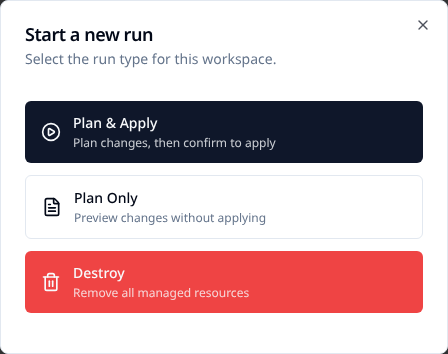

# Run your first OpenTofu workspace

Create a workspace, plan a small configuration and optionally apply it. This example uses
OpenTofu's built-in `terraform_data` resource, so you can learn the run flow without creating
cloud infrastructure or configuring a cloud provider.

## Before you start

You need an account with permission to create a workspace in an organization, a connected VCS
repository, and a platform runner or agent that can execute OpenTofu. Use a separate example
workspace and a branch you control. Planning still executes configuration code; only use code
you trust.

If you need an organization, choose **Create Organization** on the organization list. Create
a project with **New Project** if you want to group this workspace. Connect a repository using
the [GitHub App guide](../user-guides/vcs/github-app.md) or
[Azure DevOps guide](../user-guides/vcs/azure-devops.md) before the next step.

## 1. Add a small configuration

Save as `examples/first-workspace/main.tf`, commit and push it to your selected branch:

```hcl
terraform {
  required_version = ">= 1.6.0"
}

resource "terraform_data" "hello" {
  input = "Hello from Stackweaver"
}

output "greeting" {
  value = terraform_data.hello.output
}
```

This resource records a value in workspace state. It does not create a cloud VM. Keep its
working directory separate from production configuration. One repository can hold multiple
environments in separate directories; each workspace selects its own directory and state.

## 2. Create the workspace in the UI

1. Open the intended organization/project and choose **New Workspace**.
2. Name it `first-workspace`, select the VCS connection, repository and branch.
3. Set **Working Directory** to `examples/first-workspace`, relative to the repository root.
4. Choose remote execution, or an agent pool with available capacity.
5. Keep auto-apply **off** so you can review before applying. If you do not want repository
   pushes to start runs yet, turn off automatic run queuing too.
6. Create the workspace and check its saved repository, branch, directory and execution mode.

**Allow destroy plans** is enabled by default. It controls whether a destroy run can be
queued, not whether normal plans are safe. You can disable it for this example and change
it later under **Edit**.

The sample needs no input variables or cloud credentials. For other configurations, add
required Terraform/environment variables under **Variables**, or use **Import .env**, and
mark secrets sensitive. See [Manage workspace variables](../user-guides/managing-workspace-variables.md).

## Terraform or OpenTofu alternative

Use the [Stackweaver management provider](../user-guides/terraform-provider.md) to create the
workspace as code instead of creating a duplicate through the UI. Configure that provider's
host, organization and token first. In a **separate management directory**, save:

```hcl
variable "vcs_connection_id" {
  type = string
}
variable "repository" {
  type = string
}

resource "stackweaver_workspace" "first" {
  name               = "first-workspace"
  organization       = "my-org"
  working_directory  = "examples/first-workspace"
  execution_mode     = "remote"
  auto_apply         = false
  allow_destroy_plan = false

  vcs_repo {
    identifier     = var.repository
    branch         = "main"
    oauth_token_id = var.vcs_connection_id
  }
}
```

Use your organization, `owner/repository` identifier and existing VCS connection ID. The
provider uses `oauth_token_id` for this connection field: supply the Stackweaver connection
UUID, not GitHub's numeric installation ID or the token secret. Read the connection list
with a permitted token and choose its `data[].id` for the connection that can access this
repository. Set `STACKWEAVER_API_URL` to the server origin and `ORG` to the organization:

```bash
curl --fail-with-body --header "Authorization: Bearer $STACKWEAVER_TOKEN" \
  "$STACKWEAVER_API_URL/api/v2/organizations/$ORG/vcs-connections"
```
 Review the installed provider schema
and pin a compatible version. `terraform init`, `terraform plan` and `terraform apply` (or
`tofu`) manage the platform workspace here; they are separate from the example run inside it.
Read the workspace back and confirm its settings before queuing a run. If adopting a workspace
you already created, import its ID instead of creating another.

The configuration's `.tf` files define what the workspace executes. There is no management
YAML object that registers this workspace. For a direct API client, use the JSON:API creation
contract in the [API viewer](/api-reference); the provider is the repeatable configuration path
shown here. There is no released Stackweaver CLI management example for this task.

## 3. Queue a plan

Open the workspace and select **New run**:



- **Plan Only** computes changes and cannot later be applied. Choose it if you only want to
  inspect the example.
- **Plan & Apply** computes a plan, then waits for confirmation while auto-apply is off. Use
  this for the optional apply step below.

Selecting either option queues the run immediately. Wait for initialization and planning;
a queued or running status is not a successful result.

## 4. Review and optionally apply

For the example configuration, expect one `terraform_data.hello` addition and a `greeting`
output. Check the workspace, commit, working directory and resource changes before approving.
Expand resource details and use **View Raw Output** for terminal/JSON detail. Unexpected cloud
resources, deletions or replacements mean you should stop and inspect the selected configuration.

For a **Plan & Apply** run with auto-apply off, choose **Apply Plan**, review the confirmation
and confirm the apply. Wait for its terminal result and check the output/state. For a
**Plan Only** run, create a new Plan & Apply run if you decide to apply; that plan-only run
cannot be converted into an apply.

> [!WARNING]
> Auto-apply removes the manual apply checkpoint, including for destroy runs. A plan is not
> a sandbox: provider reads, external programs and other planning-time actions still use
> the runner's available permissions.

The example's successful apply should leave `greeting` equal to `Hello from Stackweaver`.
For real infrastructure, verify the target system as well as run status. An errored apply
can leave partial changes; inspect state and output before retrying.

## Troubleshoot and continue

| Symptom | Check |
|---|---|
| Repository cannot be selected or cloned | Connection access, installation/repository permissions and branch. |
| No configuration files found | The working directory is relative and contains the committed `main.tf`. |
| Run remains queued | Execution mode and runner/agent capacity. |
| Unexpected inputs or cloud access requested | The selected commit/directory is the tutorial configuration. |
| No apply action | Whether the run was plan-only, has errors or checks, or auto-applied already. |

For a failed plan, open **View Raw Output**, correct the repository configuration and push
the fix, then queue a fresh run from the intended commit. For an apply failure, inspect partial
changes and state before retrying.

A repository push can queue runs when enabled; pull-request runs are for review and do not
apply. Local execution is a separate workspace mode for CLI-driven work. Use
[Read OpenTofu runs](../user-guides/understanding-opentofu-runs.md),
[workspace settings](../features/opentofu/workspace-editing.md) and
[path filtering](../features/opentofu/vcs-path-filtering.md) when moving to a real environment.
