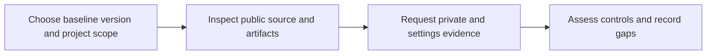

<!-- Copyright (c) 2025 VH & Co BV. Licensed under the Business Source License 1.1. See LICENSE for details. -->

# OSPS security evidence

Use this page to plan a security review: find the public evidence, identify checks that
need maintainer access and understand the gaps in Stackweaver's OSPS mapping. It is an
evidence guide, not a certification or a statement that every control is satisfied.

The mapping below retains the 24 Level 1 and 21 Level 3 control IDs from the project's
**2026.02.19** assessment scope. It does not cover Level 2 or establish full Level 3
conformance. For a new assessment, use the version marked current by
[OpenSSF](https://baseline.openssf.org/) and assess the required scope explicitly; do not
silently apply these historical IDs to another version.



## Choose the evidence you need

- **Deploying a release:** [verify its signature and attestations](./verifying-releases.md)
  against the digest you will deploy.
- **Assessing publication:** inspect [the sync trust boundary](./sync-architecture.md),
  App roles and repository requirements.
- **Assessing OSPS controls:** use the mapping below, then collect the evidence for the
  selected baseline version, source repositories and released artifacts.

Keep the baseline version, repository/workflow revision, artifact digest and check date with
your assessment. A workflow requesting an attestation is not proof that it was published;
an administrative API response is not necessarily available to a public reader.

## Scope and repository topology

The product is developed in a private monorepo and published through eight public satellites.
The shared `core/` module is private. The upstream repository and shared dependencies remain
part of a product-wide review even when they are not publicly accessible. See the
[repository map](../architecture/repositories.md) for the full source/distribution layout.

| Satellite | Purpose | Source licence | OpenSSF Scorecard |
|---|---|---|---|
| [stackweaver-api](https://github.com/vhco-pro/stackweaver-api) | API | BSL 1.1 | [](https://scorecard.dev/viewer/?uri=github.com/vhco-pro/stackweaver-api) |
| [stackweaver-frontend](https://github.com/vhco-pro/stackweaver-frontend) | Frontend and public docs | BSL 1.1 | [](https://scorecard.dev/viewer/?uri=github.com/vhco-pro/stackweaver-frontend) |
| [stackweaver-orchestrator](https://github.com/vhco-pro/stackweaver-orchestrator) | Job scheduling | BSL 1.1 | [](https://scorecard.dev/viewer/?uri=github.com/vhco-pro/stackweaver-orchestrator) |
| [stackweaver-ansible-runner](https://github.com/vhco-pro/stackweaver-ansible-runner) | Ansible execution | Apache-2.0 | [](https://scorecard.dev/viewer/?uri=github.com/vhco-pro/stackweaver-ansible-runner) |
| [stackweaver-opentofu-runner](https://github.com/vhco-pro/stackweaver-opentofu-runner) | OpenTofu execution | Apache-2.0 | [](https://scorecard.dev/viewer/?uri=github.com/vhco-pro/stackweaver-opentofu-runner) |
| [stackweaver-helm](https://github.com/vhco-pro/stackweaver-helm) | Helm chart | Apache-2.0 | [](https://scorecard.dev/viewer/?uri=github.com/vhco-pro/stackweaver-helm) |
| [stackweaver-zitadel-init](https://github.com/vhco-pro/stackweaver-zitadel-init) | Identity bootstrap | BSL 1.1 | [](https://scorecard.dev/viewer/?uri=github.com/vhco-pro/stackweaver-zitadel-init) |
| [stackweaver-secrets-init](https://github.com/vhco-pro/stackweaver-secrets-init) | Secret bootstrap | BSL 1.1 | [](https://scorecard.dev/viewer/?uri=github.com/vhco-pro/stackweaver-secrets-init) |

Read the actual `LICENSE` and its terms. GitHub can classify BSL repositories as
`NOASSERTION`; that does not mean the licence file is absent. BSL's future change licence
does not remove its current restrictions.

## How to read the control mapping

The labels describe **evidence access or an identified limitation**, not a pass score:

| Label | Meaning |
|---|---|
| Public | A reader can inspect the linked documentation or public repository data. |
| Source | Inspect the relevant workflows/code and their execution conditions. |
| Artifact | Verify the exact released digest and its contents or signed statements. |
| Maintainer | Request private evidence or use an account with appropriate settings access. |
| Gap | A documented limitation prevents treating the stated requirement as satisfied. |

The source/protection checks were reviewed on 26 October 2026. The [API and Helm verification examples](./verifying-releases.md#verification-examples) identify
the exact tested versions, digests and expected workflow identities. Their signatures,
provenance, SPDX SBOM and OpenVEX checks succeeded.
Those samples do not certify all components or all releases. Each row still needs an
assessment against the baseline's full requirement and the project's actual scope.

## OSPS Baseline - Level 1

### Access control

| Control | Review question | Evidence | Where to check |
|---|---|---|---|
| AC-01.01 | MFA required to modify the authoritative repository | Maintainer | Request MFA enforcement and enrolment evidence for every authoritative repository, including the private upstream; organisation metadata alone does not cover a personal repository. |
| AC-02.01 | New collaborators default to least privilege | Maintainer | Inspect organisation defaults and actual collaborator grants. Request a dated access-policy export. |
| AC-03.01 | Direct commits to the primary branch are prevented | Maintainer | Checked satellites require one approving review. Assess repository rules, bypass actors and the authoritative upstream separately. |
| AC-03.02 | Deletion of the primary branch requires explicit confirmation | Maintainer | Branch deletion is disabled in the checked satellite protections. Inspect the current protection and rulesets. |

### Build and release protection

| Control | Review question | Evidence | Where to check |
|---|---|---|---|
| BR-01.01 | Untrusted CI metadata is sanitised before use | Source | Inspect input handling in each privileged workflow. The sync workflow-file warning does not stop later approval steps; see [Sync architecture](./sync-architecture.md#what-the-approval-workflow-checks). |
| BR-01.03 | Untrusted code snapshots cannot access privileged CI credentials | Source | The checked auto-approval workflow does not execute PR source. Review other workflows and their credential boundaries separately. |
| BR-03.01 | Official project channels use encrypted transport | Public | Check the official GitHub, registry and documentation URLs for HTTPS. |
| BR-03.02 | The official distribution channel is authenticated against adversary-in-the-middle attacks | Artifact | Use TLS and verify the expected artifact digest, signer and issuer using [release verification](./verifying-releases.md). |
| BR-07.01 | Unencrypted secrets are kept out of version control | Maintainer | Secret scanning and push protection are enabled in all eight checked satellite metadata responses. Assess upstream scanning and exceptions separately. |

### Documentation

| Control | Review question | Evidence | Where to check |
|---|---|---|---|
| DO-01.01 | Documentation includes user guides for basic functionality | Public | Review the [user guides](../user-guides/README.md) against the functionality you intend to use. |
| DO-02.01 | Documentation includes a defect-reporting guide | Public | Inspect the [organisation issue templates](https://github.com/vhco-pro/.github/tree/main/.github/ISSUE_TEMPLATE) and defect-routing instructions. |

### Governance

| Control | Review question | Evidence | Where to check |
|---|---|---|---|
| GV-02.01 | A mechanism exists for public discussion | Public | All eight checked satellites expose Discussions. Evaluate the discussion mechanism for the project scope. |
| GV-03.01 | The contribution process is documented | Public | Read the [contribution guide](https://github.com/vhco-pro/.github/blob/main/CONTRIBUTING.md). |

### Licensing

| Control | Review question | Evidence | Where to check |
|---|---|---|---|
| LE-02.01 | The source-code licence meets the OSI/FSF definition | Gap | BSL 1.1 source is not OSI-approved open source. A future Apache change date does not satisfy the current licence requirement. |
| LE-02.02 | The released-asset licence meets the OSI/FSF definition | Gap | Assess each released asset and its bundled licences. BSL use restrictions remain relevant until the applicable change date. |
| LE-03.01 | The licence is maintained in a `LICENSE` file in the repository | Public | Inspect each repository LICENSE. GitHub classifier NOASSERTION is not a substitute for reading the licence text. |
| LE-03.02 | The licence is included in the released asset bundle | Artifact | Inspect the selected image or chart for its LICENSE and any required NOTICE; a source file does not prove inclusion in an asset. |

### Quality assurance

| Control | Review question | Evidence | Where to check |
|---|---|---|---|
| QA-01.01 | The source repository is publicly readable at a static URL | Gap | The eight satellites are public; the shared core module is private. NDA access is a separate audit option, not public source availability. |
| QA-01.02 | There is a public record of every change (who and when) | Public | Satellite Git history and sync PRs are public. The private upstream review record needs separate evidence; provenance alone does not expose it. |
| QA-02.01 | The repository contains a list of direct dependencies | Public | Inspect the relevant dependency manifests and lockfiles, including dependencies resolved from the private core module. |
| QA-04.01 | A multi-repository project documents its list of codebases | Public | Use the [repository map](../architecture/repositories.md) to identify the product codebases and distribution boundaries. |
| QA-05.01 | No generated executable artefacts are stored in version control | Source | Inspect versioned files and build-output exclusions. A Scorecard result is a signal to investigate, not a complete source inventory. |
| QA-05.02 | No unreviewable binary artefacts are stored in version control | Source | Review any committed binary assets and their purpose; distinguish documentation images from executable build artifacts. |

### Vulnerability contacts

| Control | Review question | Evidence | Where to check |
|---|---|---|---|
| VM-02.01 | Documentation contains security contacts | Public | Use the contact and reporting route in the [security policy](https://github.com/vhco-pro/.github/blob/main/SECURITY.md). |

## OSPS Baseline - Level 3

### Access control and build

| Control | Review question | Evidence | Where to check |
|---|---|---|---|
| AC-04.02 | CI jobs run with the minimum privileges necessary | Source | Compare workflow job scopes and App permissions with each operation. Top-level permissions alone do not establish least privilege. |
| BR-01.04 | Trusted-collaborator CI input is sanitised before use | Source | Inspect trusted-input sanitisation across sync and release workflows; metadata-only handling does not establish every input is safe. |
| BR-02.02 | Release assets are clearly associated with the release identifier | Artifact | Match the selected release, image/chart digest and actual asset list. The OpenTofu runner release checked in this review has no attached files. |
| BR-07.02 | A policy exists for managing secrets and credentials | Maintainer | Request credential storage, access and rotation policy plus implementation evidence. The public policy is not the complete internal procedure. |

### Documentation (release-time)

| Control | Review question | Evidence | Where to check |
|---|---|---|---|
| DO-03.01 | Documentation explains how to verify release integrity and authenticity | Public | Follow [Verify a release](./verifying-releases.md) for signer, digest, provenance and failure handling. |
| DO-03.02 | Documentation explains how to verify the identity of the release author | Public | The same guide pins the expected signing workflow identity and issuer; verify the selected artifact. |
| DO-04.01 | A statement of support scope and duration accompanies each release | Gap | The public security policy labels the supported-version policy as a working policy. Confirm the release-specific support commitment with maintainers. |
| DO-05.01 | A statement describes when releases stop receiving security updates | Public | Read the end-of-life section of the [security policy](https://github.com/vhco-pro/.github/blob/main/SECURITY.md#end-of-life) and confirm its applicability to the selected release. |

### Governance and quality assurance

| Control | Review question | Evidence | Where to check |
|---|---|---|---|
| GV-04.01 | Collaborators are reviewed before being granted escalated permissions | Maintainer | Request the access-escalation policy and review records. A low default permission is not evidence of review for every grant. |
| QA-02.02 | Compiled released assets are delivered with a software bill of materials | Artifact | Verify an SPDX SBOM for the chosen digest. Successful API/chart sample checks do not prove coverage for every compiled artifact. |
| QA-04.02 | Subprojects enforce security requirements at least as strict as the primary | Maintainer | Compare each component policy and enforcement. Helm has no required branch status check and the OpenTofu runner keeps stale reviews in the checked settings. |
| QA-06.02 | Documentation clearly describes how tests are run | Public | Inspect build/test instructions for the relevant component; the private monorepo Makefile is not sufficient public instruction on its own. |
| QA-06.03 | A policy requires major changes to add or update automated tests | Public | Inspect the [contribution policy](https://github.com/vhco-pro/.github/blob/main/CONTRIBUTING.md) and accompanying test-review evidence. |
| QA-07.01 | Primary-branch commits require at least one non-author human approval | Gap | A GitHub App approval is not the required non-author human approval. Assess authoritative review enforcement and records separately. |

### Security architecture

| Control | Review question | Evidence | Where to check |
|---|---|---|---|
| SA-03.02 | A threat model and attack-surface analysis is performed | Maintainer | Use the public [sync trust boundary](./sync-architecture.md) as one input; request the product-wide threat model and evidence it covers critical paths. |

### Vulnerability management

| Control | Review question | Evidence | Where to check |
|---|---|---|---|
| VM-04.02 | A VEX document accompanies releases for non-affecting vulnerabilities | Artifact | Verify OpenVEX for the selected digest and review its statements. An attestation proves a signed statement, not the absence of vulnerabilities. |
| VM-05.01 | A policy defines remediation thresholds for SCA findings | Maintainer | Request the documented SCA and licence-remediation thresholds; do not infer them from installed scanner names. |
| VM-05.02 | A policy requires SCA violations to be addressed prior to release | Maintainer | Review the pre-release SCA policy, exceptions and actual blocking configuration. |
| VM-05.03 | Changes are automatically evaluated against a malicious-dependency / known-vulnerability policy and blocked on violation | Source | Inspect dependency-review and scanner triggers, blocking exit codes and justified suppressions for the relevant change path. |
| VM-06.01 | A policy defines remediation thresholds for SAST findings | Maintainer | Request the documented SAST-remediation thresholds and triage/closure evidence. |
| VM-06.02 | Changes are automatically evaluated against a SAST policy and blocked on violation | Source | Inspect required CodeQL checks and release policy for the selected component; Helm has no required branch status check in the checked snapshot. |

## Argued deviations

A documented rationale helps an auditor understand a gap; it does not automatically satisfy
an unmet requirement. Keep the requirement, evidence, limitation and assessment decision
separate.

**Licensing and private source.** Apache-2.0 and BSL components need separate licence
assessments. The private core module prevents a public reader from reviewing all product
source. The [security policy](https://github.com/vhco-pro/.github/blob/main/SECURITY.md#audit-access-to-closed-components)
offers an audit-access route under NDA; that is a restricted-access review, not public
source availability.

**Automated publication and human review.** The reviewer App's approval is automated. It
does not satisfy a requirement for a non-author human approval. Upstream human review and
its enforcement need their own evidence. A satellite signature or provenance statement does
not establish that review by itself.

**Workflow and protection differences.** The sync workflow-file check is warning-only.
Helm has no required branch status check in the checked snapshot, and the OpenTofu runner
does not dismiss stale reviews. Account for these differences rather than treating the
strictest satellite as representative of the whole product.

## Current OpenSSF Scorecard scores

Use the live badges above to open the full report and inspect each component's latest available assessment, its
scan date and the individual checks. Reports and badges can lag or be unavailable. A high
aggregate score does not establish OSPS conformance; a low score needs its actual finding
reviewed, not dismissed as an unavoidable structural ceiling.

For a scripted lookup, install `curl` and `jq`, then inspect the scan metadata alongside
the score:

```bash
REPO=stackweaver-api
curl --fail --silent --show-error \
  "https://api.scorecard.dev/projects/github.com/vhco-pro/${REPO}" \
  | jq '{date, score, checks}'
```

Automated reviews, the number of required reviewers, reusable release actions, Best
Practices registration and contributor diversity can affect individual results. Read the
current explanation and evidence in that report; do not assume a fixed score for every
satellite or infer that a finding is harmless from the publication model.

## Collect maintainer evidence

Use [the sync inspection procedure](./sync-architecture.md#inspect-maintainer-evidence) for
protection and ruleset exports. It identifies the required access and handles unavailable
settings without interpreting an access error as proof of a security failure.

Request these additional inputs for a complete assessment:

1. Authoritative-repository access, MFA, collaborator and escalation policies, with evidence
   of their enforcement.
2. Human review requirements and records for the upstream source changes being assessed.
3. Secret custody/rotation and vulnerability-remediation policies, including scanner
   thresholds, justified suppressions and release-blocking behavior.
4. A release-specific support commitment. The public policy's supported-version section is
   labelled a working policy; do not turn that into a guaranteed support window here.
5. Private-source audit access and the product-wide threat model where they are in scope.

Record gaps and unavailable evidence explicitly. For suspected vulnerabilities, follow the
[private reporting policy](https://github.com/vhco-pro/.github/blob/main/SECURITY.md) rather
than publishing sensitive findings or credentials in an issue.
