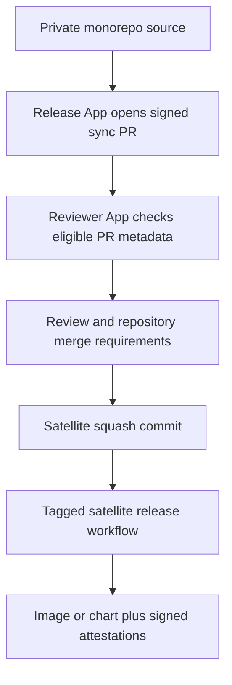

<!-- Copyright (c) 2025 VH & Co BV. Licensed under the Business Source License 1.1. See LICENSE for details. -->

# Understand satellite publication

Stackweaver's public component repositories receive selected source from a private monorepo.
A release-bot opens a sync pull request; a separate reviewer App can approve it and request
a squash merge. The satellite then builds and publishes its own releases.

Use this page to distinguish the source-publication boundary from the artifact-signing
boundary. For commands that verify a deployed image or chart, use
[Verify a release](./verifying-releases.md).



<details>
<summary>Diagram legend: which identity signs what?</summary>

- The release App creates the sync PR. Its PR-head commit uses the monorepo sync workflow's
  Sigstore identity.
- The reviewer App creates an automated approval. That approval is not a human review.
- A squash merge creates a new commit. Its signature is separate from the PR head's signature.
- The satellite release workflow signs its artifact and publishes attestations for that digest.

</details>

## Trust boundaries

**Public source and private development.** You can inspect the satellite's source, PR history
and workflows. The shared `core/` module and upstream review records are not publicly
readable. Auditors can request access through the
[security policy](https://github.com/vhco-pro/.github/blob/main/SECURITY.md#source-code-review-boundary).
Public artifact provenance identifies the satellite build; it does not by itself prove
which private monorepo change was reviewed.

**Two Apps and GitHub permissions.** `stackweaver-release-bot` writes sync branches and PRs.
`stackweaver-pr-reviewer` approves eligible PRs and requests auto-merge. They use separate App
credentials because a PR author cannot supply its own required approval.

| App | Observed repository permissions | Purpose |
|---|---|---|
| Release bot | Contents write, pull requests write, administration read, metadata read | Publish the sync branch and PR. |
| PR reviewer | Contents write, pull requests write, metadata read | Approve and request squash auto-merge. |

The reviewer has no workflow-write or administration permission in the checked App metadata.
These scopes are separate from conditions in the automation. A compromised App credential
can be used outside that workflow, so the workflow's author/branch checks do not prove that
an attacker would need both App keys. Repository rules and the App's actual permissions
remain part of the boundary.

## What the approval workflow checks

The public `auto-approve-sync.yml` runs on `pull_request_target`. Before its job runs,
three conditions must match:

1. The author is `stackweaver-release-bot[bot]`.
2. The head branch starts with `sync/`.
3. The head repository is the same as the base repository.

The job does not check out or execute PR source. It reads PR metadata and the changed-file
list, mints a reviewer token, posts an approval and requests squash auto-merge. Avoiding
untrusted code execution reduces one important risk of this privileged event; it does not
make every use of the token safe automatically.

> [!WARNING]
> The workflow-file check currently logs a warning and exits its step successfully when
> `.github/workflows/` changes. The later approval and auto-merge steps are not conditional
> on that result. This check is not an enforced fourth gate. Do not rely on the warning to
> prevent approval or substitute it for GitHub permission and repository-rule checks.

The eight public satellites use the same checked auto-approval workflow. Workflow edits
need explicit maintainer scrutiny, including whether the final approval and merge steps
are prevented from running. Matching text in a workflow is not proof of that control flow.

## What repository protection enforces

A review requirement and required status checks are separate settings. The protection
snapshot checked on 26 October 2026 shows:

| Satellites | Approving reviews | Required status check | Dismiss stale reviews |
|---|---|---|---|
| API, Frontend, Orchestrator, Ansible runner, Zitadel init, Secrets init | 1 | Component CodeQL analysis | Yes |
| OpenTofu runner | 1 | Go CodeQL analysis | No |
| Helm | 1 | None configured in branch protection | Yes |

All eight checked protections apply to administrators and disable force pushes and branch
deletion. These observations describe the checked configuration, not an immutable promise.
Read the current rules for the repository you are assessing; do not assume that every lint,
test or release scan is a required merge check, or that settings are identical across satellites.
Additional repository rulesets can impose further requirements.

Sync jobs use per-component concurrency groups and retain running jobs. They check for an
existing sync PR or published sync branch before retrying publication. This reduces duplicate
publication work; it is not a guarantee of a fixed release time.

## Inspect public evidence

With GitHub CLI access to public repositories, choose the satellite you want to inspect.
The [repository map](../architecture/repositories.md) lists the components; the OpenTofu
runner is `vhco-pro/stackweaver-opentofu-runner`.

```bash
REPO=vhco-pro/stackweaver-api

# Read the full workflow, including conditions on later approval/merge steps.
gh api "repos/${REPO}/contents/.github/workflows/auto-approve-sync.yml" \
  --jq '.content' | base64 --decode

# Inspect recent sync PRs and their resulting merge commits.
gh pr list --repo "$REPO" --state merged \
  --author app/stackweaver-release-bot --limit 5 \
  --json number,headRefName,headRefOid,mergeCommit,url

# Read the Apps' published permission declarations.
gh api apps/stackweaver-release-bot --jq '.permissions'
gh api apps/stackweaver-pr-reviewer --jq '.permissions'
```

Expect the three job-level predicates above and check what happens after the workflow-file
step. App metadata describes declared permissions; it does not prove which installations
or tokens had access at the time of a specific merge. Follow
[sync-signature verification](./verifying-releases.md#verify-a-sync-commit) to verify a selected
PR head's signer.

## Inspect maintainer evidence

The protection lookup below needs suitable repository access. For fine-grained tokens,
GitHub requires **Administration: read**. It can fail for an ordinary external reader even
when the repository is public.

```bash
REPO=vhco-pro/stackweaver-api

gh api "repos/${REPO}/branches/main/protection" --jq '{
  reviews: .required_pull_request_reviews.required_approving_review_count,
  dismiss_stale: .required_pull_request_reviews.dismiss_stale_reviews,
  checks: (.required_status_checks.contexts // []),
  admins: .enforce_admins.enabled,
  force_push: .allow_force_pushes.enabled,
  deletions: .allow_deletions.enabled
}'

# Inspect additional active repository rulesets as part of the assessment.
gh api "repos/${REPO}/rulesets" --jq '.[] | {id, name, enforcement}'
```

Compare the result with the selected repository's expected policy. A `403` or `404` alone
cannot distinguish missing permission from missing configuration. Ask a maintainer for a
dated export when you cannot inspect the settings yourself.

App-installation lookup authenticates as the relevant App. It does not list both Apps for
an ordinary reader. For an audit, request separate evidence of installation, token scope,
upstream reviews, credential handling and applicable bypass actors. Public workflow/source
checks alone cannot establish those facts.

## What to retain for an audit

Keep the repository and commit, workflow revision, PR head and squash commit, protection/ruleset
snapshot, App permission evidence and verified artifact digest together. Separate source
observations from private maintainer assertions and artifact-level verification results.

Do not infer a human review from an App approval, or infer uncompromised code from a valid
signature. Use [OSPS evidence](./osps-baseline-compliance.md) for the control mapping and
[release verification](./verifying-releases.md) for artifact checks. Report a suspected
security problem through [the private reporting policy](https://github.com/vhco-pro/.github/blob/main/SECURITY.md).
