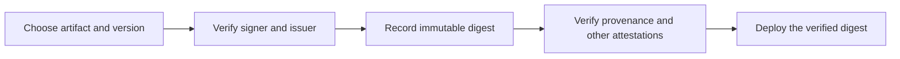

<!-- Copyright (c) 2025 VH & Co BV. Licensed under the Business Source License 1.1. See LICENSE for details. -->

# Verify a Stackweaver release

Before deploying, verify the artifact's signature and build provenance against the workflow
that you expect to publish it. Keep the verified digest in your deployment configuration
and audit record.

Stackweaver uses Sigstore keyless signing. Verification checks a short-lived signing
certificate and transparency evidence; you do not need a project GPG key or `cosign.pub`.
A valid signature identifies a signer. It does not establish that the software is free of
vulnerabilities or that every upstream change received human review.



## Before you start

Install [cosign](https://docs.sigstore.dev/cosign/system_config/installation/) and the
[GitHub CLI](https://cli.github.com/). For sync-commit verification, also install
[gitsign](https://github.com/sigstore/gitsign#installation) and Git.

Authenticate `gh` for GitHub API access. Registry access is separate: public source does
not imply a public container package. If GHCR denies access, authenticate with an account
that can read that package. See [GHCR access](../get-started/self-hosting/kubernetes/kubernetes-pull-secret-ghcr.md).
The chart is publicly pullable. Check access for the exact image you intend to verify.

These commands use the satellite repository's full `owner/repository` name. Replace the
version and component with the release you intend to deploy; do not deploy a sample just
to match the guide.

## 1. Verify a container signature

Choose a component: `api`, `frontend`, `orchestrator`, `opentofu-runner`, `ansible-runner`,
`zitadel-init` or `secrets-init`. Set its exact release tag:

```bash
COMPONENT=api
VERSION=0.17.36
REPO="vhco-pro/stackweaver-${COMPONENT}"
IMAGE="ghcr.io/${REPO}"
IDENTITY="https://github.com/${REPO}/.github/workflows/release.yml@refs/tags/${VERSION}"

cosign verify \
  --certificate-identity "$IDENTITY" \
  --certificate-oidc-issuer https://token.actions.githubusercontent.com \
  "${IMAGE}:${VERSION}"
```

Expect exit code zero, successful certificate/signature checks and a JSON payload containing
`critical.image.docker-manifest-digest`. Record that digest. The identity pins the release
workflow and tag; do not widen it to any workflow in the organisation to make a failure pass.

Set `DIGEST` to that returned value, including its `sha256:` prefix, then verify the same
identity against the immutable reference:

```bash
DIGEST='sha256:REPLACE_WITH_THE_VERIFIED_DIGEST'
REF="${IMAGE}@${DIGEST}"

cosign verify \
  --certificate-identity "$IDENTITY" \
  --certificate-oidc-issuer https://token.actions.githubusercontent.com \
  "$REF"
```

Use this digest for the remaining checks and deployment. If the tag changes between the
two checks, stop and reconcile the references rather than deploying the replacement.

## 2. Verify build provenance

With `REPO`, `REF` and `IDENTITY` from the signature check:

```bash
gh attestation verify "oci://${REF}" \
  --repo "$REPO" \
  --cert-identity "$IDENTITY" \
  --predicate-type https://slsa.dev/provenance/v1 \
  --format json
```

Expect exit code zero and verified provenance for that subject digest. Inspect the source
repository/commit, workflow ref and build-run URL in the result. Keep them with the digest.
The release workflows use GitHub attestations; workflow configuration alone does not prove
that a particular artifact has an attestation.

The API provenance identifies the satellite source commit. Do not treat it as proof of a
private monorepo commit, upstream human approval or SLSA Build Level 3 conformance. Those
need additional source/review and builder evidence. See [Sync architecture](./sync-architecture.md).

## 3. Verify the SBOM and vulnerability statements

Run these checks against the same `REF`. Each predicate is a different signed statement:

```bash
# SPDX 2.3 software bill of materials
gh attestation verify "oci://${REF}" \
  --repo "$REPO" \
  --cert-identity "$IDENTITY" \
  --predicate-type https://spdx.dev/Document/v2.3

# OpenVEX vulnerability statements
gh attestation verify "oci://${REF}" \
  --repo "$REPO" \
  --cert-identity "$IDENTITY" \
  --predicate-type https://openvex.dev/ns/v0.2.0
```

Expect both commands to exit zero. An SBOM lists components; OpenVEX records the publisher's
vulnerability applicability statements. Neither replaces your vulnerability policy or
proves that the artifact has no vulnerabilities.

Some releases also attach `provenance.intoto.jsonl`, `sbom.spdx.intoto.jsonl` and
`checksums.txt` to their GitHub Release. Check the actual asset list. A checksum checks bytes,
not signer identity; a downloaded attestation still needs verification. Do not assume that
every release has those files or that the SBOM is a raw, unsigned Release attachment.

## Verify the Helm chart

The chart's registry path is `ghcr.io/vhco-pro/charts/stackweaver`. Its signer is the Helm
satellite's release workflow. Select the chart version independently of container versions:

```bash
VERSION=0.14.0
REPO=vhco-pro/stackweaver-helm
IMAGE=ghcr.io/vhco-pro/charts/stackweaver
IDENTITY="https://github.com/${REPO}/.github/workflows/release.yml@refs/tags/${VERSION}"

cosign verify \
  --certificate-identity "$IDENTITY" \
  --certificate-oidc-issuer https://token.actions.githubusercontent.com \
  "${IMAGE}:${VERSION}"
```

Record the returned digest, set `DIGEST` and `REF` as in step 1, and run steps 2 and 3 with
these Helm variables. Verify the images selected by your chart values separately: a chart
signature does not verify the containers that it deploys.

## Verify older releases

Older releases can use a different attestation format or lack attestations. Select the
release's actual workflow and available evidence before choosing a command. A recent sample
does not establish a minimum supported version or guarantee every later publication.

For charts carrying the legacy cosign SPDX attestation, use the same expected identity
and issuer as the signature check, with the legacy attestation verifier:

```bash
cosign verify-attestation \
  --certificate-identity "$IDENTITY" \
  --certificate-oidc-issuer https://token.actions.githubusercontent.com \
  --type https://spdx.dev/Document/v2.3 \
  "$REF"
```

This is an alternative for the legacy format, not a fallback that makes a failed current
GitHub-attestation check acceptable. Check the selected release's workflow and requirements;
missing evidence does not become verified by comparing a tag or checksum.


## Verify a sync commit

A sync PR's signed head and the resulting squash commit are different Git objects. Verify
the PR head to check the sync workflow's Sigstore identity. A GitHub `Verified` badge on the
squash commit does not verify that original identity.

For the API satellite, choose a merged release-bot sync PR and verify its head in a separate
clone. This downloads source but does not execute it:

```bash
REPO=vhco-pro/stackweaver-api
gh pr list --repo "$REPO" --state merged \
  --author app/stackweaver-release-bot --limit 5 \
  --json number,headRefName,headRefOid,mergeCommit,url

# Replace this example with the merged sync PR you intend to inspect.
PR=249

git clone "https://github.com/${REPO}.git" stackweaver-api-verification
cd stackweaver-api-verification
git fetch origin "refs/pull/${PR}/head"

gitsign verify \
  --certificate-identity https://github.com/michielvha/stackweaver/.github/workflows/sync-api.yml@refs/heads/main \
  --certificate-oidc-issuer https://token.actions.githubusercontent.com \
  FETCH_HEAD
```

Expect exit code zero and valid Git signature, certificate claims and transparency evidence.
Confirm that the selected PR is the sync you intend to inspect; the latest merged PR is not
necessarily the source of your selected image. Set `PR` explicitly after inspecting its source
and merge relationship. For another satellite, replace `REPO`, the clone directory and the
identity's workflow filename using this mapping. The monorepo identity prefix and
`@refs/heads/main` suffix stay the same:

| Component | Sync workflow filename |
|---|---|
| API | `sync-api.yml` |
| Frontend | `sync-frontend.yml` |
| Orchestrator | `sync-orchestrator.yml` |
| Ansible runner | `sync-ansible-runner.yml` |
| OpenTofu runner | `sync-runner.yml` |
| Zitadel init | `sync-zitadel-init.yml` |
| Secrets init | `sync-secrets-init.yml` |
| Helm | `sync-helm.yml` |

The signer lives in the private monorepo. Its certificate can be verified publicly, but it
does not expose the private source or review record. See [the trust boundary](./sync-architecture.md#trust-boundaries).
Other commits, including GitHub squash commits and maintainer commits, can use another
signature mechanism; do not disable identity checking to accept them as sync signatures.

## Verification examples

On 26 October 2026, the signature, provenance, SPDX 2.3 SBOM and OpenVEX checks succeeded
for these two artifacts with their exact tag-specific satellite `release.yml` identities:

- API `0.17.36`.
- Helm chart `0.14.0`.

The verified references were:

```text
ghcr.io/vhco-pro/stackweaver-api@sha256:6f1b111ba6ad0a5bd0a23460641bbea9ca29d8f80d53562825948a458fd86be9
ghcr.io/vhco-pro/charts/stackweaver@sha256:4830965417cc53198af2e5cf064d37bd65b59c0f3f475e1c021ea7807d7573cb
```

These are reproducible examples, not a fleet-wide result or a requirement to deploy those
versions. Verify the digest and policy for your selected release.

## When a check fails

| Result | Next action |
|---|---|
| GHCR denies access | Confirm the package path, registry login and read permissions. |
| No matching attestation | Check the exact digest, release workflow and predicate type. Older or incomplete publications can lack evidence. |
| Unexpected signer, issuer or digest | Stop deployment and investigate the mismatch. Keep the failing reference and output. |
| Certificate or transparency verification fails | Check tool support, trust configuration and service access; keep the artifact unverified until resolved. |
| `gitsign` rejects a squash commit | Fetch and verify the intended sync PR head instead. |

For a suspected authenticity problem, use the affected repository's **Security > Report a
vulnerability** option or email [contact@vhco.pro](mailto:contact@vhco.pro). Include the
artifact digest, expected version/identity and redacted command output. Do not post secrets
or vulnerability details in a public issue. See the [security policy](https://github.com/vhco-pro/.github/blob/main/SECURITY.md).
