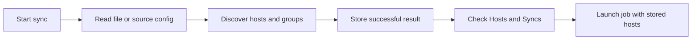
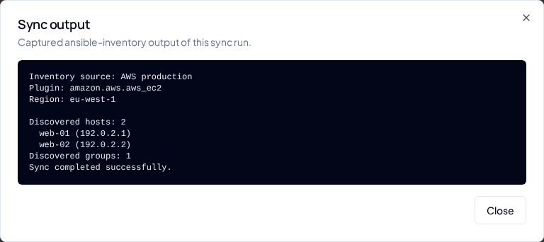

# Dynamic inventories

Refresh hosts from a cloud provider or a repository inventory file, check what was found,
then use those stored hosts in an Ansible job. Choose how the inventory should refresh
before later launches.

## Before you start

You need access to the inventory and permission to manage it: inventory write for a
project-scoped inventory, or organization Ansible management for an organization-scoped
one. Creating a new inventory also requires organization Ansible management. Reading sync
history requires organization Ansible read permission. A visible button alone does not
establish that your account can perform the operation.

The sync must reach the repository and cloud APIs and have the required Ansible
inventory plugin and authentication available where it runs. A VCS inventory always
syncs on the organization's **hosted capacity**, even when the eventual job uses a
self-hosted agent pool. A cloud source syncs on its project's or organization's default
agent pool when one is set, and on the hosted capacity otherwise. Choose a credential or
identity with read access to the resources you intend to discover.

For the cloud examples below, scope that access to the resources you need:

| Provider | Discovery access |
|---|---|
| AWS | `ec2:DescribeInstances`; region enumeration can also require `ec2:DescribeRegions`. |
| Azure | The `Reader` role on the target subscription or resource groups. |
| GCP | `compute.instances.list` on each target project. |

<a id="two-approaches" style="scroll-margin-top: 7rem"></a>

## Choose where configuration lives

VCS versus cloud source chooses where discovery settings live. UI, API and Terraform
choose how you register and manage that definition; they are not competing inventory types.
Use the UI steps below, [API requests](cloud-sources.md#configure-a-source-through-the-api), or
[Terraform/OpenTofu definitions](cloud-sources.md#manage-the-definition-with-terraform-or-opentofu).
All three paths still need a successful discovery and a host-set check.

| Use | When to choose it | Where discovery settings live |
|---|---|---|
| **VCS** inventory | Review plugin configuration in Git, including provider filters, hostnames and grouping. | A plugin YAML file in the selected repository and branch. |
| **Dynamic** inventory with cloud sources | Combine sources with their own credentials and refresh settings. | Each source's configuration. Use the API for provider-specific settings the form does not expose. |

The cloud-source form does not expose regions, GCP projects, Azure subscription/resource
groups or a general plugin configuration editor. Its generic hostname and grouping
controls are not used by the current cloud configuration generators. Configure those
settings through VCS YAML or the source API `config` before relying on them.

**Custom Script** appears in the source selector but its sync implementation is incomplete.
Use a supported cloud source or a VCS inventory file.

<a id="how-it-works" style="scroll-margin-top: 7rem"></a>

## Understand the refresh



<details>
<summary>What each step does</summary>

The sync reads the repository file or generates a plugin file from the cloud
source configuration. It runs Ansible's inventory discovery and records the result.
Jobs use the stored hosts and variables. Refreshing them is a separate operation, which
can also run automatically before a job when update on launch is enabled.

</details>

<a id="viewing-synced-hosts" style="scroll-margin-top: 7rem"></a>
<a id="syncing-and-live-status" style="scroll-margin-top: 7rem"></a>

## Check a sync before using its hosts

1. Wait for **Synced**, or read the failed source's error on **Sources**. A green state with zero
   hosts is not proof that authentication and scope are correct.
2. Open **Hosts** and check the count, names, `ansible_host` and variables against the intended
   machines. Open **Groups** if your playbook targets generated groups.
3. Open **Syncs** and select the run. Check its trigger, counts, duration and captured output.
   Every sync, VCS file syncs included, streams its output while it runs.
4. Select the inventory in your job template only after the host set is appropriate.



The page refreshes active sync status automatically. A local completion notification can
stop waiting after about a minute; that does not cancel the sync. Return to **Syncs** for
the final result. Warnings can accompany a successful discovery; read them before assuming
the returned host set is complete.

<a id="per-source-sync-behavior" style="scroll-margin-top: 7rem"></a>

## Choose refresh and merge settings

These settings belong to individual cloud sources. A VCS inventory does not gain
automatic Git refresh from this table: use **Sync from VCS**, then check its result
before launching jobs that need repository changes. Constructed inventories have
their own rebuild and cache behavior, described below.

| Setting | Effect |
|---|---|
| **Update on launch** | Enabled sources refresh before jobs use this inventory. A recent successful sync within the cache timeout can skip that refresh. The default is on. |
| **Cache timeout** | Seconds for which a successful source sync is considered fresh. Set it to `0` to refresh on every launch. |
| **Overwrite** | After a successful sync, remove hosts/groups owned by this source that disappeared from its result. A successful empty result can remove all of that source's rows. Failed discovery leaves them unchanged. |
| **Overwrite variables** | Replace a host's variables, including manually added keys. With it off, merge variables; synced values win on conflicting keys. |
| **Sync verbosity** | Increase diagnostic output when investigating a problem, then check **Syncs**. |

Avoid overlapping host/group names when sources must remain independent. Discovery can
update an existing name and adopt a previously unowned row; a manually created name is
not guaranteed protection from later overwrite pruning.

### When an update-on-launch sync fails

> [!WARNING]
> A failed refresh does **not** fail the job automatically. The job is released and uses
> stored hosts from the last successful source sync. A sync still running after 30 minutes
> also stops holding the job. Check the job's inventory-refresh warning before trusting
> that its targets were freshly discovered.

The warning names each affected source, the failure and last successful refresh, or says
that it has never synced and contributed no hosts. It appears above the job's tabs and at
the start of its output, wherever the job runs.

<details>
<summary>Refresh warnings in the API and notifications</summary>

The job API exposes `inventory-sync-warnings`, including each source's ID/name, failure,
and `last-successful-sync-at` (null when there is none). Notifications sent by the template
carry the warning in `warnings` and `extra.inventory_sync_warnings`. A channel subscribed
only to failures will not receive a successful job's warning. Check the job or sync history
when you need to establish which inventory was used.

</details>

<a id="running-ad-hoc-commands" style="scroll-margin-top: 7rem"></a>

## Run an ad hoc command

1. Select **Run Command** on the inventory, or the terminal action for one host.
2. Choose a permitted module and arguments, the host limit, a machine credential and where
   it runs: the hosted capacity or one of your self-hosted agent pools. `command` and `shell` accept free-form arguments; other modules use key/value pairs.
3. Run it and check the normal job page for output, events and results.

This requires ad hoc command permission, which is separate from template execution.
The organization controls the module allowlist. Ad hoc jobs do not install repository
Galaxy requirements. Verify the target limit before running a command that changes machines.

<a id="deleting-an-inventory" style="scroll-margin-top: 7rem"></a>

## Delete an inventory

Choose **Delete** and read the dependency message before confirming. An ordinary
delete can be blocked by templates, jobs, sources or constructed inputs that reference it.

> [!WARNING]
> **Force Delete Everything** removes the inventory and dependent sources, templates,
> schedules, jobs/events and affected workflow steps. Constructed inventories lose this
> input. This is irreversible and requires organization Ansible management permission.
> Keep the inventory if you need its dependent records and history.

To delete through the API, use:

```text
DELETE /api/v2/ansible/inventories/<inventory-id>
```

For the destructive cascade, add `?force=true` to that endpoint. An ordinary delete
returns `409 Conflict` while dependencies block it. The API force request acts immediately;
it does not show the UI confirmation.
