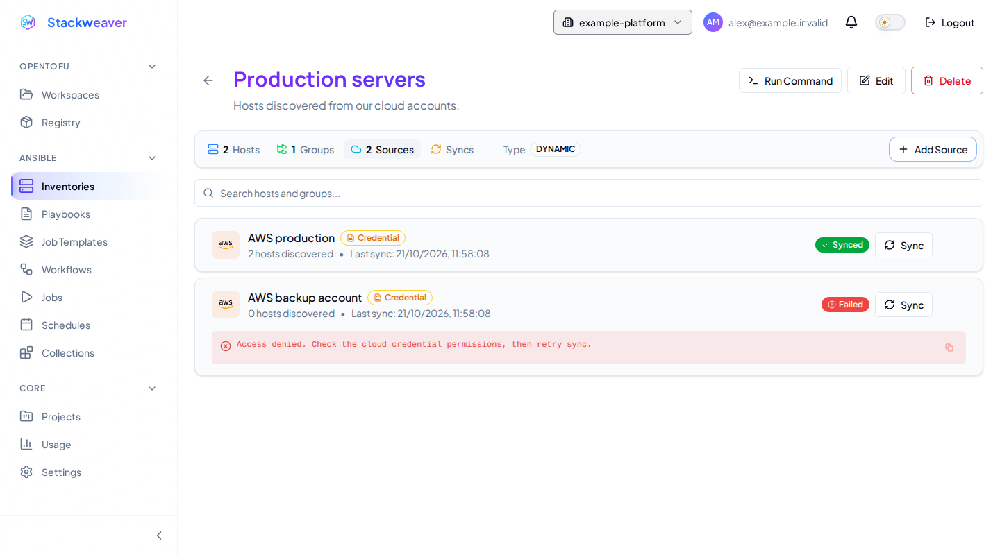
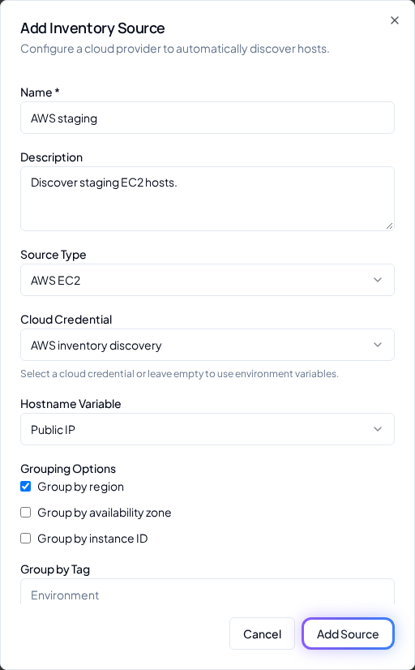

# Cloud sources

<a id="ui-configured" style="scroll-margin-top: 7rem"></a>
<a id="creating-a-ui-configured-dynamic-inventory" style="scroll-margin-top: 7rem"></a>

## Add a cloud source



1. Open **Inventories > New Inventory**, enter a name, select **Dynamic**, and create it.
2. Open **Sources > Add Source**. Enter the source name and choose **Source Type**.
3. Choose a matching **Cloud Credential**, or use an operator-configured runtime identity.
   Azure also has an **Authentication Method** selector; see the table below.
4. Scroll through the form to check refresh and overwrite settings, then select **Add Source**.
5. Configure any required provider scope through the API before the first sync. GCP sources
   need a `projects` list; the form cannot supply it.
6. Select **Sync** on the source and verify the result under **Hosts** and **Syncs**.

A cloud source syncs on its project's or organization's default agent pool when one is
set, and on the hosted capacity otherwise. Every sync of the source runs there, on a launcher
of that pool, whatever started it: **Sync**, update on launch, a workflow's inventory sync node,
or an inventory source schedule on the **Schedules** page. After creation, its edit dialog has a
**Placement** section where it can select an execution environment and an identity
binding, and a **Sync timeout (seconds)**; see
[Run Images and Execution Environments](../../launchers/run-images-and-execution-environments.md#where-a-setting-comes-from).



**Hostname Variable** and **Grouping Options** are visible in this form, but the current
cloud generators do not consume those generic controls. Set provider-specific rules in
VCS YAML or source API `config`.

Credentials must belong to the inventory's organization and match the provider type.
**None (use environment)** works only when a suitable identity is already available in
the sync's environment on the pool it syncs on. It is not automatic federation for every
provider.

For a recurring source sync, create the source first, then use **Edit > Sync Schedule**
and save. The schedule selected in the new-source form is not retained by creation.

<a id="authentication" style="scroll-margin-top: 7rem"></a>
<a id="azure-authentication-methods" style="scroll-margin-top: 7rem"></a>
<a id="choosing-a-method-on-a-private-deployment" style="scroll-margin-top: 7rem"></a>

## Choose Azure source authentication

This table applies to an Azure **cloud source**. A VCS inventory follows its repository
file and runtime configuration instead.

| Authentication method | Required setup |
|---|---|
| **OIDC Federation** | Organization Azure OIDC configuration, signing/issuer setup, and a federated credential matching this source. Entra must reach the issuer's discovery and JWKS endpoints publicly with trusted TLS. Works on every pool, the hosted capacity included, because Stackweaver mints the token for each sync. |
| **Cloud Credential** | An Azure service-principal credential attached to the source. Outbound authentication works on every pool without a public Stackweaver issuer. |
| **Managed Identity** | A managed identity the sync can reach through the Azure Instance Metadata Service. Job containers and pods in the default `platform` network mode cannot reach it, so this works only for a launcher on an Azure VM or node that runs syncs in-process, or one whose container or Kubernetes driver uses the `host-identity` network mode. For a user-assigned identity, supply its client ID. |
| **Workload Identity** | An AKS agent pool whose Kubernetes launchers offer an `azure-workload-identity` [identity binding](../../launchers/identity-bindings-and-pull-secrets.md#identity-bindings) that the source selects in its Placement section. Stackweaver does not document the Azure-side setup of identity bindings as a supported configuration, so prefer OIDC Federation unless you operate that pool yourself. |

OIDC Federation uses the subscription in the organization's Azure OIDC configuration.
For the other source authentication modes, supply `subscription_id` through source API
`config`. On a private deployment where the Stackweaver issuer is not public, use a cloud
credential, or Managed Identity or Workload Identity on an agent pool you run inside Azure.
Read [workload identity signing key and issuer](../../workload-identity/signing-key.md) before
choosing Stackweaver federation.

<a id="oidc-subject-formats" style="scroll-margin-top: 7rem"></a>

### Configure the Azure federation subject

For a source using Stackweaver OIDC Federation, configure its federated credential with
the deployment's issuer, audience `api://AzureADTokenExchange`, and this subject:

```text
organization:<org>:project:<project>:inventory:<source-name>:sync
```

Use the **source name**, not the enclosing inventory name. Use the inventory's project
name, or `default` for an organization-scoped inventory without a project. Renaming or
changing this scope requires a matching identity configuration.

This subject is not the authentication contract for a VCS inventory. A VCS inventory runs
whatever `auth_source` its `azure_rm.yml` names, in a sync on the hosted capacity with the
platform identity. When the file names no `subscription_id`, the sync uses the subscription
of your organization's Azure OIDC configuration. The inventory file remains authoritative.


<a id="cloud-credentials" style="scroll-margin-top: 7rem"></a>

AWS sources can use an attached AWS credential or a runtime AWS identity. GCP sources use
Application Default Credentials, from an attached service-account key or the sync's
environment. On Google Cloud the environment's credentials come from the metadata server,
which job containers and pods in the default `platform` network mode cannot reach, so
attach a credential unless the source syncs on a pool whose launchers allow that. VMware sources need matching provider authentication. Do not store cloud
secrets in plugin YAML or copy them into sync logs.

## Configure a source through the API

Use these requests when you need provider settings the form cannot supply. You need
`curl`, `jq`, the permissions listed above, and an existing AWS credential in the same
organization. Set `STACKWEAVER_TOKEN` to an authorized API token through your normal
secret handling. Replace the hostname, organization URL name and credential UUID below.

Creating a source registers its configuration; it does not prove discovery works. The
sync request queues work and returns before discovery finishes. Keep overwrite off until
you have checked the result.

### Create, sync and verify an AWS source

Run this in Bash in an empty example directory. It writes `inventory.json` and `source.json`;
neither file contains the credential's secret, only its ID.

```bash
export STACKWEAVER_URL="https://stackweaver.example.com"
export STACKWEAVER_ORG="my-org"
export AWS_CREDENTIAL_ID="<existing-aws-credential-uuid>"
: "${STACKWEAVER_TOKEN:?Set an authorized Stackweaver API token}"

cat > inventory.json <<'JSON'
{"data":{"type":"inventories","attributes":{
  "name":"production","inventory-type":"dynamic"
}}}
JSON

INVENTORY_ID=$(curl --fail-with-body --silent --show-error \
  -H "Authorization: Bearer $STACKWEAVER_TOKEN" \
  -H 'Content-Type: application/vnd.api+json' \
  --data-binary @inventory.json \
  "$STACKWEAVER_URL/api/v2/organizations/$STACKWEAVER_ORG/ansible/inventories" \
  | jq -er '.data.id')

jq -n --arg credential "$AWS_CREDENTIAL_ID" '{data:{
  type:"inventory-sources", attributes:{
    name:"aws-production", "source-type":"aws", "credential-id":$credential,
    config:{
      regions:["eu-west-1"],
      filters:[{name:"tag:Environment",values:["production"]}],
      group_by_region:true
    },
    "update-on-launch":true, "update-cache-timeout":300,
    overwrite:false, "overwrite-vars":false
  }
}}' > source.json

SOURCE_ID=$(curl --fail-with-body --silent --show-error \
  -H "Authorization: Bearer $STACKWEAVER_TOKEN" \
  -H 'Content-Type: application/vnd.api+json' \
  --data-binary @source.json \
  "$STACKWEAVER_URL/api/v2/ansible/inventories/$INVENTORY_ID/sources" \
  | jq -er '.data.id')

curl --fail-with-body --silent --show-error -X POST \
  -H "Authorization: Bearer $STACKWEAVER_TOKEN" \
  "$STACKWEAVER_URL/api/v2/ansible/inventory-sources/$SOURCE_ID/actions/sync"

# Repeat this read until status is successful or failed.
curl --fail-with-body --silent --show-error \
  -H "Authorization: Bearer $STACKWEAVER_TOKEN" \
  "$STACKWEAVER_URL/api/v2/ansible/inventory-sources/$SOURCE_ID" \
  | jq '.data.attributes | {status, hosts: .["hosts-count"], error: .["last-sync-error"]}'

curl --fail-with-body --silent --show-error \
  -H "Authorization: Bearer $STACKWEAVER_TOKEN" \
  "$STACKWEAVER_URL/api/v2/ansible/inventories/$INVENTORY_ID/hosts"
```

A successful result has `status: "successful"` and the expected host count. If the result
is failed or unexpectedly empty, inspect the error and scope before launching a job.
The hosts endpoint is paginated; follow `meta.pagination.next-page` when reading all hosts.


### Update scope, schedule or authentication

Save this as `source-update.json` to keep the existing AWS discovery scope and add an
hourly sync. A `config` update replaces the whole configuration object, so include
any filters and grouping you want to keep.

```json
{
  "data": {
    "type": "inventory-sources",
    "attributes": {
      "config": {
        "regions": ["eu-west-1"],
        "filters": [{"name": "tag:Environment", "values": ["production"]}],
        "group_by_region": true
      },
      "sync-schedule": "0 * * * *",
      "update-cache-timeout": 300
    }
  }
}
```

```bash
curl --fail-with-body --silent --show-error -X PATCH \
  -H "Authorization: Bearer $STACKWEAVER_TOKEN" \
  -H 'Content-Type: application/vnd.api+json' \
  --data-binary @source-update.json \
  "$STACKWEAVER_URL/api/v2/ansible/inventory-sources/$SOURCE_ID"
```

The response contains the saved source. Queue another sync to apply changed discovery
settings to stored hosts. Set `sync-schedule` to an empty string to remove the schedule.

For an Azure or GCP source, create a separate source with `source-type: "azure"` or
`"gcp"` and use the corresponding object below as its `config`. Attach a matching
credential, or omit `credential-id` for a suitable runtime identity. The Azure example
uses managed identity, so it has no attached credential, and it syncs successfully only on
a pool where the metadata service is reachable, as the authentication table describes.

::: code-group
```json [Azure managed identity: config]
{
  "auth_method": "managed_identity",
  "subscription_id": "<azure-subscription-uuid>",
  "resource_groups": ["rg-production"],
  "group_by_resource_group": true
}
```
```json [GCP: config]
{
  "projects": ["my-project-id"],
  "zones": ["us-central1-a"],
  "group_by_zone": true
}
```
:::

Azure accepts `auth_method` values `managed_identity`, `workload_identity`, `oidc` and
`credential`. Use `managed_identity_client_id` only with `managed_identity`. Stackweaver
OIDC uses the organization's OIDC subscription as described above. When switching an
existing Azure source away from a stored credential, send `credential-id: ""` alongside
the complete new `config`. Updating `source-type` does not change an existing source's
provider; create a separate source instead.

For VCS inventories and constructed rebuilds, trigger a sync with the first operation
below and no request body. The other operations read history and a run's captured output.
Replace the inventory and sync IDs with your own values.

```text
POST /api/v2/ansible/inventories/<inventory-id>/actions/sync
GET /api/v2/ansible/inventories/<inventory-id>/syncs
GET /api/v2/ansible/inventory-syncs/<sync-id>
```

Use the [API explorer](/docs/api-reference/explorer) for complete request schemas.


## Manage the definition with Terraform or OpenTofu

The [Stackweaver provider](https://github.com/vhco-pro/terraform-provider-stackweaver)
has native [inventory](https://github.com/vhco-pro/terraform-provider-stackweaver/blob/main/website/docs/r/ansible_inventory.html.markdown)
and [inventory source](https://github.com/vhco-pro/terraform-provider-stackweaver/blob/main/website/docs/r/ansible_inventory_source.html.markdown)
resources. Choose this path instead of the API creation example for the same objects.
Save this as `main.tf`, replace the hostname and organization, and supply
an existing AWS credential UUID as `TF_VAR_aws_credential_id`. Authenticate the provider
with `TFE_TOKEN` through your normal secret handling.

```hcl
terraform {
  required_providers {
    stackweaver = {
      source = "vhco-pro/stackweaver"
    }
  }
}

provider "stackweaver" {
  hostname = "stackweaver.example.com"
}

variable "aws_credential_id" {
  type = string
}

resource "stackweaver_ansible_inventory" "production" {
  organization = "my-org"
  name         = "production"
  type         = "dynamic"
}

resource "stackweaver_ansible_inventory_source" "aws" {
  inventory_id         = stackweaver_ansible_inventory.production.id
  name                 = "aws-production"
  source_type          = "aws"
  credential_id        = var.aws_credential_id
  update_on_launch     = true
  update_cache_timeout = 300
  overwrite            = false
  overwrite_vars       = false
  sync_schedule        = "0 * * * *"

  config = jsonencode({
    regions         = ["eu-west-1"]
    filters         = [{ name = "tag:Environment", values = ["production"] }]
    group_by_region = true
  })
}

output "inventory_id" {
  value = stackweaver_ansible_inventory.production.id
}

output "inventory_source_id" {
  value = stackweaver_ansible_inventory_source.aws.id
}
```

Run `terraform init`, then `terraform plan -out=inventory.tfplan` and review it before
`terraform apply inventory.tfplan` (or use the corresponding `tofu` commands). This creates
the inventory and source definitions, not a completed discovery. Use the source ID output
with the sync API request above, or select **Sync** on **Sources**, then verify the hosts.

For a repository-backed inventory, use this resource instead of the dynamic inventory and
source pair above. Replace the VCS connection UUID and repository with your organization's
connection and the repository containing the plugin file.

```hcl
resource "stackweaver_ansible_inventory" "from_git" {
  organization      = "my-org"
  name              = "production-from-git"
  type              = "vcs"
  vcs_connection_id = "<existing-vcs-connection-uuid>"
  vcs_repository    = "my-org/automation"
  vcs_branch        = "main"
  inventory_path    = "inventory/production.azure_rm.yml"
}
```

Creating a VCS inventory queues an initial sync. Inspect its status and host set; use
**Sync from VCS** or the inventory sync API to refresh subsequent repository changes.

The native resources use `stackweaver_*` names; there are no `tfe_ansible_inventory` aliases.
Use `config = jsonencode(...)` for supported provider options, rather than the ineffective
generic hostname/grouping fields. Change an existing definition in Terraform instead of
managing the same source through both Terraform and manual API updates.
