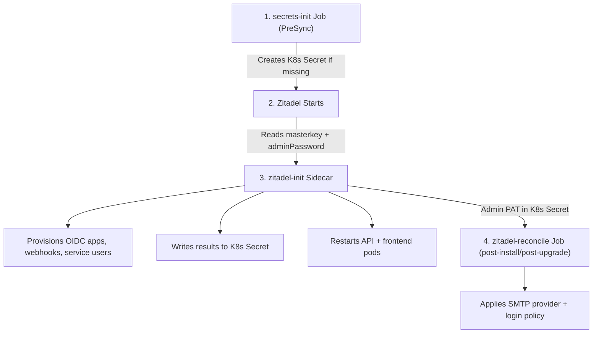
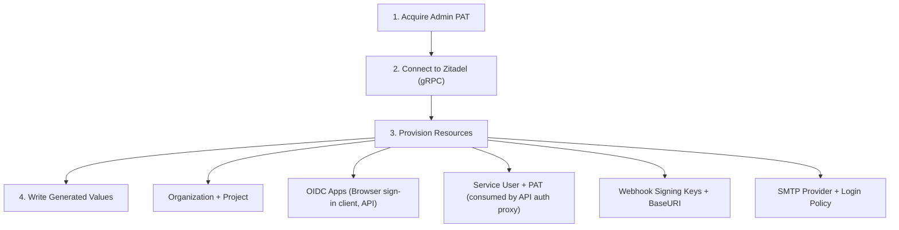

# Zitadel Setup Guide

This guide covers how Zitadel is configured and initialized in StackWeaver, for both the Kubernetes (Helm) and Docker Compose deployment paths.

> **References:**
> - [Zitadel defaults.yaml](https://github.com/zitadel/zitadel/blob/main/cmd/defaults.yaml)
> - [Zitadel setup steps.yaml](https://github.com/zitadel/zitadel/blob/main/cmd/setup/steps.yaml)
> - [Zitadel production guide](https://zitadel.com/docs/self-hosting/manage/production)

## Overview

Zitadel provides OIDC/OAuth 2.0 authentication for StackWeaver, including:

- OpenID Connect and OAuth 2.0 flows (a confidential authorization-code client the API signs browsers in with, and an API app)
- Multi-factor and passwordless authentication
- User management and roles
- Login V2: a custom login UI bundled into the Stackweaver SPA (`/login/*` routes), backed by an auth proxy in the API container that handles all Zitadel session API + OIDC endpoint calls. Stackweaver does not use Zitadel's standalone `ghcr.io/zitadel/zitadel-login` container.

StackWeaver ships a `zitadel-init` bootstrap container that automatically provisions all required OIDC apps, service users, and webhooks after Zitadel starts.
No manual Zitadel console steps are required.

## Kubernetes / Helm Deployment

### What the Chart Does Automatically

When you install the Helm chart, the following happens without any manual intervention:



<details>
<summary><strong>Flow Steps (Legend)</strong></summary>

1. **Secrets init (PreSync Job)** - A `secrets-init` Job runs before the rest of the chart. It creates the Zitadel Kubernetes Secret (containing a randomly generated 32-character `masterkey` and an `adminPassword`) only if the secret does not already exist. This is idempotent - re-syncing never overwrites existing credentials.

2. **Zitadel starts** - The Zitadel pod waits for PostgreSQL to be ready (via an initContainer), then runs `start-from-init`. It reads `masterkey` and `adminPassword` from the Kubernetes Secret via environment variables.

3. **zitadel-init sidecar** - A sidecar container in the same pod as Zitadel waits for Zitadel to become ready, then provisions the OIDC apps (the confidential browser sign-in client and the API app), registers the production redirect and post-logout URIs and the back-channel logout URI, deactivates any public frontend app an earlier install created, sets the Login V2 BaseURI to the Stackweaver SPA's `/login` path via the Feature API, configures the login service user (whose PAT is consumed by the API container's auth proxy + TOTP service + Zitadel webhook handler), and webhook keys, then writes the results directly into the Zitadel Kubernetes Secret. It also triggers rolling restarts of the API + frontend pods, then enters an idle state with a health endpoint on `:8081`.

4. **zitadel-reconcile Job** - After every `helm install` and `helm upgrade`, a Job (`stackweaver-zitadel-reconcile` for a release named `stackweaver`) runs the same image in reconcile-only mode (`ZITADEL_INIT_MODE=reconcile`). It reads the admin PAT the sidecar stored in the Zitadel Secret, configures Zitadel's SMTP provider from the `smtp.*` values, and sets the login policy (registration, password reset, email codes) to match whether email can be delivered and `signup.selfRegistration`. A failure fails the `helm` command while Zitadel keeps serving sign-ins. The Job renders only with `zitadel.bundled: true`. See [Email (SMTP) and sign-up](../../get-started/self-hosting/email.md).

</details>

**PAT acquisition**: On the first boot (fresh database), Zitadel writes an admin PAT to a shared emptyDir volume. The sidecar reads this file and persists the PAT into the K8s Secret (`admin-pat` key). On subsequent pod restarts, the emptyDir is empty (Zitadel skips PAT generation for existing databases), so the sidecar falls back to reading the PAT from the K8s Secret. This three-tier fallback (`ZITADEL_PAT` env var > PAT file > K8s Secret) ensures the sidecar never crash-loops on pod restarts.

### Accessing the Zitadel Admin Console (Kubernetes)

The Zitadel console is available at `https://<ingress.hosts.auth>/ui/console`.

**Admin credentials:**

In Zitadel, login names follow the format `username@orgname.externaldomain`.
When `ExternalDomain` is your auth hostname (e.g. `sw-auth.example.com`), the admin login name becomes:

```
admin@zitadel.<ingress.hosts.auth>
# example: admin@zitadel.sw-auth.example.com
```

The email address, configured via `zitadel.init.adminUsername` (`admin@stackweaver.local` by default), also works as a login identifier. With an empty `platform.admins`, this account is also the installation's [platform administrator](../platform-administration.md).

The password is auto-generated on first install. Retrieve it with:

```bash
kubectl get secret stackweaver-zitadel -n stackweaver \
  -o jsonpath='{.data.admin-password}' | base64 -d
```

> **Note:** In Docker Compose, `ExternalDomain` is `localhost`, so the login name is `admin@ZITADEL.localhost` with the static password `Password1!`. These differ from Kubernetes by design.

### Troubleshooting: Admin Password Does Not Work (Kubernetes)

The admin password is written to the Kubernetes Secret by the PreSync `secrets-init` job and injected into Zitadel via `ZITADEL_FIRSTINSTANCE_ORG_HUMAN_PASSWORD`. This only takes effect during the **first** Zitadel initialization - if the database already existed with a different password (e.g. the secret was deleted and recreated), the DB and secret are out of sync.

To recover, reset the Zitadel database and let it reinitialize:

```bash
PG_POD=$(kubectl get pod -n stackweaver \
  -l app.kubernetes.io/component=postgresql \
  -o jsonpath='{.items[0].metadata.name}')

kubectl exec -n stackweaver "$PG_POD" -- \
  psql -U iac -c "DROP DATABASE IF EXISTS zitadel;"

kubectl exec -n stackweaver "$PG_POD" -- \
  psql -U iac -c "CREATE DATABASE zitadel OWNER iac;"

kubectl rollout restart deployment/stackweaver-zitadel -n stackweaver
```

After Zitadel restarts and completes initialization, the new password from the secret will be active.

### Monitoring Initialization Progress

```bash
# Watch the zitadel-init sidecar logs
kubectl logs -f deployment/stackweaver-zitadel -c zitadel-init -n stackweaver

# Check Zitadel pod status
kubectl get pod -n stackweaver -l app.kubernetes.io/component=zitadel
```

### Troubleshooting: zitadel-init Crash-Looping (PAT Not Found)

If the `zitadel-init` sidecar is crash-looping with errors about the PAT file not being found, this means:

1. The database already exists (Zitadel skips `FirstInstance`, so no PAT file is written to emptyDir).
2. The K8s Secret does not contain an `admin-pat` value (e.g., the secret was manually recreated without it).

**To fix**, force a clean first-time initialization:

```bash
# Option A: Reset the Zitadel database (preserves other data)
PG_POD=$(kubectl get pod -n stackweaver \
  -l app.kubernetes.io/component=postgresql \
  -o jsonpath='{.items[0].metadata.name}')

kubectl exec -n stackweaver "$PG_POD" -- \
  psql -U iac -c "DROP DATABASE IF EXISTS zitadel;"

kubectl exec -n stackweaver "$PG_POD" -- \
  psql -U iac -c "CREATE DATABASE zitadel OWNER iac;"

# Delete the Zitadel secret so it gets recreated with empty admin-pat
kubectl delete secret stackweaver-zitadel -n stackweaver

# Restart Zitadel to trigger a fresh FirstInstance
kubectl rollout restart deployment/stackweaver-zitadel -n stackweaver
```

After Zitadel reinitializes, the sidecar will read the PAT from the emptyDir and persist it to the K8s Secret. Future pod restarts will use the secret fallback.

### Troubleshooting: Stuck Migration Lock

If Zitadel fails with `migration already started` or `migration failed err.id=MIGR-*`, a previous run left a partially completed migration lock in the database.
This typically happens after a crash during first initialization.

To clear it, drop and recreate the `zitadel` database:

```bash
PG_POD=$(kubectl get pod -n stackweaver \
  -l app.kubernetes.io/component=postgresql \
  -o jsonpath='{.items[0].metadata.name}')

kubectl exec -n stackweaver "$PG_POD" -- \
  psql -U iac -c "DROP DATABASE IF EXISTS zitadel;"

kubectl exec -n stackweaver "$PG_POD" -- \
  psql -U iac -c "CREATE DATABASE zitadel OWNER iac;"
```

Then restart the Zitadel pod:

```bash
kubectl rollout restart deployment/stackweaver-zitadel -n stackweaver
```

### Troubleshooting: Zitadel Panics with "no private ip address"

If Zitadel panics with:

```
none of the enabled methods for identifying the machine succeeded
failed to get Private IP address no private ip address
```

This means Zitadel's Sonyflake ID generator cannot identify the machine.
In Kubernetes each pod runs in its own network namespace, so the private IP scan returns nothing.
The Helm chart avoids this by setting `Machine.Identification.Hostname.Enabled: true`.
If you see this panic, upgrade to the current chart version and resync.

### Troubleshooting: Zitadel Not Starting

```bash
# Check Zitadel pod logs
kubectl logs -n stackweaver \
  $(kubectl get pod -n stackweaver -l app.kubernetes.io/component=zitadel -o jsonpath='{.items[0].metadata.name}')

# Check if PostgreSQL is ready
kubectl get pod -n stackweaver -l app.kubernetes.io/component=postgresql
```

### Troubleshooting: OAuth Redirects to Internal Service URL

If the browser is redirected to a URL like `http://stackweaver-frontend:5173/login/...` (an internal Kubernetes DNS name) instead of `https://<your-app-host>/login/...`, the Login V2 BaseURI in Zitadel's database is pointing at the internal service instead of the public app domain.

`zitadel-init` calls the Zitadel Feature API (`SetInstanceFeatures`) on every run to set `LoginV2.BaseUri` to `https://<ingress.hosts.app>/login` (the Stackweaver SPA's `/login` routes).
The Feature API update runs after every ArgoCD sync, so setting the correct `ingress.hosts.app` in `values.yaml` and resyncing corrects the BaseURI.

If you need to verify what BaseURI is currently active:

```bash
# Check the LOGIN_UI_BASE_URL passed to the zitadel-init sidecar
kubectl get deploy stackweaver-zitadel -n stackweaver \
  -o jsonpath='{.spec.template.spec.containers[?(@.name=="zitadel-init")].env[?(@.name=="LOGIN_UI_BASE_URL")].value}'

# Or check the zitadel-init sidecar logs for the confirmation line
kubectl logs deploy/stackweaver-zitadel -c zitadel-init -n stackweaver | grep "Login V2 BaseURI"
```

---

## Docker Compose Deployment

### Quick Start (Automated Bootstrap)

The Docker Compose stack includes the `zitadel-init` container (image `ghcr.io/vhco-pro/stackweaver-zitadel-init`), which provisions all required OIDC apps automatically. Run these commands in your Compose directory (the directory that holds `docker-compose.yml`, see the [Docker Compose deployment guide](../../get-started/self-hosting/docker-compose/README.md)).

```bash
# 1. Start the stack. zitadel-init runs automatically once Zitadel is up.
docker compose up -d

# 2. Follow the initializer until it reports completion
docker compose logs -f zitadel-init

# 3. Recreate the services so they pick up the values init wrote to .env
docker compose up -d
```

To run the initializer again later, for example after changing `zitadel-init.yaml`, use `docker compose run --rm zitadel-init` and then `docker compose up -d`.

> **Networking:** `docker-compose.yml` runs every service on a single user-defined bridge network, so containers reach each other by service name (for example `zitadel:8080`) and the browser-facing ports are published on `localhost`.

### Admin Credentials (Docker Compose)

The Docker Compose stack uses static credentials defined in `zitadel-init-steps.yaml`:

| Field | Value |
|---|---|
| Username | `admin@ZITADEL.localhost` |
| Password | `Password1!` |
| Console URL | `http://localhost:8080/ui/console` |

This account is also the installation's [platform administrator](../platform-administration.md) unless `STACKWEAVER_PLATFORM_ADMINS` in `sso.env` names other people.

### What `zitadel-init` Does



<details>
<summary><strong>Flow Steps (Legend)</strong></summary>

1. **Acquire admin PAT** - **Docker Compose**: waits up to 300s for `/pat/admin.pat` (written by Zitadel during `start-from-init`). **Kubernetes (first boot)**: waits for readiness, reads PAT from emptyDir, persists to K8s Secret. **Kubernetes (pod restart)**: falls back to `admin-pat` from K8s Secret. **Manual override**: `ZITADEL_PAT` env var takes highest priority.
2. **Connect** - Uses the PAT to connect to Zitadel via gRPC at `ZITADEL_INTERNAL_ADDR`: `zitadel:8080` on the Docker Compose bridge network, or `localhost:8080` on Kubernetes, where the initializer runs inside the Zitadel pod.
3. **Provision** - Creates or updates: Organization `IAC Platform`, Project, the confidential browser sign-in app (`Stackweaver BFF`, described under [The Browser Sign-in Client](#the-browser-sign-in-client)), API app (client secret), deactivation of any public frontend app an earlier install created, service-account machine user + PAT (`IAM_LOGIN_CLIENT` role, named `login-ui-service`, consumed by the API container's auth proxy + TOTP service + Zitadel webhook handler), webhook signing keys, and Login V2 BaseURI (via Feature API). Then it configures Zitadel's SMTP provider from the `SMTP_*` settings in `sso.env` and sets the login policy to match whether email can be delivered and `STACKWEAVER_SELF_REGISTRATION`; an error in either step stops the run (see [Email (SMTP) and sign-up](../../get-started/self-hosting/email.md)). In Kubernetes the sidecar skips these two steps, which the reconcile Job performs instead.
4. **Write** - Writes the generated values to `.env` in the Compose directory.

</details>

The bootstrap is idempotent - re-running it reuses existing apps and orgs.

### Environment Variables Written to `.env`

```env
ZITADEL_BFF_CLIENT_ID=<browser-sign-in-client-id>
ZITADEL_BFF_CLIENT_SECRET=<browser-sign-in-client-secret>
ZITADEL_API_CLIENT_ID=<api-client-id>
ZITADEL_API_CLIENT_SECRET=<api-client-secret>
ZITADEL_LOGIN_SERVICE_USER_TOKEN=<login-service-user-pat>
ZITADEL_LOGIN_SERVICE_USER_ID=<login-service-user-id>
ZITADEL_ISSUER=<issuer-derived-from-zitadel-defaults.yaml>
ZITADEL_EXTERNAL_HOST=<ExternalDomain>
ZITADEL_TLS_MODE=<disabled-or-external>
ZITADEL_WEBHOOK_IDP_SYNC_KEY=<webhook-key>
ZITADEL_WEBHOOK_COMPLEMENT_TOKEN_KEY=<webhook-key>
```

`ZITADEL_BFF_CLIENT_SECRET` is kept across runs: Zitadel returns a client secret only when it creates an app, so `zitadel-init` keeps the stored value, and generates a new secret only when none is stored.

> **Important:** `zitadel-init` rewrites `.env` on each run.
> Keep SSO, VCS, and workload identity settings in `sso.env`, `vcs.env`, and `oidc.env`, which it never touches.

### Environment Variable Reference for `zitadel-init`

| Variable | Description | Default |
|---|---|---|
| `ZITADEL_ISSUER` | Public issuer written to `.env` | `http://localhost:8080` |
| `ZITADEL_INTERNAL_ADDR` | Host:port the initializer dials | `zitadel:8080` (set in `docker-compose.yml`) |
| `ZITADEL_ADMIN_USERNAME` | Admin username (matches init-steps.yaml) | `admin@ZITADEL.localhost` |
| `ZITADEL_ADMIN_PASSWORD` | Admin password (matches init-steps.yaml) | `Password1!` |
| `PROJECT_ROOT` | Where env/config files are written | `/config` inside container |
| `ZITADEL_PAT` | Optional PAT override instead of `/pat/admin.pat` | empty |
| `FRONTEND_REDIRECT_URI` | Sign-in redirect URI (`https://<app host>/auth/callback`) registered on the browser sign-in app, in addition to `http://localhost:5173/auth/callback` and the `frontend_redirect_uris` in `zitadel-init.yaml` | empty (Kubernetes only) |
| `FRONTEND_POST_LOGOUT_URI` | Post-logout redirect URI (the app's origin) registered on the browser sign-in app, in addition to `http://localhost:5173` and the `frontend_post_logout_redirect_uris` in `zitadel-init.yaml` | empty (Kubernetes only) |
| `ZITADEL_BFF_BACKCHANNEL_LOGOUT_URI` | Back-channel logout URI registered on the browser sign-in app, where Zitadel posts a logout token when a session ends. It must be the API's `/auth/oidc/end-session`, at an address Zitadel can reach | empty |
| `LOGIN_UI_BASE_URL` | Login V2 BaseURI set via Feature API (overrides database value) - points at the Stackweaver SPA's `/login` route. Despite the `LOGIN_UI` prefix, the value is the SPA URL | empty (Kubernetes only) |

The SMTP, sign-up and notification-mode variables (`SMTP_*`, `STACKWEAVER_SELF_REGISTRATION`, `STACKWEAVER_NOTIFICATION_MODE`) are described in [Email (SMTP) and sign-up](../../get-started/self-hosting/email.md) and the [Environment Variables Reference](../../get-started/self-hosting/environment-variables.md).

### Troubleshooting: Zitadel Not Starting (Docker Compose)

```bash
# Check logs
docker logs zitadel

# Verify PostgreSQL is accessible
docker exec postgres psql -U iac -d iac_platform -c "SELECT 1;"
```

### Troubleshooting: `App.NotFound` Error

The OAuth client ID doesn't exist or isn't accessible.

- Run `docker compose run --rm zitadel-init` to create/update applications, then `docker compose up -d`.
- Verify that `ZITADEL_BFF_CLIENT_ID` in `.env` matches the client ID of the `Stackweaver BFF` app in the Zitadel console.

### Troubleshooting: Sign-in Fails After the Login Page

If the login page accepts the password but the browser returns to the sign-in screen, or the callback page reports that the sign-in could not be completed, check the API logs with `docker compose logs api | grep "auth proxy"`.

- A failed code exchange means the redirect URI the API sends is not registered on the app, or the API's `ZITADEL_BFF_CLIENT_SECRET` does not match the app in Zitadel. Running `zitadel-init` again adds missing redirect URIs, but it keeps a stored secret, so it does not repair a secret that went stale, for example after the secret was regenerated in the Zitadel console or an older `.env` or Secret was restored. To replace the secret, remove the stored one first so that `zitadel-init` generates a new one: in Docker Compose, delete the `ZITADEL_BFF_CLIENT_SECRET` line from `.env`, run `docker compose run --rm zitadel-init`, then `docker compose up -d` to recreate the API with the new value. In Kubernetes with the bundled Zitadel, remove the `bff-client-secret` key from the Zitadel Secret with `kubectl patch secret <release>-zitadel -n <namespace> --type=json -p '[{"op":"remove","path":"/data/bff-client-secret"}]'`, then run `kubectl rollout restart deployment/<release>-zitadel -n <namespace>`; the sidecar writes the new secret and restarts the API.
- A sign-in that completes and is then immediately lost means the browser dropped the session cookie. Browser sign-in needs HTTPS, or `http://localhost`; see [HTTPS and reverse proxies](../../get-started/self-hosting/docker-compose/README.md#https-and-browser-sessions).

---

## Login V2 (Custom Stackweaver SPA)

Both deployment paths use Zitadel's Login V2 feature. Instead of Zitadel's standalone `ghcr.io/zitadel/zitadel-login` Next.js service, Stackweaver serves a custom login UI bundled into the Stackweaver SPA (`/login/*` routes); the auth proxy in the API container handles all Zitadel session API + OIDC endpoint calls. See the [Zitadel Custom Login UI guide](https://zitadel.com/docs/guides/integrate/login-ui) for the upstream architecture pattern this implementation follows.

### How the Login V2 BaseURI is managed

The BaseURI (the browser-reachable URL Zitadel redirects users to for login) is set from two sources, in priority order:

**Kubernetes (Helm):**
1. `DefaultInstance.Features.LoginV2.BaseURI` in the Zitadel ConfigMap - sets the initial value in the database on first Zitadel startup. Set to `https://<ingress.hosts.app>/login` (the Stackweaver SPA's login route on the **app** host, not the auth host).
2. `zitadel-init` Feature API call - on every post-install/post-upgrade run, `zitadel-init` calls `SetInstanceFeatures` with `LoginV2.BaseUri` set to the same public URL. This overwrites the database value, so domain changes take effect on the next sync without a database reset.

**Docker Compose:**
The `DefaultInstance.Features.LoginV2.BaseURI` in the mounted `zitadel-defaults.yaml` is set to `http://localhost:5173/login`, which is directly browser-reachable because the Compose stack publishes the SPA on port 5173 of localhost.

> **Note:** `DefaultInstance` settings only apply during first initialization.
> In Kubernetes, `zitadel-init` handles ongoing updates via the Feature API - you do not need to reset the database when the auth domain changes.

---

## The Browser Sign-in Client

Stackweaver signs browsers in on the server. The API completes the OpenID Connect authorization-code flow itself, as a confidential client, and gives the browser a session cookie that page scripts cannot read. The browser never holds an OAuth token, and Stackweaver stores none: it verifies the tokens Zitadel returns at sign-in and then discards them.

With the bundled Zitadel, `zitadel-init` creates and maintains this client as a web application named `Stackweaver BFF` in the Stackweaver project. The app authenticates with a client secret sent as HTTP Basic, allows the authorization-code grant only, issues JWT access tokens, and has ID-token userinfo assertion enabled, so the ID token carries the email address and whether it is verified. Its redirect URI is the app's `/auth/callback` page and its post-logout redirect URI is the app's origin. Its back-channel logout URI is the API's `/auth/oidc/end-session` when `ZITADEL_BFF_BACKCHANNEL_LOGOUT_URI` is set, which the Helm chart does; the Docker Compose example leaves it unset, because Zitadel's default deny list blocks the private address the API has there, so on that install a session ended in Zitadel ends in Stackweaver at the next liveness check, and a URI you set in the console is kept. On every run `zitadel-init` adds any missing URIs and restores these settings, and it deactivates any public frontend app an earlier install created, so no client on the app's origin can obtain tokens.

The client id and secret reach the API as `ZITADEL_BFF_CLIENT_ID` and `ZITADEL_BFF_CLIENT_SECRET`: through `.env` in Docker Compose, and through the `bff-client-id` and `bff-client-secret` keys of the Zitadel Secret in Kubernetes. When the API runs with `GIN_MODE=release`, as it does in the Helm chart, it refuses to start without them or without `ZITADEL_LOGIN_SERVICE_USER_TOKEN`.

### Using an External Zitadel

If you run your own Zitadel (`zitadel.bundled: false` in Helm), create the browser sign-in client yourself before you install or upgrade Stackweaver. In the Zitadel console, open the project that holds your Stackweaver apps and add a web application with these settings:

| Setting | Value |
|---|---|
| Application type | Web |
| Authentication method | Basic (client secret) |
| Grant types | Authorization Code only |
| Response type | Code |
| Access token type | JWT |
| ID token userinfo assertion | Enabled |
| Redirect URI | `https://<app host>/auth/callback` |
| Post-logout redirect URI | `https://<app host>` |
| Back-channel logout URI | `https://<app host>/auth/oidc/end-session` |

Copy the client id and the client secret Zitadel shows when it creates the app, and give them to the API as `ZITADEL_BFF_CLIENT_ID` and `ZITADEL_BFF_CLIENT_SECRET`. In Kubernetes, put them in your Zitadel Secret as `bff-client-id` and `bff-client-secret`; see [BYO Zitadel Secret with External Zitadel](../../get-started/self-hosting/kubernetes/README.md#byo-zitadel-secret-with-external-zitadel).

Zitadel must be able to reach the back-channel logout URI, because it posts a logout token there whenever a session ends. Zitadel's `HTTPClient.DenyList` blocks private and loopback addresses by default, so if the URI resolves to a private address from where Zitadel runs, remove the private ranges from the deny list in your Zitadel configuration or use an address that is publicly routable. Without back-channel logout, a session ended in Zitadel still ends the Stackweaver session at the next liveness check.

Stackweaver reads SSO groups from the `sso_groups` claim of the access token this client receives at sign-in, so [SSO team mapping](../sso/team-mapping.md) works with an external Zitadel only when its complement-token action adds that claim to the tokens of this app.

## Browser Sessions

A signed-in browser holds one cookie, `__Host-sw_session`. It is `HttpOnly`, `Secure` and `SameSite=Strict`, and it survives a browser restart until a session limit ends it. The session itself lives in Stackweaver's PostgreSQL database, so it survives restarts of the API and works on every API replica.

A session ends when any of the following happens:

| Event | When it takes effect |
|---|---|
| The person signs out | Immediately; the Zitadel session is ended too |
| No keyboard, mouse or touch activity in Stackweaver for the idle timeout | At the next request, or within a minute |
| The maximum lifetime has passed since sign-in, whatever the activity | At the next request, or within a minute |
| The session is revoked under **Settings > Sessions** | At the browser's next request |
| The Zitadel session ends elsewhere (another application signs out, an administrator ends it) | Within seconds through back-channel logout, or at the next liveness check |
| The user or their organization is deactivated in Zitadel, or the user's email is no longer verified | At the next liveness check |

Background refreshes of a page do not count as activity, so a tab left open is signed out on time. When a session reaches the idle timeout or the maximum lifetime, Stackweaver also ends its Zitadel session, so signing back in asks for a password or passkey again.

The limits are set on the API:

| Setting | Helm value | Default |
|---|---|---|
| `STACKWEAVER_SESSION_IDLE_TIMEOUT` | `api.session.idleTimeout` | `1h` |
| `STACKWEAVER_SESSION_MAX_LIFETIME` | `api.session.maxLifetime` | `12h` |
| `STACKWEAVER_SESSION_LIVENESS_INTERVAL` | `api.session.livenessInterval` | `5m` |

Each value is a duration such as `30m` or `8h`, and the API refuses to start with a value it cannot read. The liveness check asks Zitadel, with the login service account, whether the session, the user and the user's organization are still active. If Zitadel cannot be reached, the session is kept and the check is tried again 30 seconds later, so a Zitadel outage never signs people out; the idle timeout and the maximum lifetime still apply.

Zitadel's access-token lifetime does not affect how long a browser stays signed in. `zitadel-init` still applies `zitadel.config.accessTokenLifetime` (Kubernetes) or `ZITADEL_ACCESS_TOKEN_LIFETIME` (Docker Compose), default `1h`, to the bundled instance, where it governs tokens issued to other applications.

Scripts, CI pipelines and the Terraform CLI do not use browser sessions. They authenticate with an API token, created under **Settings > API Tokens** or with `terraform login`, and sent as `Authorization: Bearer <token>`. A Zitadel access token is not accepted as an API credential.

## Production Considerations

- Serve Stackweaver over HTTPS. The session cookie is `Secure`, so browsers drop it over plain HTTP on any host other than `localhost`, and the API logs a warning at startup when `STACKWEAVER_APP_URL` is plain `http` on another host. In Helm, set `ingress.tls.enabled: true`.
- Store secrets in a secrets manager or use the `secrets.<component>.secretName` values to bring your own pre-created Kubernetes Secrets.
- Review the session limits above against your organization's policy.
- Back up the Zitadel PostgreSQL database regularly.

## Additional Resources

- [Zitadel Documentation](https://zitadel.com/docs)
- [OIDC Specification](https://openid.net/specs/openid-connect-core-1_0.html)
- [Zitadel Go SDK](https://pkg.go.dev/github.com/zitadel/oidc/v3/pkg/oidc)
- [Login UI integration guide](https://zitadel.com/docs/guides/integrate/login-ui)
