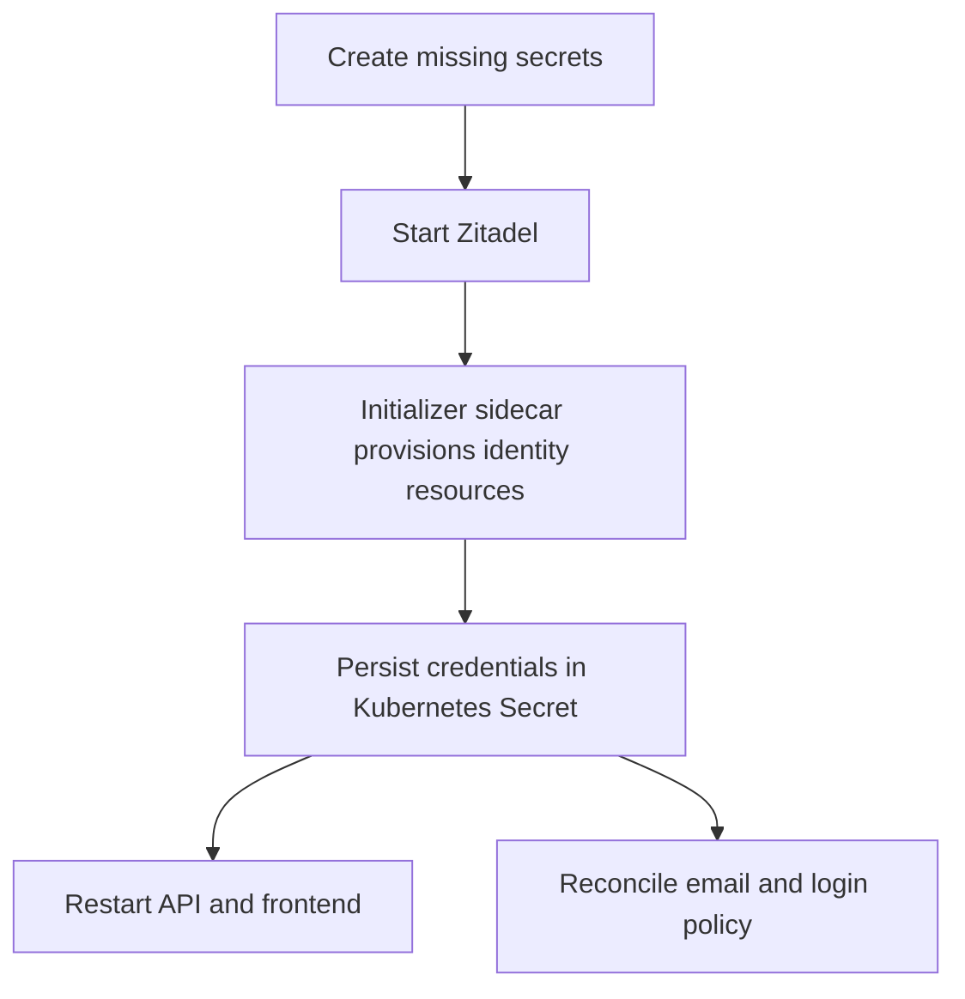

# Set up Zitadel

The bundled initializer creates the OIDC applications, login service user and webhook keys that Stackweaver needs. Use your deployment's bootstrap path below, then verify a browser sign-in. You do not need to create those applications by hand in the Zitadel console.

Stackweaver serves the login UI at the application's `/login` routes. Zitadel remains the identity service, and the API proxies login requests to it.

## Before you start

Use the [Compose deployment](../../get-started/self-hosting/docker-compose/README.md) or [Kubernetes deployment](../../get-started/self-hosting/kubernetes/README.md) as the installation source. Choose the public app and auth hostnames before inviting users. For domain settings, follow [Zitadel custom domain](./zitadel-custom-domain.md).

Keep the identity database, master key and generated credentials backed up together. Bootstrap reuses existing applications; it does not reset an existing administrator's password.

## Docker Compose

Run these commands in the directory containing your installed `docker-compose.yml`:

```bash
docker compose up -d
docker compose logs -f zitadel-init
```

Wait for initialization to finish, then leave log-following with **Ctrl+C** and apply the generated values:

```bash
docker compose up -d
```

The second command lets Compose recreate services whose resolved configuration changed after the initializer wrote `.env`. To reconcile a changed `zitadel-init.yaml` later, run:

```bash
docker compose run --rm zitadel-init
docker compose up -d
```

The bundled local development configuration uses `admin@ZITADEL.localhost`, password `Password1!`, and console `http://localhost:8080/ui/console`. Treat these as local development values; inspect your installed bootstrap configuration and change the administrator password before exposing an installation.

> [!IMPORTANT]
> `.env` is generated. Keep persistent SMTP and SSO settings in `sso.env`, VCS settings in `vcs.env`, and workload signing settings in `oidc.env`.

### Configuration inputs and generated results

| Input | What it controls |
|---|---|
| `zitadel-defaults.yaml` | External domain, port and scheme used to derive the public issuer. |
| `zitadel-init.yaml` | Additional trusted domains and bootstrap configuration. |
| `LOGIN_UI_BASE_URL` on the initializer | The browser-reachable app login URL, such as `https://app.example.com/login`. |
| `ZITADEL_DOMAIN` | Instance hostname for the initializer connection. Match the configured `ExternalDomain`, especially on the first public-domain bootstrap. |
| `ZITADEL_INTERNAL_ADDR` | Internal connection to Zitadel, `zitadel:8080` on the Compose network. |
| `ZITADEL_PAT` | Optional administrator PAT override for initialization. Protect it as a secret. |
| `PROJECT_ROOT` | Configuration/output directory; `/config` inside the initializer container. |
| `ZITADEL_ADMIN_USERNAME`, `ZITADEL_ADMIN_PASSWORD` | Bootstrap administrator values. They do not overwrite an existing account password. |
| `FRONTEND_REDIRECT_URI`, `FRONTEND_POST_LOGOUT_URI` | Explicit application redirect and logout URLs when supplied. |

The initializer creates or reconciles **Stackweaver BFF**, preserves its stored client secret,
adds configured callback/logout URIs, and deactivates the old public frontend application.
It writes client IDs, the BFF and API client secrets, the login service user token/ID, issuer, external host, TLS mode and webhook keys to `.env`. The names include:

```env
ZITADEL_BFF_CLIENT_ID=<confidential-client-id>
ZITADEL_BFF_CLIENT_SECRET=<confidential-client-secret>
ZITADEL_API_CLIENT_ID=<api-client-id>
ZITADEL_API_CLIENT_SECRET=<api-client-secret>
ZITADEL_LOGIN_SERVICE_USER_TOKEN=<login-service-user-pat>
ZITADEL_LOGIN_SERVICE_USER_ID=<login-service-user-id>
ZITADEL_ISSUER=<issuer-derived-from-zitadel-defaults.yaml>
ZITADEL_EXTERNAL_HOST=<ExternalDomain>
ZITADEL_TLS_MODE=<disabled-or-external>
ZITADEL_WEBHOOK_IDP_SYNC_KEY=<webhook-key>
ZITADEL_WEBHOOK_COMPLEMENT_TOKEN_KEY=<webhook-key>
```

These are output names for diagnosis, not values to paste into a hand-maintained `.env`. See [Email and sign-up](../../get-started/self-hosting/email.md) for SMTP, self-registration and notification-mode inputs.

## Kubernetes and Helm

These initialization steps require `zitadel.bundled: true`. With an external Zitadel instance, first [create the confidential client](#using-an-external-zitadel), then configure the [existing identity Secret](../../get-started/self-hosting/kubernetes/README.md#byo-zitadel-secret-with-external-zitadel). No bundled initializer sidecar runs.

The bundled chart initializes identity resources and reconciles email/login policy through separate steps:



<details>
<summary>Initialization flow legend</summary>

Secrets initialization preserves existing credentials. The sidecar waits for Zitadel, creates or reuses applications and the login service user, sets the public login BaseURI, writes results to the Secret and restarts dependent pods. It then serves its health endpoint on port 8081.

The reconcile Job runs after Helm install/upgrade when bundled Zitadel is enabled. It configures SMTP and login policy from chart values. A failure fails the Helm operation while Zitadel can continue serving sign-ins.

On first boot, the sidecar reads the generated admin PAT from a shared volume and persists it as `admin-pat` in the Secret. On restart it can read the persisted PAT. An explicit `ZITADEL_PAT` takes priority.

</details>

Configure public hosts in your values file and apply it through the [Kubernetes deployment procedure](../../get-started/self-hosting/kubernetes/README.md). The login BaseURI must point to the **app** host's `/login` route, not the auth host or a cluster service name.

For a release and namespace named `stackweaver`, inspect progress with:

```bash
kubectl logs -f deployment/stackweaver-zitadel -c zitadel-init -n stackweaver
kubectl get pod -n stackweaver -l app.kubernetes.io/component=zitadel
kubectl get pod -n stackweaver -l app.kubernetes.io/component=postgresql
```

Leave log-following with **Ctrl+C** when initialization completes. The console is at `https://<auth-host>/ui/console`. Use the email configured by `zitadel.init.adminUsername`, or the account's Zitadel login name. The generated password is available to administrators who can read the Secret:

```bash
kubectl get secret stackweaver-zitadel -n stackweaver \
  -o jsonpath='{.data.admin-password}' | base64 -d
```

Replace release-derived resource names and the namespace for your installation. Do not paste the password into support logs.

## The browser sign-in client

Stackweaver signs browsers in on the server. The API completes the OpenID Connect authorization-code flow itself, as a confidential client, and gives the browser a session cookie that page scripts cannot read. The browser never holds an OAuth token, and Stackweaver stores none: it verifies the tokens Zitadel returns at sign-in and then discards them.

With the bundled Zitadel, `zitadel-init` creates and maintains this client as a web application named `Stackweaver BFF` in the Stackweaver project. The app authenticates with a client secret sent as HTTP Basic, allows the authorization-code grant only, issues JWT access tokens, and has ID-token userinfo assertion enabled, so the ID token carries the email address and whether it is verified.

Its redirect URI is the app's `/auth/callback` page and its post-logout redirect URI is the app's origin.

Its back-channel logout URI is the API's `/auth/oidc/end-session` when `ZITADEL_BFF_BACKCHANNEL_LOGOUT_URI` is set. The Helm chart sets this value. The Docker Compose example leaves it unset because Zitadel's default deny list blocks the API's private address. In that case, a session ended in Zitadel ends in Stackweaver at the next liveness check. While the URI's host does not resolve, as on a first Docker Compose install where the API starts after the initializer, the app is created without it and the initializer's `api-urls` run (`ZITADEL_INIT_MODE=api-urls`), started once the API is healthy, adds it. The initializer preserves a URI you set in the console. On every run `zitadel-init` adds any missing URIs, restores these settings, and deactivates the public frontend app from an earlier install.

The client id and secret reach the API as `ZITADEL_BFF_CLIENT_ID` and `ZITADEL_BFF_CLIENT_SECRET`: through `.env` in Docker Compose, and through the `bff-client-id` and `bff-client-secret` keys of the Zitadel Secret in Kubernetes. When the API runs with `GIN_MODE=release`, as it does in the Helm chart, it refuses to start without them or without `ZITADEL_LOGIN_SERVICE_USER_TOKEN`.

### Using an external Zitadel

If you run your own Zitadel (`zitadel.bundled: false` in Helm), create the browser sign-in client yourself before you install or upgrade Stackweaver. In the Zitadel console, open the project that holds your Stackweaver apps and add a web application with these settings:

| Setting | Value |
|---|---|
| Application type | Web |
| Authentication method | Basic (client secret) |
| Grant types | Authorization Code only |
| Response type | Code |
| Access token type | JWT |
| ID token userinfo assertion | Enabled |
| Redirect URI | `https://<app host>/auth/callback` |
| Post-logout redirect URI | `https://<app host>` |
| Back-channel logout URI | `https://<app host>/auth/oidc/end-session` |

Copy the client id and the client secret Zitadel shows when it creates the app, and give them to the API as `ZITADEL_BFF_CLIENT_ID` and `ZITADEL_BFF_CLIENT_SECRET`. In Kubernetes, put them in your Zitadel Secret as `bff-client-id` and `bff-client-secret`; see [BYO Zitadel Secret with External Zitadel](../../get-started/self-hosting/kubernetes/README.md#byo-zitadel-secret-with-external-zitadel).

Zitadel must be able to reach the back-channel logout URI, because it posts a logout token there whenever a session ends. Zitadel's `HTTPClient.DenyList` blocks private and loopback addresses by default, so if the URI resolves to a private address from where Zitadel runs, remove the private ranges from the deny list in your Zitadel configuration or use an address that is publicly routable. Without back-channel logout, a session ended in Zitadel still ends the Stackweaver session at the next liveness check.

Stackweaver reads SSO groups from the `sso_groups` claim of the access token this client receives at sign-in, so [SSO team mapping](../sso/team-mapping.md) works with an external Zitadel only when its complement-token action adds that claim to the tokens of this app.

## Browser sessions

A signed-in browser holds one cookie, `__Host-sw_session`. It is `HttpOnly`, `Secure` and `SameSite=Strict`, and it survives a browser restart until a session limit ends it. The session itself lives in Stackweaver's PostgreSQL database, so it survives restarts of the API and works on every API replica.

A session ends when any of the following happens:

| Event | When it takes effect |
|---|---|
| The person signs out | Immediately; the Zitadel session is ended too |
| No keyboard, mouse or touch activity in Stackweaver for the idle timeout | At the next request, or within a minute |
| The maximum lifetime has passed since sign-in, whatever the activity | At the next request, or within a minute |
| The session is revoked under **Settings > Sessions** | At the browser's next request |
| The Zitadel session ends elsewhere (another application signs out, an administrator ends it) | Within seconds through back-channel logout, or at the next liveness check |
| The user or their organization is deactivated in Zitadel, or the user's email is no longer verified | At the next liveness check |

Background refreshes of a page do not count as activity, so a tab left open is signed out on time. When a session reaches the idle timeout or the maximum lifetime, Stackweaver also ends its Zitadel session, so signing back in asks for a password or passkey again.

The limits are set on the API:

| Setting | Helm value | Default |
|---|---|---|
| `STACKWEAVER_SESSION_IDLE_TIMEOUT` | `api.session.idleTimeout` | `1h` |
| `STACKWEAVER_SESSION_MAX_LIFETIME` | `api.session.maxLifetime` | `12h` |
| `STACKWEAVER_SESSION_LIVENESS_INTERVAL` | `api.session.livenessInterval` | `5m` |

Each value is a duration such as `30m` or `8h`, and the API refuses to start with a value it cannot read. The liveness check asks Zitadel, with the login service account, whether the session, the user and the user's organization are still active. If Zitadel cannot be reached, the session is kept and the check is tried again 30 seconds later, so a Zitadel outage never signs people out; the idle timeout and the maximum lifetime still apply.

Zitadel's access-token lifetime does not affect how long a browser stays signed in. `zitadel-init` still applies `zitadel.config.accessTokenLifetime` (Kubernetes) or `ZITADEL_ACCESS_TOKEN_LIFETIME` (Docker Compose), default `1h`, to the bundled instance, where it governs tokens issued to other applications.

Scripts, CI pipelines and the Terraform CLI do not use browser sessions. They authenticate with an API token, created under **Settings > API Tokens** or with `terraform login`, and sent as `Authorization: Bearer <token>`. A Zitadel access token is not accepted as an API credential.


## Verify the installation

1. Confirm initializer logs report the expected applications and public Login V2 BaseURI.
2. Open the public app URL and sign in. The login page must be reachable by the browser.
3. Sign out and sign in again to check the configured callback and logout URLs.
4. If using external SSO, complete a separate [SSO sign-in test](../sso/README.md).

`DefaultInstance` settings only initialize a fresh identity database. The initializer's Feature API call reconciles the Login V2 BaseURI on later runs; check its confirmation in logs after a domain change. A warning about this update means you must verify the active redirect rather than assuming it changed.

## Troubleshooting

| Symptom | Check and next action |
|---|---|
| Administrator password is rejected. | Check the deployment's login identifier and existing account password. A new Secret value does not change a password already stored in Zitadel. Recover through an existing administrator or your tested identity backup procedure. |
| Initializer cannot find an admin PAT. | Check the configured PAT source, its permissions, and the persisted `admin-pat` key. Restore the original credential or supply a valid authorized PAT through your secret configuration. |
| Zitadel reports a migration lock or failed migration. | Keep the logs and backup, check for concurrent migration processes, and follow the recovery procedure for your deployed Zitadel version. Do not delete the identity database to clear a login or startup error. |
| `no private ip address` during startup. | Check that your chart renders `Machine.Identification.Hostname.Enabled: true` and apply the matching chart configuration. |
| Browser redirects to an internal service hostname. | Correct the public app host/Login BaseURI, rerun initialization, and inspect the confirmation log. |
| `App.NotFound`. | Rerun the initializer and check that the generated BFF client ID and secret reach the API configuration. |
| API cannot connect to Zitadel. | Inspect Zitadel and database readiness, then check internal service addressing and the configured auth hostname. |

### Sign-in fails after the login page

If the password is accepted but the callback fails or returns to sign-in, inspect the API's
`auth proxy` logs:

```bash
docker compose logs api | grep "auth proxy"
```

A failed code exchange can mean an unregistered redirect URI or a mismatched
`ZITADEL_BFF_CLIENT_SECRET`. Compare the API's callback with the BFF application's
registered URI. Rerunning the initializer adds missing URIs but **preserves a stored secret**;
it cannot repair a secret regenerated in the console or restored from an outdated backup.

For the **bundled Zitadel**, recover a stale secret using the matching deployment:

- **Docker Compose:** remove only the generated `ZITADEL_BFF_CLIENT_SECRET` line from `.env`,
  run `docker compose run --rm zitadel-init`, then `docker compose up -d` so the API receives
  the new value. This is a credential-recovery operation; keep ordinary persistent settings
  in the hand-managed env files described above.
- **Kubernetes:** remove only `bff-client-secret` from the Zitadel Secret, then restart the
  Zitadel Deployment. The initializer sidecar writes a new secret and restarts the API.
  Replace the release and namespace placeholders before running:

```bash
kubectl patch secret <release>-zitadel -n <namespace> --type=json \
  -p '[{"op":"remove","path":"/data/bff-client-secret"}]'
kubectl rollout restart deployment/<release>-zitadel -n <namespace>
```

With **external Zitadel**, synchronize the confidential application's secret through your
secret-management system and restart the API; the bundled initializer does not manage it.
If sign-in succeeds and is immediately lost, inspect whether the browser accepted the
session cookie. Browser sign-in requires HTTPS or `http://localhost`; see
[HTTPS and browser sessions](../../get-started/self-hosting/docker-compose/README.md#https-and-browser-sessions).

### Deployment diagnostics

Compose diagnostics:

```bash
docker compose logs zitadel zitadel-init
docker compose exec postgres psql -U iac -d iac_platform -c "SELECT 1;"
```

Kubernetes BaseURI diagnostics:

```bash
kubectl get deploy stackweaver-zitadel -n stackweaver \
  -o jsonpath='{.spec.template.spec.containers[?(@.name=="zitadel-init")].env[?(@.name=="LOGIN_UI_BASE_URL")].value}'
kubectl logs deploy/stackweaver-zitadel -c zitadel-init -n stackweaver | grep "Login V2 BaseURI"
```

## Operate in production

Use HTTPS, protect generated credentials in your secret-management system, review token lifetimes, and back up Zitadel's PostgreSQL database and master key. Keep [email and sign-up](../../get-started/self-hosting/email.md) configured consistently with the authentication methods you offer.
