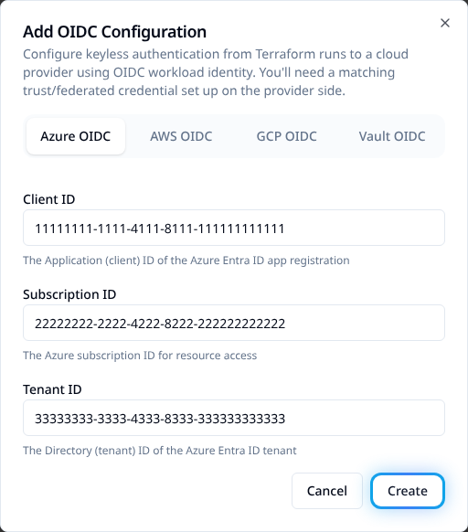

# Read Azure Key Vault secrets from a playbook

Read a secret during an Ansible job, verify it without printing its value, and make it
available to later tasks. This example runs on the runner with `hosts: localhost`; your
managed hosts do not need Azure credentials for the lookup.

## Before you begin

You need an existing vault, an enabled secret and an Azure identity allowed to read it.
The runner must reach the vault and Azure sign-in endpoints, including any private-endpoint
DNS and network configuration your vault requires. Its execution environment needs
`azure.azcollection` and the collection's Python dependencies.

| Maintain this | In this place |
|---|---|
| Secret retrieval and use | Your repository's Ansible playbook YAML. |
| Collection version | Your repository's `requirements.yml`; Python dependencies belong in the runner image. |
| Stackweaver's organization identity | The UI or the Terraform/OpenTofu provider example below. |
| Azure trust and vault access | Your Azure identity and role configuration. Saving an identity in Stackweaver does not grant vault access. |

The [Galaxy collections guide](../features/ansible/galaxy-collections.md) explains repository
dependency installation and runner image requirements.

<a id="how-authentication-reaches-your-playbook"></a>

## 1. Choose the runner's Azure identity

Stackweaver supplies credentials to the playbook's environment. An attached Azure credential
takes precedence over organization federation; the runner's AKS identity is another option
when neither supplies the job identity.

| Method | Configure this |
|---|---|
| Attached service principal | Attach an Azure credential to the job template. Use the identity's vault permissions, not the permissions of the person launching the job. |
| Organization federation | Save the organization's Azure application identifiers and configure the application's trust for Stackweaver's issuer, audience and job subject. Both platform and self-hosted runners receive a job token. |
| AKS Entra Workload ID | Configure the runner pod's workload identity and projected token. The playbook uses that pod identity, not a Stackweaver job federation subject. |

If you already have a working attached credential or AKS identity, continue to
[grant vault access](#azure-setup). Otherwise, configure organization federation through
one of the following paths.

### Configure organization federation in the UI

You need organization permission to manage OIDC settings. Open your organization's
**Settings > OIDC Configurations**, choose **Add OIDC**, and select **Azure OIDC**.
Enter the application's **Client ID**, Azure **Subscription ID** and **Tenant ID**, then
choose **Create**. Confirm the saved Azure entry has the intended identifiers.



*Example Azure identifiers. Use your own application's values.*

### Configure the same identity with Terraform or OpenTofu

With the [Stackweaver provider configured](./terraform-provider.md), add this resource to
`oidc.tf`. Replace `example-platform` and the three example Azure identifiers. Use the
existing identity configuration if one is already managed; do not create a second copy in
the UI and your provider configuration.

```hcl
resource "stackweaver_azure_oidc_configuration" "ansible" {
  organization    = "example-platform"
  client_id       = "11111111-1111-4111-8111-111111111111"
  subscription_id = "22222222-2222-4222-8222-222222222222"
  tenant_id       = "33333333-3333-4333-8333-333333333333"
}
```

Review the plan, apply it, and confirm the saved configuration has those identifiers. This
resource configures Stackweaver's side of federation. It does not create the Azure application,
its federated credential or its Key Vault role assignment.

### For API integrations

Use the provider for maintained configuration. For an API integration, send a `POST` request
to the path below, replacing `<org>` with your organization name. Authenticate with a
Stackweaver API token allowed to manage its OIDC settings; see
[Using the API](../architecture/using-the-api.md).

```text
/api/v2/organizations/<org>/oidc-configurations
```

Use this body, replacing the Azure identifiers:

```json
{
  "data": {
    "type": "azure-oidc-configurations",
    "attributes": {
      "client-id": "11111111-1111-4111-8111-111111111111",
      "subscription-id": "22222222-2222-4222-8222-222222222222",
      "tenant-id": "33333333-3333-4333-8333-333333333333"
    }
  }
}
```

A successful create returns HTTP `201` with the saved resource in `data`. Check its ID and
attributes. This configures the same organization identity; it is not an API for retrieving
vault secrets. Use the [API explorer](/docs/api-reference/explorer) for operation schemas.

### Complete the Azure trust

The application's federated credential must trust your Stackweaver issuer and audience
`api://AzureADTokenExchange`. The subject has this format:

```text
organization:<org>:project:<project>:job:<job-name>:run
```

Match the organization, project and job names in the job's token. This is the job subject,
not an OpenTofu workspace or inventory-source subject. Follow
[OIDC configuration](./oidc-configuration.md) for issuer and Azure trust setup. Stackweaver
supplies the token environment; do not paste token values into YAML.

<a id="azure-setup"></a>
<a id="1-allow-the-identity-to-read-secrets"></a>

## 2. Allow that identity to read the secret

On a vault using Azure RBAC, grant the chosen identity **Key Vault Secrets User** at the
appropriate scope. A management-plane role such as **Key Vault Contributor** does not let
it read secret values. For an access-policy vault, allow secret `get` for this named-secret
example; listing secrets also needs `list`. See
[Azure's Key Vault access guide](https://learn.microsoft.com/en-us/azure/key-vault/general/rbac-guide).

<a id="2-declare-the-collection"></a>

## 3. Declare the collection

If the repository installs its collection dependencies, add this to `requirements.yml`:

```yaml
collections:
  - name: azure.azcollection
    version: ">=3.17.0"
```

OIDC token and token-file support require `azure.azcollection` 3.17.0 or later. Use a
reviewed version compatible with your runner image's Python dependencies; installing the
collection does not install those dependencies. The
[module authentication reference](https://docs.ansible.com/projects/ansible/latest/collections/azure/azcollection/azure_rm_keyvaultsecret_info_module.html#parameters)
lists the supported environment variables. Collection dependencies belong in the repository,
not a collection list on the job template.

<a id="using-it-in-a-playbook"></a>
<a id="3-read-and-verify-the-secret"></a>

## 4. Read and verify the secret

Save this as `playbooks/read-key-vault.yml` in your repository.
[Register the playbook](./managing-ansible-playbooks.md) and select it on a job template
using the identity above. Replace the vault URI and secret name with your own.

```yaml
- name: Read a Key Vault secret
  hosts: localhost
  connection: local
  gather_facts: false
  tasks:
    - name: Retrieve the database password
      azure.azcollection.azure_rm_keyvaultsecret_info:
        auth_source: env
        vault_uri: "https://my-vault.vault.azure.net"
        name: database-password
        version: current
      register: kv
      no_log: true

    - name: Confirm a non-empty secret was returned
      ansible.builtin.assert:
        that:
          - kv.secrets | length > 0
          - kv.secrets[0].secret is defined
          - kv.secrets[0].secret | length > 0
      no_log: true

    - name: Make the password available to later tasks
      ansible.builtin.set_fact:
        db_password: "{{ kv.secrets[0].secret }}"
      no_log: true
```

`auth_source: env` uses the runner's supplied identity environment instead of falling back
to a local Azure CLI login or credentials file. `version: current` reads the current secret
version; choose a specific version if the play must use a fixed value.

Launch the job. The three tasks should succeed, with their results hidden by `no_log`.
The assertion confirms a non-empty value without displaying it. Use `db_password` in a later
task in this play and keep `no_log: true` on tasks that read or use the secret. Do not print
`kv` or `db_password` to check authentication. A secret read by this play is not automatically
stored as a Stackweaver credential.

## If the lookup fails

| Symptom | Check |
|---|---|
| Module not found or a Python import error | Check the installed collection and its Python dependencies in the runner's execution environment. |
| Authentication fails | Check the effective identity and collection version. For federation, compare issuer, audience and job subject with the Azure trust. For AKS, check the pod identity and projected token. |
| Access denied | Check the effective identity's secret data-plane permission, secret enabled state and vault firewall rules. A management role alone is insufficient. |
| Connection timeout or DNS failure | Check connectivity and private-endpoint DNS from the runner, where the module executes. |
| The assertion fails | Check the vault URI, secret name and whether the current version contains a non-empty value. Keep secret output hidden while investigating. |

## Timeouts and long plays

Stackweaver's job federation token expires one hour after it is issued. Read secrets early;
increasing the job timeout does not extend that token's lifetime. Do not assume a later
lookup in a long-running play will receive a renewed job token. AKS pod identity follows
its own token lifecycle.
