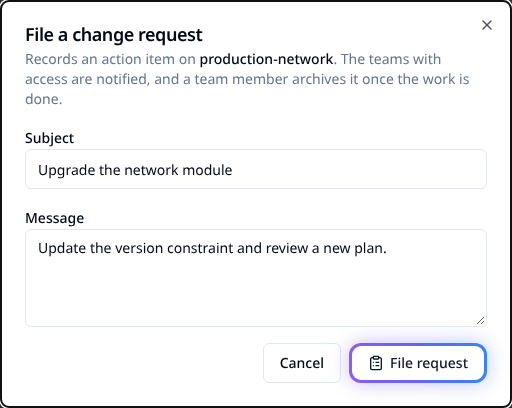
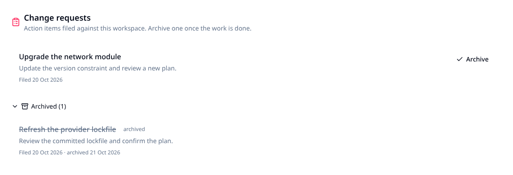
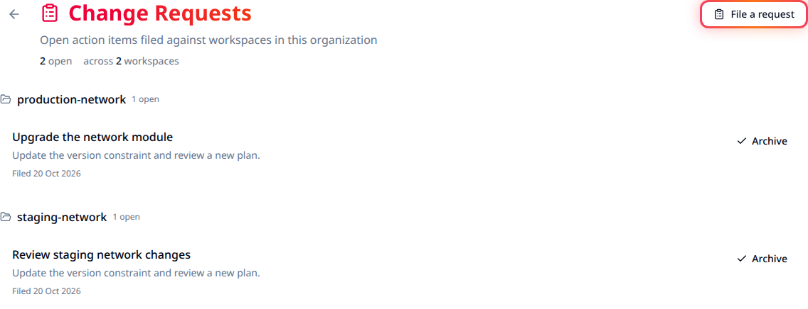

# Change requests

Use a change request to record work a workspace's team needs to do, such as upgrading a
module. The request stays open until someone archives it. Filing a request does not change
infrastructure or start a run.

<a id="overview" style="scroll-margin-top: 7rem"></a>

## Before you start

| Action | Access needed |
|---|---|
| File a request or view the organization's open-request backlog | Organization permission to manage workspaces (`org:manage-workspaces`). Organization owners have this permission. |
| Read a workspace's requests | Read access to that workspace, or organization ownership. |
| Archive a request | Write access to that workspace, or organization ownership. |

Requests have a subject and an optional message. They do not have assignees, priorities
or comment threads.

| Interface | Use it for |
|---|---|
| Web interface | File a request for one workspace and review or archive work. |
| REST API | File the same instruction against explicit workspace IDs, list requests and archive completed work. The same access requirements apply. |
| Terraform/OpenTofu provider | Request filing and archiving are not exposed as provider resources. Use the API for this operational workflow. |

<a id="filing-a-change-request" style="scroll-margin-top: 7rem"></a>

## File a request

1. Open your organization's **Workspaces** list.
2. Open **Workspace actions** on the workspace's row and choose **File change request**.
3. Check the workspace named in the dialog. Enter a **Subject** describing the work,
   and optionally a **Message** with instructions. Messages display as plain text.
4. Select **File request**.
5. Open **Settings > Change Requests** and check that the request appears under the workspace.

For example, use a subject such as "Upgrade the network module" and put the target version
and the checks to perform in the message. File a separate request for each affected workspace
so its team can close out the work independently.



*Example workspace and instruction. Filing records the work; it does not execute it.*

<a id="seeing-and-archiving-requests" style="scroll-margin-top: 7rem"></a>

## Close completed work

1. Complete and verify the work described in the request.
2. Open the workspace's **Change Requests** tab and select **Archive** on that request.
3. Expand **Archived** to check that the request is retained there with its archive date.

Archiving records completion without deleting the request. The interface does not offer a
reopen action. It does not verify that the infrastructure work was completed for you.



*An open module upgrade request and a completed lockfile review. Archived work stays separate.*

<a id="triaging-across-the-organization" style="scroll-margin-top: 7rem"></a>

## Review the organization's backlog

Open **Settings > Change Requests** to see open requests grouped by workspace. Select a
workspace name to open its requests, or use **Archive** there once its work is complete.
Archived requests disappear from this backlog and remain in the workspace's **Archived** section.



*Example organization backlog with separate workspaces and an Archive action on each request.*

For larger backlogs, use the paginated API below. The organization view loads up to 100
open requests; the workspace tab loads up to 20 requests, with open requests first. These views
do not load additional pages, so a missing older request is not proof it was deleted.

## If an action is unavailable

| Symptom | What to check |
|---|---|
| **File change request** is missing from the row menu | You need organization-level workspace management permission. Workspace write access alone is not enough. |
| Archiving is refused | Ask an organization owner to check your write access to the workspace. |
| **File request** is disabled | Enter a nonempty subject and check that a workspace is selected. |
| An older request is missing | Read the API's next page. Include archived records when looking for completed work. |

<a id="api-compatibility" style="scroll-margin-top: 7rem"></a>

## Automate requests

### 1. File against selected workspaces

Configure the environment as in [Using the API](../architecture/using-the-api.md). Save
the following as `change-request.json`, replacing the workspace IDs with IDs in the
selected organization. Attribute names use underscores for this bulk operation.

```json
{
  "data": {
    "type": "bulk_actions",
    "attributes": {
      "action_type": "change_requests",
      "action_inputs": {
        "subject": "Upgrade the network module",
        "message": "Update the version constraint and review a new plan."
      },
      "target_ids": ["<workspace-id>", "<another-workspace-id>"]
    }
  }
}
```

```bash
curl --fail --silent --show-error --request POST \
  --header "Authorization: Bearer $STACKWEAVER_TOKEN" \
  --header "Content-Type: application/vnd.api+json" \
  --data @change-request.json \
  "$STACKWEAVER_API_URL/api/v2/organizations/$STACKWEAVER_ORGANIZATION/explorer/bulk-actions"
```

A successful request returns `201 Created` describing the bulk action. Retrieve the created
requests to obtain their individual IDs; the bulk-action response is not a request ID.
Bulk filing accepts explicit `target_ids`, not a workspace query. All target IDs must belong
to the selected organization; a missing or out-of-organization target rejects the operation
before requests are created.

Repeating this POST files new requests. If its response is uncertain, check the target
workspaces before retrying so you do not file the same instruction twice.

### 2. Find requests and their IDs

Set `WORKSPACE_ID` to one of the target IDs above. This request includes archived records
and asks for the first page of up to 100 results:

```bash
curl --fail --silent --show-error --globoff \
  --header "Authorization: Bearer $STACKWEAVER_TOKEN" \
  "$STACKWEAVER_API_URL/api/v2/workspaces/$WORKSPACE_ID/change-requests?filter[archived]=true&page[number]=1&page[size]=100"
```

Compare the subject, message, workspace and `created-at` before choosing a record's
`data[].id`; a workspace can have several requests with the same subject. Open requests
have `archived-at: null`. Omit `filter[archived]=true` to list only open requests. Follow
`meta.pagination.next-page` until it is `null` to retrieve the complete list; do not stop
after the first page when verifying a large batch. Repeat the check for each target workspace.

### 3. Archive completed work

After completing the work, set `CHANGE_REQUEST_ID` to that request's ID and archive it:

```bash
curl --fail --silent --show-error --request PATCH \
  --header "Authorization: Bearer $STACKWEAVER_TOKEN" \
  "$STACKWEAVER_API_URL/api/v2/workspaces/change-requests/$CHANGE_REQUEST_ID"
```

Check that the response has a non-null `data.attributes.archived-at`, then read the workspace
list with archived records included to verify persistence. Archiving an already archived
request preserves its original archive details. Read the
[API explorer](/docs/api-reference/explorer) for complete operation schemas. Filing or
archiving through the API does not execute the requested infrastructure work.
