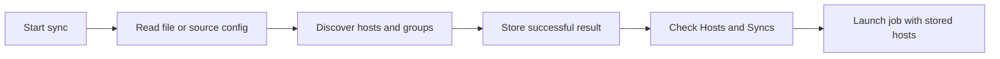
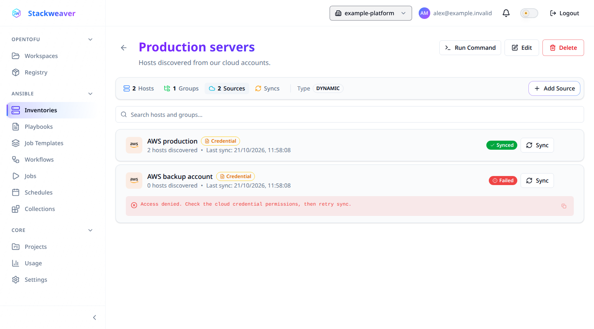
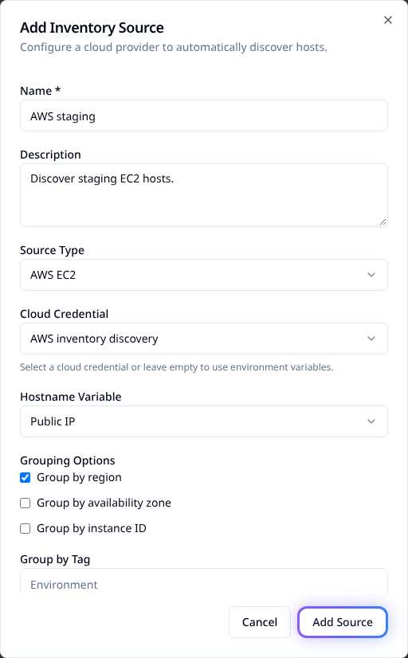
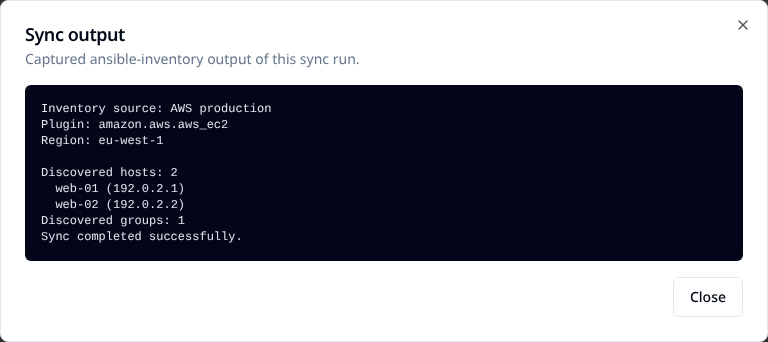

# Dynamic inventories

Refresh hosts from a cloud provider or a repository inventory file, check what was found,
then use those stored hosts in an Ansible job. Choose how the inventory should refresh
before later launches.

## Before you start

You need access to the inventory and permission to manage it: inventory write for a
project-scoped inventory, or organization Ansible management for an organization-scoped
one. Creating a new inventory also requires organization Ansible management. Reading sync
history requires organization Ansible read permission. A visible button alone does not
establish that your account can perform the operation.

The platform runner must reach the repository and cloud APIs and have the required
Ansible inventory plugin and authentication available. Inventory discovery runs on
**platform infrastructure**, even when the eventual job uses a self-hosted agent pool.
Choose a credential or identity with read access to the resources you intend to discover.

For the cloud examples below, scope that access to the resources you need:

| Provider | Discovery access |
|---|---|
| AWS | `ec2:DescribeInstances`; region enumeration can also require `ec2:DescribeRegions`. |
| Azure | The `Reader` role on the target subscription or resource groups. |
| GCP | `compute.instances.list` on each target project. |

<a id="two-approaches" style="scroll-margin-top: 7rem"></a>

## Choose where configuration lives

VCS versus cloud source chooses where discovery settings live. UI, API and Terraform
choose how you register and manage that definition; they are not competing inventory types.
Use the UI steps below, [API requests](#configure-a-source-through-the-api), or
[Terraform/OpenTofu definitions](#manage-the-definition-with-terraform-or-opentofu).
All three paths still need a successful discovery and a host-set check.

| Use | When to choose it | Where discovery settings live |
|---|---|---|
| **VCS** inventory | Review plugin configuration in Git, including provider filters, hostnames and grouping. | A plugin YAML file in the selected repository and branch. |
| **Dynamic** inventory with cloud sources | Combine sources with their own credentials and refresh settings. | Each source's configuration. Use the API for provider-specific settings the form does not expose. |

The cloud-source form does not expose regions, GCP projects, Azure subscription/resource
groups or a general plugin configuration editor. Its generic hostname and grouping
controls are not used by the current cloud configuration generators. Configure those
settings through VCS YAML or the source API `config` before relying on them.

**Custom Script** appears in the source selector but its sync implementation is incomplete.
Use a supported cloud source or a VCS inventory file.

<a id="how-it-works" style="scroll-margin-top: 7rem"></a>

## Understand the refresh



<details>
<summary>What each step does</summary>

The platform runner reads the repository file or generates a plugin file from the cloud
source configuration. It runs Ansible's inventory discovery and records the result.
Jobs use the stored hosts and variables. Refreshing them is a separate operation, which
can also run automatically before a job when update on launch is enabled.

</details>

<a id="vcs-backed-recommended-for-teams" style="scroll-margin-top: 7rem"></a>
<a id="creating-a-vcs-backed-dynamic-inventory" style="scroll-margin-top: 7rem"></a>

## Use a repository plugin file

1. Commit an inventory plugin file to a repository connected to your organization.
   Use the filename suffix required by the plugin.
2. Open **Inventories > New Inventory**. Enter a name, choose **VCS**, then select the
   connection, repository, branch and **Inventory Path**.
   The connection selector offers GitHub and Azure DevOps connections. Register repository
   access as a [VCS connection](./vcs/README.md), rather than as an Ansible credential.
3. Select **Create Inventory**, open it, and select **Sync from VCS**.
4. Check the completed sync and discovered hosts before selecting the inventory in a
   [job template](../get-started/your-first-ansible-job.md).

Repository-backed discovery uses your file and the platform runner's environment for
cloud authentication. Attaching a cloud credential to a separate dynamic source does
not authenticate a VCS inventory. For Azure, this path does not mint Stackweaver OIDC
inventory tokens; arrange runtime identity or plugin authentication with your operator.
Keep secrets out of the repository.

<a id="step-1-prepare-the-inventory-plugin-file" style="scroll-margin-top: 7rem"></a>
<a id="cloud-provider-detection" style="scroll-margin-top: 7rem"></a>

### Plugin YAML examples

| Provider | Plugin | Required filename ending |
|---|---|---|
| AWS | `amazon.aws.aws_ec2` | `aws_ec2.yml` or `aws_ec2.yaml` |
| Azure | `azure.azcollection.azure_rm` | `azure_rm.yml` or `azure_rm.yaml` |
| GCP | `google.cloud.gcp_compute` | `gcp_compute.yml`, `gcp_compute.yaml`, `gcp.yml` or `gcp.yaml` |

A provider icon is a UI hint, not proof that Ansible accepts the filename. These filename
requirements come from the [AWS](https://docs.ansible.com/projects/ansible/latest/collections/amazon/aws/aws_ec2_inventory.html),
[Azure](https://docs.ansible.com/projects/ansible/latest/collections/azure/azcollection/azure_rm_inventory.html)
and [GCP](https://docs.ansible.com/projects/ansible/latest/collections/google/cloud/gcp_compute_inventory.html)
plugin references; use those references for additional options and dependencies.

Save one of these files in your repository, replacing the example region, resource group
or project with your own scope. The AWS example selects running production instances;
Azure lists VMs in `rg-production`; GCP lists instances in the named project and zone.
Authentication must already be available to the platform runner as described above.

::: code-group
```yaml [AWS: inventory/production.aws_ec2.yml]
plugin: amazon.aws.aws_ec2
regions:
  - eu-west-1
filters:
  instance-state-name: running
  tag:Environment: production
keyed_groups:
  - key: placement.region
    prefix: region
```
```yaml [Azure: inventory/production.azure_rm.yml]
plugin: azure.azcollection.azure_rm
auth_source: auto
include_vm_resource_groups:
  - rg-production
hostnames:
  - name
keyed_groups:
  - key: location
    prefix: region
```
```yaml [GCP: inventory/production.gcp_compute.yml]
plugin: google.cloud.gcp_compute
auth_kind: application
projects:
  - my-project-id
zones:
  - us-central1-a
keyed_groups:
  - key: labels.env
    prefix: env
```
:::

For Azure managed identity, use `auth_source: msi` instead of `auto`. Give that identity
read access to the target subscription/resource groups. For GCP, `application` uses
Application Default Credentials available on the platform runtime; it does not attach a
Stackweaver credential to a VCS inventory. After syncing, check **Hosts** and **Groups**
for the intended scope before using it in a job.


The file picker hides playbooks, roles, variables, tests, hidden directories and tooling
files. If no candidates are found, it offers a typed path. If other candidates appear
but yours is missing, check the repository and branch, then use the inventory registration
operation in the [API explorer](/docs/api-reference/explorer). Not every picker accepts
an arbitrary path.

<a id="ui-configured" style="scroll-margin-top: 7rem"></a>
<a id="creating-a-ui-configured-dynamic-inventory" style="scroll-margin-top: 7rem"></a>

## Add a cloud source



1. Open **Inventories > New Inventory**, enter a name, select **Dynamic**, and create it.
2. Open **Sources > Add Source**. Enter the source name and choose **Source Type**.
3. Choose a matching **Cloud Credential**, or use an operator-configured runtime identity.
   Azure also has an **Authentication Method** selector; see the table below.
4. Scroll through the form to check refresh and overwrite settings, then select **Add Source**.
5. Configure any required provider scope through the API before the first sync. GCP sources
   need a `projects` list; the form cannot supply it.
6. Select **Sync** on the source and verify the result under **Hosts** and **Syncs**.



**Hostname Variable** and **Grouping Options** are visible in this form, but the current
cloud generators do not consume those generic controls. Set provider-specific rules in
VCS YAML or source API `config`.

Credentials must belong to the inventory's organization and match the provider type.
**None (use environment)** works only when a suitable identity is already available to
the platform runner. It is not automatic federation for every provider.

For a recurring source sync, create the source first, then use **Edit > Sync Schedule**
and save. The schedule selected in the new-source form is not retained by creation.

<a id="authentication" style="scroll-margin-top: 7rem"></a>
<a id="azure-authentication-methods" style="scroll-margin-top: 7rem"></a>
<a id="choosing-a-method-on-a-private-deployment" style="scroll-margin-top: 7rem"></a>

## Choose Azure source authentication

This table applies to an Azure **cloud source**. A VCS inventory follows its repository
file and runtime configuration instead.

| Authentication method | Required setup |
|---|---|
| **Managed Identity** | A managed identity reachable through the platform runner's Azure metadata endpoint. For a user-assigned identity, supply its client ID. |
| **Workload Identity** | An AKS runtime with a projected workload-identity token and the runner's workload identity enabled. |
| **OIDC Federation** | Organization Azure OIDC configuration, signing/issuer setup, and a federated credential matching this source. Entra must reach the issuer's discovery and JWKS endpoints publicly with trusted TLS. |
| **Cloud Credential** | An Azure service-principal credential attached to the source. Outbound authentication works without a public Stackweaver issuer. |

OIDC Federation uses the subscription in the organization's Azure OIDC configuration.
For the other source authentication modes, supply `subscription_id` through source API
`config`. On a private deployment,
use a runtime identity or a cloud credential when the Stackweaver issuer is not public.
Read [OIDC operator configuration](./oidc-configuration.md#operator-configuration) before
choosing Stackweaver federation.

<a id="oidc-subject-formats" style="scroll-margin-top: 7rem"></a>

### Configure the Azure federation subject

For a source using Stackweaver OIDC Federation, configure its federated credential with
the deployment's issuer, audience `api://AzureADTokenExchange`, and this subject:

```text
organization:<org>:project:<project>:inventory:<source-name>:sync
```

Use the **source name**, not the enclosing inventory name. Use the inventory's project
name, or `default` for an organization-scoped inventory without a project. Renaming or
changing this scope requires a matching identity configuration.

This subject is not the authentication contract for a VCS inventory. For Azure VCS
workload identity, the runner resolves the subscription from the file's `subscription_id`,
then the organization's Azure OIDC configuration, then its inherited `AZURE_SUBSCRIPTION_ID`.
The operator configures the runtime identity. The inventory file remains authoritative.


<a id="cloud-credentials" style="scroll-margin-top: 7rem"></a>

AWS sources can use an attached AWS credential or a runtime AWS identity. GCP sources use
Application Default Credentials, from an attached service-account key or the platform's
runtime identity. VMware sources need matching provider authentication. Do not store cloud
secrets in plugin YAML or copy them into sync logs.

## Configure a source through the API

Use these requests when you need provider settings the form cannot supply. You need
`curl`, `jq`, the permissions listed above, and an existing AWS credential in the same
organization. Set `STACKWEAVER_TOKEN` to an authorized API token through your normal
secret handling. Replace the hostname, organization URL name and credential UUID below.

Creating a source registers its configuration; it does not prove discovery works. The
sync request queues work and returns before discovery finishes. Keep overwrite off until
you have checked the result.

### Create, sync and verify an AWS source

Run this in Bash in an empty example directory. It writes `inventory.json` and `source.json`;
neither file contains the credential's secret, only its ID.

```bash
export STACKWEAVER_URL="https://stackweaver.example.com"
export STACKWEAVER_ORG="my-org"
export AWS_CREDENTIAL_ID="<existing-aws-credential-uuid>"
: "${STACKWEAVER_TOKEN:?Set an authorized Stackweaver API token}"

cat > inventory.json <<'JSON'
{"data":{"type":"inventories","attributes":{
  "name":"production","inventory-type":"dynamic"
}}}
JSON

INVENTORY_ID=$(curl --fail-with-body --silent --show-error \
  -H "Authorization: Bearer $STACKWEAVER_TOKEN" \
  -H 'Content-Type: application/vnd.api+json' \
  --data-binary @inventory.json \
  "$STACKWEAVER_URL/api/v2/organizations/$STACKWEAVER_ORG/ansible/inventories" \
  | jq -er '.data.id')

jq -n --arg credential "$AWS_CREDENTIAL_ID" '{data:{
  type:"inventory-sources", attributes:{
    name:"aws-production", "source-type":"aws", "credential-id":$credential,
    config:{
      regions:["eu-west-1"],
      filters:[{name:"tag:Environment",values:["production"]}],
      group_by_region:true
    },
    "update-on-launch":true, "update-cache-timeout":300,
    overwrite:false, "overwrite-vars":false
  }
}}' > source.json

SOURCE_ID=$(curl --fail-with-body --silent --show-error \
  -H "Authorization: Bearer $STACKWEAVER_TOKEN" \
  -H 'Content-Type: application/vnd.api+json' \
  --data-binary @source.json \
  "$STACKWEAVER_URL/api/v2/ansible/inventories/$INVENTORY_ID/sources" \
  | jq -er '.data.id')

curl --fail-with-body --silent --show-error -X POST \
  -H "Authorization: Bearer $STACKWEAVER_TOKEN" \
  "$STACKWEAVER_URL/api/v2/ansible/inventory-sources/$SOURCE_ID/actions/sync"

# Repeat this read until status is successful or failed.
curl --fail-with-body --silent --show-error \
  -H "Authorization: Bearer $STACKWEAVER_TOKEN" \
  "$STACKWEAVER_URL/api/v2/ansible/inventory-sources/$SOURCE_ID" \
  | jq '.data.attributes | {status, hosts: .["hosts-count"], error: .["last-sync-error"]}'

curl --fail-with-body --silent --show-error \
  -H "Authorization: Bearer $STACKWEAVER_TOKEN" \
  "$STACKWEAVER_URL/api/v2/ansible/inventories/$INVENTORY_ID/hosts"
```

A successful result has `status: "successful"` and the expected host count. If the result
is failed or unexpectedly empty, inspect the error and scope before launching a job.
The hosts endpoint is paginated; follow `meta.pagination.next-page` when reading all hosts.


### Update scope, schedule or authentication

Save this as `source-update.json` to keep the existing AWS discovery scope and add an
hourly sync. A `config` update replaces the whole configuration object, so include
any filters and grouping you want to keep.

```json
{
  "data": {
    "type": "inventory-sources",
    "attributes": {
      "config": {
        "regions": ["eu-west-1"],
        "filters": [{"name": "tag:Environment", "values": ["production"]}],
        "group_by_region": true
      },
      "sync-schedule": "0 * * * *",
      "update-cache-timeout": 300
    }
  }
}
```

```bash
curl --fail-with-body --silent --show-error -X PATCH \
  -H "Authorization: Bearer $STACKWEAVER_TOKEN" \
  -H 'Content-Type: application/vnd.api+json' \
  --data-binary @source-update.json \
  "$STACKWEAVER_URL/api/v2/ansible/inventory-sources/$SOURCE_ID"
```

The response contains the saved source. Queue another sync to apply changed discovery
settings to stored hosts. Set `sync-schedule` to an empty string to remove the schedule.

For an Azure or GCP source, create a separate source with `source-type: "azure"` or
`"gcp"` and use the corresponding object below as its `config`. Attach a matching
credential, or omit `credential-id` for a suitable runtime identity. The Azure example
uses managed identity, so it has no attached credential.

::: code-group
```json [Azure managed identity: config]
{
  "auth_method": "managed_identity",
  "subscription_id": "<azure-subscription-uuid>",
  "resource_groups": ["rg-production"],
  "group_by_resource_group": true
}
```
```json [GCP: config]
{
  "projects": ["my-project-id"],
  "zones": ["us-central1-a"],
  "group_by_zone": true
}
```
:::

Azure accepts `auth_method` values `managed_identity`, `workload_identity`, `oidc` and
`credential`. Use `managed_identity_client_id` only with `managed_identity`. Stackweaver
OIDC uses the organization's OIDC subscription as described above. When switching an
existing Azure source away from a stored credential, send `credential-id: ""` alongside
the complete new `config`. Updating `source-type` does not change an existing source's
provider; create a separate source instead.

For VCS inventories and constructed rebuilds, trigger a sync with the first operation
below and no request body. The other operations read history and a run's captured output.
Replace the inventory and sync IDs with your own values.

```text
POST /api/v2/ansible/inventories/<inventory-id>/actions/sync
GET /api/v2/ansible/inventories/<inventory-id>/syncs
GET /api/v2/ansible/inventory-syncs/<sync-id>
```

Use the [API explorer](/docs/api-reference/explorer) for complete request schemas.


## Manage the definition with Terraform or OpenTofu

The [Stackweaver provider](https://github.com/vhco-pro/terraform-provider-stackweaver)
has native [inventory](https://github.com/vhco-pro/terraform-provider-stackweaver/blob/main/website/docs/r/ansible_inventory.html.markdown)
and [inventory source](https://github.com/vhco-pro/terraform-provider-stackweaver/blob/main/website/docs/r/ansible_inventory_source.html.markdown)
resources. Choose this path instead of the API creation example for the same objects.
Save this as `main.tf`, replace the hostname and organization, and supply
an existing AWS credential UUID as `TF_VAR_aws_credential_id`. Authenticate the provider
with `TFE_TOKEN` through your normal secret handling.

```hcl
terraform {
  required_providers {
    stackweaver = {
      source = "vhco-pro/stackweaver"
    }
  }
}

provider "stackweaver" {
  hostname = "stackweaver.example.com"
}

variable "aws_credential_id" {
  type = string
}

resource "stackweaver_ansible_inventory" "production" {
  organization = "my-org"
  name         = "production"
  type         = "dynamic"
}

resource "stackweaver_ansible_inventory_source" "aws" {
  inventory_id         = stackweaver_ansible_inventory.production.id
  name                 = "aws-production"
  source_type          = "aws"
  credential_id        = var.aws_credential_id
  update_on_launch     = true
  update_cache_timeout = 300
  overwrite            = false
  overwrite_vars       = false
  sync_schedule        = "0 * * * *"

  config = jsonencode({
    regions         = ["eu-west-1"]
    filters         = [{ name = "tag:Environment", values = ["production"] }]
    group_by_region = true
  })
}

output "inventory_id" {
  value = stackweaver_ansible_inventory.production.id
}

output "inventory_source_id" {
  value = stackweaver_ansible_inventory_source.aws.id
}
```

Run `terraform init`, then `terraform plan -out=inventory.tfplan` and review it before
`terraform apply inventory.tfplan` (or use the corresponding `tofu` commands). This creates
the inventory and source definitions, not a completed discovery. Use the source ID output
with the sync API request above, or select **Sync** on **Sources**, then verify the hosts.

For a repository-backed inventory, use this resource instead of the dynamic inventory and
source pair above. Replace the VCS connection UUID and repository with your organization's
connection and the repository containing the plugin file.

```hcl
resource "stackweaver_ansible_inventory" "from_git" {
  organization      = "my-org"
  name              = "production-from-git"
  type              = "vcs"
  vcs_connection_id = "<existing-vcs-connection-uuid>"
  vcs_repository    = "my-org/automation"
  vcs_branch        = "main"
  inventory_path    = "inventory/production.azure_rm.yml"
}
```

Creating a VCS inventory queues an initial sync. Inspect its status and host set; use
**Sync from VCS** or the inventory sync API to refresh subsequent repository changes.

The native resources use `stackweaver_*` names; there are no `tfe_ansible_inventory` aliases.
Use `config = jsonencode(...)` for supported provider options, rather than the ineffective
generic hostname/grouping fields. Change an existing definition in Terraform instead of
managing the same source through both Terraform and manual API updates.


<a id="viewing-synced-hosts" style="scroll-margin-top: 7rem"></a>
<a id="syncing-and-live-status" style="scroll-margin-top: 7rem"></a>

## Check a sync before using its hosts

1. Wait for **Synced**, or read the failed source's error on **Sources**. A green state with zero
   hosts is not proof that authentication and scope are correct.
2. Open **Hosts** and check the count, names, `ansible_host` and variables against the intended
   machines. Open **Groups** if your playbook targets generated groups.
3. Open **Syncs** and select the run. Check its trigger, counts, duration and captured output.
   Source and constructed builds can stream output while running; VCS output appears at completion.
4. Select the inventory in your job template only after the host set is appropriate.



The page refreshes active sync status automatically. A local completion notification can
stop waiting after about a minute; that does not cancel the sync. Return to **Syncs** for
the final result. Warnings can accompany a successful discovery; read them before assuming
the returned host set is complete.

<a id="per-source-sync-behavior" style="scroll-margin-top: 7rem"></a>

## Choose refresh and merge settings

These settings belong to individual cloud sources. A VCS inventory does not gain
automatic Git refresh from this table: use **Sync from VCS**, then check its result
before launching jobs that need repository changes. Constructed inventories have
their own rebuild and cache behavior, described below.

| Setting | Effect |
|---|---|
| **Update on launch** | Enabled sources refresh before jobs use this inventory. A recent successful sync within the cache timeout can skip that refresh. The default is on. |
| **Cache timeout** | Seconds for which a successful source sync is considered fresh. Set it to `0` to refresh on every launch. |
| **Overwrite** | After a successful sync, remove hosts/groups owned by this source that disappeared from its result. A successful empty result can remove all of that source's rows. Failed discovery leaves them unchanged. |
| **Overwrite variables** | Replace a host's variables, including manually added keys. With it off, merge variables; synced values win on conflicting keys. |
| **Sync verbosity** | Increase diagnostic output when investigating a problem, then check **Syncs**. |

Avoid overlapping host/group names when sources must remain independent. Discovery can
update an existing name and adopt a previously unowned row; a manually created name is
not guaranteed protection from later overwrite pruning.

### When an update-on-launch sync fails

> [!WARNING]
> A failed refresh does **not** fail the job automatically. The job is released and uses
> stored hosts from the last successful source sync. A sync still running after 30 minutes
> also stops holding the job. Check the job's inventory-refresh warning before trusting
> that its targets were freshly discovered.

The warning names each affected source, the failure and last successful refresh, or says
that it has never synced and contributed no hosts. It appears above the job's tabs and at
the start of its output on platform and self-hosted runners.

<details>
<summary>Refresh warnings in the API and notifications</summary>

The job API exposes `inventory-sync-warnings`, including each source's ID/name, failure,
and `last-successful-sync-at` (null when there is none). Notifications sent by the template
carry the warning in `warnings` and `extra.inventory_sync_warnings`. A channel subscribed
only to failures will not receive a successful job's warning. Check the job or sync history
when you need to establish which inventory was used.

</details>

<a id="running-ad-hoc-commands" style="scroll-margin-top: 7rem"></a>

## Run an ad hoc command

1. Select **Run Command** on the inventory, or the terminal action for one host.
2. Choose a permitted module and arguments, the host limit, a machine credential and runner
   destination. `command` and `shell` accept free-form arguments; other modules use key/value pairs.
3. Run it and check the normal job page for output, events and results.

This requires ad hoc command permission, which is separate from template execution.
The organization controls the module allowlist. Ad hoc jobs do not install repository
Galaxy requirements. Verify the target limit before running a command that changes machines.

<a id="constructed-inventories" style="scroll-margin-top: 7rem"></a>

## Build a constructed inventory

Choose **Constructed** when creating an inventory to derive hosts from other inventories
instead of querying a cloud. Select ordered inputs, optional `compose`, `groups` and
`keyed_groups` rules, and a host limit. Use **Rebuild** and inspect **Syncs** to verify it.
It also rebuilds before job launches, subject to its cache timeout.

### Define constructed rules

Save as `constructed-rules.yml` and paste its contents into **Constructed rules (YAML)**
when creating or editing the constructed inventory. Select the AWS inventory as an input.
These rules use the `ec2_tags` and `ec2_region` variables produced by an AWS cloud source.

```yaml
compose:
  deployment_region: ec2_region | default('unknown')
groups:
  production: (ec2_tags | default({})).get('Environment', '') == 'production'
keyed_groups:
  - key: ec2_region | default('unknown')
    prefix: region
```

The build adds a `production` group for tagged hosts, a `region_...` group per region and
a `deployment_region` host variable. Set **Limit** to `production` if only those hosts
should remain in the result. Leave it empty to keep all input hosts.

With the Terraform definition above, add this resource to `main.tf` and keep
`constructed-rules.yml` beside it:

```hcl
resource "stackweaver_ansible_inventory" "production_hosts" {
  organization        = "my-org"
  name                = "production-hosts"
  type                = "constructed"
  input_inventory_ids = [stackweaver_ansible_inventory.production.id]
  source_vars         = file("${path.module}/constructed-rules.yml")
  constructed_limit   = "production"
}
```

Creation queues a build; wait for a successful result before using its hosts. It derives
hosts from the stored input, so sync the AWS source first if that input has no hosts yet.

Through the API, create an inventory with `inventory-type: "constructed"`, the rules as
the `source-vars` YAML string, and an ordered `input-inventory-ids` array. Terraform exposes
the same settings as `type = "constructed"`, the `source_vars` file content and
`input_inventory_ids`. Neither path takes a cloud source on the constructed inventory.


Inputs must be in the same organization and cannot themselves be constructed inventories.
The result is derived: edit input data or rules to change it. Manual host/group creation
and source additions are blocked. Successful rebuilds replace the derived host set; failed
builds retain the last successful result. A disabled/deleted derived host or deleted group
can reappear on rebuild. Move any manually maintained entries to an input inventory before
rebuilding if you need to preserve them.

<a id="deleting-an-inventory" style="scroll-margin-top: 7rem"></a>

## Delete an inventory

Choose **Delete** and read the dependency message before confirming. An ordinary
delete can be blocked by templates, jobs, sources or constructed inputs that reference it.

> [!WARNING]
> **Force Delete Everything** removes the inventory and dependent sources, templates,
> schedules, jobs/events and affected workflow steps. Constructed inventories lose this
> input. This is irreversible and requires organization Ansible management permission.
> Keep the inventory if you need its dependent records and history.

To delete through the API, use:

```text
DELETE /api/v2/ansible/inventories/<inventory-id>
```

For the destructive cascade, add `?force=true` to that endpoint. An ordinary delete
returns `409 Conflict` while dependencies block it. The API force request acts immediately;
it does not show the UI confirmation.

## Troubleshooting

| Symptom | Check next |
|---|---|
| Authentication fails | Credential provider/organization, expiry, runtime identity and cloud permissions. For Azure federation, also verify issuer, audience and the source-name subject. |
| Success with no hosts | Provider scope and filters. Set explicit GCP projects; no projects can produce a successful sync that contacts nothing. |
| Hosts disappear after sync | Overwrite, successful empty results and overlapping host/group names. Review the source's output before retrying. |
| A plugin warning appears | Read the captured output in **Syncs**. An amber indicator can accompany a successful result. Check options against the installed collection's documentation. |
| `azure_cloud` is undefined | Ask the operator to check the custom runner image's Azure collection dependencies, including `azure-cli-core`. Rebuild the image with its required dependencies. |
| Desired grouping, hostname or region control is absent or ineffective | Use VCS plugin YAML or source API `config`; the generic form fields do not configure those provider options. |
