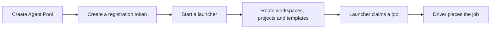

# Launchers

Run OpenTofu or Ansible inside your own network by starting a launcher, registering it with an agent pool and explicitly routing work to that pool. A launcher runs one job at a time unless you raise its concurrency; add launchers to increase parallel capacity.

| Execution choice | Who operates the launchers? |
|---|---|
| Hosted capacity. | The Stackweaver installation runs them and serves everything in `remote` execution mode. |
| Agent pool. | You run persistent launchers on your own servers or Kubernetes clusters that keep a heartbeat open to Stackweaver. |

Use separate pools for trust or network boundaries, and grant each pool only the workspace/project access it needs. A launcher initiates outbound connections to Stackweaver over HTTPS; you do not need an inbound listener for job dispatch. Workloads still need their own network access to providers, targets and dependency registries. Agent pools follow the Terraform Cloud and HCP Terraform agent pool model, so `tfe_agent_pool` and `tfe_agent_token` from the `hashicorp/tfe` provider manage them, and so does [the Stackweaver provider](../terraform-provider.md).

## Before you start

Before you start, make sure you have:

| Requirement | Description |
|-------------|-------------|
| **Stackweaver account** | Sign in to your organization. |
| **Organization admin or agent pool permissions** | You need permission to manage agent pools and API keys with the Launcher registration scope. |
| **A Linux host or a Kubernetes cluster** | Launchers run on Linux only. The container driver needs a Docker or Podman socket on the host; the Kubernetes driver needs a namespace it may create pods in. |
| **Outbound HTTPS access** | The launcher, and every job it places, must reach your Stackweaver API (e.g. `https://your-stackweaver.example.com`). |

## How a job runs

Every OpenTofu run, Ansible job and sync goes through the same three parts, wherever it runs.

| Part | What it does |
|------|--------------|
| **Launcher** | A long-running process (the `stackweaver-launcher` image, a job image, or the `stackweaver-launcher` binary on a Linux host) that registers with one agent pool, or with the installation's hosted capacity, and keeps one heartbeat open to the API. When the API offers it work, it claims the job, asks the API for a token valid for that one job, and hands the job to its driver. With the container and Kubernetes drivers a launcher never runs user code itself, and it holds no database, object storage or Redis credential. |
| **Driver** | Decides where the job runs: `inprocess` (a child process of the launcher), `container` (a fresh container per job through a Docker or Podman socket) or `kubernetes` (a fresh pod per job). |
| **Job process** | Runs one job and exits. It fetches the job's configuration, variables, credentials and state from the API with the job token, runs `tofu` or `ansible-playbook`, streams the output back and uploads the plan, the state and the result. The job token is refused once the job has finished. |

## Registration and dispatch

**Agent pools** group launchers and define which workspaces or projects can use them. You create a pool in Settings, then start launchers in that pool. When you configure a workspace (or project) to use agent execution, or name the pool on an Ansible job template, its work is offered to the launchers of that pool.

**Launchers** register with one pool using a registration credential, and the API gives each one a launcher token of its own. After registration, the launcher appears in **Settings > Launchers** and shows its status (online, busy, offline), engines (OpenTofu, Ansible, or OpenTofu and Ansible), driver, network mode and last heartbeat.

The flow is:

<strong>Flow Steps (Legend)</strong>

1. **Agent pool** - Create an agent pool and optionally restrict which workspaces or projects can use it.
2. **Registration token** - Create an agent token on the pool, or an API key with the Launcher registration scope.
3. **Launcher** - Start the launcher with that token, the pool ID and the server URL; it registers itself.
4. **Routing** - Set workspace/project/organization execution defaults for OpenTofu; select the pool on an Ansible template or ad hoc command.
5. **Claim** - The launcher's heartbeat is answered with the work waiting for its pool, up to its free capacity, and it claims a job atomically, so a job never runs twice.
6. **Placement** - The driver starts the job's process in-process, in a container or in a pod, with a token for that job alone.

