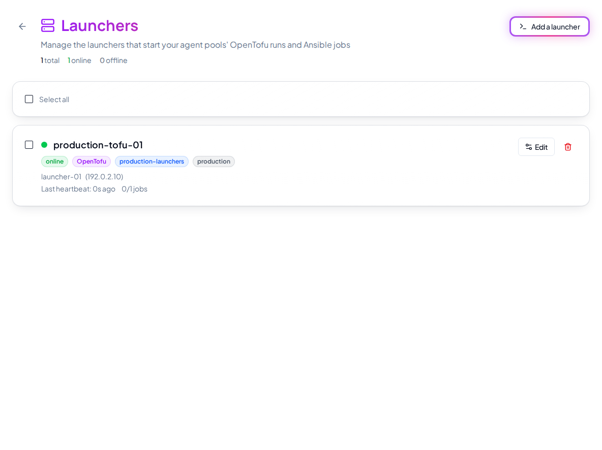

# Monitor and operate launchers

## Verify and monitor launchers

Open **Settings > Launchers** to check status (Online, Busy, Offline or Error), engines, pool, hostname, heartbeat and current load against capacity. Open a launcher for capabilities, labels and recent jobs.

After registration, run a reviewed test plan or harmless Ansible job and verify which launcher ran it and its output. Online heartbeats prove connectivity, not cloud permissions or successful workload execution.

To see where the latest attempt ran, select the launcher's name in the run's header, next to the run ID, or open a job's **Details** tab and select its **Launcher**. The **Placement** dialog shows the attempt number (for a run, of its current phase, so an apply that follows its plan is the apply's first attempt, and only a plan offered again or a re-queued apply counts as a new one), the driver, the container or pod, the image and its digest with the level the image came from, the identity binding (or the platform token) and the node.

### Launcher status

Launchers keep a heartbeat open to the API. If heartbeats stop (e.g. container down or network issue), Stackweaver marks the launcher **Offline** after a short period and offers it no new work. When the launcher comes back and heartbeats again, it returns to **Online** and can receive jobs again.

Use **Edit** on a launcher to change its description or labels. See [Operate and troubleshoot](#operate-and-troubleshoot) for deletion, image replacement and bulk maintenance.

## Operate and troubleshoot

| Symptom or task | Action |
|---|---|
| Launcher stays offline. | Check the container, `STACKWEAVER_SERVER`, `STACKWEAVER_TOKEN`, `RUNNER_AGENT_POOL_ID`, the outbound TLS connection and the registration/heartbeat logs. The launcher retries with backoff, and `/readyz` on port 9090 says what it is waiting for. |
| Launcher is online but work waits. | Check workload type, pool assignment/access, labels and available capacity. A launcher runs at most `RUNNER_MAX_CONCURRENT_JOBS` jobs at once. Work on the hosted capacity may be waiting on the organization's hosted cap. |
| All launchers in a pool are offline. | Restore capacity or explicitly change execution routing after reviewing its trust/network implications. There is no automatic fallback. |
| A job fails with an error about its image on an in-process pool. | The job resolved a run image other than its engine's job image, and an in-process launcher runs only its own image. Run the pool's launchers with the container or Kubernetes driver, or select no run image for that workspace, template or project. |
| Upgrade the platform. | Upgrade your launchers to the platform's release at the same time, because a job's `stackweaver-executor` program comes from its launcher's image. A launcher ignores `RUNNER_MODE`; remove it from older launcher deployments. |
| Upgrade a launcher. | Pull a reviewed image, replace the container with the same intended name/pool and a valid registration credential, then confirm registration and a test job. A stopping launcher finishes its jobs first, for up to `RUNNER_DRAIN_GRACE`. Same-name registration in the same organization reuses the launcher record and refreshes its launcher token. Do not run two instances with the same name. |
| Run both workload types. | A launcher on the container or Kubernetes driver serves both engines from the launcher image. An in-process launcher serves the engines whose toolchain its host or image has, so in Docker or Kubernetes run each engine's job image as a launcher of its own. Launchers can join the same pool with the same registration credential. |
| Remove a launcher. | Stop the container as well as deleting its registration. Deleting the launcher also deletes the launcher token its registration created. A running container with valid registration credentials can register again. |

Use resource limits and size each launcher for its workload: set CPU and memory limits on the pool so a single job cannot exhaust the host, and require them where a job without limits is not acceptable. Prefer the container or Kubernetes driver for any pool that runs code from more than one team, so each job gets its own filesystem and network, and keep the `platform` network mode unless jobs really need the node's identity. Give the container driver's host the Docker or Podman socket only through the launcher, since the socket is root-equivalent. Keep registration keys out of repositories and avoid passing the launcher's full environment to jobs. Use [the environment allowlist](../../get-started/self-hosting/environment-variables.md#launcher-variables-that-reach-runs) when additional job variables are needed.

For bulk maintenance, select launcher cards and use **Add label**, **Remove label** or **Delete**. Label operations change only the selected label; deletion asks for confirmation. A launcher that is already gone, for example because someone else deleted it first, counts as deleted. Partial failures leave failed launchers selected for retry. Verify selection and scope before repeating a batch.

Next, [run jobs in your own images](./run-images-and-execution-environments.md), [give jobs cloud access with workload identity](../workload-identity/README.md), [manage workspace inputs](../opentofu/managing-workspace-variables.md), [read OpenTofu run results](../opentofu/understanding-opentofu-runs.md) or [run an Ansible job](../../get-started/your-first-ansible-job.md).
