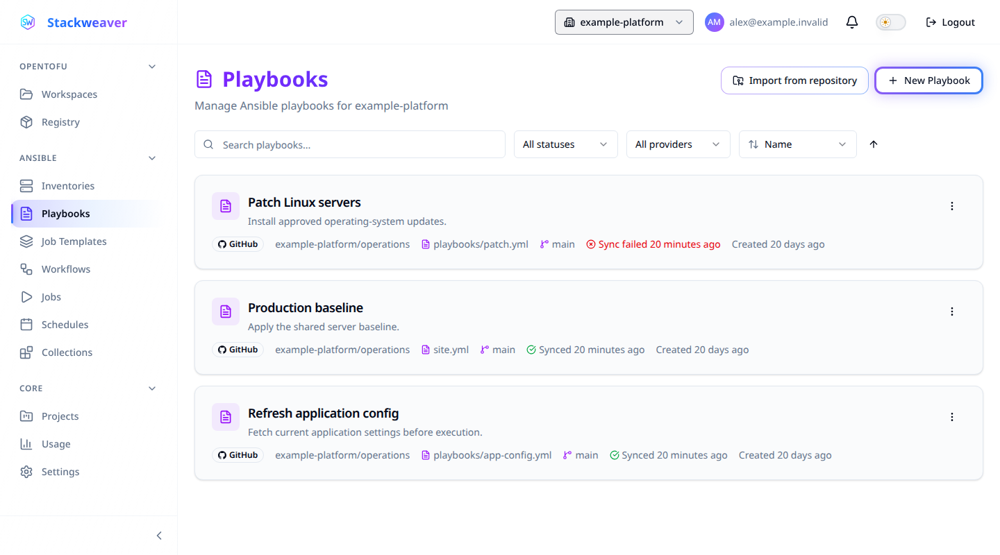
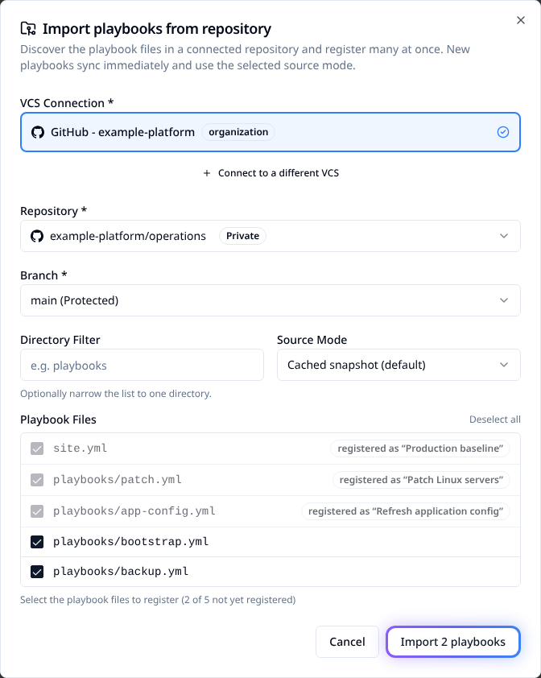

# Managing Ansible playbooks

Register a repository file so you can use it in a job template. Choose a source mode to
control whether jobs use a synced snapshot or fetch the branch when they start.



## Before you start

For creation or import from the **Playbooks** page, you need organization-level Ansible
management permission and at least one project in the organization. Use a
[GitHub or Azure DevOps connection](./vcs/README.md) in that same organization with access
to the repository and branch containing your playbooks.

The Playbooks page and import wizard do not offer a project picker. Do not rely on a
particular default project. If placement matters, specify the project through the
[provider or API examples below](#automate-registrations).

### Prepare a repository file

A registration points to a playbook; it does not create its YAML. If you need a small file
to verify repository loading, commit this as `site.yml` on the branch you will register:

```yaml
- name: Verify repository playbook loading
  hosts: localhost
  connection: local
  gather_facts: false
  tasks:
    - name: Confirm the playbook loaded
      ansible.builtin.debug:
        msg: Repository playbook loaded
```

This example runs on the runner and changes no managed hosts. A successful task verifies
that the file loaded; it does not test connectivity or permissions on your target hosts.
Use your own playbook for the actual work. Collection dependencies belong in repository
`requirements.yml`; see [Galaxy collections](../features/ansible/galaxy-collections.md).

| Interface | Use it for |
|---|---|
| Web interface | Register one file, discover several files for import and inspect sync results. |
| Terraform provider | Declare registrations with an explicit project, repository, file and source mode. |
| REST API | Register or bulk-import files, change source mode, request a sync and read its result. See [Automate registrations](#automate-registrations). |

<a id="source-modes" style="scroll-margin-top: 7rem"></a>

## Choose what a job runs

| Source mode | What runs |
|---|---|
| **Cached snapshot** (default) | Content captured by the last successful sync. Once a usable snapshot exists, snapshot-capable runners do not need to clone the playbook repository. |
| **Fresh from remote** / **Fresh from VCS at runtime** | The selected branch's HEAD at job execution time. This requires repository access for every job. |

Fresh mode does not pin a job to the commit that triggered a webhook. Cached mode can
use an older snapshot while a new sync is still in progress. Check the intended commit
before launching work that depends on a particular revision.

Older self-hosted agents still clone in cached mode. Before relying on execution while
VCS is unavailable, [verify snapshot support on your runner](#find-a-playbook-or-recover-a-failed-sync).

Galaxy dependencies and playbook tasks can still need network access in either mode.

<details>
<summary>Cached mode on platform and self-hosted runners</summary>

If a cached playbook has no snapshot, the platform runner fetches and captures one before
execution. A current self-hosted agent clones for that job while a snapshot sync is queued
for later jobs. Older agents without snapshot support clone even when cached mode is selected.

</details>

<a id="registering-a-single-playbook" style="scroll-margin-top: 7rem"></a>

## Register one playbook

1. Open **Playbooks** and select **New Playbook**.
2. Choose the **VCS Connection**, repository and branch.
3. Select the **Playbook Path** and check the generated **Name**, or enter your own name.
4. Under **Source**, choose **Cached snapshot (recommended)** or **Fresh from remote**.
5. Select **Create Playbook** and check that it appears on the Playbooks page.


To prepare a cached revision before launching, open the playbook and select **Sync from VCS**.
Wait for a successful sync and check the recorded commit. For an end-to-end launch, continue
with [your first Ansible job](../get-started/your-first-ansible-job.md).

<a id="importing-many-playbooks-at-once" style="scroll-margin-top: 7rem"></a>

## Import several playbooks

1. On **Playbooks**, select **Import from repository**.
2. Choose the connection, repository and branch.
3. Use **Directory Filter** if needed, then select files under **Playbook Files**.
   Already registered files are disabled and identify their existing registration.
4. Choose **Source Mode** and import up to 200 files at a time.
5. Read the per-file results. Some files can be created while others fail; correct the
   reported failures and retry those files.



New registrations queue a sync, so an import result does not prove content is already
synced. Check the eventual sync status before relying on a cached revision. Repeating an
import skips registrations already present for the same project, connection, repository,
branch and path. Files with colliding names receive disambiguated names; check the result.

<a id="picking-a-playbook-directly-in-a-job-template" style="scroll-margin-top: 7rem"></a>

## Pick a file while creating a template

In a job template's playbook field, choose **Registered** for an existing playbook or
**From repository** to select a connection, repository, branch and **Playbook File**.

Saving the template reuses an existing registration or creates one if needed. New registrations
through this path default to cached mode. Canceling the form does not register the selected file.

<a id="finding-playbooks-on-the-overview-page" style="scroll-margin-top: 7rem"></a>

## Find a playbook or recover a failed sync

Search matches the name, description and file path. Filter by provider or sync status;
sort by name, creation time, last sync, provider or sync status. Sorting applies to the
whole list, not just the current page. Use **Clear filters** to reset the view.

| Sync state | What to do |
|---|---|
| **Syncing** | Wait for the result before expecting a new cached revision. |
| **Synced** | Check the commit and sync time when a specific revision matters. |
| **Sync failed** | Read the error from the status indicator or detail page. Check repository access, branch and path, then use **Retry sync** or **Sync from VCS**. |

An older cached snapshot can remain usable after a failed sync. A green result from an
import or an existing registration alone does not establish which revision a job ran.
For cached execution, the job's **Playbook source** event identifies the snapshot commit
and capture time. To verify a self-hosted runner before relying on cached execution, sync
the playbook and run a non-changing test playbook in cached mode. Check for that source
event. If it is absent, treat snapshot support as unverified and ask the runner operator
to check the installed image.

Fresh jobs do not emit that cached-snapshot banner. Checking branch HEAD before launch
does not establish which revision was fetched later. When a recorded revision is required,
use cached mode, wait for a successful sync and verify the job's snapshot source event.

<a id="how-playbook-discovery-filters-files" style="scroll-margin-top: 7rem"></a>

## If the file is missing from discovery

Discovery lists YAML candidates by path conventions; it does not validate that every
candidate is an executable playbook. Check that the file is in the selected repository
and branch, then consider the exclusions below.

<details>
<summary>Excluded paths and repository listing limits</summary>

Role internals, variable and inventory directories, tests, hidden directories and dependency
files are excluded. Examples include `roles/`, `tasks/`, `group_vars/`, `inventories/`,
`.github/`, `requirements.yml` and cloud inventory plugin files. Both `.yml` and `.yaml`
files can be candidates outside excluded locations.

A very large GitHub repository can return a truncated file listing. If the form finds no
candidates, it offers a typed path. When it lists other candidates but omits your file,
use the registration operation in the [API explorer](/docs/api-reference/explorer), or
move the playbook to a discoverable path. Do not assume every form accepts arbitrary paths.

</details>

<a id="deleting-a-playbook" style="scroll-margin-top: 7rem"></a>

## Delete a registration

Choose **Delete** from the list or playbook detail page and review the confirmation.
If references from templates or jobs block deletion, review the dependency message. Keep
the registration if you need those records; force deletion removes their history.

> [!WARNING]
> **Force Delete Everything** also removes dependent templates, jobs and their events,
> schedules and affected workflow steps. This cannot be undone. It requires playbook write
> access and organization-level Ansible management permission.

## Automate registrations

### Declare a playbook with Terraform

Configure the [Stackweaver provider](./terraform-provider.md) with your host, token and
organization. Add this resource to `playbooks.tf`, supplying existing project and
VCS connection IDs from that organization:

```hcl
variable "project_id" { type = string }
variable "vcs_connection_id" { type = string }

resource "stackweaver_ansible_playbook" "baseline" {
  project_id        = var.project_id
  name              = "Production baseline"
  vcs_connection_id = var.vcs_connection_id
  vcs_repository    = "example-platform/operations"
  vcs_branch        = "main"
  playbook_path     = "site.yml"
  source_mode       = "cached"
}
```

Replace the repository, branch and path with your own, review the plan, then apply it.
The resource registers a file; it does not launch a job. Check the registration's sync
status and cached commit before using it. Changing `source_mode` to `fresh` updates the
registration. If it already exists outside Terraform, set `PLAYBOOK_ID` to the existing
registration's ID and import it before managing it with this resource.

```bash
terraform import stackweaver_ansible_playbook.baseline "$PLAYBOOK_ID"
```

### Register and sync through the API

Configure the environment as in [Using the API](../architecture/using-the-api.md). Save
this as `playbook.json`, replacing the project and connection IDs and repository details:

```json
{
  "data": {
    "type": "ansible-playbooks",
    "attributes": {
      "name": "Production baseline",
      "vcs-repository": "example-platform/operations",
      "vcs-branch": "main",
      "playbook-path": "site.yml",
      "source-mode": "cached"
    },
    "relationships": {
      "project": {"data": {"type": "projects", "id": "<project-id>"}},
      "vcs-connection": {"data": {"type": "vcs-connections", "id": "<connection-id>"}}
    }
  }
}
```

```bash
curl --fail --silent --show-error --request POST \
  --header "Authorization: Bearer $STACKWEAVER_TOKEN" \
  --header "Content-Type: application/vnd.api+json" \
  --data @playbook.json \
  "$STACKWEAVER_API_URL/api/v2/organizations/$STACKWEAVER_ORGANIZATION/ansible/playbooks"
```

Creation returns `201 Created` with the playbook ID in `data.id`; its initial sync can
still be pending. Set `PLAYBOOK_ID` to that ID. Request another sync when needed:

```bash
curl --fail --silent --show-error --request POST \
  --header "Authorization: Bearer $STACKWEAVER_TOKEN" \
  "$STACKWEAVER_API_URL/api/v2/ansible/playbooks/$PLAYBOOK_ID/actions/sync"
```

`202 Accepted` means the sync was queued. Read `GET /api/v2/ansible/playbooks/{id}` until
`data.attributes.last-sync-status` reports its result, then check `cached-commit` for cached
execution. To update the source mode, send `PATCH /api/v2/ansible/playbooks/{id}` with
this body:

```json
{
  "data": {
    "type": "ansible-playbooks",
    "attributes": {"source-mode": "fresh"}
  }
}
```

The current playbook edit dialog has no source-mode selector.

### Import several files through the API

Save this as `playbooks-import.json`, replacing the identifiers and repository details.
Include only paths that exist on the selected branch; this example registers two files.

```json
{
  "data": {
    "type": "ansible-playbooks",
    "attributes": {
      "project-id": "<project-id>",
      "vcs-connection-id": "<connection-id>",
      "repository": "example-platform/operations",
      "branch": "main",
      "source-mode": "cached",
      "playbooks": [
        {"path": "site.yml", "name": "Production baseline"},
        {"path": "playbooks/bootstrap.yml", "name": "Bootstrap hosts"}
      ]
    }
  }
}
```

```bash
curl --fail --silent --show-error --request POST \
  --header "Authorization: Bearer $STACKWEAVER_TOKEN" \
  --header "Content-Type: application/vnd.api+json" \
  --data @playbooks-import.json \
  "$STACKWEAVER_API_URL/api/v2/organizations/$STACKWEAVER_ORGANIZATION/ansible/playbooks/actions/bulk-import"
```

Expect HTTP `200`, a `data` array of registrations, and `meta.created`, `meta.skipped`,
`meta.failed` and `meta.failed-rows`. Inspect failures even when the HTTP request succeeds,
then retry only the affected files. New registrations still need a successful sync before
their cached content is ready. The limit is 200 files per request. Use the
[API explorer](/docs/api-reference/explorer) for complete operation schemas.
