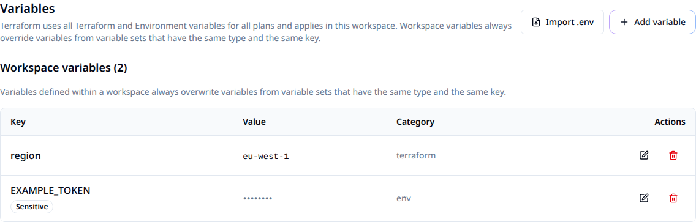

# Manage workspace variables

Set inputs on a workspace, or share them through a variable set. Keep variable declarations in your OpenTofu repository and supply deployment-specific values through Stackweaver.

## Choose a category and scope

| Choice | Use it for | Example |
|---|---|---|
| Terraform category. | Inputs declared in your root module. | `region = "eu-west-1"`. |
| Environment category. | Providers or programs that read process environment variables. | `AWS_PROFILE`. |
| Workspace scope. | Values specific to one workspace. | A production instance size. |
| Variable set. | Values shared across selected projects/workspaces or the organization. | Shared environment defaults. |
| Repository default. | A fallback and type declaration in the configuration itself. | `default = "t2.micro"`. |

Use the [provider](#configure-variables-as-code) for repeatable management, the [UI](#add-a-workspace-variable) for individual changes or `.env` import, and the [API](#configure-a-variable-through-the-api) for direct integrations. There is no separate Stackweaver management-YAML format; `.env` is an import format, not a continuously synchronized source.

## Add a workspace variable

Use an account with permission to write variables on the workspace. Read access alone does not authorize a change.

1. Open the workspace's **Variables** tab and choose **Add variable**.
2. Enter a key matching the root module's variable declaration, or the environment name expected by the tool. Choose **Terraform** or **Environment**.
3. Enter the value. Enable **HCL** for a Terraform expression such as a list or map; leave it off for a literal string. Mark secrets **Sensitive**.
4. Save, then confirm the key, category and flags in the list. The value is available to subsequent runs.



| Value | HCL setting |
|---|---|
| `production` | Off, for a string. |
| `["10.0.0.0/8", "192.168.0.0/16"]` | On, for a list. |
| `{Environment = "prod", Team = "platform"}` | On, for a map. |

Only the key is required for a non-HCL value. An empty string is valid; an empty HCL expression is rejected. A sensitive value is hidden in the editor: leaving its value field blank keeps the stored value, while typing a new one replaces it. Clearing a non-sensitive value or description stores the empty field.

> [!WARNING]
> Sensitive values are encrypted at rest and hidden from normal value readback. Programs running with those values can still print or transmit them. Do not rely on a Sensitive flag to make arbitrary job code or logs safe.

## Import a `.env` file

Choose **Import .env** next to **Add variable**, then select/drop a file or paste its text. The same importer is available when creating or editing variable sets.

For example, a local `workspace.env` can contain:

```dotenv
DEPLOY_REGION=eu-west-1
FEATURE_FLAG=
```

1. Review the parsed rows, rename or edit keys as needed, and deselect rows you do not want.
2. Choose **Import as** for the whole batch. Environment is the default; use Terraform for root-module inputs.
3. Review Sensitive flags. Secret-like key names are detected heuristically, so check the result or use **Mark all sensitive**.
4. For existing keys, choose whether to keep or replace. Replacement updates the value and sensitivity while retaining the existing category.
5. Run the import and inspect created, replaced, skipped and failed counts. A failed row does not roll back successful rows; correct only the failures before retrying.

| Input detail | Import behavior |
|---|---|
| Comments, blank lines and optional `export`. | Accepted. |
| Single, double or backtick quotes; multiline values. | Accepted. Escape sequences are expanded only inside double quotes. |
| `${DATABASE_HOST}`. | Stored literally; variable interpolation is not performed. |
| Repeated key. | The last assignment in the file wins. |
| Invalid assignment. | Reported with its line number. |
| `FEATURE_FLAG=` replacing a key. | Clears its value when replacement is selected. An existing HCL value cannot be replaced by an empty expression. |

Nothing is written before you review and confirm the import.

## Share values with variable sets

Open the organization's **Variable Sets**, create a named set, add its variables and select its scope. Organization members can view sets. Managing an organization-owned set requires owner or the relevant organization management permission; a project-owned set uses that project's write/maintain/admin or granular variable-set management permission.

| Scope | Where the set applies |
|---|---|
| Global, organization-owned. | Every workspace in the organization. |
| Scoped, organization-owned. | Selected projects and/or individual workspaces. Selecting targets at creation makes it scoped. |
| Project-owned. | Workspaces in its owning project. |

On a workspace's **Variables** tab, use **Attach Variable Set** to select an applicable set. Confirm it appears in the workspace before relying on its values.

### Precedence

For the same key and category, a **Priority** variable set overrides a workspace variable. Otherwise a workspace variable overrides ordinary variable sets. Repository defaults apply when no higher-precedence input supplies a value.

For conflicts among sets, priority sets are considered before ordinary sets; global sets before scoped sets, then set names in lexical order. Avoid relying on set-name ordering to express an environment policy. Use a workspace override or explicit Priority setting and verify the resulting plan.

Terraform-category values are written to `stackweaver.auto.tfvars`. Your repository's `terraform.tfvars` is retained. Terraform/OpenTofu loads auto variable files after `terraform.tfvars`; other auto files and explicit CLI arguments can also affect the final input.

> [!IMPORTANT]
> Do not maintain `stackweaver.auto.tfvars` in your repository. The runner creates it for each run. Put declarations in `.tf` files and repository defaults in a file you control.

## Configure variables as code

Configure [the Stackweaver provider](./terraform-provider.md) first, then put this example in `workspace-variables.tf`. Replace the workspace ID and organization. Review the plan before applying:

```hcl
resource "stackweaver_variable" "region" {
  workspace_id = "ws-REPLACE_ME"
  key          = "region"
  value        = "eu-west-1"
  category     = "terraform"
  hcl          = false
  sensitive    = false
}

resource "stackweaver_variable_set" "shared" {
  organization  = "your-org"
  name          = "shared-defaults"
  global        = false
  priority      = false
  workspace_ids = ["ws-REPLACE_ME"]
}

resource "stackweaver_variable" "shared_environment" {
  variable_set_id = stackweaver_variable_set.shared.id
  key             = "ENVIRONMENT"
  value           = "production"
  category        = "env"
}
```

After apply, confirm the workspace variable and attached set in the UI, then review the next run's plan. When managing secrets, protect provider state as well as configuration; marking a resource sensitive does not remove its value from ordinary Terraform state.

In the workload repository, declare the input separately, for example in `variables.tf`:

```hcl
variable "region" {
  description = "Cloud region for this workspace"
  type        = string
  default     = "eu-west-1"
}

variable "instance_type" {
  description = "EC2 instance type for web servers"
  type        = string
  default     = "t2.micro"
}
```

## Configure a variable through the API

Use a token with write access to the workspace. Set `STACKWEAVER_URL` to the origin without a trailing slash, `STACKWEAVER_TOKEN` to the token, and `WORKSPACE_ID` to the destination ID. Save this request body as `variable.json`:

```json
{
  "data": {
    "type": "vars",
    "attributes": {
      "key": "region",
      "value": "eu-west-1",
      "category": "terraform",
      "hcl": false,
      "sensitive": false
    }
  }
}
```

```bash
curl --fail-with-body --silent --show-error \
  --header "Authorization: Bearer $STACKWEAVER_TOKEN" \
  --header 'Content-Type: application/vnd.api+json' \
  --data @variable.json \
  "$STACKWEAVER_URL/api/v2/workspaces/$WORKSPACE_ID/vars"
```

Expect a `vars` resource with an ID. Read the collection back before retrying an uncertain create; do not assume a network failure means nothing was written. Use [the API explorer](/docs/api-reference/explorer) for variable-set attachment and update schemas.

## Read platform context from a run

The runner supplies `TF_WORKSPACE_ID`, `TF_WORKSPACE_NAME`, `TF_PROJECT_ID`, `TF_PROJECT_NAME`, `TF_ORGANIZATION_ID` and `TF_ORGANIZATION_NAME` as environment variables. They are not undeclared Terraform inputs. User-defined environment variables can override these values, so keep the names reserved in your configuration.

Terraform/OpenTofu expressions do not have an `env()` function. If you need this context in expressions, use the external data source with a program that emits valid JSON. For example, with `jq` installed on your runner, save `get-platform-env.sh` next to your `.tf` files:

```bash
#!/bin/sh
jq -n \
  --arg workspace_id "$TF_WORKSPACE_ID" \
  --arg workspace_name "$TF_WORKSPACE_NAME" \
  --arg project_id "$TF_PROJECT_ID" \
  --arg organization_id "$TF_ORGANIZATION_ID" \
  '{workspace_id:$workspace_id,workspace_name:$workspace_name,project_id:$project_id,organization_id:$organization_id}'
```

The `hashicorp/external` provider consumes string-valued JSON. In `platform-context.tf`:

```hcl
data "external" "platform" {
  program = ["sh", "${path.module}/get-platform-env.sh"]
}

output "workspace_id" {
  value = data.external.platform.result.workspace_id
}
```

Alternatively, the program can be inline with the same `jq` prerequisite:

```hcl
data "external" "platform_inline" {
  program = ["sh", "-c", <<-EOT
    jq -n --arg workspace_id "$TF_WORKSPACE_ID" --arg workspace_name "$TF_WORKSPACE_NAME" '{workspace_id:$workspace_id,workspace_name:$workspace_name}'
  EOT
  ]
}
```

A provisioner's shell can read the environment directly:

```hcl
resource "null_resource" "example" {
  provisioner "local-exec" {
    command = "echo Running in workspace $TF_WORKSPACE_ID"
  }
}
```

These external/null examples require their respective providers. The stock OpenTofu runner does not promise `jq`; use a reviewed runner image containing it for these examples.

## Troubleshooting

| Symptom | What to check |
|---|---|
| Missing variable. | Match the case-sensitive declaration, category, workspace and set attachment. |
| Wrong value. | Check Priority sets, workspace overrides and repository/CLI inputs. |
| Wrong type or invalid expression. | Compare the declared type with the HCL flag and expression. |
| Import partly failed. | Read the per-row summary and retry failed rows only. |
| Secret appears in output. | Stop exposing it, restrict the output and rotate the credential if needed. Review the code that prints it; the Sensitive flag is not a guarantee against disclosure. |

For related changes, see [workspace editing](../features/opentofu/workspace-editing.md) and [VCS path filtering](../features/opentofu/vcs-path-filtering.md).
