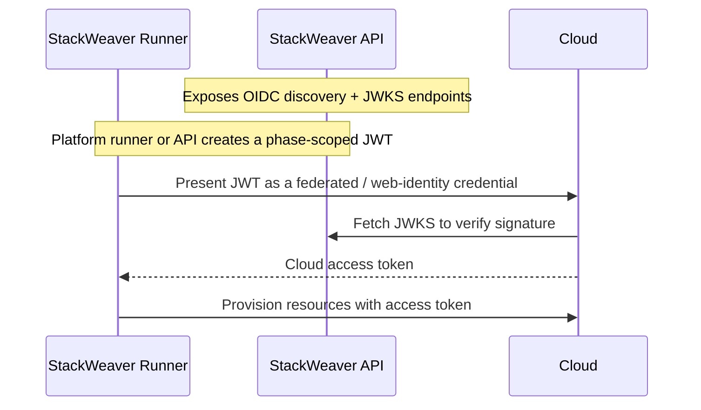

# Configure workload identity

Use workload identity to give OpenTofu runs short-lived cloud or Vault access without storing a cloud secret in workspace variables. First configure the operator's signing key and issuer, then the target's trust and a Stackweaver registration.

This guide covers OpenTofu targets below. Ansible uses different resource subjects and authentication paths; use [dynamic inventories](./dynamic-inventories.md) for inventory discovery and [Azure Key Vault from playbooks](./azure-key-vault-from-playbooks.md) for Azure job identity. Do not assume an OpenTofu registration enables every Ansible integration.

| Target | Registration resource | Trust and audience |
|---|---|---|
| Azure. | `stackweaver_azure_oidc_configuration`. | Entra federated credential; `api://AzureADTokenExchange`. |
| AWS. | `stackweaver_aws_oidc_configuration`. | IAM OIDC provider and role; `sts.amazonaws.com`. |
| GCP. | `stackweaver_gcp_oidc_configuration`. | Workload Identity Pool/provider and service account; `//iam.googleapis.com/<workload-provider-name>`. |
| Vault. | `stackweaver_vault_oidc_configuration`. | JWT auth method and role; `vault.workload.identity`. |

## Choose a configuration path

Use [the Stackweaver provider](./terraform-provider.md) and save the target's registration example in `workload-identity.tf`. The compatible `tfe_*` resources expose the corresponding configuration. Review the plan before apply. Cloud trust resources are configured separately on the target platform; Stackweaver's registration stores identifiers, not cloud permissions.

In the UI, open **Settings > OIDC Configurations**, choose **Add OIDC**, select the target and enter the same identifiers. For Azure, the form looks like this:


A direct [JSON:API example](#register-through-the-api) is also provided. There is no separate management-YAML format for these registrations. Repository provider configuration and Ansible inventory plugin YAML serve different purposes.

## How a run authenticates



<details>
<summary><strong>Flow Steps (Legend)</strong></summary>

1. **OIDC provider** - Stackweaver exposes a signing key at `/.well-known/jwks` and a discovery document at `/.well-known/openid-configuration`.
2. **Cloud trust** - You configure your cloud to trust Stackweaver as an OIDC issuer (an Azure federated credential, an AWS IAM OIDC provider + role, or a GCP Workload Identity Pool provider).
3. **Registration** - You register the cloud-side identifiers in Stackweaver using the TFE Terraform provider (one resource per cloud).
4. **Run time** - The runner generates a short-lived JWT scoped to the specific workspace and run phase, and injects it alongside the cloud identifiers as environment variables. The target provider uses the injected credential. Ansible integrations have their own documented configuration.

</details>

## Prerequisites

- You must be an organization owner in Stackweaver, or have the `manage-vcs-settings` permission.
- For the HCL path, configure the Stackweaver provider against your instance. For the UI/API path, use the same organization permissions.
- Your Stackweaver issuer must be **publicly reachable** by the cloud provider (it fetches the JWKS to verify tokens). Ask your operator to complete [operator configuration](#operator-configuration) before testing trust.
- You need permission on the cloud side to create the relevant trust (App Registration / IAM OIDC provider + role / Workload Identity Pool).

## The token subject (shared across clouds)

Stackweaver embeds a subject in every workload identity token; your cloud-side trust matches on it. The format depends on the resource type.

**Terraform workspace runs** (plan/apply):

```
organization:<org-name>:project:<project-name>:workspace:<workspace-name>:run_phase:<plan|apply>
```

For example, the `apply` phase of the `production` workspace in project `infra` under organization `main`:

```
organization:main:project:infra:workspace:production:run_phase:apply
```

`plan` and `apply` produce **different subjects**, so where the cloud matches an exact subject you need to allow both (or use a wildcard/attribute condition where supported).

**Ansible inventory sync** (StackWeaver-native format, no `run_phase:`):

```
organization:<org-name>:project:<project-name>:inventory:<name>:sync
```

For a UI-configured dynamic source using Stackweaver federation, `<name>` is the **source name**. Native tokens can also represent an inventory, but a VCS inventory file does not automatically use that trust contract. Follow the [dynamic inventory guide](./dynamic-inventories.md) for VCS runtime identity and plugin configuration.

**Ansible job execution** (StackWeaver-native format):

```
organization:<org-name>:project:<project-name>:job:<job-name>:run
```

`<project-name>` is the StackWeaver project the resource belongs to, or `default` for org-scoped resources without a project.

### Pinning to immutable identifiers

The subject uses organization, project and resource names. Renaming one can break an exact cloud trust match. Names containing a colon are rejected when minting a token so they cannot shift subject segments. Organization names remain reserved after deletion or rename; only the same organization can reuse its prior name.

Where the target supports custom-claim conditions, pin the immutable `stackweaver_organization_id` as well as `sub`. Tokens also carry `stackweaver_project_id` and, for Terraform runs, `stackweaver_workspace_id`. Get the organization ID from its API response. Ansible tokens carry organization/project IDs rather than a Terraform workspace ID.

---

## Azure

Keyless auth to Azure uses an Entra ID App Registration with a federated credential that trusts Stackweaver.

### Step 1: Create an App Registration in Azure Entra ID

1. Sign in to the [Azure Portal](https://portal.azure.com).
2. Navigate to **Microsoft Entra ID** > **App registrations** > **New registration**.
3. Fill in the form:
   - **Name**: something descriptive, such as `stackweaver-automation`.
   - **Supported account types**: "Accounts in this organizational directory only (Single tenant)".
   - **Redirect URI**: leave blank.
4. Click **Register**.
5. On the **Overview** page, note these values:

   | TFE provider argument | Azure Portal label |
   |-----------------------|--------------------|
   | `client_id` | Application (client) ID |
   | `tenant_id` | Directory (tenant) ID |
   | `subscription_id` | Found under **Subscriptions** in the portal |

### Step 2: Assign Azure RBAC Roles

Grant the service principal only the permissions the workload needs, at the smallest useful scope. Select it under **Access control (IAM) > Add role assignment** on the target resource group, subscription or management group.

`Contributor` can manage resources but cannot assign Azure RBAC roles. If the workload creates role assignments, grant the corresponding role-assignment permissions too, for example a suitably scoped Role Based Access Control Administrator role. `Owner` is a broader option, not a requirement for all automation. See [Azure's privileged built-in roles](https://learn.microsoft.com/en-us/azure/role-based-access-control/built-in-roles/privileged).

> [!WARNING]
> A federated credential authenticates the principal; it does not limit its Azure permissions. Avoid subscription-wide Owner access unless the workload requires that scope and authority.

### Step 3: Configure a Federated Identity Credential

1. In the App Registration, go to **Certificates & secrets** > **Federated credentials** > **Add credential**.
2. For **Federated credential scenario**, select **Other issuer**.
3. Fill in the fields:

   | Field | Value |
   |-------|-------|
   | **Issuer** | The public URL of your Stackweaver instance, e.g. `https://stackweaver.example.com` |
   | **Subject identifier** | A subject from [The Token Subject](#the-token-subject-shared-across-clouds) |
   | **Name** | A descriptive label, e.g. `stackweaver-my-org-plan` |
   | **Audience** | `api://AzureADTokenExchange` |

4. Click **Add**. Create one credential for `run_phase:plan` and one for `run_phase:apply` to cover the full OpenTofu run lifecycle.

### Step 4: Register the Configuration in Stackweaver

```hcl
resource "stackweaver_azure_oidc_configuration" "main" {
  organization    = "your-org-name"
  client_id       = "xxxxxxxx-xxxx-xxxx-xxxx-xxxxxxxxxxxx" # Application (client) ID
  subscription_id = "yyyyyyyy-yyyy-yyyy-yyyy-yyyyyyyyyyyy" # Azure subscription ID
  tenant_id       = "zzzzzzzz-zzzz-zzzz-zzzz-zzzzzzzzzzzz" # Directory (tenant) ID
}
```

After apply, confirm the registration exists and its returned identifiers match the intended target before starting a run.

### Step 5: Configure the azurerm Provider in Your Workspaces

Configure the `azurerm` provider to use OIDC. Do not set `client_secret` or `use_msi`:

```hcl
provider "azurerm" {
  features {}
  use_oidc = true
}
```

The runner injects these environment variables automatically:

| Variable | Description |
|----------|-------------|
| `TFC_WORKLOAD_IDENTITY_TOKEN` | Short-lived RS256 JWT signed by Stackweaver |
| `ARM_OIDC_TOKEN` | Same JWT (read by the `azurerm` and `azapi` providers) |
| `ARM_CLIENT_ID` | The `client_id` you registered |
| `ARM_SUBSCRIPTION_ID` | The `subscription_id` you registered |
| `ARM_TENANT_ID` | The `tenant_id` you registered |
| `ARM_USE_OIDC` | `true` |

---

## AWS

Keyless auth to AWS uses an IAM OIDC identity provider plus a role whose trust policy accepts Stackweaver's web-identity token (`AssumeRoleWithWebIdentity`). The token audience is `sts.amazonaws.com`.

### Step 1: Create an IAM OIDC Identity Provider

1. In the AWS Console, go to **IAM** > **Identity providers** > **Add provider**.
2. Select **OpenID Connect**.
3. **Provider URL**: the public URL of your Stackweaver instance, e.g. `https://stackweaver.example.com`. Click **Get thumbprint**.
4. **Audience**: `sts.amazonaws.com`.
5. Click **Add provider**.

### Step 2: Create an IAM Role with a Web-Identity Trust Policy

Create a role your automation will assume, trusting the provider from Step 1 and restricting it to your run's subject:

```json
{
  "Version": "2012-10-17",
  "Statement": [{
    "Effect": "Allow",
    "Principal": { "Federated": "arn:aws:iam::123456789012:oidc-provider/stackweaver.example.com" },
    "Action": "sts:AssumeRoleWithWebIdentity",
    "Condition": {
      "StringEquals": {
        "stackweaver.example.com:aud": "sts.amazonaws.com",
        "stackweaver.example.com:sub": "organization:main:project:infra:workspace:production:run_phase:apply"
      }
    }
  }]
}
```

Add a condition entry for each subject you want to allow (`plan` and `apply` are distinct), or use `StringLike` with a wildcard. Attach whatever resource-management permissions your automation needs to the role.

### Step 3: Register AWS in Stackweaver

```hcl
resource "stackweaver_aws_oidc_configuration" "main" {
  organization = "your-org-name"
  role_arn     = "arn:aws:iam::123456789012:role/stackweaver-oidc"
}
```

After apply, confirm the registration exists and its returned identifiers match the intended target before starting a run.

### Step 4: Configure the aws Provider in Your Workspaces

With no conflicting static credentials configured, the `aws` provider performs `AssumeRoleWithWebIdentity` automatically from the injected environment. The runner writes the token to a file and sets:

| Variable | Description |
|----------|-------------|
| `AWS_ROLE_ARN` | The `role_arn` you registered |
| `AWS_WEB_IDENTITY_TOKEN_FILE` | Path to the short-lived JWT (the AWS SDK reads the token from a file, not an env value) |
| `AWS_ROLE_SESSION_NAME` | A per-run session name (`stackweaver-<run-id>`) |

---

## GCP

Keyless auth to GCP uses Workload Identity Federation: a Workload Identity Pool with an OIDC provider that trusts Stackweaver, bound to a service account your automation impersonates. The token audience uses the full provider resource name:

```text
//iam.googleapis.com/<workload-provider-name>
```

### Step 1: Create a Workload Identity Pool and OIDC Provider

```bash
gcloud iam workload-identity-pools create stackweaver \
  --location=global --display-name="Stackweaver"

gcloud iam workload-identity-pools providers create-oidc stackweaver \
  --location=global --workload-identity-pool=stackweaver \
  --issuer-uri="https://stackweaver.example.com" \
  --attribute-mapping="google.subject=assertion.sub" \
  --allowed-audiences="//iam.googleapis.com/projects/123456789012/locations/global/workloadIdentityPools/stackweaver/providers/stackweaver"
```

Note the numeric **project number** and the full **provider resource name**. Register both in Step 3. The resource name has this form:

```text
projects/<number>/locations/global/workloadIdentityPools/<pool>/providers/<provider>
```

### Step 2: Bind the Service Account

Grant the pool's identities permission to impersonate the service account your automation uses, scoped to the run subject:

```bash
gcloud iam service-accounts add-iam-policy-binding \
  stackweaver@my-project.iam.gserviceaccount.com \
  --role=roles/iam.workloadIdentityUser \
  --member="principal://iam.googleapis.com/projects/123456789012/locations/global/workloadIdentityPools/stackweaver/subject/organization:main:project:infra:workspace:production:run_phase:apply"
```

Add a binding per subject you want to allow (`plan` and `apply` are distinct), or bind on a mapped attribute. Grant the service account itself whatever resource-management roles your automation needs.

### Step 3: Register GCP in Stackweaver

```hcl
resource "stackweaver_gcp_oidc_configuration" "main" {
  organization           = "your-org-name"
  service_account_email  = "stackweaver@my-project.iam.gserviceaccount.com"
  project_number         = "123456789012"
  workload_provider_name = "projects/123456789012/locations/global/workloadIdentityPools/stackweaver/providers/stackweaver"
}
```

After apply, confirm the registration exists and its returned identifiers match the intended target before starting a run.

### Step 4: Configure the google Provider in Your Workspaces

No provider block credentials are required - the `google` provider reads an external-account credential configuration automatically from the injected environment. The runner writes the token and a credential-config file and sets:

| Variable | Description |
|----------|-------------|
| `GOOGLE_APPLICATION_CREDENTIALS` | Path to an `external_account` credential-config JSON (references the token file + STS token-exchange and impersonation URLs) |
| `TFC_GCP_PROVIDER_AUTH` | `true` |
| `TFC_GCP_RUN_SERVICE_ACCOUNT_EMAIL` | The `service_account_email` you registered |
| `TFC_GCP_WORKLOAD_PROVIDER_NAME` | The `workload_provider_name` you registered |
| `TFC_GCP_PROJECT_NUMBER` | The `project_number` you registered |

Set the `project` (and `region`) in your `google` provider block as usual.

---

## Vault

HashiCorp Vault differs from the cloud providers: instead of the provider exchanging a token, the
**runner logs in to Vault** via the JWT auth method and exports a `VAULT_TOKEN` for the run. Point the
Vault JWT auth method at Stackweaver as an OIDC issuer, then register the config. The token audience is
`vault.workload.identity`.

### Step 1: Enable and Configure the JWT Auth Method

```bash
vault auth enable jwt

# Trust Stackweaver's JWKS (or use oidc_discovery_url with the issuer for full discovery).
vault write auth/jwt/config \
  jwks_url="https://stackweaver.example.com/.well-known/jwks"
```

### Step 2: Create a Role Bound to the Run

Save this role definition as `stackweaver-vault-role.json`. Replace the organization/project/workspace names and policy. Both subjects are listed because the registration below selects one role for both phases:

```json
{
  "role_type": "jwt",
  "bound_audiences": ["vault.workload.identity"],
  "user_claim": "sub",
  "bound_claims": {
    "sub": [
      "organization:main:project:infra:workspace:production:run_phase:plan",
      "organization:main:project:infra:workspace:production:run_phase:apply"
    ]
  },
  "token_policies": ["my-policy"],
  "token_ttl": "20m"
}
```

```bash
vault write auth/jwt/role/stackweaver @stackweaver-vault-role.json
```

The [Vault JWT role schema](https://developer.hashicorp.com/vault/api-docs/auth/jwt#bound_claims) accepts a list of allowed values for a bound claim. This example grants the same policy to both phases; do not assume separate phase-specific roles are selected automatically. Review the policy so plan has only the access you intend to grant.

### Step 3: Register Vault in Stackweaver

```hcl
resource "stackweaver_vault_oidc_configuration" "main" {
  organization = "your-org-name"
  address      = "https://vault.example.com:8200"
  role_name    = "stackweaver"
  namespace    = "admin" # required by the provider; any value for Vault OSS (sent as X-Vault-Namespace)
  auth_path    = "jwt"   # optional, defaults to "jwt"
  # encoded_cacert = filebase64("vault-ca.pem")  # optional, for a private Vault CA
}
```

After apply, confirm the registration exists and its returned identifiers match the intended target before starting a run.

### Step 4: Use the vault Provider in Your Workspaces

No provider block credentials are required - the runner logs in to Vault before the run and exports the
token. The `vault` provider (and any provider reading `VAULT_*`) picks it up automatically:

| Variable | Description |
|----------|-------------|
| `VAULT_ADDR` | The `address` you registered |
| `VAULT_TOKEN` | The client token from the JWT-auth login |
| `VAULT_NAMESPACE` | The `namespace` you registered (when set) |
| `VAULT_CACERT` | Path to the CA cert file (when `encoded_cacert` is set) |

---

## Register through the API

Set `STACKWEAVER_URL` to the origin without a trailing slash, `STACKWEAVER_TOKEN` to an authorized organization credential, and `ORG` to its name. After creating Azure trust, save the identifiers as `azure-oidc.json`:

```json
{
  "data": {
    "type": "azure-oidc-configurations",
    "attributes": {
      "client-id": "11111111-1111-4111-8111-111111111111",
      "subscription-id": "22222222-2222-4222-8222-222222222222",
      "tenant-id": "33333333-3333-4333-8333-333333333333"
    }
  }
}
```

Replace every sample UUID with the matching Azure identifier, then submit:

```bash
curl --fail-with-body --silent --show-error \
  --header "Authorization: Bearer $STACKWEAVER_TOKEN" \
  --header 'Content-Type: application/vnd.api+json' \
  --data @azure-oidc.json \
  "$STACKWEAVER_URL/api/v2/organizations/$ORG/oidc-configurations"
```

Expect an `azure-oidc-configurations` resource with an ID. List the registrations to verify the saved identifiers before retrying an uncertain create. The same endpoint dispatches AWS, GCP and Vault bodies by their JSON:API type; use [the API explorer](/docs/api-reference/explorer) for their complete schemas and the target-specific HCL examples above for declarative management.

## Verify a workload

Use a test workspace and review a plan with the intended identity. Check that the target accepts the issuer, exact subject and audience and permits the required read operations. Confirm apply-phase trust separately before approving changes: plan and apply have different subjects. A saved registration alone does not prove federation or resource permissions work.

## Operator configuration

Workload identity has its own issuer; it is separate from the Zitadel issuer used for user sign-in. Two variables control token signing and discovery for every target. On Docker Compose they live in `oidc.env` in your Compose directory (copied from `oidc.env.example` during installation). On Kubernetes, set the issuer with the `oidc.issuerUrl` Helm value; the chart generates the signing key into a Secret shared by the API and both runners, or uses your own Secret when you set `secrets.oidc.secretName`.

| Variable | Required | Description |
|----------|----------|-------------|
| `OIDC_SIGNING_KEY` | **Yes** | Base64-encoded RSA-2048 private key used to sign workload identity tokens. |
| `OIDC_ISSUER_URL` | Set explicitly | The public URL embedded in tokens and the OIDC discovery document. Must match the **Issuer** you configured on the cloud side exactly (no trailing slash). |

### Share a persistent signing key

Stackweaver runs two separate containers that participate in OIDC: the API (which serves the JWKS public key endpoint the cloud fetches) and the runner (which signs the workload identity token injected into each run). Both read the same `OIDC_SIGNING_KEY`, so the key the runner signs with is the key the API publishes. Without a valid configured key, secure API startup fails and platform runners cannot initialize workload identity. An ephemeral key is generated only when `DEV_INSECURE_KEY=1` is set, which is meant for local development: each container then mints its own key, the runner's token carries a `kid` the API's JWKS does not advertise, and the cloud rejects it (for example Azure's `AADSTS700211`).

On Docker Compose, set `OIDC_SIGNING_KEY` in `oidc.env`; the self-hosting bundle reads that file into the API and both runners. On Kubernetes the chart generates the key into a Secret and mounts it into the same three Deployments, or uses the Secret you name in `secrets.oidc.secretName`.

### Store the key on one line

Docker Compose `env_file` does not support multi-line values. A raw PEM key spans multiple lines; base64 collapses it to a single line `env_file` can read.

### Generate and apply the signing key

On Docker Compose, generate a 2048-bit RSA key and base64-encode it onto a single line:

```bash
openssl genrsa 2048 | base64 -w 0
# Copy the single-line output and set it as OIDC_SIGNING_KEY in oidc.env
```

After editing `oidc.env`, recreate the services that read it so they pick up the new configuration:

```bash
# Run in your Compose directory
docker compose up -d api runner ansible-runner
```

Keep the key private and shared by the components that sign or serve tokens. Do not regenerate it as routine troubleshooting; changing it affects existing trust and active tokens.

On Kubernetes the chart generates the key for you. After changing `oidc.issuerUrl` in `my-values.yaml`, apply it with:

```bash
helm upgrade stackweaver oci://ghcr.io/vhco-pro/charts/stackweaver \
  --namespace stackweaver --values my-values.yaml
```

## Troubleshooting

### `403 Forbidden` when creating the OIDC configuration

Your Stackweaver token does not have the `manage-vcs-settings` permission. Perform the configuration as an organization owner, or ask an owner to grant you that permission.

### The cloud rejects the token with "no matching identity" (e.g. Azure `AADSTS70021`, AWS web-identity authorization failure, GCP `unable to verify`)

The issuer, subject, or audience in the token does not match your cloud-side trust. Check:

- The **Issuer** configured on the cloud matches `OIDC_ISSUER_URL` (or `API_URL` if that variable is not set) exactly, with no trailing slash, and is publicly reachable.
- The **Subject** matches the run that failed - see [The Token Subject](#the-token-subject-shared-across-clouds). `plan` and `apply` have different subjects and each needs its own trust entry.
- The **Audience** matches the cloud: `api://AzureADTokenExchange` (Azure), `sts.amazonaws.com` (AWS), or the full provider-resource audience shown in [GCP](#gcp).

### Tokens are rejected only after a Stackweaver restart, or intermittently

The containers are running with `DEV_INSECURE_KEY=1` and no `OIDC_SIGNING_KEY`, so each one generates its own RSA key pair on every start and the API and runner hold different keys. On Docker Compose, set a stable, shared `OIDC_SIGNING_KEY` in `oidc.env`, remove `DEV_INSECURE_KEY`, and recreate the services as described in [Generating the signing key](#generate-and-apply-the-signing-key). On Kubernetes, confirm that the API and runner Deployments reference the same OIDC Secret.

### Azure: role-assignment authorization fails

Check the failed operation and service principal scope. `Contributor` cannot assign Azure RBAC roles. Grant the required role-assignment permission at the intended scope rather than switching every workload to subscription Owner.
