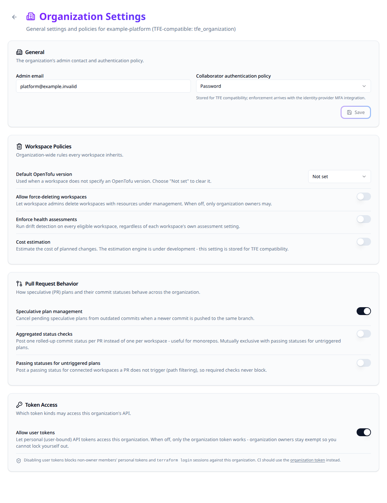

# Configure organization settings

Open **Settings > Organization** to change policies for an organization. These settings affect API access, workspace deletion, drift assessments and pull-request plans. Use an organization owner or an account with organization membership-management permission.

## Change a setting and confirm it

1. Select the intended organization and open **Settings > Organization**.
2. Edit the admin contact/authentication policy and choose **Save**, or change an individual policy switch. Switches save immediately.
3. Wait for the result, then reopen the page to confirm the persisted value. Check affected automation before changing another access policy.



## General and access policies

| Setting | Current behavior |
|---|---|
| Admin email. | Stores the organization's contact address and returns it through the API. |
| Collaborator authentication policy. | Accepts `password` or `two_factor_mandatory`, but mandatory two-factor enforcement is not implemented by this setting. Configure actual authentication through the identity provider. |
| Allow user tokens, default on. | When off, non-owner personal API tokens and `terraform login` sessions receive 403 on organization routes. Organization-owner user tokens remain usable, and browser sessions are unaffected. Use an organization token for automation subject to this policy. |

Create an organization token under **Settings > Organization Token** before moving automation away from personal tokens. Confirm the replacement can perform its required operations before disabling user-token access.

## Workspace policies

| Setting | Effect and limits |
|---|---|
| Allow force-deleting workspaces, default off. | When off, deleting a workspace with managed resources requires an organization owner. When on, a workspace admin can force-delete it too. Deleting an empty workspace still follows workspace permissions. |
| Enforce health assessments, default off. | Includes every eligible workspace in drift detection, ignoring a workspace opt-out. Explicit drift schedules remain; otherwise checks use a daily cadence. A workspace without an uploaded configuration version is skipped. |
| Cost estimation. | Stores and returns the flag. It does not enable a working cost-estimation engine. |

> [!WARNING]
> Force deletion removes workspace management records without destroying the infrastructure. Keep state and ownership recovery requirements in mind before granting that permission.

## Pull-request behavior

| Setting | Effect |
|---|---|
| Speculative plan management, default on. | Cancels still-pending speculative plans from older commits on the same branch when a newer commit arrives. Other pull requests and plan-and-apply runs are unaffected. |
| Aggregated status checks, default off. | Posts one `terraform-plan` status per commit across its workspace plans, using the worst result and a passed/total summary. |
| Passing statuses for untriggered plans, default off. | Posts a passing check for connected workspaces skipped by path filtering so an unrelated change does not block a required check. |

Aggregated checks and passing statuses for untriggered plans are mutually exclusive. The UI turns the other option off when enabling one; the API rejects a body enabling both.

## Configure settings as code

Configure [the Stackweaver Terraform provider](./terraform-provider.md), then use `organization.tf`. The example creates a new organization; import an existing organization into the chosen resource before managing it, rather than creating a duplicate.

```hcl
resource "stackweaver_organization" "platform" {
  name                                                    = "your-org"
  email                                                   = "platform@example.com"
  user_tokens_enabled                                     = true
  allow_force_delete_workspaces                           = false
  assessments_enforced                                    = false
  speculative_plan_management_enabled                     = true
  aggregated_commit_status_enabled                        = false
  send_passing_statuses_for_untriggered_speculative_plans = false
}
```

Review the plan, apply, then confirm the policy values on the organization page or API response. The compatible `tfe_organization` resource exposes the corresponding supported attributes as well.

Do not set `session_timeout_minutes`, `session_remember_minutes`, `enforce_hyok`, `stacks_enabled`, `max_ttl_enabled` or `owners_team_saml_role_id` expecting a subsystem to be enabled. They have no backing behavior here; session settings are controlled by Zitadel and unsupported provider attributes can produce drift.

## Update an existing organization through the API

Use an authorized token. Set `STACKWEAVER_URL` to the origin without a trailing slash, `STACKWEAVER_TOKEN` to the token, and `ORG` to the organization name. Save `organization-policy.json`:

```json
{
  "data": {
    "type": "organizations",
    "attributes": {
      "allow-force-delete-workspaces": false,
      "aggregated-commit-status-enabled": true,
      "send-passing-statuses-for-untriggered-speculative-plans": false
    }
  }
}
```

```bash
curl --fail-with-body --silent --show-error --request PATCH \
  --header "Authorization: Bearer $STACKWEAVER_TOKEN" \
  --header 'Content-Type: application/vnd.api+json' \
  --data @organization-policy.json \
  "$STACKWEAVER_URL/api/v2/organizations/$ORG"
```

Expect the organization resource with the saved attributes. Re-read it to resolve an uncertain update before retrying. See [Using the API](../architecture/using-the-api.md) for token scope, error responses and operation discovery. These management settings use provider HCL or JSON:API, not a repository YAML document.

## Organization creation and names

Creating an organization requires a user credential; an organization token cannot create another organization. The creator becomes a member of its `owners` team. The organization starts with `owners` and `viewers` teams and a `default` project.

Organization names are permanently reserved because workload-identity trust can contain them. Deleting an organization does not free its name. A create or rename using another organization's reserved name returns 422. Renaming preserves the old name for the same organization, which may rename back to it. Review cloud trust before changing a name used in token subjects.


## Organization creation and install-wide defaults

Who may create organizations is a deployment setting, `STACKWEAVER_ORGANIZATION_CREATION` in `sso.env` on Docker Compose or `platform.organizationCreation` on Kubernetes. The default, `everyone`, lets every signed-in user create organizations. With `platform-admins`, only a [platform administrator](./platform-administration.md) may create one: the create endpoint answers 403 to everyone else, and the Organizations page hides **Create Organization** and says "Organizations on this installation are created by a platform administrator. Ask yours to create one and add you to it." The person who creates an organization still becomes its owner, whatever the setting. Any client can read the value from `GET /api/v2/platform/settings` (attribute `organization-creation`), and `GET /api/v2/account/details` reports whether the signed-in user may create organizations in `permissions.can-create-organizations`.

Note that organization names are permanently reserved once used. Deleting an organization does not free its name, because workload-identity token subjects embed the organization name and a re-registered name could otherwise be trusted by the original tenant's cloud federation. Terraform Enterprise would allow the reuse; here a create with a previously-used name returns a 422, and so does renaming an organization onto a name another organization used before, so pick a new name. Renaming keeps the old name reserved for your organization, so you can rename back to it later but nobody else can take it.

The default OpenTofu version (`default-terraform-version`) is set in **Workspace Policies**. Choose an enabled, non-deprecated entry from the installation catalogue or **Not set**. A platform administrator manages the catalogue; organization ownership alone does not grant that role.
