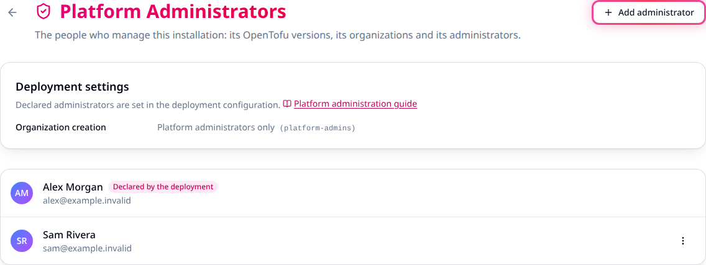
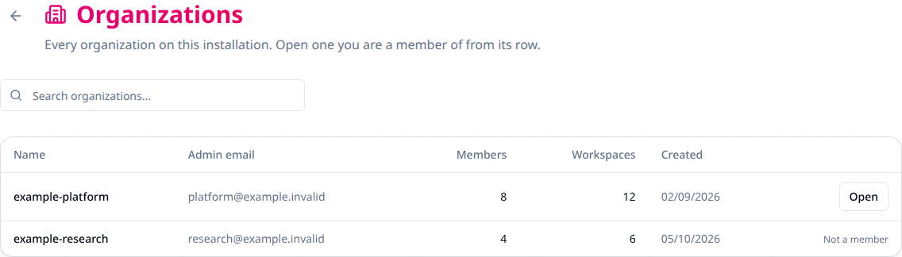
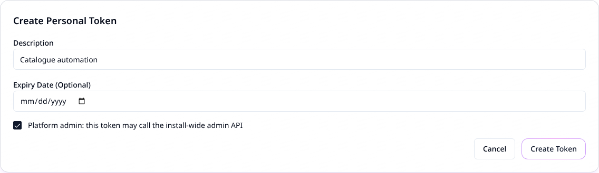

# Administer a Stackweaver installation

Use platform administration to manage installation-wide administrators, the OpenTofu
version catalogue, and a read-only organization directory. Organization access remains
separate: this role does not let you open another organization's workspaces or secrets.

## Choose the right interface

| Task | Use |
|---|---|
| Declare the installation's administrators or restrict organization creation | Docker Compose environment configuration or Helm values. |
| Grant or remove an administrator | **Settings > Platform Administrators**, or the admin API. |
| Manage the version catalogue | **Settings > OpenTofu Versions**, or the Terraform/OpenTofu provider. |
| Find organizations on the installation | **Settings > Organizations**, or the read-only admin API. |

There is no Stackweaver CLI or management YAML resource for granting this role. Helm YAML
configures the deployment; it does not replace organization membership or API resources.

## What the role can and cannot do

| Platform administrators can | Organization access still requires |
|---|---|
| Add, enable, disable and delete catalogue versions, subject to deletion restrictions. | Membership and permissions in the target organization. |
| Grant and remove other platform administrators. | An existing owner to add you to the `owners` team when owner access is needed. |
| See each organization's admin email, member/workspace counts and creation date. | Membership before its directory row opens workspaces. Other rows say **Not a member**. |

Being an organization owner does not grant the platform role. Organization owners select
their own default OpenTofu version from the catalogue under
[Organization settings](./organization-settings.md).

## Declared and granted administrators

| Type | Controlled by | How access changes |
|---|---|---|
| Declared | The deployment's list of verified email addresses. | Add an address and have the user sign in. Remove an address and restart or redeploy the API with the updated configuration. |
| Granted | Another admin, through the UI or API. | A grant or removal takes effect on the next request, without signing out. |

Declared administrators carry a **Declared by the deployment** badge and cannot be removed
through the UI or API. A granted administrator can remove themselves. Keep a controlled,
usable declared account so you can recover access.

Stackweaver matches declared addresses case-insensitively against the verified email at
sign-in. A granted administrator whose address is added to the list becomes declared at
their next sign-in. A declared administrator signing in with a verified address outside
the list loses the role at that sign-in. Existing browser sessions do not re-evaluate the
declared email list on each request.

> [!WARNING]
> Declare only addresses you control at every identity provider used by the installation.
> Someone able to register and verify a declared address at any trusted provider could
> receive platform administration access.

Grants, removals, declarations and withdrawals create activity records outside any
organization. The records identify the actor and affected user; startup reconciliation
uses the system as the actor.

## Declare administrators in the deployment

Before changing access, confirm you control the declared accounts and can sign in through
the configured identity provider. Replace the example addresses with verified addresses
from your own installation.

### Docker Compose

Add this to the hand-managed `deploy/sso.env` file:

```dotenv
STACKWEAVER_PLATFORM_ADMINS=ops@example.com,lead@example.com
STACKWEAVER_ORGANIZATION_CREATION=platform-admins
```

The second setting is optional. Its default, `everyone`, lets any signed-in user create an
organization; `platform-admins` restricts creation to platform administrators.

From `deploy/`, recreate the API using your installation's normal Compose files and any
tunnel or other overrides:

```bash
docker compose up -d --no-deps api
```

A plain container restart does not reload a changed Compose environment file. Do not edit
the generated `deploy/.env` for these settings. After recreation, sign in with a declared
address and check **Settings > Platform Administrators** for the declaration badge and
**Deployment settings** for the expected organization-creation policy.

### Kubernetes with Helm

Save these overrides as `platform-values.yaml`:

```yaml
platform:
  admins:
    - ops@example.com
    - lead@example.com
  organizationCreation: platform-admins
```

Set `RELEASE`, `NAMESPACE` and `CHART_VERSION` to your existing release, namespace and
**installed chart version**. Preserve the release's other values for this settings-only
change:

```bash
helm upgrade "$RELEASE" oci://ghcr.io/vhco-pro/charts/stackweaver \
  --namespace "$NAMESPACE" --version "$CHART_VERSION" \
  --reuse-values --values platform-values.yaml
```

Wait for the API rollout, sign in as a declared user, then check the badge and policy on
**Settings > Platform Administrators**. This changes access policy; review the addresses
before applying it. It is not an instruction to upgrade the platform version.

### Bootstrap and external identity setups

When the declared list contains no address, the API falls back to `ZITADEL_ADMIN_USERNAME`.
The bundled installers set this to their bootstrap human administrator's email. The Helm
chart uses `zitadel.init.adminUsername` with bundled Zitadel.

With an external Zitadel (`zitadel.bundled: false`), explicitly set `platform.admins`.
The chart cannot infer an external bootstrap account. If neither the list nor a bootstrap
address is configured, the API logs a warning and cannot declare an administrator. Adding
an address takes effect when that person signs in; startup reconciliation only withdraws
stale declarations.

## The platform Settings pages

Platform administrators see a **Platform** section below personal settings. Its pages are:

- **Platform Administrators** (`/settings/platform/administrators`): administrators and
  the read-only deployment policy.
- **OpenTofu Versions** (`/settings/platform/terraform-versions`): the shared catalogue.
- **Organizations** (`/settings/platform/organizations`): the searchable directory.

Other users do not see this section. The platform pages and authenticated admin API calls
return not found when the caller lacks the required access.

### Add or remove an administrator

1. Have the person sign in to Stackweaver once so their account exists.
2. Open **Settings > Platform Administrators**, then **Add administrator**.
3. Enter the account's full email address and submit. A successful grant adds it to the list.
   **No account has this email address** means no matching account exists.
4. To remove a granted administrator, open their row's actions menu, choose
   **Remove administrator**, then confirm. Their organization memberships remain unchanged.



*Generated example data. Declared accounts have a badge and no remove action.*

### Inspect the organization directory

Open **Settings > Organizations** and search by organization name. Check its contact,
counts and creation date. **Open** appears only for organizations you belong to; **Not a
member** does not provide a way to bypass membership.



*Generated example data. Directory visibility does not grant organization access.*

## Platform admin tokens

For scripts and the provider, create a personal token with the platform administration
scope:

1. Sign in as a platform administrator and open **Settings > API Tokens**.
2. Choose **Create Token**, provide a description and optionally an expiry date.
3. Select **Platform admin: this token may call the install-wide admin API**, then create
   the token. Save the one-time value in your secret store.
4. Check the token's **Platform admin** badge and verify a read-only admin request below.



*Generated example data. The form is prepared without creating or exposing a token.*

Only a platform administrator can create this token. A plain personal token, a token from
`terraform login`, and organization/team tokens cannot call the admin routes, even if
their owner is a platform administrator. A Zitadel access token is not a Stackweaver API
credential; use a `tfe-` API token.

Inside organizations, a platform admin token has its owner's ordinary membership and
permissions. Removing the owner's platform role stops install-wide access on the next
request; it does not revoke their organization access or turn the token into an invalid
personal token.

## The platform API

Set `STACKWEAVER_URL` to the HTTPS **API origin** of your installation, without `/api/v2`
or a trailing slash. Supply `TFE_TOKEN` from your secret store; do not paste tokens into
command history. This read lists current administrators:

```bash
curl --fail-with-body --silent --show-error --get \
  "$STACKWEAVER_URL/api/v2/admin/users" \
  --header "Authorization: Bearer $TFE_TOKEN" \
  --data-urlencode 'filter[admin]=true'
```

Expect a JSON:API `users` list with `is-admin` and `platform-admin-declared` attributes.
To look up one existing account before granting access:

```bash
curl --fail-with-body --silent --show-error --get \
  "$STACKWEAVER_URL/api/v2/admin/users" \
  --header "Authorization: Bearer $TFE_TOKEN" \
  --data-urlencode 'q=engineer@example.com'
```

Use the returned account ID as `USER_ID`, after checking its email. This action grants
installation-wide privileges immediately:

```bash
curl --fail-with-body --silent --show-error --request POST \
  "$STACKWEAVER_URL/api/v2/admin/users/$USER_ID/actions/grant_admin" \
  --header "Authorization: Bearer $TFE_TOKEN"
```

Expect the returned user's `is-admin` to be `true`, then repeat the administrator-list
request to confirm. To remove a **granted** administrator, use the same request with
`revoke_admin` in place of `grant_admin`. This withdraws platform access immediately.
Do not revoke your own only usable granted account without a working recovery path.

The available routes are:

```text
GET    /api/v2/admin/users
POST   /api/v2/admin/users/:id/actions/grant_admin
POST   /api/v2/admin/users/:id/actions/revoke_admin
GET    /api/v2/admin/organizations
GET    /api/v2/admin/organizations/:name
       /api/v2/admin/terraform-versions
```

The last route supports catalogue operations; check the API reference for their methods
and schemas.

| Operation | Purpose or failure behavior |
|---|---|
| User lookup | Requires `filter[admin]=true` or `q` with one full email address. Invalid or missing lookup parameters return 400; this is not a directory of all accounts. |
| Grant | An already-granted administrator returns 400. A declared administrator stays unchanged. |
| Revoke | A non-admin returns 400; a deployment-declared administrator returns 422. |
| Organization list or read | Returns summaries without member lists, settings or tokens. |

For authenticated callers, missing platform standing or a missing platform-admin token
scope returns 404. `GET /api/v2/account/details` and `GET /api/v2/platform/settings` are
available to signed-in callers without that role. Account details report `is-site-admin`,
`platform-admin-declared` and `permissions.can-create-organizations`; platform settings
report `organization-creation`. See the [API reference](/api-reference) for operation schemas.

## Manage catalogue versions with Terraform or OpenTofu

Use the native provider's `stackweaver_terraform_version` resource or its
`tfe_terraform_version` alias with a platform admin token. Follow the
[provider setup](./terraform-provider.md) for the hostname, credentials and version pinning.
Save this example alongside that provider configuration:

```hcl
variable "opentofu_version" {
  type = string
}

variable "opentofu_download_url" {
  type = string
}

variable "opentofu_sha256" {
  type = string
}

resource "stackweaver_terraform_version" "approved" {
  version = var.opentofu_version
  url     = var.opentofu_download_url
  sha     = var.opentofu_sha256
  enabled = true
}
```

Supply the version, Linux/amd64 archive URL and its verified SHA-256 from the release you
intend to offer. For other runner architectures, configure the provider's `archs` entries
as described in its resource reference. Do not use a dummy checksum or an untrusted binary.

Review the plan before applying:

```bash
terraform plan
terraform apply
terraform state show stackweaver_terraform_version.approved
```

Check the result under **Settings > OpenTofu Versions**. Use `tofu` for the same sequence
with OpenTofu. Set `enabled = false` to disable
a catalogue entry. Deletion is refused for official entries and versions assigned to a
workspace. A catalogue change is shared across the installation; review its effect before
applying. The provider does not expose a role-grant resource for this guide's admin actions.

## Recovering a lost login

If a declared administrator cannot sign in, recover the identity account through your
Zitadel administrator or your tested identity recovery procedure. Stackweaver does not
manage identity passwords. The Zitadel console is normally at `/ui/console` on the auth
host; see [Zitadel setup](./authentication/zitadel-setup.md#troubleshooting).

If you have deployment access and another usable identity account, add its verified email
to the declared list, redeploy or recreate the API, then have that user sign in. Changing
the list does not fix a password, create an identity account or verify its email.

For installations using the bundled initializer, a persisted administrator PAT may support
identity recovery: Docker Compose uses `/pat/admin.pat` in the `zitadel-pat` volume, and
Kubernetes persists `admin-pat` in the Zitadel Secret. This requires a still-valid credential
with the necessary Zitadel permissions. External identity installations may use a different
credential source. Protect it as an identity administrator secret; use the recovery
procedure for your deployed identity version rather than assuming it always works.

| Symptom | Check |
|---|---|
| Platform pages are missing or show not found. | Confirm the account signed in after declaration, its verified email matches, and the API loaded the intended deployment list. |
| UI works but the provider or admin API returns 404. | Use a personal token with **Platform admin** selected and confirm its owner still has the role. |
| A declared account cannot be removed in the UI. | Remove its address from deployment configuration and reload the API configuration. Check the bootstrap fallback if the list becomes empty. |
| Admin lookup finds no account. | Have the person sign in first, then use their complete account email address. |
