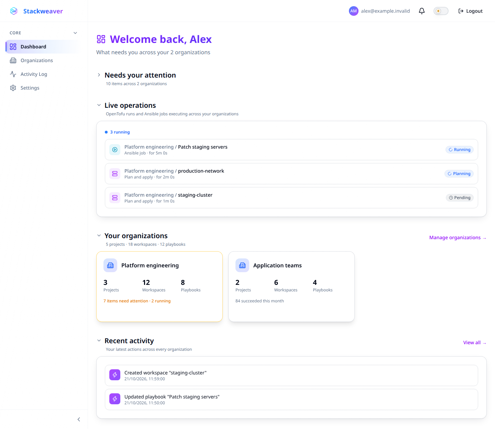
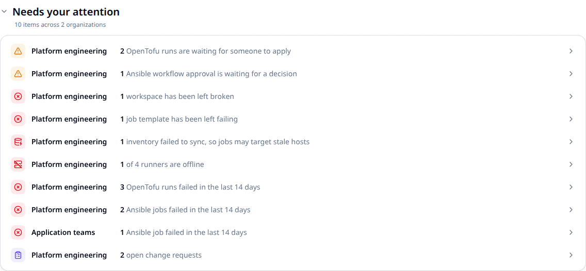

# Reading the dashboard

Start at the dashboard to find work that needs attention across your organizations.
Each attention row names an organization and links to the workspace list, workflow list
or other page where you can investigate.



## What needs your attention

Rows appear only when there is something to report. Decisions waiting for a person come
first, followed by failed work and other action items.



| Signal | Where to go and what to check |
|---|---|
| OpenTofu runs waiting for apply | Open the filtered **Workspaces** list, then review the relevant run's plan before applying. |
| Ansible workflow approvals | Open **Workflows**, inspect the waiting workflow run, and approve or deny its gate. |
| Workspaces left broken | Open the errored **Workspaces** list and inspect the most recent failed run. |
| Job templates left failing | Open **Job Templates** and inspect the template's latest failed job. |
| Inventories failed to sync | Open **Inventories** and read the failed sync output. Check whether jobs would use stale hosts. |
| Runners offline | Open **Settings > Runners** and check the affected runners and pools. Other runners may still be available. |
| Recent OpenTofu failures | Open **Usage** to investigate the failed runs. |
| Recent Ansible failures | Open the filtered **Jobs** list and inspect the failed jobs. |
| Open change requests | Open **Settings > Change Requests** to review outstanding workspace tasks. |

### Read the counts correctly

| Count | What it means |
|---|---|
| A workspace or template left failing | Its latest execution failed and no newer run or job has replaced it. |
| Recent failures | Failures in the last 14 days, including work that may since have recovered. A failed ad hoc Ansible job belongs here, not under failing job templates. |

You see only data your account can access. Runner rows require permission to manage agent
pools; change-request rows require permission to manage workspaces in that organization.
An omitted row does not prove that everything is healthy.

<a id="what-is-running-right-now" style="scroll-margin-top: 7rem"></a>

## Check live operations

**Live operations** lists queued and active OpenTofu runs and Ansible jobs across your
accessible organizations, oldest first. Select a row to open its run or job details.
The list shows up to 25 items and tells you when more are in flight.

Runs waiting for apply confirmation appear in the attention section instead. Use the
status on each live row to distinguish queued work from execution already in progress.

The list refreshes about every 5 seconds while it contains work and every 30 seconds
when empty. Attention counts refresh about once a minute, so the sections can briefly differ.

## Your organizations

Select an organization card to open its **Workspaces** list. The card shows resource
counts and a brief activity summary. Its attention highlight covers standing problems
and pending decisions; it does not include every recent failure or open change request.

For success rates, durations and delivery trends, open **Usage** in the organization's
sidebar. [Usage & Analytics](./usage-analytics.md) explains that page. Read
[Change requests](./change-requests.md)
for the filing and archive workflow.

## Your recent activity

Use **Recent activity** to see your latest actions across organizations. Select **View all**
to open the full activity log.

<a id="folding-sections-away" style="scroll-margin-top: 7rem"></a>

## Adjust the view

Select a section heading to collapse or expand it. Your browser remembers the choice
for your next visit.

<a id="when-you-are-just-getting-started" style="scroll-margin-top: 7rem"></a>

## First-time setup

The **Getting started** checklist replaces attention and live operations until your account
can see an organization, a project and an OpenTofu workspace. Ansible playbooks or jobs alone
do not complete that checklist. If the operational sections are absent, check those setup
steps and your resource access first.

## Read dashboard data through the API

| Interface | Use it for |
|---|---|
| Dashboard | Inspect signals and follow links to the page where you can act. |
| REST API | Read cross-organization statistics and live operations for your authenticated identity. |

The dashboard is a read-only overview, so there is no dashboard YAML or Terraform
configuration to apply. Changes to runs, jobs or resources happen through their own
operations. With the environment from [Using the API](../architecture/using-the-api.md):

### Read statistics

```bash
curl --fail --silent --show-error \
  --header "Authorization: Bearer $STACKWEAVER_TOKEN" \
  "$STACKWEAVER_API_URL/api/v2/dashboard/stats"
```

Read the cross-organization counts and per-organization breakdown in `data.attributes`.
Respect the permission-based omissions described above; a zero count or missing field
does not establish health for resources the caller cannot see.

### Read queued and active operations

```bash
curl --fail --silent --show-error \
  --header "Authorization: Bearer $STACKWEAVER_TOKEN" \
  "$STACKWEAVER_API_URL/api/v2/dashboard/operations"
```

Read `data.attributes.executions` and `data.attributes.truncated`. If `truncated` is true,
the response is a bounded snapshot, not a complete queue. Use the organization's
**Workspaces** or **Jobs** list to investigate work beyond it. An empty list still reflects the caller's access.
Use the [API explorer](/docs/api-reference/explorer) for full schemas.
