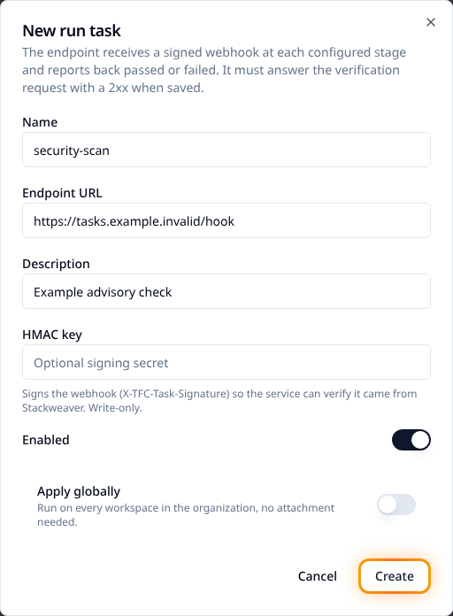

# Set up run tasks

A run task calls an external service at a run-stage boundary and records its verdict. Use it for a security scan, compliance check or another external gate. Start with an advisory task on a test workspace before making it mandatory or applying it globally.

## Before you start

You need a reachable HTTP(S) task endpoint, organization permission to manage run tasks, and run-task management permission on any workspace attachment. The receiving service must answer a verification request successfully when you save the definition. It must implement the callback contract below and verify request signatures when an HMAC key is configured.

| Stage | When it runs |
|---|---|
| `pre_plan` | Before the plan is queued; configuration can be inspected but no plan exists yet. |
| `post_plan` | After the plan, when the machine-readable plan is available. This is the default. |
| `pre_apply` | After confirmation and before apply starts. |
| `post_apply` | After apply completes. A failed check cannot undo the apply. |

## Create and attach a task in the UI

1. Open **Settings > Run Tasks** and choose **New run task**. Set a name, endpoint and optional description. Supply an HMAC key if the service expects signed requests; the stored key is encrypted and write-only.
2. Keep global application off for a workspace trial. Save the task. The endpoint must return a 2xx response to the verification payload with `access_token` equal to `test-token`.
3. Open the workspace's **Run Tasks** tab, select the task and its stages, then choose advisory or mandatory enforcement.
4. Create a new run and inspect the task stage on its detail page. Confirm the result and the service's message before expanding the rollout.



A global task applies to every workspace at its configured stages and enforcement level. If a workspace attaches the same task directly, that attachment takes precedence, including its enforcement setting. The run snapshots its applicable tasks at creation; editing attachments does not alter an in-flight run.

## Choose enforcement and handle failures

| Result | Advisory | Mandatory |
|---|---|---|
| Passed. | The run continues. | The run continues. |
| Failed verdict. | The failure is recorded and the run continues. | The run waits for an authorized override or can be discarded. |
| Delivery error or timeout. | The error is recorded and the gate passes. | The run fails; there is no verdict to override. |

Users with apply permission can override a failed mandatory verdict. The stage records the actor and optional comment. Runs waiting at task stages can be cancelled. Review the service's findings before overriding; applying infrastructure is still your responsibility.

The default timeouts are ten minutes without progress and sixty minutes total. Operators can configure them. A `running` callback reports progress; it does not remove the total-duration limit.

## Configure tasks as code

Set up [the Stackweaver provider](./terraform-provider.md), then save this in `run-tasks.tf`. Replace the organization, workspace ID and service URL. The example starts advisory:

```hcl
resource "stackweaver_organization_run_task" "security" {
  organization = "your-org"
  name         = "security-scan"
  url          = "https://tasks.example.com/hook"
  enabled      = true
}

resource "stackweaver_workspace_run_task" "security" {
  workspace_id      = "ws-REPLACE_ME"
  task_id           = stackweaver_organization_run_task.security.id
  stages            = ["post_plan"]
  enforcement_level = "advisory"
}
```

Review and apply, then create a new run to confirm the attachment executes. The compatible `hashicorp/tfe` resource family is `tfe_organization_run_task`, `tfe_workspace_run_task` and `tfe_organization_run_task_global_settings`, with data sources for lookup. Prefer plural `stages`; singular `stage` is deprecated compatibility input. Protect state if you configure an HMAC secret through a provider.

## Configure tasks through the API

Set `STACKWEAVER_URL` to the origin without a trailing slash, `STACKWEAVER_TOKEN` to a token with the permissions above, and `ORG`/`WORKSPACE_ID` to your targets. There is no separate repository YAML format for these management resources.

Save `task.json`:

```json
{
  "data": {
    "type": "tasks",
    "attributes": {
      "name": "security-scan",
      "url": "https://tasks.example.com/hook",
      "category": "task",
      "enabled": true
    }
  }
}
```

```bash
curl --fail-with-body --silent --show-error \
  --header "Authorization: Bearer $STACKWEAVER_TOKEN" \
  --header 'Content-Type: application/vnd.api+json' \
  --data @task.json \
  "$STACKWEAVER_URL/api/v2/organizations/$ORG/tasks"
```

The endpoint verification runs during creation. Copy the returned task ID into `workspace-task.json`:

```json
{
  "data": {
    "type": "workspace-tasks",
    "attributes": {
      "stages": ["post_plan"],
      "enforcement-level": "advisory"
    },
    "relationships": {
      "task": {"data": {"type": "tasks", "id": "task-REPLACE_ME"}}
    }
  }
}
```

```bash
curl --fail-with-body --silent --show-error \
  --header "Authorization: Bearer $STACKWEAVER_TOKEN" \
  --header 'Content-Type: application/vnd.api+json' \
  --data @workspace-task.json \
  "$STACKWEAVER_URL/api/v2/workspaces/$WORKSPACE_ID/tasks"
```

Confirm the returned `workspace-tasks` relationship and stage settings, then test a new run. If creation has an uncertain network result, list the existing tasks/attachments before retrying. Use [the API explorer](/docs/api-reference/explorer) for global-configuration and update schemas.

## Implement the receiving service

For the verification payload, return 2xx and do not start analysis with `test-token`. For a real webhook, verify `X-TFC-Task-Signature` when configured: it is hex HMAC-SHA512 over the raw request body using the shared HMAC key.

The payload supplies a short-lived bearer `access_token`, configuration/plan access and `task_result_callback_url`. Treat them as credentials. Download only the inputs needed by the selected stage, then PATCH the callback URL with a result such as `task-result.json`:

```json
{
  "data": {
    "type": "task-results",
    "attributes": {
      "status": "passed",
      "message": "No policy violations found"
    }
  }
}
```

```bash
curl --fail-with-body --silent --show-error --request PATCH \
  --header "Authorization: Bearer $TASK_ACCESS_TOKEN" \
  --header 'Content-Type: application/vnd.api+json' \
  --data @task-result.json \
  "$TASK_RESULT_CALLBACK_URL"
```

Here `TASK_ACCESS_TOKEN` and `TASK_RESULT_CALLBACK_URL` come from that specific verified webhook, not your user API token. Supported statuses are `passed`, `failed` and `running`. The callback can include structured findings for the run page, with a one-megabyte body limit per finding. Use the explorer for the full schema and inspect the saved result on the run page.

If registration fails, check the verification response before changing enforcement. If a run fails at a gate, distinguish a failed verdict from a delivery/timeout error; only the verdict is overridable.
