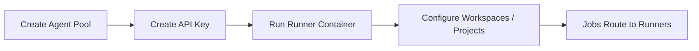
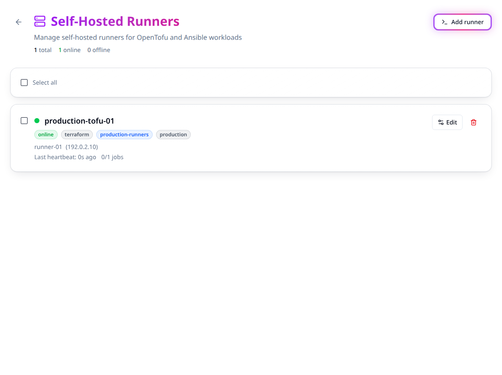

# Set up self-hosted runners

Run OpenTofu or Ansible inside your own network by starting a runner container, registering it with an agent pool and explicitly routing work to that pool. Each runner executes one job at a time; add runners to increase parallel capacity.

| Execution choice | Who operates the runner? |
|---|---|
| Platform-hosted. | The Stackweaver operator supplies execution capacity. |
| Self-hosted. | You run a persistent container that polls Stackweaver for work. |

Use separate pools for trust or network boundaries, and grant each pool only the workspace/project access it needs. A runner initiates outbound connections to Stackweaver; you do not need an inbound listener for job dispatch. Workloads still need their own network access to providers, targets, repositories and dependency registries.

## Before you start

Before you start, make sure you have:

| Requirement | Description |
|-------------|-------------|
| **Stackweaver account** | Sign in to your organization. |
| **Organization admin or runner permissions** | You need permission to manage agent pools and API keys with runner scopes. |
| **Docker (or Kubernetes)** | A host where you can run the runner container. |
| **Outbound HTTPS access** | The runner must reach your Stackweaver API (e.g. `https://your-stackweaver.example.com`). |

## Registration and dispatch

**Agent pools** group runners and define which workspaces or projects can use them. You create a pool in Settings, then register runners into that pool. When you configure a workspace (or project) to use agent execution, you attach it to a pool; jobs for that workspace or project are then dispatched to runners in that pool.

**Runners** are the containers that poll for jobs and execute them. Each runner belongs to one agent pool and is registered using an API key with runner scopes. After registration, the runner appears in Settings > Runners and shows status (online, busy, offline), type (OpenTofu, Ansible, or combined), and last heartbeat.

The flow is:



<details>
<summary><strong>Flow Steps (Legend)</strong></summary>

1. **Agent pool** - Create an agent pool and optionally restrict which workspaces or projects can use it.
2. **API key** - Create an API key with runner scopes.
3. **Runner** - Run the runner container with that API key and the pool ID; the runner registers itself.
4. **Routing** - Set workspace/project/organization execution defaults for OpenTofu; select the pool on an Ansible template or ad hoc command.

</details>

---

## 1. Create an agent pool

Agent pools are managed per organization under **Settings > Agent Pools**.

1. In your organization, go to **Settings** (from the sidebar or org menu).
2. Open **Agent Pools**.
3. Choose **New Agent Pool**.
4. Give the pool a name (e.g. `production-runners` or `ansible-pool`).
5. Choose **Organization-scoped** or **Restricted**:
   - **Organization-scoped**: The pool is available to all workspaces in the organization unless you exclude specific workspaces.
   - **Restricted**: The pool is available only to workspaces or projects you explicitly allow.
6. If restricted, add the allowed workspaces or projects.
7. Save the pool.

You can later edit the pool to change allowed or excluded workspaces and projects. The list of runners in each pool is shown on the Agent Pools page.

> [!TIP]
> Create separate pools for different environments (e.g. `dev-pool` and `prod-pool`) so you can assign workspaces to the right runners.

---

## 2. Create a registration credential

Runners authenticate using the same API key system as the rest of Stackweaver. You create a key with runner scopes and use it only when starting the runner. This key is a *registration* credential: when a runner registers, the API issues it its own runner-scoped token, and the runner uses that token - not your registration key - for every heartbeat and job afterward. That means you can safely revoke the registration key once your runners are up; they keep running until they next restart and need to register again.

1. Go to **Settings > API Keys**.
2. Create a new API key.
3. For the organization, select the same organization that owns the agent pool.
4. Enable the **Runner** permissions your runners need:
   - **Runner: Register**: required so the runner can register with the API.
   - **Runner: OpenTofu** and/or **Runner: Ansible** (or **Runner: Combined** if one runner will do both).
5. Save the key and **copy the token** (e.g. `tfe-xxx...`). You will not see it again.

The registration key must explicitly carry `org:<organization-id>:runner:register`.
A general-purpose key with no scopes or wildcard scopes cannot register a runner. Pool-bound
keys must match that pool; an unreadable binding is an error, not unrestricted access.

Protect the registration credential and supply it only to the runner. Revoking it does not stop already-registered runners, because they use their own scoped tokens; a restart needs a valid registration credential again.

> [!TIP]
> **Pool-scoped agent tokens.** Instead of a general runner-scoped API key, you can create an agent token directly on a pool: expand the pool on the **Settings > Agent Pools** page and use its **Agent tokens** section (create with a description, copy the value once, revoke when done). An agent token is a registration credential **bound to that one pool** - a runner presenting it can only join that pool - so it is the safest way to hand out registration access per environment. This is the Terraform-compatible `tfe_agent_token` resource, so you can also manage these tokens with the `hashicorp/tfe` provider. Everything below works the same whichever kind of registration token you use.

### Rotating an agent token

1. Expand the pool's **Agent tokens** section and choose **Rotate** on the token row.
2. Choose the grace period: 24 hours by default, up to 7 days, or immediate retirement. Copy the new token when shown; its value is displayed once.
3. Within the grace period, update each runner's `STACKWEAVER_TOKEN` and restart it. Keep its intended `RUNNER_NAME` and pool. Replace runners individually and keep enough remaining capacity for work during each restart.
4. Confirm each runner is Online in the intended pool and verify a test workload before retiring the old credential across the fleet.

The old registration token works until its grace period ends; its row shows the expiry. Same-name registration in the same organization reuses the runner identity and labels. Rotating an already-retiring token never extends its expiry. Choose immediate retirement only when you are ready for restarts to require the new credential.

Rotation is also available through this API action, with an optional `grace-period-hours` attribute (0 to 168):

```text
POST /api/v2/authentication-tokens/:id/actions/rotate
```

Replace `:id` with the agent token ID. The response carries the new token and, in its `meta`, the id and expiry of the token it replaced. This action is a Stackweaver extension: the TFE agent token API has no rotate operation, so the `hashicorp/tfe` provider cannot drive it, and a token managed by that provider is rotated by replacing the resource instead.

---

## 3. Start the runner

You run the same container images Stackweaver uses for platform-hosted execution, but in **agent mode**. The runner registers with the API, polls for jobs, and runs them locally on your infrastructure.

### Required values

Before starting a runner, gather the following values.

| Value | Where to find it | Example |
|-------|-------------------|---------|
| **Agent pool ID** | Agent Pools UI (pool detail page or URL) | `a1b2c3d4-e5f6-7890-abcd-ef1234567890` |
| **Registration token** | The token you created in step 2 | `tfe-xxx...` |
| **Stackweaver server** | Your Stackweaver URL | `https://app.stackweaver.io` |

### Docker

Use `docker run` to start a runner on any machine with Docker installed. Pick the tab for the runner type your pool serves, and replace `<pool-uuid>`, `<your-api-key>`, and the server URL with your actual values.

::: code-group
```bash [OpenTofu runner]
docker run -d --restart unless-stopped \
  -e RUNNER_MODE=agent \
  -e RUNNER_AGENT_POOL_ID="<pool-uuid>" \
  -e STACKWEAVER_TOKEN="<your-api-key>" \
  -e STACKWEAVER_SERVER=https://your-stackweaver.example.com \
  -e RUNNER_NAME=my-tofu-runner \
  ghcr.io/vhco-pro/stackweaver-opentofu-runner:latest
```
```bash [Ansible runner]
docker run -d --restart unless-stopped \
  -e RUNNER_MODE=agent \
  -e RUNNER_AGENT_POOL_ID="<pool-uuid>" \
  -e STACKWEAVER_TOKEN="<your-api-key>" \
  -e STACKWEAVER_SERVER=https://your-stackweaver.example.com \
  -e RUNNER_NAME=my-ansible-runner \
  ghcr.io/vhco-pro/stackweaver-ansible-runner:latest
```
:::

### Kubernetes

Create the target namespace first. Store the registration credential in a Secret, then deploy the runner with `runner.yaml`. Pin the runner image to a reviewed release for a repeatable deployment; `latest` below is an example tag. Avoid entering real tokens in shared shell history, and use your secret-management tooling for production.

#### Step 3a: Create a Secret for the API key

```bash
kubectl create secret generic stackweaver-runner-token \
  --namespace "<runner-namespace>" \
  --from-literal=token="<your-api-key>"
```

#### Step 3b: Deploy the runner

Apply a Deployment manifest for the runner type you need. The examples below deploy a single replica; increase `replicas` to run multiple runners in the same pool.

**OpenTofu runner (Kubernetes):**

```yaml
apiVersion: apps/v1
kind: Deployment
metadata:
  name: stackweaver-terraform-runner
  namespace: <runner-namespace>
spec:
  replicas: 1
  selector:
    matchLabels:
      app: stackweaver-terraform-runner
  template:
    metadata:
      labels:
        app: stackweaver-terraform-runner
    spec:
      containers:
        - name: runner
          image: ghcr.io/vhco-pro/stackweaver-opentofu-runner:latest
          env:
            - name: RUNNER_MODE
              value: agent
            - name: RUNNER_AGENT_POOL_ID
              value: "<pool-uuid>"
            - name: STACKWEAVER_SERVER
              value: "https://your-stackweaver.example.com"
            - name: RUNNER_NAME
              valueFrom:
                fieldRef:
                  fieldPath: metadata.name
            - name: STACKWEAVER_TOKEN
              valueFrom:
                secretKeyRef:
                  name: stackweaver-runner-token
                  key: token
          resources:
            requests:
              cpu: 200m
              memory: 256Mi
            limits:
              cpu: "1"
              memory: 1Gi
```

**Ansible runner (Kubernetes):**

```yaml
apiVersion: apps/v1
kind: Deployment
metadata:
  name: stackweaver-ansible-runner
  namespace: <runner-namespace>
spec:
  replicas: 1
  selector:
    matchLabels:
      app: stackweaver-ansible-runner
  template:
    metadata:
      labels:
        app: stackweaver-ansible-runner
    spec:
      containers:
        - name: runner
          image: ghcr.io/vhco-pro/stackweaver-ansible-runner:latest
          env:
            - name: RUNNER_MODE
              value: agent
            - name: RUNNER_AGENT_POOL_ID
              value: "<pool-uuid>"
            - name: STACKWEAVER_SERVER
              value: "https://your-stackweaver.example.com"
            - name: RUNNER_NAME
              valueFrom:
                fieldRef:
                  fieldPath: metadata.name
            - name: STACKWEAVER_TOKEN
              valueFrom:
                secretKeyRef:
                  name: stackweaver-runner-token
                  key: token
          resources:
            requests:
              cpu: 200m
              memory: 256Mi
            limits:
              cpu: "1"
              memory: 1Gi
```

Apply the manifest with `kubectl apply -f runner.yaml`. The runner pod starts, registers with the API, and appears in **Settings > Runners**. Confirm its pool and **Online** status before routing work.

> [!TIP]
> Use `RUNNER_NAME` with `fieldRef: metadata.name` so each pod gets a distinct registration name. A Deployment replacement changes the pod name and can leave an old offline row. For stable fleet identities, use a deployment model with stable names and verify registrations after replacement.

### Optional environment variables

These variables work with both Docker and Kubernetes deployments.

| Variable | Description | Default |
|----------|-------------|---------|
| `RUNNER_NAME` | Name shown in the UI (e.g. hostname). | Hostname |
| `RUNNER_LABELS` | Comma-separated labels for targeting (e.g. `production,gpu`). | (none) |
| `STACKWEAVER_RUN_ENV_PASSTHROUGH` | Comma-separated names of further variables set on the runner to hand to the jobs it runs (e.g. `AWS_PROFILE,AWS_CONFIG_FILE`). | (none) |

The jobs a runner executes do not inherit its whole environment, which holds its API key. They receive their own variables from Stackweaver plus a fixed allowlist of the runner's (path, locale, proxy and CA settings, pod-level cloud identity variables such as IRSA's `AWS_ROLE_ARN` and `AWS_WEB_IDENTITY_TOKEN_FILE` or AKS workload identity's `AZURE_FEDERATED_TOKEN_FILE`, and a few OpenTofu and Ansible settings), listed in [Runner variables that reach runs](../get-started/self-hosting/environment-variables.md#runner-variables-that-reach-runs). If your jobs rely on another variable you set on the runner host or container, such as cloud credentials or `AWS_PROFILE`, name it in `STACKWEAVER_RUN_ENV_PASSTHROUGH`.

Each runner runs one job at a time. To run several jobs in parallel for a pool, start more runners in that pool.

After the runner starts, it registers with the API and appears under **Settings > Runners** with status **Online** once heartbeats are received. You can open a runner from the list to see details, labels, and recent jobs.

> [!NOTE]
> The **Add runner** dialog in Settings > Runners shows Docker commands with your pool ID and server URL filled in. Use the copy button there as a starting point, then replace `<your-api-key>` with your actual token. For Kubernetes, use the Docker commands as a reference for the environment variables to include in your manifest.

---

## 4. Route work to the pool

### OpenTofu workspaces

Open the workspace's edit form, set **Execution Mode** to **Agent**, select **Agent Pool**, then save. Verify both the mode and pool on the saved workspace before starting a test plan.

Pool eligibility alone does not select agent execution. A workspace assigned to a pool with no available runner waits; there is no automatic platform fallback.

### Routing every workspace by default

Setting each workspace individually does not scale once you have more than a handful. Instead, set an organization-wide default: open **Settings > Agent Pools** and use the **Default execution** section at the top to choose **Agent** and the pool you want. Every workspace then runs on that pool without being configured, and you only touch the ones that need something different.

Stackweaver resolves execution settings when a run starts, taking the most specific setting that applies. A workspace with its own execution mode always wins. Otherwise the workspace's project decides, if the project set its own defaults. Only when neither has expressed a preference does the organization default apply. A project that has deliberately chosen a non-agent mode is respected, so it will not be pulled onto agents by an organization default.

The same settings are available to Terraform configuration through the `tfe_organization_default_settings` resource, so you can manage them alongside the rest of your platform.

### Ansible jobs

Select **Agent Pool (Optional)** on the job template, or the agent-pool choice for an ad hoc command. Jobs inherit the template's selected pool. A job with a pool is offered to self-hosted runners; a job without one uses platform execution. The pool must belong to the same organization and permit the relevant scope.

Do not assume OpenTofu organization execution defaults select the Ansible job's pool. Verify the saved template and start a non-destructive test job before routing production automation.

---

## 5. Configure Ansible dependencies

If you use Ansible, you can customize `ansible.cfg` per organization or project so that jobs run with your preferred settings (e.g. timeouts, SSH options, callback plugins).

1. Go to **Settings > Ansible Configuration**.
2. Choose the scope: **Organization** or **Project**.
3. Edit the configuration content. Edit sections such as `[defaults]` and `[ssh_connection]`.
4. Save.

When a job runs (on a platform-hosted or self-hosted runner), Stackweaver injects the appropriate `ansible.cfg` into the job environment. The settings UI exposes organization and project configuration; a project override takes precedence over the organization default.

### Ansible runner prerequisites

A self-hosted Ansible runner prepares a playbook the same way the platform runner does, and it does so from inside your network using only its outbound connection to the Stackweaver API plus whatever the playbook itself needs.

A playbook in `cached` source mode is downloaded from Stackweaver as a snapshot, so the runner does not need to reach your VCS provider to run it. A playbook in `fresh` mode, and a `cached` playbook that has not been synced yet, is cloned by the runner, which then needs outbound access to the VCS provider. A runner tells Stackweaver that it can run snapshots when it fetches a job. A runner image that does not do so is sent the repository's clone URL and clones every playbook, including `cached` ones, so it needs that outbound access for all of them. Use a current runner image to run `cached` playbooks from their snapshot and to keep clone credentials off the runner for them.

When the playbook repository contains a `requirements.yml`, the runner installs its collections and roles before the play. The runner host therefore needs a route to the source of those collections: `galaxy.ansible.com`, your Git host for `type: git` entries, or a private Galaxy server or Automation Hub. Configure a private server in the `[galaxy]` section of the `ansible.cfg` described above. If the install fails, the job output says so and the play still runs.

Installed collections are cached per project under `GALAXY_CACHE_DIR`, which defaults to `galaxy-cache` under `WORKSPACES_DIR` (`/home/stackweaver/workspaces` in the runner image). The cache is optional, and without a volume it is rebuilt after the container restarts. To keep it, mount a volume at that path, and use that volume for nothing else, because the runner manages the directory's contents. With Docker, add a named volume to the `docker run` command for the Ansible runner:

```bash
-v stackweaver-galaxy-cache:/home/stackweaver/workspaces/galaxy-cache
```

With Kubernetes, provision a `stackweaver-galaxy-cache` PVC in the runner's namespace, then merge this fragment into `runner.yaml`. The container name must match the existing Deployment; this is not a complete manifest:

```yaml
spec:
  template:
    spec:
      containers:
        - name: runner
          volumeMounts:
            - name: galaxy-cache
              mountPath: /home/stackweaver/workspaces/galaxy-cache
      volumes:
        - name: galaxy-cache
          persistentVolumeClaim:
            claimName: stackweaver-galaxy-cache
```

A project's cache that has not been used for `GALAXY_CACHE_TTL_DAYS` days (14 by default) is removed automatically. Collections that you installed on the runner host yourself, for example under `~/.ansible/collections`, remain available to every job. See [Galaxy Collections](../features/ansible/galaxy-collections.md) for the details.

---

## Verify and monitor runners

Open **Settings > Runners** to check status, type, pool, hostname, heartbeat and current load. Open a runner for capabilities, labels and recent jobs.



After registration, run a reviewed test plan or harmless Ansible job and verify its runner assignment and output. Online heartbeats prove connectivity, not cloud permissions or successful workload execution.

### Runner status

Runners send heartbeats to the API on a regular interval. If heartbeats stop (e.g. container down or network issue), Stackweaver marks the runner **Offline** after a short period. No new jobs are assigned to offline runners. When the runner comes back and heartbeats again, it returns to **Online** and can receive jobs again.

Use **Edit** on a runner to change its description or labels. See [Operate and troubleshoot](#operate-and-troubleshoot) for deletion, image replacement and bulk maintenance.

## Configure pools and routing as code

Configure [the Stackweaver provider](./terraform-provider.md) and save `runner-pool.tf`. Use an authorized organization credential for management; keep the resulting registration token private:

```hcl
resource "stackweaver_agent_pool" "production" {
  organization        = "your-org"
  name                = "production-runners"
  organization_scoped = true
}

resource "stackweaver_agent_token" "production" {
  agent_pool_id = stackweaver_agent_pool.production.id
  description   = "Production runner registration"
}

resource "stackweaver_organization_default_settings" "execution" {
  organization           = "your-org"
  default_execution_mode = "agent"
  default_agent_pool_id  = stackweaver_agent_pool.production.id
}
```

This makes the pool eligible organization-wide and sets the OpenTofu organization default; review that scope before apply. Use allowed/excluded workspace and project resources for narrower eligibility. Workspace/project overrides still take precedence. Provider state contains the token, even though the attribute is sensitive. Obtain the token through your protected deployment workflow rather than a public output.

For a specific workspace, set `execution_mode = "agent"` and `agent_pool_id` on its provider resource. An Ansible template's `agent_pool_id` is a separate setting; see [playbook management](./managing-ansible-playbooks.md) for source selection and the provider reference for the complete template schema. The compatible TFE pool, token and organization-default resource families can also manage the corresponding OpenTofu settings.

## Create a pool through the API

Set `STACKWEAVER_URL` to the origin without a trailing slash, `STACKWEAVER_TOKEN` to an organization credential authorized to manage pools, and `ORG` to its name. Save `agent-pool.json`:

```json
{
  "data": {
    "type": "agent-pools",
    "attributes": {
      "name": "production-runners",
      "organization-scoped": true
    }
  }
}
```

```bash
curl --fail-with-body --silent --show-error \
  --header "Authorization: Bearer $STACKWEAVER_TOKEN" \
  --header 'Content-Type: application/vnd.api+json' \
  --data @agent-pool.json \
  "$STACKWEAVER_URL/api/v2/organizations/$ORG/agent-pools"
```

Record the returned pool ID and verify its access scope. List pools before retrying an uncertain create. Create a pool token in the UI or provider path above; [the API explorer](/docs/api-reference/explorer) documents token creation, rotation and routing schemas. Runner deployment itself uses the Docker environment or Kubernetes YAML shown above, not a Stackweaver management-YAML resource.

## Operate and troubleshoot

| Symptom or task | Action |
|---|---|
| Runner stays offline. | Check the container, server URL, registration credential, outbound TLS connection and registration/heartbeat logs. |
| Runner is online but work waits. | Check workload type, pool assignment/access, labels and available capacity. One runner executes one job at a time. |
| All runners in a pool are offline. | Restore capacity or explicitly change execution routing after reviewing its trust/network implications. There is no automatic fallback. |
| Upgrade a runner. | Pull a reviewed image, replace the container with the same intended name/pool and a valid registration credential, then confirm registration and a test job. Same-name registration in the same organization reuses the runner record and refreshes its scoped token. Do not run two instances with the same name. |
| Run both workload types. | Deploy the documented OpenTofu and Ansible images separately. A registration scope or UI type does not install the other workload's runtime in an image. |
| Remove a runner. | Stop the container as well as deleting its registration. A running container with valid registration credentials can register again. |

Use resource limits and size each runner for its workload. Keep registration keys out of repositories and avoid passing the runner's full environment to jobs. Use [the environment allowlist](../get-started/self-hosting/environment-variables.md#runner-variables-that-reach-runs) when additional job variables are needed.

For bulk maintenance, select runner cards and use **Add label**, **Remove label** or **Delete**. Label operations change only the selected label; deletion asks for confirmation. Partial failures leave failed runners selected for retry. Verify selection and scope before repeating a batch.

Next, [manage workspace inputs](./managing-workspace-variables.md), [read OpenTofu run results](./understanding-opentofu-runs.md) or [run an Ansible job](../get-started/your-first-ansible-job.md).
