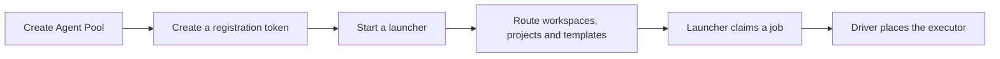
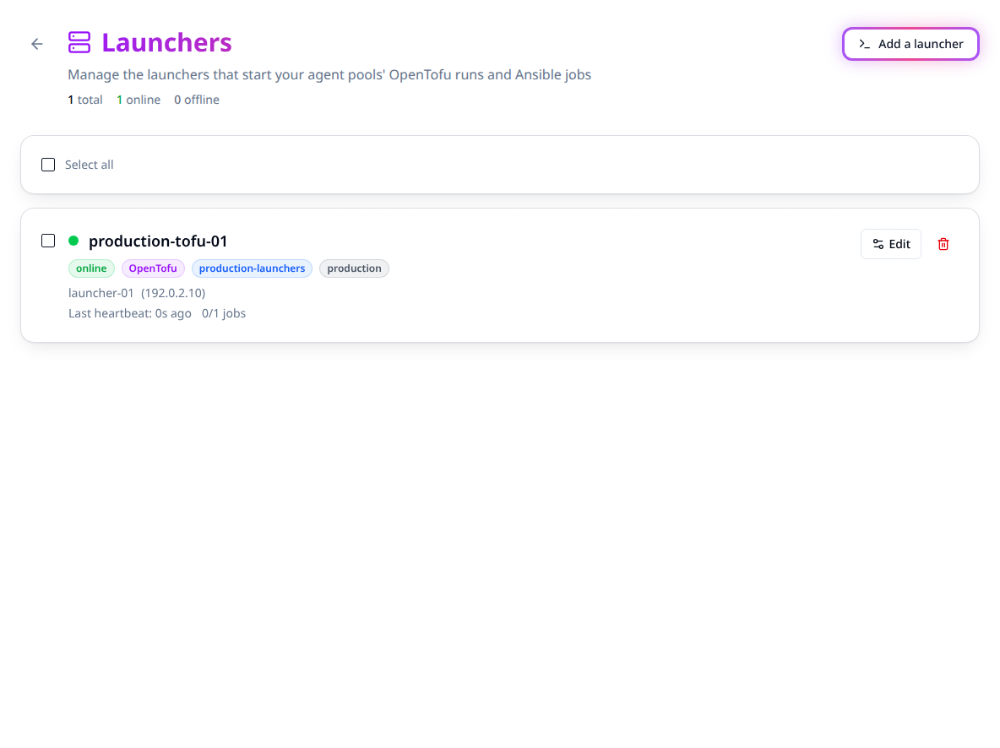

# Set up self-hosted runners

Run OpenTofu or Ansible inside your own network by starting a launcher, registering it with an agent pool and explicitly routing work to that pool. A launcher runs one job at a time unless you raise its concurrency; add launchers to increase parallel capacity.

| Execution choice | Who operates the launchers? |
|---|---|
| Hosted capacity. | The Stackweaver installation runs them and serves everything in `remote` execution mode. |
| Agent pool. | You run persistent launchers on your own servers or Kubernetes clusters that keep a heartbeat open to Stackweaver. |

Use separate pools for trust or network boundaries, and grant each pool only the workspace/project access it needs. A launcher initiates outbound connections to Stackweaver over HTTPS; you do not need an inbound listener for job dispatch. Workloads still need their own network access to providers, targets and dependency registries. Agent pools follow the Terraform Cloud and HCP Terraform agent pool model, so `tfe_agent_pool` and `tfe_agent_token` from the `hashicorp/tfe` provider manage them, and so does [the Stackweaver provider](./terraform-provider.md).

## Before you start

Before you start, make sure you have:

| Requirement | Description |
|-------------|-------------|
| **Stackweaver account** | Sign in to your organization. |
| **Organization admin or runner permissions** | You need permission to manage agent pools and API keys with runner scopes. |
| **A Linux host or a Kubernetes cluster** | Launchers run on Linux only. The container driver needs a Docker or Podman socket on the host; the Kubernetes driver needs a namespace it may create pods in. |
| **Outbound HTTPS access** | The launcher, and every job it places, must reach your Stackweaver API (e.g. `https://your-stackweaver.example.com`). |

## How a job runs

Every OpenTofu run, Ansible job and sync goes through the same three parts, wherever it runs.

| Part | What it does |
|------|--------------|
| **Launcher** | A long-running process (the `stackweaver-opentofu-runner` or `stackweaver-ansible-runner` image) that registers with one agent pool, or with the installation's hosted capacity, and keeps one heartbeat open to the API. When the API offers it work, it claims the job, asks the API for a token valid for that one job, and hands the job to its driver. With the container and Kubernetes drivers a launcher never runs user code itself, and it holds no database, object storage or Redis credential. |
| **Driver** | Decides where the job runs: `inprocess` (a child process of the launcher), `container` (a fresh container per job through a Docker or Podman socket) or `kubernetes` (a fresh pod per job). |
| **Executor** | Runs one job and exits. It fetches the job's configuration, variables, credentials and state from the API with the job token, runs `tofu` or `ansible-playbook`, streams the output back and uploads the plan, the state and the result. The job token is refused once the job has finished. |

## Registration and dispatch

**Agent pools** group launchers and define which workspaces or projects can use them. You create a pool in Settings, then start launchers in that pool. When you configure a workspace (or project) to use agent execution, or name the pool on an Ansible job template, its work is offered to the launchers of that pool.

**Launchers** register with one pool using a registration credential, and the API gives each one a runner token of its own. After registration, the launcher appears in Settings > Runners and shows its status (online, busy, offline), type (OpenTofu, Ansible, or combined), driver, network mode and last heartbeat.

The flow is:



<details>
<summary><strong>Flow Steps (Legend)</strong></summary>

1. **Agent pool** - Create an agent pool and optionally restrict which workspaces or projects can use it.
2. **Registration token** - Create an agent token on the pool, or an API key with the runner registration scope.
3. **Launcher** - Start the launcher with that token, the pool ID and the server URL; it registers itself.
4. **Routing** - Set workspace/project/organization execution defaults for OpenTofu; select the pool on an Ansible template or ad hoc command.
5. **Claim** - The launcher's heartbeat is answered with the work waiting for its pool, up to its free capacity, and it claims a job atomically, so a job never runs twice.
6. **Placement** - The driver starts the executor in-process, in a container or in a pod, with a token for that job alone.

</details>

---

## 1. Create an agent pool

Agent pools are managed per organization under **Settings > Agent Pools**.

1. In your organization, go to **Settings** (from the sidebar or org menu).
2. Open **Agent Pools**.
3. Choose **New Agent Pool**.
4. Give the pool a name (e.g. `production-runners` or `ansible-pool`).
5. Choose **Organization-scoped** or **Restricted**:
   - **Organization-scoped**: The pool is available to all workspaces in the organization unless you exclude specific workspaces.
   - **Restricted**: The pool is available only to workspaces or projects you explicitly allow.
6. If restricted, add the allowed workspaces or projects.
7. Save the pool.

You can later edit the pool to change allowed or excluded workspaces and projects, and its job placement settings (see [Pool settings](#pool-settings)). Expanding a pool on the page lists its launchers with the driver, network mode and node cache each one reported when it registered.

> [!TIP]
> Create separate pools for different environments (e.g. `dev-pool` and `prod-pool`) so you can assign workspaces to the right launchers.

---

## 2. Create a registration credential

A launcher registers with a registration credential and then switches to a runner token the API issues to it, which it uses for every heartbeat and claim afterwards. That means you can safely revoke the registration credential once your launchers are up; they keep working until they next restart and need to register again.

The safest registration credential is a **pool-scoped agent token**. Expand the pool on the **Settings > Agent Pools** page and use its **Agent tokens** section: create a token with a description, copy the value once, and revoke it when you are done. A launcher presenting an agent token can only join that pool, so it is the safest way to hand out registration access per environment. This is the Terraform-compatible `tfe_agent_token` resource, so you can also manage these tokens with the `hashicorp/tfe` provider.

You can also use an organization API key that may register runners:

1. Go to **Settings > API Keys**.
2. Create a new API key and choose the **Runner Registration** scope.
3. For the organization, select the same organization that owns the agent pool.
4. Save the key and **copy the token** (e.g. `tfe-xxx...`). You will not see it again.

The registration key must explicitly carry `org:<organization-id>:runner:register`.
A general-purpose key with no scopes or wildcard scopes cannot register a runner. Pool-bound
keys must match that pool; an unreadable binding is an error, not unrestricted access. Such a key registers launchers into any pool of that organization, so prefer an agent token when a launcher should only ever join one pool.

Protect the registration credential and supply it only to the launcher. Revoking it does not stop already-registered launchers, because they use their own runner tokens; a restart needs a valid registration credential again. Everything below works the same whichever kind of registration credential you use.

### Rotating an agent token

1. Expand the pool's **Agent tokens** section and choose **Rotate** on the token row.
2. Choose the grace period: 24 hours by default, up to 7 days, or immediate retirement. Copy the new token when shown; its value is displayed once.
3. Within the grace period, update each launcher's `STACKWEAVER_TOKEN` and restart it. Keep its intended `RUNNER_NAME` and pool. Replace launchers individually and keep enough remaining capacity for work during each restart.
4. Confirm each launcher is Online in the intended pool and verify a test workload before retiring the old credential across the fleet.

The old registration token works until its grace period ends; its row shows the expiry. A launcher that registers again under the same `RUNNER_NAME` in the same organization keeps its identity, labels and pool. Rotating an already-retiring token never extends its expiry. Choose immediate retirement only when you are ready for restarts to require the new credential.

Rotation is also available through this API action, with an optional `grace-period-hours` attribute (0 to 168):

```text
POST /api/v2/authentication-tokens/:id/actions/rotate
```

Replace `:id` with the agent token ID. The response carries the new token and, in its `meta`, the id and expiry of the token it replaced. This action is a Stackweaver extension: the TFE agent token API has no rotate operation, so the `hashicorp/tfe` provider cannot drive it, and a token managed by that provider is rotated by replacing the resource instead.

---

## 3. Start a launcher

The launcher is the same image the installation's hosted capacity uses. Started with a pool ID and a registration token, it serves that pool and runs each job with its driver.

### Required values

Before starting a launcher, gather the following values.

| Value | Where to find it | Example |
|-------|-------------------|---------|
| **Agent pool ID** | Agent Pools UI (pool detail page or URL) | `a1b2c3d4-e5f6-7890-abcd-ef1234567890` |
| **Registration token** | The token you created in step 2 | `tfe-xxx...` |
| **Stackweaver server** | Your Stackweaver URL | `https://app.stackweaver.io` |

### Docker, in-process driver

The simplest launcher runs each job as a child process of its own container and needs nothing from the host but Docker. Pick the tab for the workload your pool serves, and replace `<pool-uuid>`, `<your-token>`, and the server URL with your actual values.

::: code-group
```bash [OpenTofu launcher]
docker run -d --restart unless-stopped \
  -e RUNNER_AGENT_POOL_ID="<pool-uuid>" \
  -e STACKWEAVER_TOKEN="<your-token>" \
  -e STACKWEAVER_SERVER=https://your-stackweaver.example.com \
  -e RUNNER_NAME=my-tofu-launcher \
  ghcr.io/vhco-pro/stackweaver-opentofu-runner:latest
```
```bash [Ansible launcher]
docker run -d --restart unless-stopped \
  -e RUNNER_AGENT_POOL_ID="<pool-uuid>" \
  -e STACKWEAVER_TOKEN="<your-token>" \
  -e STACKWEAVER_SERVER=https://your-stackweaver.example.com \
  -e RUNNER_NAME=my-ansible-launcher \
  ghcr.io/vhco-pro/stackweaver-ansible-runner:latest
```
:::

An in-process launcher runs one job at a time unless you raise `RUNNER_MAX_CONCURRENT_JOBS`. Its jobs share the launcher's filesystem, user and network, and they run only in the platform image. Use the container driver when jobs need isolation from one another or a [run image](./run-images-and-execution-environments.md) of their own.

### Docker or Podman, container driver

With the container driver, the launcher creates a fresh, hardened container for every job through the engine's socket. Each job container runs as a non-root user with a read-only root filesystem and a writable `/tmp`, drops every Linux capability, forbids privilege escalation and is removed when the job ends. The socket is root-equivalent on the host, which is why the launcher itself never runs user code.

```bash
docker run -d --restart unless-stopped --user root \
  -v /var/run/docker.sock:/var/run/docker.sock \
  -v stackweaver-launcher-cache:/var/cache/stackweaver-launcher \
  -e RUNNER_AGENT_POOL_ID="<pool-uuid>" \
  -e STACKWEAVER_TOKEN="<your-token>" \
  -e STACKWEAVER_SERVER=https://your-stackweaver.example.com \
  -e RUNNER_NAME=my-tofu-launcher \
  -e RUNNER_DRIVER=container \
  -e RUNNER_IMAGE=ghcr.io/vhco-pro/stackweaver-opentofu-runner:latest \
  -e RUNNER_NETWORK=stackweaver-jobs \
  -e RUNNER_MAX_CONCURRENT_JOBS=4 \
  -e RUNNER_CACHE_DIR=/var/cache/stackweaver-launcher \
  -e RUNNER_CACHE_VOLUME=stackweaver-launcher-cache \
  ghcr.io/vhco-pro/stackweaver-opentofu-runner:latest
```

`RUNNER_IMAGE` is the platform image the executor comes from, normally the launcher's own image. `RUNNER_NETWORK` names the jobs network the launcher creates and firewalls (see [Network modes](#network-modes)); leave it out and jobs run on the engine's default network without the firewall. `RUNNER_CACHE_DIR` and `RUNNER_CACHE_VOLUME` give the launcher a node-local copy of the organization's cache that job containers mount read-only (see [The node-local cache](#the-node-local-cache)). For an Ansible launcher, use the Ansible image in both places.

Jobs reach the API at the address in `STACKWEAVER_SERVER`, from the jobs network. Use an address a job container can resolve, never `localhost`. When the API runs on the same host, use `http://host.docker.internal:<api-port>`, and add `--add-host host.docker.internal:host-gateway` and `-e RUNNER_EXTRA_HOSTS=host.docker.internal:host-gateway` to the command above so the launcher and its jobs both resolve that name.

#### Use Podman instead of Docker

The driver speaks the Docker Engine API, which Podman also serves.

1. Start Podman's API socket: `sudo systemctl enable --now podman.socket` for rootful Podman (`/run/podman/podman.sock`), or `systemctl --user enable --now podman.socket` for rootless Podman (`$XDG_RUNTIME_DIR/podman/podman.sock`).
2. Mount that socket into the launcher. When the path inside the launcher container is not `/var/run/docker.sock`, set `RUNNER_DOCKER_SOCKET` to it. A rootful socket must be readable by the user the launcher runs as.
3. On a host that also runs Docker, let rootful Podman's jobs network past Docker's `FORWARD` drop policy, or run one engine per host. Start the launcher once so it creates the network, read the subnet from `podman network inspect stackweaver-jobs`, and add it to Docker's `DOCKER-USER` chain:

   ```bash
   sudo iptables -I DOCKER-USER -s <jobs subnet> -j ACCEPT
   sudo iptables -I DOCKER-USER -d <jobs subnet> -m conntrack --ctstate RELATED,ESTABLISHED -j ACCEPT
   ```

   These rules last until the next reboot; save them with your distribution's firewall tooling.

On rootful Podman the launcher firewalls the jobs network with an nftables table, so the firewall image (`RUNNER_FIREWALL_IMAGE`, the platform image by default) needs `nft`. Rootless Podman cannot program the host firewall, so the jobs network has no firewall there. Every executor then checks at start whether a cloud metadata endpoint answers from its network, and refuses to run if one does.

CPU and memory limits are applied on engines with cgroup v2. On an engine that cannot enforce them, the job runs without them, unless the pool requires limits.

On Docker 26 or later (Engine API 1.45), each job mounts its organization's part of the node-local cache volume. Podman's API cannot mount part of a volume, so on Podman and on older Docker the launcher mounts that part from the volume's directory on the host instead, which needs the `local` volume driver. Where neither works, jobs fetch every cache entry through the API. The cache is mounted read-only with the shared SELinux container label, so jobs can read it on hosts that enforce SELinux, such as Fedora with Podman.

### Kubernetes

Create the target namespace first. Store the registration credential in a Secret, then deploy the launcher with `launcher.yaml`. Pin the launcher image to a reviewed release for a repeatable deployment; `latest` below is an example tag. Avoid entering real tokens in shared shell history, and use your secret-management tooling for production.

#### Step 3a: Create a Secret for the registration token

```bash
kubectl create secret generic stackweaver-runner-token \
  --namespace "<runner-namespace>" \
  --from-literal=token="<your-token>"
```

#### Step 3b: Deploy the launcher

The manifest below runs an OpenTofu launcher with the in-process driver, which needs no permissions in the cluster. For an Ansible launcher, use the `ghcr.io/vhco-pro/stackweaver-ansible-runner` image. It deploys a single replica; increase `replicas` to run more launchers in the same pool.

```yaml
apiVersion: apps/v1
kind: Deployment
metadata:
  name: stackweaver-tofu-launcher
  namespace: <runner-namespace>
spec:
  replicas: 1
  selector:
    matchLabels:
      app: stackweaver-tofu-launcher
  template:
    metadata:
      labels:
        app: stackweaver-tofu-launcher
    spec:
      containers:
        - name: launcher
          image: ghcr.io/vhco-pro/stackweaver-opentofu-runner:latest
          env:
            - name: RUNNER_AGENT_POOL_ID
              value: "<pool-uuid>"
            - name: STACKWEAVER_SERVER
              value: "https://your-stackweaver.example.com"
            - name: RUNNER_NAME
              valueFrom:
                fieldRef:
                  fieldPath: metadata.name
            - name: STACKWEAVER_TOKEN
              valueFrom:
                secretKeyRef:
                  name: stackweaver-runner-token
                  key: token
          ports:
            - name: health
              containerPort: 9090
          livenessProbe:
            httpGet:
              path: /healthz
              port: health
          readinessProbe:
            httpGet:
              path: /readyz
              port: health
          resources:
            requests:
              cpu: 200m
              memory: 256Mi
            limits:
              cpu: "1"
              memory: 1Gi
```

Apply the manifest with `kubectl apply -f launcher.yaml`. The pod starts, registers with the API, and appears in **Settings > Runners**. Confirm its pool and **Online** status before routing work. `/healthz` answers while the process is up, and `/readyz` answers once the launcher is registered, its heartbeat is fresh and its driver can place jobs.

> [!TIP]
> Use `RUNNER_NAME` with `fieldRef: metadata.name` so each pod gets a distinct registration name. A Deployment replacement changes the pod name and can leave an old offline row. For stable fleet identities, use a deployment model with stable names and verify registrations after replacement.

#### Step 3c: Run every job in a pod of its own

The Kubernetes driver gives every job a fresh pod. The launcher then needs a ServiceAccount and a Role in the job namespace. Save the following as `launcher-rbac.yaml` and replace `<runner-namespace>`:

```yaml
apiVersion: v1
kind: ServiceAccount
metadata:
  name: stackweaver-launcher
  namespace: <runner-namespace>
---
apiVersion: rbac.authorization.k8s.io/v1
kind: Role
metadata:
  name: stackweaver-launcher
  namespace: <runner-namespace>
rules:
  - apiGroups: [""]
    resources: ["pods", "secrets", "serviceaccounts"]
    verbs: ["get", "list", "create", "patch", "delete"]
  - apiGroups: [""]
    resources: ["pods/log", "configmaps"]
    verbs: ["get"]
  # Only while the launcher manages the job NetworkPolicy (RUNNER_MANAGE_NETWORK_POLICY unset).
  - apiGroups: ["networking.k8s.io"]
    resources: ["networkpolicies"]
    verbs: ["get", "create", "patch"]
---
apiVersion: rbac.authorization.k8s.io/v1
kind: RoleBinding
metadata:
  name: stackweaver-launcher
  namespace: <runner-namespace>
roleRef:
  apiGroup: rbac.authorization.k8s.io
  kind: Role
  name: stackweaver-launcher
subjects:
  - kind: ServiceAccount
    name: stackweaver-launcher
    namespace: <runner-namespace>
```

The Role grants no `exec` and nothing cluster-scoped. If you manage the job namespace's NetworkPolicy yourself, set `RUNNER_MANAGE_NETWORK_POLICY=false` and remove the `networkpolicies` rule; the Helm chart does this for its own launchers.

Then change `launcher.yaml`:

1. Add `serviceAccountName: stackweaver-launcher` to the pod `spec`.
2. Add these entries to the container's `env`, with your cluster's pod and service ranges:

   ```yaml
   - name: RUNNER_DRIVER
     value: kubernetes
   - name: RUNNER_IMAGE
     value: ghcr.io/vhco-pro/stackweaver-opentofu-runner:latest
   - name: RUNNER_CLUSTER_CIDRS
     value: "10.244.0.0/16,10.96.0.0/12"
   ```

3. Check that `STACKWEAVER_SERVER` resolves from a job pod. Job pods reach the API at the same address as the launcher.

Apply both files with `kubectl apply -f launcher-rbac.yaml -f launcher.yaml`.

Jobs run in the launcher's namespace, or in the one `RUNNER_JOB_NAMESPACE` names. For a separate job namespace, create the Role and RoleBinding there, keep the RoleBinding's subject in the launcher's namespace, and use a namespace-qualified API address such as `http://stackweaver-api.stackweaver.svc:8022`. Each job pod satisfies the restricted Pod Security Standard, runs under `RUNNER_JOB_UID` when its image's user is not numeric, and carries no ServiceAccount token unless its identity needs one. `RUNNER_RUNTIME_CLASS` runs job pods under a sandboxed runtime such as gVisor or Kata. At start the launcher applies a NetworkPolicy to the job namespace that blocks the cluster ranges in `RUNNER_CLUSTER_CIDRS` and the cloud metadata ranges.

### Launcher environment variables

These variables work with Docker, Podman and Kubernetes. The [environment variables reference](../get-started/self-hosting/environment-variables.md#launchers) lists every launcher variable.

| Variable | Description | Default |
|----------|-------------|---------|
| `STACKWEAVER_SERVER` | Base URL of the Stackweaver API. Job containers and pods use the same address, so it must resolve where they run: with `RUNNER_JOB_NAMESPACE` set, use a namespace-qualified Service name such as `http://stackweaver-api.stackweaver.svc:8022`. | (required) |
| `STACKWEAVER_TOKEN` | Agent token or API key the launcher registers with. | (required) |
| `RUNNER_AGENT_POOL_ID` | ID of the agent pool the launcher joins. | (required) |
| `RUNNER_NAME` | Name shown in the UI; it must be unique per launcher. | Hostname |
| `RUNNER_LABELS` | Comma-separated labels reported with the launcher (e.g. `production,gpu`). | (none) |
| `RUNNER_MAX_CONCURRENT_JOBS` | Jobs the launcher runs at once. | `1` |
| `RUNNER_DRIVER` | `inprocess`, `container` or `kubernetes`. | `inprocess` |
| `RUNNER_IMAGE` | Platform image the executor comes from; required by the container and Kubernetes drivers. | (none) |
| `RUNNER_NETWORK` | Jobs network of the container driver. | (none) |
| `RUNNER_NETWORK_MODE` | `platform` or `host-identity` (see [Network modes](#network-modes)). | `platform` |
| `RUNNER_DRAIN_GRACE` | How long a stopping launcher waits for its jobs to finish. | `5m` |
| `STACKWEAVER_RUN_ENV_PASSTHROUGH` | Comma-separated names of further launcher variables handed to the jobs of an in-process launcher. | (none) |

The jobs a launcher places do not inherit its environment, which holds its registration and runner tokens. They receive their own variables from Stackweaver plus a fixed allowlist of the launcher's, listed in [Runner variables that reach runs](../get-started/self-hosting/environment-variables.md#runner-variables-that-reach-runs). On an in-process launcher, name any further variable your jobs rely on in `STACKWEAVER_RUN_ENV_PASSTHROUGH`; on the container and Kubernetes drivers, give a job its settings through workspace or variable-set variables, or its job template's extra variables.

After the launcher starts, it registers with the API and appears under **Settings > Runners** with status **Online** once its heartbeat is answered. You can open it from the list to see details, labels, and recent jobs.

> [!NOTE]
> The **Add runner** dialog in Settings > Runners shows Docker commands with your pool ID and server URL filled in. Use the copy button there as a starting point, then replace `<your-api-key>` with your actual token. For Kubernetes, use the Docker commands as a reference for the environment variables to include in your manifest.

---

## 4. Route work to the pool

### OpenTofu workspaces

Open the workspace's edit form, set **Execution Mode** to **Agent**, select **Agent Pool**, then save. Verify both the mode and pool on the saved workspace before starting a test plan. A workspace in **remote** execution mode runs on the organization's hosted capacity.

Pool eligibility alone does not select agent execution. A workspace assigned to a pool with no available launcher waits; there is no automatic fallback to the hosted capacity.

A VCS-backed workspace's run starts from a snapshot of its repository, which a sync on the hosted capacity captured, so the launcher and the run never clone it. Module sources are different: `tofu init` fetches them from the run itself, and private git module sources get no platform credential. A `git::` source on a private Git host works only with a credential you give the run, for example in a sensitive environment variable your git configuration reads, and over a route from the run to that host.

### Routing every workspace by default

Setting each workspace individually does not scale once you have more than a handful. Instead, set an organization-wide default: open **Settings > Agent Pools** and use the **Default execution** section at the top to choose **Agent** and the pool you want. Every workspace then runs on that pool without being configured, and you only touch the ones that need something different. A project can carry its own default too, on the **Edit project** dialog of the project page.

Stackweaver resolves execution settings when a run starts, taking the most specific setting that applies. A workspace with its own execution mode always wins. Otherwise the workspace's project decides, if the project set its own defaults. Only when neither has expressed a preference does the organization default apply. A project that has deliberately chosen a non-agent mode is respected, so it will not be pulled onto agents by an organization default.

The same settings are available to Terraform configuration through the `tfe_organization_default_settings` resource, so you can manage them alongside the rest of your platform.

### Ansible jobs

Select **Agent Pool (Optional)** on the job template, or the agent-pool choice for an ad hoc command. A job launched from a template runs on the template's pool. When the template names none, it runs on the project's default pool, then the organization's, when that level's execution mode is **Agent**, and otherwise on the organization's hosted capacity. An ad hoc command runs on the pool you choose for it, or on the hosted capacity. The pool must belong to the same organization and permit the relevant scope.

The template's effective settings (`GET /api/v2/ansible/job-templates/:id/effective-settings`) name the pool its jobs use and the level it comes from (`agent-pool-id`). Check them and start a non-destructive test job before routing production automation.

Syncs are routed by the kind of sync. A dynamic inventory source sync runs on the project's or the organization's default agent pool when one is set, and on the hosted capacity otherwise. The syncs that capture a snapshot from your VCS provider (a playbook snapshot, a VCS inventory file, a constructed inventory rebuild, and the configuration of a VCS-backed workspace) always run on the hosted capacity in the platform image, so the launchers in your pools never need a route to your VCS host or a VCS credential.

---

## 5. Configure Ansible dependencies

If you use Ansible, you can customize `ansible.cfg` per organization or project so that jobs run with your preferred settings (e.g. timeouts, SSH options, callback plugins).

1. Go to **Settings > Ansible Configuration**.
2. Choose the scope: **Organization** or **Project**.
3. Edit the configuration content. Edit sections such as `[defaults]` and `[ssh_connection]`.
4. Save.

When a job runs, on the hosted capacity or on your launchers, Stackweaver writes the appropriate `ansible.cfg` into the job. The settings UI exposes organization and project configuration; a project override takes precedence over the organization default.

### What an Ansible job needs from the network

An Ansible job starts from a snapshot of its playbook's repository, which a sync on the hosted capacity captured, so the launcher and its jobs never clone from your VCS provider. A `fresh` playbook is captured again for every launch, and the job waits for that capture.

When the playbook repository contains a `requirements.yml`, the job first installs what the organization's cache holds for it and then runs `ansible-galaxy` for the rest. The job therefore needs a route to wherever the remaining collections and roles come from: `galaxy.ansible.com`, your Git host for `type: git` entries, or a private Galaxy server or Automation Hub. Configure a private server in the `[galaxy]` section of the `ansible.cfg` described above, or for the whole installation with `STACKWEAVER_GALAXY_SERVERS` on the API. `ansible-galaxy` gets no platform credential, so a `type: git` entry on a private Git host needs a credential you give the job. If the install fails, the job output says so and the play still runs. See [Galaxy Collections](../features/ansible/galaxy-collections.md) for the details.

Jobs run in the platform Ansible image unless they select an execution environment. [Run Images and Execution Environments](./run-images-and-execution-environments.md) explains when you need one and how an AWX execution environment runs on Stackweaver.

---

## Drivers and isolation

| Driver | Where a job runs | Isolation | Limits |
|--------|------------------|-----------|--------|
| `inprocess` | A child process of the launcher | The job sees an allowlisted environment and a fresh working directory, and cannot read the launcher's memory. It shares the launcher's user, filesystem and network. | Not applied; a pool that requires limits refuses the job. |
| `container` | A fresh container per job on the launcher's Docker or Podman engine | Own filesystem, non-root user, no capabilities, read-only root filesystem, the firewalled jobs network | Applied where the engine supports cgroup v2 |
| `kubernetes` | A fresh pod per job in the job namespace | Own filesystem, restricted Pod Security Standard, the job namespace's NetworkPolicy, optional sandboxed runtime class | Applied as pod resource limits |

On every driver the executor writes the credentials a job needs (inventory secrets, SSH keys, vault passwords, cloud token files, CLI configuration) with owner-only permissions into a directory that exists for that job, and removes it on every exit path before a failed container or pod is kept for inspection. A container or Kubernetes job image must run as a non-root user; a launcher on the container driver accepts a root image only with `RUNNER_ALLOW_ROOT=true`.

When a launcher stops (`SIGTERM`), it stops claiming, lets its jobs finish for up to `RUNNER_DRAIN_GRACE` and then deregisters. If a launcher disappears in the middle of a job, Stackweaver handles the job by what is safe to repeat: a plan or a sync is offered again as a new attempt, while an apply ends as failed with the message "runner lost during apply" (its apply reported as errored to Terraform clients) and an Ansible job ends as errored with "runner lost during job". Neither is retried on its own: **Re-queue apply** on the run page (or `POST /api/v2/runs/:id/actions/apply`) applies the run's saved plan as a new attempt, and is refused if the workspace state moved meanwhile; relaunch the job to run it again. Each attempt has its own job token, and the token of an earlier attempt is refused, so an orphaned job can neither finish nor upload state. A restarted launcher reattaches to the job containers or pods it still owns.

## Network modes

The installer sets a launcher's network mode with `RUNNER_NETWORK_MODE` (chart value `launcher.network`). The pool page shows it read-only for each launcher, and nothing in the API or the UI can widen it.

| Mode | What jobs can reach |
|------|---------------------|
| `platform` (default) | The API, DNS and the internet. Inbound traffic, the cloud metadata ranges (`169.254.0.0/16`, `fd00:ec2::/64`, `fd20:ce::/64`), the other networks on the engine and, on Kubernetes, the cluster ranges in `RUNNER_CLUSTER_CIDRS` are blocked. Jobs get cloud access from the platform identity or an identity binding, never from the node. |
| `host-identity` | The same, plus the cloud metadata endpoints, so jobs can use the node's or VM's own identity. It applies to the container and Kubernetes drivers; on the container driver the executor skips its metadata check in this mode. A launcher started with `STACKWEAVER_HOSTED_STRICT` refuses this mode. |

On the container driver, the launcher creates the network `RUNNER_NETWORK` names and, on a rootful engine, programs the host firewall for it through a short-lived container from the platform image: a chain under Docker's `DOCKER-USER` on Docker, and an nftables table of its own on Podman and on Docker's nftables backend. Jobs never reach `168.63.129.16`, Azure's platform address, in any network mode; they resolve names through the engine's resolver. Jobs on the network cannot reach each other, the engine's gateway or any port the host publishes, except the API, whether it listens on the host or runs in a container behind a port the host publishes. `RUNNER_DENY_CIDRS` adds ranges no job may reach, such as your database's subnet. `RUNNER_ALLOW_TCP` lists `host:port` endpoints, or `http` and `https` URLs, that jobs may reach even inside a denied range, which is how jobs on an air-gapped install reach mirrors on the same host or network; the launcher resolves each name when it starts. On the Kubernetes driver, `RUNNER_ALLOW_TCP` adds the same endpoints as allowed peers of the job NetworkPolicy the launcher manages. On rootful Podman it creates the network through Podman's own API, without Podman's isolation between networks, so a job reaches an allowed endpoint that a container on another Podman network publishes; the nftables table refuses everything else.

The in-process driver has no network isolation: its jobs reach whatever the launcher can reach, including the metadata endpoint of the host.

## Hosted capacity

Each organization has a hosted pool that runs everything in `remote` execution mode and every snapshot sync. On a self-hosted install its launchers are the `launcher` and `ansible-launcher` services of the Docker Compose bundle, or the launcher Deployments of the Helm chart. It is shown read-only as **Hosted capacity** at the top of **Settings > Agent Pools**, with the jobs in flight, the jobs queued, the hosted launchers online and the placement group it is served from. Its launchers belong to the installation, so they are counted rather than named. The hosted pool cannot be renamed, deleted or selected as a workspace's agent pool, and it does not appear in the TFE agent pools API.

A platform administrator can cap how many jobs of one organization the hosted capacity runs at once, and choose which placement group serves it, through `max-concurrent-jobs` and `placement-group` on `PATCH /api/v2/agent-pools/:id`; the pool's ID is the `pool-id` of `GET /api/v2/organizations/:name/hosted-capacity`. An organization admin's request for those fields is refused. When a hosted pool sets no cap, the deployment's `STACKWEAVER_HOSTED_DEFAULT_MAX_CONCURRENT_JOBS` applies, and `0` means unlimited. A run or job waiting on the cap stays `pending`, and its timeline says "Waiting for hosted capacity" with the slots in use. A hosted launcher serves only the hosted pools whose placement group equals its own `STACKWEAVER_HOSTED_GROUP` (`default` when unset), so a group can be dedicated capacity for one organization, a region, or a set of nodes with stricter controls. Work on a hosted pool whose group has no launcher online waits until one comes online.

## Pool settings

The pool's edit dialog on **Settings > Agent Pools** has a **Job placement** section, and the expanded pool row shows the same values read-only.

| Setting | Effect |
|---------|--------|
| **CPU limit** and **Memory limit** | Limits applied to each job container or pod, in Kubernetes quantities such as `1500m` and `2Gi`. |
| **Refuse a job whose limits the launcher cannot enforce** | A job is refused, rather than run without limits, on a launcher that cannot apply them (the in-process driver, or an engine without cgroup v2). |
| **Keep a failed job for (minutes)** | Leaves a failed job's container or pod in place this long for inspection. The executor has already removed every credential it wrote. A canceled job is not a failure and is removed at once. When unset, the launcher's `RUNNER_KEEP_FAILED_FOR` applies. |
| **Keep a node-local copy of the organization's cache** | On by default. Turn it off to have every job read its cache entries through the API. |

The expanded row also has a read-only **Deployment settings** panel with the values the installer set for the whole installation: the allowed image registries, the default run timeout, the sync timeout, the job log cap, the cache size limit, the hosted default cap, the rate budgets of launchers and jobs, and the mirrors, proxy and extra CA certificates jobs use. The same values are the `deployment` attribute of `GET /api/v2/platform/settings`.

## Identity bindings

A job always receives the platform identity: for each cloud the organization has an [OIDC configuration](./oidc-configuration.md) for, Stackweaver mints a short-lived token for that run or job and the executor hands it to the job. [Workload Identity](./workload-identity.md) describes it.

A pool can also offer identity bindings, which run its job pods as a Kubernetes ServiceAccount that a cloud's pod identity mechanism trusts. Add them in the **Identity bindings** section of the pool's expanded row. A binding has a name, a mechanism (`aws-irsa`, `aws-pod-identity`, `gcp-workload-identity` or `azure-workload-identity`), a ServiceAccount name with the annotations the mechanism reads, and one of three ways of handling the ServiceAccount: **Create it**, where the launcher creates the account with those annotations; **Create one per job**, where the launcher creates a copy of it for every job and removes it with the pod; or **Reference an existing one**, where the account is declared elsewhere and the launcher never writes it. When the launcher finds that something other than Stackweaver manages a ServiceAccount, for example a GitOps controller, the binding is marked as declared outside Stackweaver and becomes read-only.

A workspace, job template or inventory source selects a binding in its **Identity binding** control, and a project or organization can set a default (see [Run Images and Execution Environments](./run-images-and-execution-environments.md#where-a-setting-comes-from)). A job whose resolved binding belongs to a pool other than the one it runs on is refused, and hosted pools offer no bindings. Bindings apply to jobs placed by a launcher on the Kubernetes driver. This guide does not cover the cloud-side setup of each mechanism; [Workload Identity](./workload-identity.md) describes the platform identity, which needs none.

## Registry pull Secrets

On the Kubernetes driver a job whose run image comes from a private registry is pulled with a dockerconfigjson Secret. By default the launcher writes one for each job from the run image's registry credential and the pod deletes it with itself. A pool can instead keep a long-lived pull Secret per registry in its job namespace: add it in the **Registry pull Secrets** section of the pool's expanded row, with a name, the registry host (such as `ghcr.io` or `registry.example:5000`), the Secret's name, and one of two ways of handling it. **Create it** has the launcher create and keep the Secret from an organization registry credential (from **Settings > Credentials**); **Reference an existing one** uses a Secret declared elsewhere, in git, a Helm value or a plain manifest, which the launcher never writes. A job of the pool whose run image comes from that registry then runs with the Secret, and the launcher reads no credential for it. The same requests are available over the API at `GET` and `POST /api/v2/agent-pools/:id/pull-secrets` and `GET`, `PATCH` and `DELETE /api/v2/pull-secrets/:id`.

Pull Secrets follow the same rules as identity bindings. Creating one whose Secret name another tool already manages in the namespace (Argo CD, Flux, Helm, or another server-side apply manager) is refused with an error naming that manager; reference it by name instead. When the launcher finds that a Secret it created has been taken over, for example because it was committed to git and is now applied by Argo CD or Flux, the pull Secret is marked as managed outside Stackweaver, the launcher stops writing to it, and its Kubernetes fields can no longer be edited or the entry deleted here; jobs keep using it. A Secret the launcher reports missing is shown as such, and jobs fall back to a Secret written for each job until it exists again. Deleting a pull Secret leaves the Kubernetes Secret the launcher created in the namespace for you to remove.

An Argo CD project that warns on orphaned resources should permit only the kinds the job namespace declares in git, or ignore `Pod sw-job-*`: a job pod has no owner, and an object created in the UI counts as an orphan until it is committed to git.

## The organization's cache

Every organization has a verified cache of the OpenTofu releases, provider packages, Galaxy collections and roles, and git sources its jobs install, so a job does not download the same artifact again. A job only reads the cache. When a job installs something the cache did not supply, it reports it, and the launcher that ran it fetches the artifact again from its source and verifies it before adding it: an OpenTofu release against its signed `SHA256SUMS`, a provider against the registry's signed checksums and the configuration's lock file, a Galaxy collection against the checksum the Galaxy server publishes, and a role or git source by its commit. An artifact that does not match what the job reported is dropped. The run log says what the cache supplied, for example "From the organization's cache: OpenTofu 1.10.6, provider registry.opentofu.org/hashicorp/null 3.2.4".

The cache lives in the installation's object storage, under a prefix of its own for each organization, and no organization reads another's entries. The oldest entries are removed first once it reaches the organization's cache size limit, set under **Run Defaults** in **Settings > Organization**, or the deployment's `CACHE_SIZE_LIMIT` (50 GiB by default).

OpenTofu releases are verified with `cosign`, which consults the Sigstore transparency log; the OpenTofu runner image includes `cosign`. A launcher that cannot reach the log, on an air-gapped network, can be started with `CACHE_VERIFY_TRANSPARENCY_LOG=false`; it then verifies the release's GPG signature against OpenTofu's release key, which the launcher carries, and records the entry as verified offline. A launcher started with `STACKWEAVER_HOSTED_STRICT` refuses that setting.

## The node-local cache

A launcher keeps a copy of the cache entries its jobs used, so repeated jobs on the same host fetch nothing twice. Only the launcher writes the copy: it fetches each entry under its runner token, checks its digest, and mounts the job's organization's part of it read-only into the job. The executor still checks the digest of every entry it reads and fetches anything missing through the API. A run log line that ends in "(node-local copy)" says every entry came from it.

| Driver | Where the copy lives |
|--------|----------------------|
| `inprocess` | `RUNNER_CACHE_DIR`, by default under the launcher user's cache directory |
| `container` | The named volume `RUNNER_CACHE_VOLUME`, mounted into the launcher at `RUNNER_CACHE_DIR`. A launcher that runs in a container needs both, or jobs read every entry through the API. |
| `kubernetes` | None. A job pod under the restricted profile cannot mount a node directory, so it reads its entries through the API. |

`RUNNER_CACHE_LOCAL_SIZE_LIMIT` bounds the copy (20Gi by default), and the least recently used entries are removed first. `RUNNER_CACHE_DIR=off` turns the copy off for a launcher, and the pool setting **Keep a node-local copy of the organization's cache** turns it off for a pool.

---

## Verify and monitor runners

Open **Settings > Runners** to check status (Online, Busy, Offline or Error), type, pool, hostname, heartbeat and current load against capacity. Open a launcher for capabilities, labels and recent jobs.



After registration, run a reviewed test plan or harmless Ansible job and verify its runner assignment and output. Online heartbeats prove connectivity, not cloud permissions or successful workload execution.

A run or job page has a **Placement** panel that shows where its latest attempt ran: the attempt number (for a run, of its current phase, so an apply that follows its plan is the apply's first attempt, and only a plan offered again or a re-queued apply counts as a new one), the driver, the container or pod, the image and its digest with the level the image came from, the identity binding (or the platform token) and the node.

### Runner status

Launchers keep a heartbeat open to the API. If heartbeats stop (e.g. container down or network issue), Stackweaver marks the launcher **Offline** after a short period and offers it no new work. When the launcher comes back and heartbeats again, it returns to **Online** and can receive jobs again.

Use **Edit** on a runner to change its description or labels. See [Operate and troubleshoot](#operate-and-troubleshoot) for deletion, image replacement and bulk maintenance.

## Configure pools and routing as code

Configure [the Stackweaver provider](./terraform-provider.md) and save `runner-pool.tf`. Use an authorized organization credential for management; keep the resulting registration token private:

```hcl
resource "stackweaver_agent_pool" "production" {
  organization        = "your-org"
  name                = "production-runners"
  organization_scoped = true
}

resource "stackweaver_agent_token" "production" {
  agent_pool_id = stackweaver_agent_pool.production.id
  description   = "Production runner registration"
}

resource "stackweaver_organization_default_settings" "execution" {
  organization           = "your-org"
  default_execution_mode = "agent"
  default_agent_pool_id  = stackweaver_agent_pool.production.id
}
```

This makes the pool eligible organization-wide and sets the OpenTofu organization default; review that scope before apply. Use allowed/excluded workspace and project resources for narrower eligibility. Workspace/project overrides still take precedence. Provider state contains the token, even though the attribute is sensitive. Obtain the token through your protected deployment workflow rather than a public output.

For a specific workspace, set `execution_mode = "agent"` and `agent_pool_id` on its provider resource. An Ansible template's `agent_pool_id` is a separate setting; see [playbook management](./managing-ansible-playbooks.md) for source selection and the provider reference for the complete template schema. The compatible TFE pool, token and organization-default resource families can also manage the corresponding OpenTofu settings.

## Create a pool through the API

Set `STACKWEAVER_URL` to the origin without a trailing slash, `STACKWEAVER_TOKEN` to an organization credential authorized to manage pools, and `ORG` to its name. Save `agent-pool.json`:

```json
{
  "data": {
    "type": "agent-pools",
    "attributes": {
      "name": "production-runners",
      "organization-scoped": true
    }
  }
}
```

```bash
curl --fail-with-body --silent --show-error \
  --header "Authorization: Bearer $STACKWEAVER_TOKEN" \
  --header 'Content-Type: application/vnd.api+json' \
  --data @agent-pool.json \
  "$STACKWEAVER_URL/api/v2/organizations/$ORG/agent-pools"
```

Record the returned pool ID and verify its access scope. List pools before retrying an uncertain create. Create a pool token in the UI or provider path above; [the API explorer](/docs/api-reference/explorer) documents token creation, rotation and routing schemas. Launcher deployment itself uses the Docker environment or Kubernetes YAML shown above, not a Stackweaver management-YAML resource.

## Operate and troubleshoot

| Symptom or task | Action |
|---|---|
| Launcher stays offline. | Check the container, `STACKWEAVER_SERVER`, `STACKWEAVER_TOKEN`, `RUNNER_AGENT_POOL_ID`, the outbound TLS connection and the registration/heartbeat logs. The launcher retries with backoff, and `/readyz` on port 9090 says what it is waiting for. |
| Launcher is online but work waits. | Check workload type, pool assignment/access, labels and available capacity. A launcher runs at most `RUNNER_MAX_CONCURRENT_JOBS` jobs at once. Work on the hosted capacity may be waiting on the organization's hosted cap. |
| All launchers in a pool are offline. | Restore capacity or explicitly change execution routing after reviewing its trust/network implications. There is no automatic fallback. |
| A job fails with an error about its image on an in-process pool. | The job resolved a run image other than the platform image, and an in-process launcher runs only its own image. Run the pool's launchers with the container or Kubernetes driver, or select no run image for that workspace, template or project. |
| Upgrade the platform. | Upgrade your launchers to the platform's release at the same time, because a job's executor comes from its launcher's image. A launcher ignores `RUNNER_MODE`; remove it from older runner deployments. |
| Upgrade a launcher. | Pull a reviewed image, replace the container with the same intended name/pool and a valid registration credential, then confirm registration and a test job. A stopping launcher finishes its jobs first, for up to `RUNNER_DRAIN_GRACE`. Same-name registration in the same organization reuses the runner record and refreshes its runner token. Do not run two instances with the same name. |
| Run both workload types. | Deploy the documented OpenTofu and Ansible images separately; each image runs one engine. They can join the same pool with the same registration credential. |
| Remove a launcher. | Stop the container as well as deleting its registration. A running container with valid registration credentials can register again. |

Use resource limits and size each launcher for its workload: set CPU and memory limits on the pool so a single job cannot exhaust the host, and require them where a job without limits is not acceptable. Prefer the container or Kubernetes driver for any pool that runs code from more than one team, so each job gets its own filesystem and network, and keep the `platform` network mode unless jobs really need the node's identity. Give the container driver's host the Docker or Podman socket only through the launcher, since the socket is root-equivalent. Keep registration keys out of repositories and avoid passing the launcher's full environment to jobs. Use [the environment allowlist](../get-started/self-hosting/environment-variables.md#runner-variables-that-reach-runs) when additional job variables are needed.

For bulk maintenance, select runner cards and use **Add label**, **Remove label** or **Delete**. Label operations change only the selected label; deletion asks for confirmation. Partial failures leave failed runners selected for retry. Verify selection and scope before repeating a batch.

Next, [run jobs in your own images](./run-images-and-execution-environments.md), [give jobs cloud access with workload identity](./workload-identity.md), [manage workspace inputs](./managing-workspace-variables.md), [read OpenTofu run results](./understanding-opentofu-runs.md) or [run an Ansible job](../get-started/your-first-ansible-job.md).
