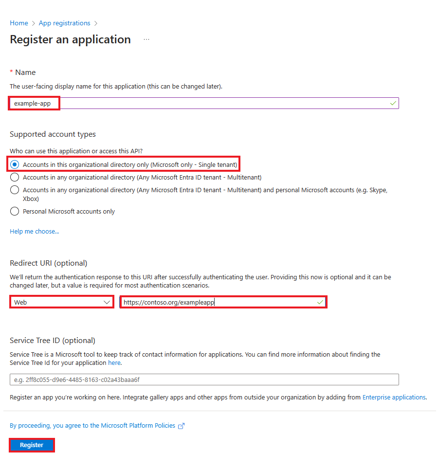
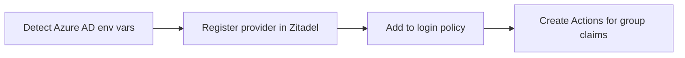

# Set up Microsoft Entra ID SSO

Connect Microsoft Entra ID to Zitadel for browser sign-in to Stackweaver. Keep the tenant,
callback and group settings together, then verify account creation and organization access.
This is separate from Azure workload identity for runs.

## Choose a setup path

Use the portal procedure below, or the complete Terraform example. Both produce the client
settings consumed by Stackweaver; registering the upstream application and configuring the
Stackweaver deployment are separate steps. Complete the same sign-in and access checks
regardless of which path you choose.


## Step 1: Register an Application in Azure AD

1. Sign in to the [Azure Portal](https://portal.azure.com).
2. Navigate to **Microsoft Entra ID** (formerly Azure Active Directory) > **App registrations**.
3. Click **New registration**.
4. Fill in the registration form:
   - **Name**: `Stackweaver` (or any descriptive name).
   - **Supported account types**: Choose based on your requirements. For most organizations, select "Accounts in this organizational directory only (Single tenant)".
   - **Redirect URI**: Select **Web** and enter your Zitadel callback URL:
     ```
     https://zitadel.example.com/idps/callback
     ```
     Replace `zitadel.example.com` with your actual Zitadel domain. For a localhost-only setup (no custom domain), use `http://localhost:8080/idps/callback`.
     See the [Custom Domain guide](../authentication/zitadel-custom-domain.md) for how the callback URL is constructed.
5. Click **Register**.



Microsoft Learn's [registration reference](https://learn.microsoft.com/en-us/entra/identity-platform/howto-create-service-principal-portal),
reproduced under [CC BY 4.0](https://github.com/MicrosoftDocs/entra-docs/blob/main/ThirdPartyNotices.md).
The image uses Microsoft's example names. Enter your Zitadel callback from the steps above.

## Step 2: Create a Client Secret

1. In your newly registered application, go to **Certificates & secrets**.
2. Click **New client secret**.
3. Add a description (e.g., `Stackweaver SSO`) and choose an expiration period.
4. Click **Add**.
5. **Copy the client secret value immediately.** It will not be shown again.

## Step 3: Note Your Application Details

From the application's **Overview** page, note the following values:

| Field | Location | Example |
|-------|----------|---------|
| Application (client) ID | Overview page | `a1b2c3d4-e5f6-7890-abcd-ef1234567890` |
| Directory (tenant) ID | Overview page | `f0e1d2c3-b4a5-6789-0abc-def123456789` |
| Client Secret | Certificates & secrets | (the value you copied in Step 2) |

## Step 4: Configure Group Claims (Optional)

If you want to use automatic team mapping based on Azure AD group memberships:

1. In your app registration, go to **Token configuration**.
2. Click **Add groups claim**.
3. Select the group types to include:
   - **Security groups**: Recommended for most setups.
   - **Directory roles**: Optional.
   - **Groups assigned to the application**: Use this for fine-grained control.
4. Under **Customize token properties by type**, ensure **Group ID** is selected for the **ID** token type. Keep Object IDs for the recipe below. Other formats, such as **sAMAccountName** or
     cloud display names, have provider/group restrictions; use the exact emitted value only
     after checking [Microsoft's group-claim options](https://learn.microsoft.com/en-us/entra/identity/hybrid/connect/how-to-connect-fed-group-claims).
5. Click **Add**.

> **Note:** By default, Azure AD sends group Object IDs (GUIDs) in the `groups` claim. Readable names require the relevant Entra claim configuration and supported group type. The values in the `groups` claim must match the `sso_team_id` values you configure on your Stackweaver teams.

## Step 5: Configure API Permissions

Ensure the application has the following API permissions:

1. Go to **API permissions**.
2. Verify these permissions exist (they should be added by default):
   - `Microsoft Graph` > `User.Read` (Delegated)
   - `openid` (Delegated)
   - `profile` (Delegated)
   - `email` (Delegated)
3. If they are missing, click **Add a permission** > **Microsoft Graph** > **Delegated permissions** and add them.


## Automate the identity-provider setup with Terraform

Authenticate the AzureAD provider with an Azure CLI session in the intended tenant, or
with the management identity's `ARM_TENANT_ID`, `ARM_CLIENT_ID` and `ARM_CLIENT_SECRET`.
That identity needs permission to manage the application and read the Microsoft Graph
service principal. These management credentials are different from the SSO client secret
created by the example.

The example creates a single-tenant confidential Web app, security-group Object ID claims,
Graph delegated permission declarations, a service principal and an expiring client secret.
Choose a future `secret_expiry` according to your rotation policy. Required tenant consent
remains a separate administrator/user action.

Download all files into a separate private working directory. The example creates upstream
identity resources, not Stackweaver teams. Review existing resources before applying; do not
create a second app merely to replace a working configuration.

::: code-explorer ./examples/entra default="main.tf"
:::

Copy `terraform.tfvars.example` to `terraform.tfvars`, replace every example value, and run:

```bash
terraform init
terraform plan -out=sso.tfplan
terraform apply sso.tfplan
```

Keep the declared version constraint and commit the lock file produced by `terraform init`
in your automation repository. The saved plan may contain
secrets; keep it and state in protected storage. The `sensitive` output flag hides routine
display but does not remove secrets from state. This example does not grant consent or
establish successful sign-in by itself.

Read the generated configuration values privately:

```bash
terraform output -raw azure_ad_client_id
terraform output -raw azure_ad_tenant_id
terraform output -raw azure_ad_client_secret
```

Put them in the persistent Compose `sso.env` or the Helm values/Secret shown below. The
client-secret output prints plain text; do not send it to a shared log.

For an existing application, import its **object ID**, not the client ID, before reconciling
the full resource configuration:

```bash
terraform import azuread_application.stackweaver /applications/REPLACE_WITH_OBJECT_ID
```

Import any existing service principal separately. Existing secret values cannot be imported
into the password resource; introduce a replacement credential deliberately and preserve the
working one until the deployment is verified. Full application resources manage more than
redirects, so inspect the plan against the imported settings.

See the [AzureAD provider reference](https://registry.terraform.io/providers/hashicorp/azuread/latest/docs).

## Step 6: Configure Stackweaver

Choose the instructions for your deployment method. These reconcile steps assume the
bundled Stackweaver initializer. An externally managed Zitadel installation needs its own
IdP/Actions configuration; the deployment wiring guide is not that manual procedure.

### Docker Compose

Add the following variables to **`sso.env`** in your Compose directory (the directory that holds `docker-compose.yml`; `zitadel-init` never overwrites this file):

```dotenv
# Azure AD / Entra ID SSO Configuration
AZURE_AD_CLIENT_ID=a1b2c3d4-e5f6-7890-abcd-ef1234567890
AZURE_AD_CLIENT_SECRET=your-client-secret-value
AZURE_AD_TENANT_ID=f0e1d2c3-b4a5-6789-0abc-def123456789
```

`AZURE_AD_TENANT_ID` is required. A first sign-in through Azure AD creates a Stackweaver account even when public sign-up is off (see [Email (SMTP) and sign-up](../../get-started/self-hosting/email.md)), so the tenant ID is what limits sign-in to your organisation's people. To accept any Microsoft account deliberately, leave the tenant ID empty and set `AZURE_AD_ALLOW_MULTI_TENANT=true` (Helm: `sso.azureAd.allowMultiTenant: true`); without one of the two, `zitadel-init` stops with an error naming both settings.

Apply the initializer inputs, then recreate services that consume the generated credentials:

```bash
# Run in your Compose directory
docker compose run --rm zitadel-init
docker compose up -d
```

### Kubernetes / Helm

Create a Kubernetes Secret with the client secret:

```bash
kubectl create secret generic stackweaver-sso \
  --namespace stackweaver \
  --from-literal=azure-ad-client-secret="your-client-secret-value"
```

Add the Azure AD configuration to your Helm values file:

```yaml
sso:
  secretName: stackweaver-sso
  azureAd:
    clientId: "a1b2c3d4-e5f6-7890-abcd-ef1234567890"
    tenantId: "f0e1d2c3-b4a5-6789-0abc-def123456789"
```

Set `STACKWEAVER_CHART_VERSION` to the installed chart version shown by
`helm list --namespace stackweaver`. Preserve the existing release values when applying
these settings. A configuration change should not silently upgrade the platform:

```bash
helm upgrade stackweaver oci://ghcr.io/vhco-pro/charts/stackweaver \
  --version "${STACKWEAVER_CHART_VERSION:?Set the installed chart version}" \
  --namespace stackweaver \
  --values my-values.yaml
```

### Verify the configuration

The `zitadel-init` service will automatically detect the Azure AD environment variables and configure everything:



<details>
<summary><strong>Flow Steps (Legend)</strong></summary>

1. **Register** - Registers the Azure AD provider in Zitadel with the name "Microsoft".
2. **Login policy** - Adds the provider to the login policy so the "Sign in with Microsoft" button appears.
3. **Actions** - Creates Zitadel Actions to capture and forward group claims through the JWT.

</details>

Check the logs to verify:

**Docker Compose:** inspect the output of the preceding one-off initializer command.
Its `--rm` container is removed after it exits, so service logs do not retain that output.
If your deployment ran the service container instead, inspect its retained logs:

```bash
docker compose logs zitadel-init
```

**Kubernetes:**
```bash
kubectl logs -f deployment/stackweaver-zitadel -c zitadel-init --namespace stackweaver
```

A first reconcile can report lines like these; an existing provider/target reports
`Updated Azure AD provider` or `Using existing target` instead. Check the complete log for
errors rather than requiring every create message:
```
✅ Created Azure AD provider (instance): <provider-id>
✅ Created target 'stackweaver-idp-sync': <target-id>
✅ Created target 'stackweaver-complement-token': <target-id>
✅ Set execution: Response on RetrieveIdentityProviderIntent → IDP Sync webhook
✅ Set execution: Function preaccesstoken → Complement Token webhook
```

## Step 7: Test the Integration

1. Open your public Stackweaver URL in your browser. A local development installation uses `http://localhost:5173`.
2. On the login page, you should see a "Sign in with Microsoft" button.
3. Click it to be redirected to Microsoft's login page.
4. Sign in with your Azure AD credentials.
5. On first login, Zitadel will auto-provision the user and redirect you back to Stackweaver.

After the first login, the user is provisioned in Stackweaver but does not have access to any organization. An admin must invite the user to an organization, or you can configure [team mapping](./team-mapping.md) for automatic access.

## Provider behavior

The Azure AD provider is configured with the following behaviors:

| Setting | Value | Description |
|---------|-------|-------------|
| Auto-creation | Enabled | New users are automatically created in Zitadel on first login, with their email marked as verified, even when public sign-up is off |
| Auto-update | Enabled | User profile (name, email) is synced on each login |
| Account linking | Not automatic | A first sign-in whose email already belongs to an existing account is refused, and the person is asked to sign in with their password first |
| Email verification | Trusted | Azure AD emails are treated as verified (Azure AD does not send the `email_verified` claim) |
| Scopes | `openid`, `profile`, `email`, `User.Read` | Standard OIDC scopes plus Microsoft Graph basic profile |

## Troubleshooting

### "Sign in with Microsoft" button does not appear

Verify that the `AZURE_AD_CLIENT_ID` environment variable is set and non-empty. For Docker Compose, check `sso.env`. For Kubernetes, verify your Helm values have `sso.azureAd.clientId` set. Then re-run `zitadel-init` and check its logs for errors.

### Redirect URI mismatch error (AADSTS50011)

Zitadel constructs the callback URL from the HTTP request's domain context, not directly from the `ExternalDomain` config. The Stackweaver auth proxy (in the API container) must send the correct `x-zitadel-instance-host` header so that Zitadel builds the callback with your external domain. The expected format is:
```
https://{your-domain}/idps/callback
```

If the error shows `https://localhost:8080/idps/callback`, the `CUSTOM_REQUEST_HEADERS` on the API service is not set correctly. Verify the configuration:

```bash
# Check that ZITADEL_EXTERNAL_HOST is set in .env
grep ZITADEL_EXTERNAL_HOST .env

# Check that the API container has the header configured
docker compose exec api printenv CUSTOM_REQUEST_HEADERS
# Expected: x-zitadel-instance-host:zitadel.example.com
```

If missing, re-run `docker compose run --rm zitadel-init` in your Compose directory to regenerate `.env`, then recreate the services with `docker compose up -d`. See the [Custom Domain guide](../authentication/zitadel-custom-domain.md) for the full explanation of how callback URLs are constructed.

Also ensure the redirect URI registered in Azure Portal matches `https://your-domain/idps/callback` exactly.

### User creation failed on first SSO login

If the first SSO login ends on a "Registration failed" page (a URL ending in `/registration-failed`), Zitadel could not auto-provision the user. Check the upstream email, first/last name, required profile fields and the exact API error.
Missing profile data is one possible cause; do not assume every registration error has the same cause.

To fix this:

1. Ensure the Azure AD user has a first name and last name set in their profile (Azure Portal > Users > select user > Properties).
2. Verify that the Azure AD app registration has the `profile` scope in **API permissions** (Step 5). Without this scope, Azure AD may not include `given_name` and `family_name` claims in the token.
3. After fixing the profile, try the SSO login again.

### User is authenticated but has no organization access

This is expected behavior. SSO users are provisioned without organization membership for multi-tenant isolation. Either invite the user to an organization manually, or configure [team mapping](./team-mapping.md) to grant access automatically based on group claims.

### Group claims are not appearing

1. Verify you configured group claims in **Token configuration** (Step 4).
2. Check that the user is a member of at least one Azure AD group.
3. If membership exceeds the JWT limit of 200 groups, Entra can send overage information
   instead of inline groups. Stackweaver does not resolve that Graph link. Limit the emitted
   groups, for example with **Groups assigned to the application**, and verify the result.

### Login page shows a blank or skeleton page

If the login page loads but shows only a blank skeleton, check the API container logs (the login UI is bundled into the Stackweaver SPA, and Zitadel calls go through the auth proxy in the API container):

```bash
docker logs api 2>&1 | tail -50 | grep -iE 'auth|zitadel|proxy'
```

Common causes include the auth proxy failing to reach Zitadel (`curl http://localhost:8080/debug/healthz` should return 200) or a missing `ZITADEL_LOGIN_SERVICE_USER_TOKEN` in the `.env` that `zitadel-init` writes (without that service-account PAT the API starts but does not initialize the auth proxy, and logs `Auth Proxy not initialized`).

### "Errors.Target.DeniedURL" when configuring Actions (Kubernetes)

See the [SSO overview troubleshooting](./README.md#errorstargetdeniedurl-when-configuring-actions) for details and fix steps.
