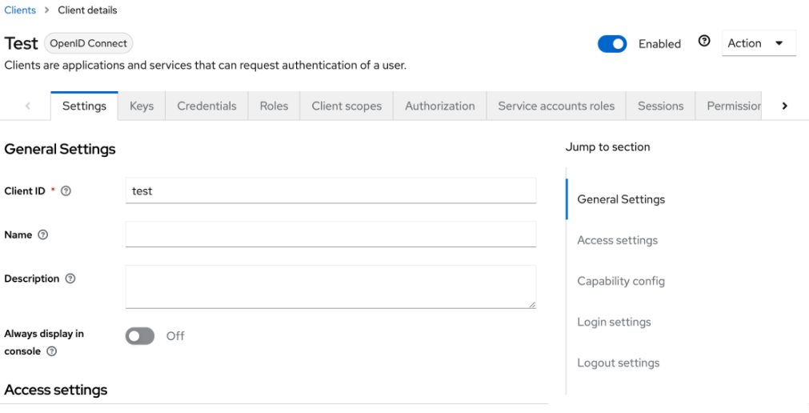
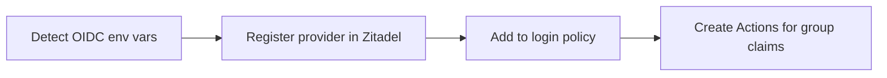

# Set up a generic OIDC provider

Register a confidential client at your identity provider, pass its issuer and credentials
to the Stackweaver initializer, then test browser sign-in and organization access. Entra
has a [dedicated guide](./azure-ad.md); Okta has a [tested custom-server recipe](./okta.md).

The discovery and group-claim examples below are starting points for providers such as
Auth0, Keycloak, Google Workspace, OneLogin, PingIdentity, JumpCloud and custom servers.
Check the provider's supported scopes and claims rather than treating the list as a
certification of every configuration.

## Choose a setup path

Use the portal procedure below, or the complete Terraform example. Both produce the client
settings consumed by Stackweaver; registering the upstream application and configuring the
Stackweaver deployment are separate steps. Complete the same sign-in and access checks
regardless of which path you choose.

## Prerequisites

Your OIDC provider must support:

1. **Authorization Code flow** with a client secret (confidential client).
2. **Standard OIDC discovery** via a `/.well-known/openid-configuration` endpoint at the issuer URL.
3. **Requested scopes**: the initializer requests `openid`, `profile`, `email` and `groups`.
   Confirm the provider accepts this set; the initializer has no per-provider scope override.
4. **Userinfo endpoint** for identity/profile mapping. Group extraction can also read the
   upstream ID/access tokens, so groups do not have to be duplicated in userinfo.

## Step 1: Register an Application

In your identity provider's admin console, create a new OIDC application:

1. Set the application type to **Web Application** (confidential client).
2. Set the **Redirect URI** / **Callback URL** to:
   ```
   https://zitadel.example.com/idps/callback
   ```
   Replace `zitadel.example.com` with your actual Zitadel domain. For a localhost-only setup, use `http://localhost:8080/idps/callback`. See the [Custom Domain guide](../authentication/zitadel-custom-domain.md) for how the callback URL is constructed.
3. Ensure the **Authorization Code** grant type is enabled.
4. Configure the client for the requested `openid`, `profile`, `email` and `groups` scopes.
5. Note the **Client ID** and **Client Secret**.

## Step 2: Find Your Issuer URL

The OIDC Issuer URL is the base URL that serves the `/.well-known/openid-configuration` document. You can verify it by opening the following URL in a browser:

```
{issuer}/.well-known/openid-configuration
```

It should return a JSON document with fields like `authorization_endpoint`, `token_endpoint`, and `userinfo_endpoint`.

Common issuer URL formats:

| Provider | Issuer URL Format |
|----------|-------------------|
| Auth0 | `https://{your-tenant}.auth0.com/` |
| Keycloak | `https://{host}/realms/{realm}` |
| Google | `https://accounts.google.com` |
| OneLogin | `https://{your-domain}.onelogin.com/oidc/2` |
| PingIdentity | `https://auth.pingone.com/{environment-id}/as` |

## Step 3: Configure Group Claims (Optional)

If you want automatic team mapping, configure your provider to include a `groups` claim in the ID token or the userinfo response. The exact steps vary by provider:

- **Auth0**: Use a [Post Login Action](https://auth0.com/docs/customize/actions/flows-and-triggers/login-flow)
  to customize claims. Check Auth0's reserved/namespaced-claim restrictions and the accepted
  names below; a URL-namespaced claim is not automatically mapped to `groups`.
- **Keycloak**: Add a "Group Membership" protocol mapper to your client with the claim name `groups`.
- **Google Workspace**: Group information is not available in standard OIDC claims. Consider using a middleware or a different approach.
- **OneLogin**: Configure a "Groups" parameter in the application's Parameters tab.

Prefer a JSON array of group identifiers. The extractor also accepts a single string;
matching uses the exact emitted value. For example:
```json
{
  "groups": ["engineering", "platform-admins", "security"]
}
```

Stackweaver's IDP sync webhook extracts groups from multiple sources. It uses the first
nonempty supported result rather than combining every claim. It checks the following claim names in order: `groups`, `cognito:groups`, `roles`, `group`, and Keycloak's `realm_access.roles`. It also inspects the OAuth `id_token` and `access_token` JWTs directly, which is needed for providers like Azure AD that include groups in the token but not in the userinfo response.



Keycloak's [Server Administration Guide](https://www.keycloak.org/docs/latest/server_admin/index.html#_oidc_clients)
provides this unmodified reference image under [Apache 2.0](https://github.com/keycloak/keycloak/blob/main/LICENSE.txt).
Use the confidential client, callback and scopes described here.


## Automate the identity-provider setup with Terraform

A generic OIDC client has no universal Terraform resource. This complete **Keycloak**
example gives one concrete automation path; other providers use their own resources.
It targets an existing realm and creates a confidential client, a `groups` client scope,
its group-membership mapper and the client's optional-scope assignment.

Authenticate the provider with `KEYCLOAK_URL`, `KEYCLOAK_REALM`, `KEYCLOAK_CLIENT_ID` and
`KEYCLOAK_CLIENT_SECRET` for a management service account. The authentication realm can
be different from the `realm_id` where you create the SSO client. The realm's normal
`profile` and `email` default scopes must remain attached.

Set `other_optional_scopes` to the complete desired set. That assignment is authoritative,
so do not accidentally remove a scope your client needs. `full_path = false` emits group
names; map their exact values and check for same-name collisions between nested groups.

Download all files into a separate private working directory. The example creates upstream
identity resources, not Stackweaver teams. Review existing resources before applying; do not
create a second app merely to replace a working configuration.

::: code-explorer ./examples/keycloak default="main.tf"
:::

Copy `terraform.tfvars.example` to `terraform.tfvars`, replace every example value, and run:

```bash
terraform init
terraform plan -out=sso.tfplan
terraform apply sso.tfplan
```

Keep the declared version constraint and commit the lock file produced by `terraform init`
in your automation repository. The saved plan may contain
secrets; keep it and state in protected storage. The `sensitive` output flag hides routine
display but does not remove secrets from state. This example does not grant consent or
establish successful sign-in by itself.

Read the client credentials privately:

```bash
terraform output -raw oidc_idp_client_id
terraform output -raw oidc_idp_client_secret
```

Use the realm's public issuer, normally the Keycloak origin followed by `/realms/<realm>`,
and pass the client values to the persistent deployment inputs below.

Import an existing client or `groups` scope before managing it; do not duplicate an existing
working configuration. Client and scope imports use their internal UUIDs:

```bash
terraform import keycloak_openid_client.stackweaver REALM/CLIENT_UUID
terraform import keycloak_openid_client_scope.groups REALM/SCOPE_UUID
```

The mapper import is `realm/client-scope/scope-uuid/mapper-uuid`; optional-scope assignments
use `realm/internal-client-uuid`. See the
[Keycloak provider reference](https://registry.terraform.io/providers/keycloak/keycloak/latest/docs).

## Step 4: Configure Stackweaver

| Variable | Required | Description |
|----------|----------|-------------|
| `OIDC_IDP_NAME` | No | Display name shown on the login button (defaults to "SSO") |
| `OIDC_IDP_ISSUER` | Yes | The OIDC issuer URL (must serve `/.well-known/openid-configuration`) |
| `OIDC_IDP_CLIENT_ID` | Yes | OAuth 2.0 client ID from your provider |
| `OIDC_IDP_CLIENT_SECRET` | Yes | OAuth 2.0 client secret from your provider |

Choose the instructions for your deployment method. These reconcile steps assume the
bundled Stackweaver initializer. An externally managed Zitadel installation needs its own
IdP/Actions configuration; the deployment wiring guide is not that manual procedure.

### Docker Compose

Add the following variables to **`sso.env`** in your Compose directory (the directory that holds `docker-compose.yml`; `zitadel-init` never overwrites this file):

```dotenv
# Generic OIDC SSO Configuration
OIDC_IDP_NAME="My Provider"
OIDC_IDP_ISSUER=https://your-provider.example.com
OIDC_IDP_CLIENT_ID=your-client-id
OIDC_IDP_CLIENT_SECRET=your-client-secret
```

Apply the initializer inputs, then recreate services that consume the generated credentials:

```bash
# Run in your Compose directory
docker compose run --rm zitadel-init
docker compose up -d
```

### Kubernetes / Helm

Create a Kubernetes Secret with the client secret:

```bash
kubectl create secret generic stackweaver-sso \
  --namespace stackweaver \
  --from-literal=oidc-idp-client-secret="your-client-secret"
```

Add the OIDC provider configuration to your Helm values file:

```yaml
sso:
  secretName: stackweaver-sso
  oidcProvider:
    name: "My Provider"
    issuer: "https://your-provider.example.com"
    clientId: "your-client-id"
```

Set `STACKWEAVER_CHART_VERSION` to the installed chart version shown by
`helm list --namespace stackweaver`. Preserve the existing release values when applying
these settings. A configuration change should not silently upgrade the platform:

```bash
helm upgrade stackweaver oci://ghcr.io/vhco-pro/charts/stackweaver \
  --version "${STACKWEAVER_CHART_VERSION:?Set the installed chart version}" \
  --namespace stackweaver \
  --values my-values.yaml
```

### Verify the configuration

The `zitadel-init` service will detect the OIDC environment variables and configure everything:



<details>
<summary><strong>Flow Steps (Legend)</strong></summary>

1. **Register** - Registers the OIDC provider in Zitadel with the configured display name.
2. **Login policy** - Adds the provider to the login policy so the login button appears.
3. **Actions** - Creates Zitadel Actions to capture and forward group claims through the JWT.

</details>

Check the logs to verify:

**Docker Compose:** inspect the output of the preceding one-off initializer command.
Its `--rm` container is removed after it exits, so service logs do not retain that output.
If your deployment ran the service container instead, inspect its retained logs:

```bash
docker compose logs zitadel-init
```

**Kubernetes:**
```bash
kubectl logs -f deployment/stackweaver-zitadel -c zitadel-init --namespace stackweaver
```

## Step 5: Test the Integration

1. Open Stackweaver in your browser.
2. On the login page, you should see a "Sign in with {OIDC_IDP_NAME}" button.
3. Click it to be redirected to your provider's login page.
4. Sign in with your credentials.
5. On first login, Zitadel auto-provisions the user and redirects you back to Stackweaver.

After first login, the user is provisioned but has no organization access. An admin must invite the user, or you can configure [team mapping](./team-mapping.md) for automatic access.

## Provider Behavior

| Setting | Value | Description |
|---------|-------|-------------|
| Auto-creation | Enabled | New users are automatically created in Zitadel on first login, with their email marked as verified, even when public sign-up is off |
| Auto-update | Enabled | User profile is synced on each login |
| Account linking | Not automatic | A first sign-in whose email already belongs to an existing account is refused, and the person is asked to sign in with their password first |
| Profile mapping | Userinfo endpoint | Identity/profile uses userinfo; group extraction also checks upstream ID/access tokens |
| Scopes | `openid`, `profile`, `email`, `groups` | Fixed initializer request; confirm provider compatibility |

## Limitations

### One Generic OIDC Provider at a Time

The environment variable-based configuration supports one Generic OIDC provider at a time. Azure AD uses a separate dedicated integration and can be configured alongside a Generic OIDC provider. This means you can have both Azure AD and one other OIDC provider active simultaneously.

If you need multiple Generic OIDC providers, you can configure additional providers directly through the Zitadel admin console.

### Userinfo Endpoint Required

Identity/profile mapping uses userinfo. Group extraction is separate: the IDP-sync webhook
also inspects upstream ID/access tokens. A missing groups field in userinfo alone does
not establish that team mapping fails.

## Troubleshooting

### Login button does not appear

Verify that `OIDC_IDP_CLIENT_ID` is set and non-empty. Re-run `zitadel-init` and check its logs.

### Discovery document errors

Verify your issuer URL serves a valid OIDC discovery document at `{issuer}/.well-known/openid-configuration`. Common issues include trailing slashes or incorrect paths.

### "Invalid redirect URI" error

Ensure the redirect URI in your provider's app configuration matches the callback URL that Zitadel uses:
```
https://{your-zitadel-domain}/idps/callback
```

The callback URL is constructed from the request's domain context, not directly from configuration. See the [Custom Domain guide](../authentication/zitadel-custom-domain.md) for details on how it works and how to verify it.

### Groups not appearing

1. Verify your provider sends a `groups` claim (as a JSON array of strings).
2. Check raw provider information and the upstream ID/access tokens. Groups in an ID token
   can be sufficient; verify the subsequent `sso_groups` claim and mapped membership.
3. Some providers require explicit configuration to include group claims. See your provider's documentation.

### "Errors.Target.DeniedURL" when configuring Actions (Kubernetes)

See the [SSO overview troubleshooting](./README.md#errorstargetdeniedurl-when-configuring-actions) for details and fix steps.
