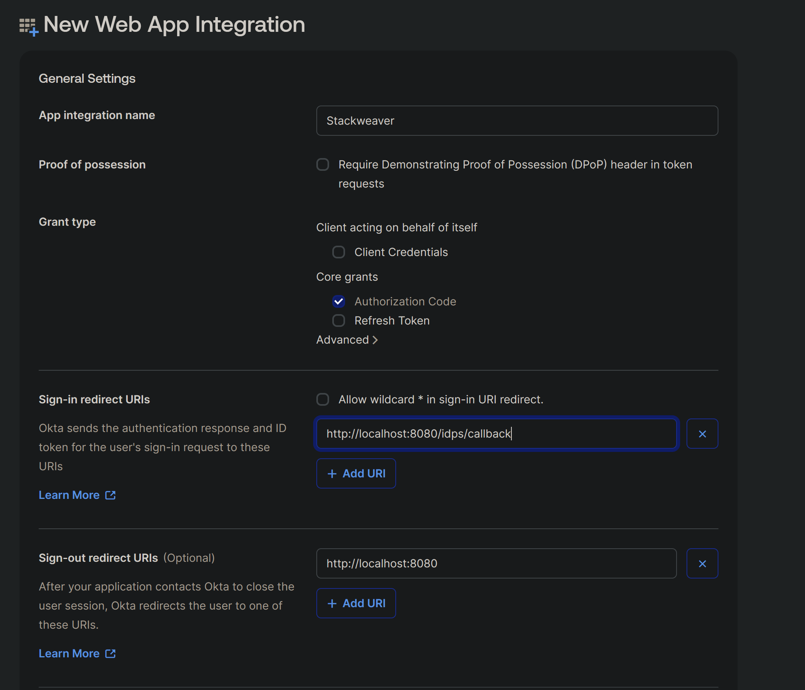

# Set up Okta SSO

Use an Okta confidential Web application and the custom authorization server in the
working recipe below. It occupies Stackweaver's generic OIDC slot.

## Choose a setup path

Use the portal procedure below, or the complete Terraform example. Both produce the client
settings consumed by Stackweaver; registering the upstream application and configuring the
Stackweaver deployment are separate steps. Complete the same sign-in and access checks
regardless of which path you choose.


## Step 1: Create an Application in Okta

1. Sign in to your [Okta Admin Console](https://admin.okta.com).
2. Navigate to **Applications** > **Applications**.
3. Click **Create App Integration**.
4. Select **OIDC - OpenID Connect** as the sign-in method.
5. Select **Web Application** as the application type.
6. Click **Next**.

## Step 2: Configure the Application

Fill in the application settings:

- **App integration name**: `Stackweaver`
- **Grant type**: Ensure **Authorization Code** is selected.
- **Sign-in redirect URIs**: Add your Zitadel callback URL:
  ```text
  https://zitadel.example.com/idps/callback
  ```
  Replace `zitadel.example.com` with your actual Zitadel domain. For a localhost-only setup, use `http://localhost:8080/idps/callback`. See the [Custom Domain guide](../authentication/zitadel-custom-domain.md) for how the callback URL is constructed.
- **Sign-out redirect URIs**: Leave empty or add your Stackweaver frontend URL.
- **Assignments**: Choose who can use this application. Select **Allow everyone in your organization to access** for the broadest access, or limit to specific groups.

Click **Save**.



The example shows a local `localhost` callback. Use your deployment's public Zitadel
callback for production.

## Step 3: Note Your Application Details

After creating the application, note the following from the **General** tab:

| Field | Location | Example |
|-------|----------|---------|
| Client ID | General > Client Credentials | `0oa1a2b3c4d5e6f7g8h9` |
| Client Secret | General > Client Credentials | (click the copy icon) |
| Okta Domain | Your Okta org URL | `dev-12345678.okta.com` |

Your OIDC Issuer URL depends on which Okta authorization server you use. Okta has two types:

- **Custom Authorization Server** (recommended): append `/oauth2/default` to your Okta domain. This supports custom claims (including groups) configured through the Okta admin console.
- **Org Authorization Server**: `https://{your-okta-domain}`. It supports app-level ID-token
  groups claims through a different configuration. Settings on a custom server do not apply
  to this issuer; keep the custom-server recipe below together.

For this group-claim setup, use the Custom Authorization Server issuer URL:

```text
https://dev-12345678.okta.com/oauth2/default
```

> [!IMPORTANT]
> If you have a URL with `-admin` in it, the `-admin` part must be left out when specifying the issuer URL.

## Step 4: Configure the custom authorization server

To forward group memberships to Stackweaver for automatic team assignment, you need to configure three things on your Okta Custom Authorization Server: a `groups` scope, a `groups` claim, and an access policy that covers your application.

Navigate to **Security** > **API** > **Authorization Servers** and select the **default** authorization server (or whichever custom authorization server your issuer URL points to).

### 4a. Add a `groups` scope

Stackweaver requests the `groups` scope when authenticating with Okta. This scope must exist on the authorization server, otherwise Okta will reject the request.

1. Go to the **Scopes** tab.
2. Click **Add Scope**.
3. Configure the scope:
   - **Name**: `groups`
   - **Description**: `Group memberships`
   - **Metadata**: leave unchecked
4. Click **Create**.

### 4b. Add a `groups` claim

This is the tested **ID Token > Always** recipe. Stackweaver can extract groups from the
upstream ID/access tokens as well as raw IdP information. Identity/profile mapping through
userinfo does not mean the `groups` claim must also appear there.

1. Go to the **Claims** tab.
2. Click **Add Claim**.
3. Configure the claim:
   - **Name**: `groups`
   - **Include in token type**: **ID Token** and **Always**
   - **Value type**: **Groups**
   - **Filter**: **Matches regex** with value `.*` (dot-star, not just `*`; a bare `*` is invalid regex and silently matches nothing)
4. Click **Create**.

### 4c. Configure the Access Policy

The Custom Authorization Server uses Access Policies to decide which applications can obtain tokens. Without a policy that covers your Stackweaver application, Okta returns a "Policy evaluation failed" error.

1. Go to the **Access Policies** tab.
2. If a default policy already exists (usually named "Default Policy"), click on it and verify your application is covered. The policy should be assigned to **All clients** or specifically to the Stackweaver application you created in Step 1.
3. If no policy exists, click **Add Policy**:
   - **Name**: `Stackweaver`
   - **Description**: `Access policy for Stackweaver SSO`
   - **Assign to**: **All clients** (or select the Stackweaver application specifically)
4. Inside the policy, click **Add Rule**:
   - **Name**: `Allow Authorization Code`
   - **Grant type is**: check **Authorization Code**
   - **User is**: **Any user assigned the app**
   - **Scopes requested**: **Any scopes**
   - Leave token lifetimes at their defaults
5. Click **Create Rule**.

## Map Okta groups to teams

After [configuring group claims](#step-4-configure-the-custom-authorization-server) and [enabling team sync](./team-mapping.md), you can create Stackweaver teams that automatically get members from Okta groups. Use the Terraform Enterprise provider's `tfe_team` resource and set `sso_team_id` to the value Okta sends in the `groups` claim.

**Which value to use for `sso_team_id`:**  
Okta's `groups` claim usually contains **group names** (the name shown in **Directory** → **Groups**). In that case, set `sso_team_id` to that exact name (case-sensitive). If you configured your Okta authorization server to put group **IDs** in the claim instead (e.g. via a custom claim with expression like a group-ID expression supported by your Okta configuration), then use the group ID. You can see a group's ID in the Okta Admin URL when you open the group.

Example: you have an Okta group named **Engineering**. Create a team in Terraform and set `sso_team_id` to that name:

```hcl
terraform {
  required_providers {
    tfe = {
      source  = "hashicorp/tfe"
      version = "~> 0.72.0"
    }
  }
}

variable "stackweaver_token" {
  type      = string
  sensitive = true
}

provider "tfe" {
  hostname = "stackweaver.example.com" # Your Stackweaver hostname
  token    = var.stackweaver_token
}

resource "tfe_team" "engineering" {
  name         = "engineering"
  organization = "my-org"
  visibility   = "organization"

  # Must match the value Okta sends in the groups claim (usually the group name)
  sso_team_id = "Engineering"
}
```

After `terraform apply`, verify the emitted groups, issued `sso_groups` claim and team
membership with a test account. First-sign-in metadata transfer and group removal have
limits described in the mapping guide. For more options (API, removal behavior, provider-specific details), see [SSO Team Mapping](./team-mapping.md).


## Automate the identity-provider setup with Terraform

Authenticate the Okta provider with `OKTA_ORG_NAME`, `OKTA_BASE_URL` and a protected
`OKTA_API_TOKEN`, or the provider's documented OAuth management authentication. Do not use
the SSO client secret as the provider's management credential.

The example uses your existing custom authorization server, `default` by default, preserving
the documented issuer. It creates a confidential app, assigns an existing group, declares
`groups`, adds the **ID Token > Always** groups claim and an app-specific policy/rule.
Choose `policy_priority` after inspecting the server's current policy order. The assigned
group must contain your test user. The `.*` claim filter retains the tested recipe; a
restricted filter is an optional change that needs its own group-value check.

Download all files into a separate private working directory. The example creates upstream
identity resources, not Stackweaver teams. Review existing resources before applying; do not
create a second app merely to replace a working configuration.

::: code-explorer ./examples/okta default="main.tf"
:::

Copy `terraform.tfvars.example` to `terraform.tfvars`, replace every example value, and run:

```bash
terraform init
terraform plan -out=sso.tfplan
terraform apply sso.tfplan
```

Keep the declared version constraint and commit the lock file produced by `terraform init`
in your automation repository. The saved plan may contain
secrets; keep it and state in protected storage. The `sensitive` output flag hides routine
display but does not remove secrets from state. This example does not grant consent or
establish successful sign-in by itself.

Read the client ID and secret privately:

```bash
terraform output -raw oidc_idp_client_id
terraform output -raw oidc_idp_client_secret
```

Keep the issuer aligned with `auth_server_id`; for `default`, it is your Okta origin followed
by `/oauth2/default`. Use these values in the deployment configuration below.

If the `groups` scope, groups claim, policy or application already exists, import it into
this configuration instead of trying to create a duplicate. Inspect the plan before applying.
For example, replace the IDs in these separate imports:

```bash
terraform import okta_app_oauth.stackweaver REPLACE_WITH_APP_ID
terraform import okta_auth_server_scope.groups default/REPLACE_WITH_SCOPE_ID
terraform import okta_auth_server_claim.groups default/REPLACE_WITH_CLAIM_ID
```

Assignments import as `app-id/group-id`, policies as `server-id/policy-id`, and rules as
`server-id/policy-id/rule-id`. Do not recreate built-in OIDC scopes. A custom authorization
server requires the corresponding Okta capability/subscription.

See the [Okta provider reference](https://registry.terraform.io/providers/okta/okta/latest/docs).

## Step 5: Configure Stackweaver

Choose the instructions for your deployment method. These reconcile steps assume the
bundled Stackweaver initializer. An externally managed Zitadel installation needs its own
IdP/Actions configuration; the deployment wiring guide is not that manual procedure.

### Docker Compose

Add the following variables to **`sso.env`** in your Compose directory (the directory that holds `docker-compose.yml`; `zitadel-init` never overwrites this file):

```dotenv
# Okta SSO Configuration
OIDC_IDP_NAME=Okta
OIDC_IDP_ISSUER=https://dev-12345678.okta.com/oauth2/default
OIDC_IDP_CLIENT_ID=0oa1a2b3c4d5e6f7g8h9
OIDC_IDP_CLIENT_SECRET=your-client-secret-value
```

Replace the example values with your actual Okta application details.

Apply the initializer inputs, then recreate services that consume the generated credentials:

```bash
# Run in your Compose directory
docker compose run --rm zitadel-init
docker compose up -d
```

### Kubernetes / Helm

Create a Kubernetes Secret with the client secret:

```bash
kubectl create secret generic stackweaver-sso \
  --namespace stackweaver \
  --from-literal=oidc-idp-client-secret="your-client-secret-value"
```

Add the Okta configuration to your Helm values file:

```yaml
sso:
  secretName: stackweaver-sso
  oidcProvider:
    name: "Okta"
    issuer: "https://dev-12345678.okta.com/oauth2/default"
    clientId: "0oa1a2b3c4d5e6f7g8h9"
```

Set `STACKWEAVER_CHART_VERSION` to the installed chart version shown by
`helm list --namespace stackweaver`. Preserve the existing release values when applying
these settings. A configuration change should not silently upgrade the platform:

```bash
helm upgrade stackweaver oci://ghcr.io/vhco-pro/charts/stackweaver \
  --version "${STACKWEAVER_CHART_VERSION:?Set the installed chart version}" \
  --namespace stackweaver \
  --values my-values.yaml
```

### Verify the configuration

The `zitadel-init` service will detect the OIDC environment variables and:

1. Register the OIDC provider in Zitadel with the name "Okta".
2. Add the provider to the login policy so a "Sign in with Okta" button appears.
3. Create Zitadel Actions to capture and forward group claims through the JWT.

Check the logs to verify:

**Docker Compose:** inspect the output of the preceding one-off initializer command.
Its `--rm` container is removed after it exits, so service logs do not retain that output.
If your deployment ran the service container instead, inspect its retained logs:

```bash
docker compose logs zitadel-init
```

**Kubernetes:**
```bash
kubectl logs -f deployment/stackweaver-zitadel -c zitadel-init --namespace stackweaver
```

## Step 6: Test the Integration

1. Open Stackweaver in your browser.
2. On the login page, you should see a "Sign in with Okta" button.
3. Click it to be redirected to Okta's login page.
4. Sign in with your Okta credentials.
5. On first login, Zitadel auto-provisions the user and redirects you back to Stackweaver.

After the first login, the user is provisioned but does not have access to any organization. An admin must invite the user, or you can configure [team mapping](./team-mapping.md) for automatic access.

## Provider Behavior

| Setting | Value | Description |
|---------|-------|-------------|
| Auto-creation | Enabled | New users are automatically created in Zitadel on first login, with their email marked as verified, even when public sign-up is off |
| Auto-update | Enabled | User profile is synced on each login |
| Account linking | Not automatic | A first sign-in whose email already belongs to an existing account is refused, and the person is asked to sign in with their password first |
| Profile mapping | Userinfo endpoint | Identity/profile uses userinfo; group extraction also checks upstream ID/access tokens |
| Scopes | `openid`, `profile`, `email`, `groups` | Standard OIDC scopes plus groups for team sync |

## Troubleshooting

### Login button does not appear

Verify that `OIDC_IDP_CLIENT_ID` is set and non-empty in `sso.env`. Re-run `zitadel-init` and check the logs.

### "Invalid redirect URI" error from Okta

Ensure the redirect URI in your Okta app matches the callback URL that Zitadel uses:
```
https://{your-zitadel-domain}/idps/callback
```

The callback URL is constructed from the request's domain context, not directly from configuration. See the [Custom Domain guide](../authentication/zitadel-custom-domain.md) for details.

### User authenticated but no organization access

This is expected. SSO users are provisioned without organization membership. Either invite the user to an organization or configure [team mapping](./team-mapping.md).

### "Policy evaluation failed" error from Okta

This means the Custom Authorization Server's Access Policy does not cover your application. Follow [Step 4c](#4c-configure-the-access-policy) to add or update the access policy.

### "Invalid scope" or scope-related error from Okta

The `groups` scope must be explicitly defined on the Custom Authorization Server before it can be requested. Follow [Step 4a](#4a-add-a-groups-scope) to add it.

### Groups not appearing in Stackweaver

1. Verify you are using the Custom Authorization Server issuer URL (`/oauth2/default`), not the Org Authorization Server. The org server uses a different groups-claim setup; it does not use the custom-server settings below.
2. Verify the `groups` scope and claim are both configured on the Custom Authorization Server (Step 4a and 4b).
3. Check that the user is assigned to at least one Okta group.
4. Use the Token Preview to verify the groups claim is working correctly:
   1. Go to **Security** > **API** > **Authorization Servers** > **default** > **Token Preview**.
   2. Set **OAuth/OIDC client** to your Stackweaver application, **Grant type** to **Authorization Code**, and select a test **User**.
   3. Add both `openid` and `groups` to the **Scopes** field (type each scope name and press enter).
   4. Click **Preview Token**. Two tabs appear in the result: **Token** (access token) and **ID Token**.
   5. Select the **ID Token** tab and look for a `"groups"` key in the payload. It should contain your group names, for example `"groups": ["Everyone"]`. Note that the **Token** tab shows the access token, which only has a `"scp"` field listing the granted scopes; this is not the same as the groups claim.
   6. If the `groups` claim is missing from the ID Token, go to the **Claims** tab and verify a claim named `groups` exists with **Value type** set to **Groups**, **Include in token type** set to **ID Token, Always**, and **Filter** set to **Matches regex** with value `.*`.

> **Note:** Stackweaver uses the Generic OIDC integration for Okta. If you need Azure AD, see the [Azure AD Setup Guide](./azure-ad.md) instead. Only one Generic OIDC provider can be configured at a time through environment variables.
